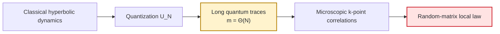
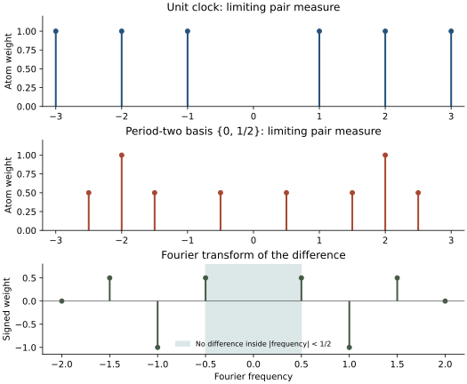
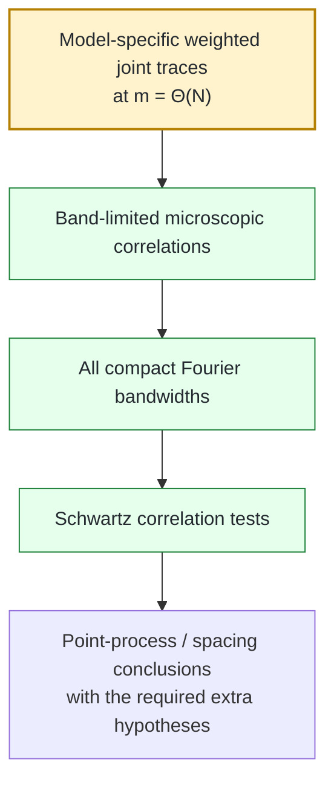
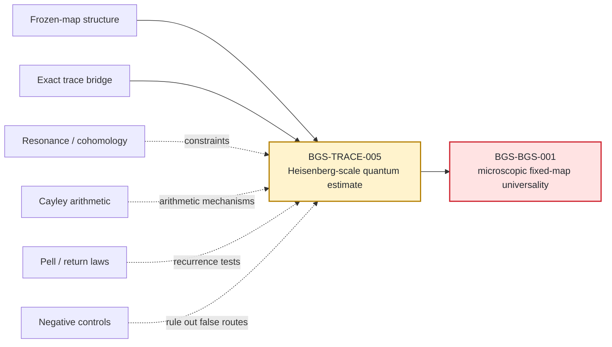
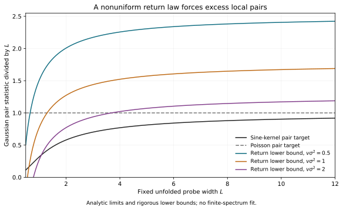
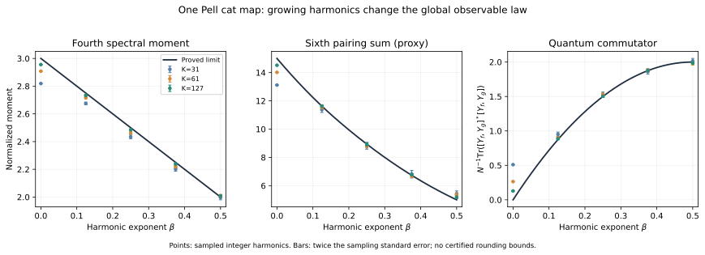
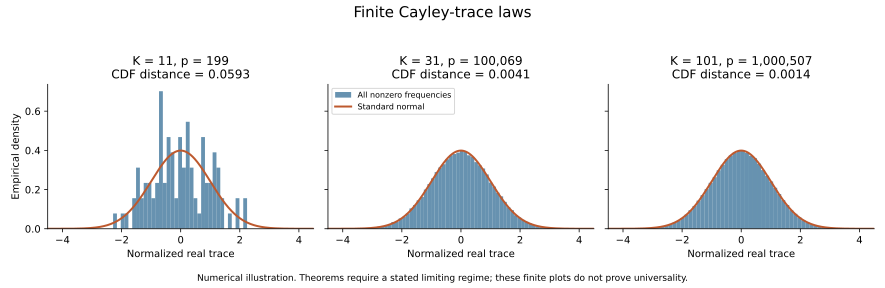

# Bohigas–Giannoni–Schmit programme

The [Heisenberg pair continuation](record/heisenberg_pair_program_20261005.md)
gives an exact determinant formula for the full stable pair heat
compensation. For the unchanged frozen operator, its logarithmic trace
window now gives superpolynomial CUE form-factor accuracy **after heat
smoothing** throughout each fixed band $aN\le m\le bN<N/2$.
The [proof](mathematics/heisenberg_pair_heat_formula.md) also constructs
simple spectra with identical sublinear short-trace data but different
signed noise defects. Actual unperturbed cancellation and full BGS remain
OPEN; the [growing-degree results](record/growing_degree_program_20261005.md)
retain their established projection and inverse-norm scope.

The [5 October all-order continuation](record/all_order_program_20261005.md)
proves all fixed local correlation orders for the original random chain
from the actual operator, including one-chain origin averages and complete
signed Fourier comparisons in $L^2$. The
[transport](mathematics/local_moment_transport.md) and
[chain proof](mathematics/coboundary_all_order_limit.md) received independent
internal review and use one superpolynomial step schedule. Their exact
deterministic noise-removal condition remains unestimated; full BGS is OPEN.

### Arithmetic quantum chaos, trace statistics, and microscopic spectral universality

<p align="center">
  <strong>English</strong> · <a href="README.ru.md">Русский</a>
</p>

> **Scientific status — 5 October 2026.**
> The fixed-strength microscopic BGS statement for the maintained frozen quantum map is **OPEN**. The repository contains project proofs, exact reductions, applications of external theorems with hypothesis maps, formal finite kernels, reproducible computations, and explicit counterexamples to insufficient proof strategies. The sole authority for current claim status is the [claim ledger](record/claim_ledger.md).

The [noise-removal continuation](record/noise_removal_program_20261005.md)
gives an exact signed defect criterion and a flat-heat-jet counterexample:
every initial heat derivative vanishes, yet the local noisy defect has a
strictly positive limit. It also excludes unscaled full-class stationarity
for the actual bounded-trace start, quantifies uniform global heat-inverse
instability and proves infinite Poisson entropy of every raw finite
deterministic spectral field. These are scoped transfer boundaries;
the actual signed defect, deterministic BGS and priority remain open.

The [actual-start continuation](record/general_start_review_20261004.md)
retains the original frozen initial spectrum and proves its auxiliary
random-chain Sine_2 limit. FLOW-014 closes the gap-independent circular
kernel and full Fredholm argument at t_N=8g_N, g_N=4 log J_N/J_N,
J_N=floor(c log N). Balanced kicks give smooth Laplace error O_f(sqrt(g_N))
after floor(2 t_N^3 N^36) steps. The prescribed-time obstruction and exact
source boundaries are recorded separately. Deterministic noise removal
and BGS remain open; priority is unestablished.

The [polynomial coboundary continuation](record/polynomial_coboundary_review_20261004.md)
proves a joint Sine_2 weak limit for the original random chain from an odd
clock with epsilon_N=N^(-26/3), t_N=N^(-2/3) and exactly 2N^34 steps.
Smooth Laplace tests retain error O_f(N^(-1/3)). Dimension-uniform
coefficient derivatives close the recorded polynomial-regime question.
Actual-start relaxation is proved separately at the slower logarithmic
time in FLOW-014; deterministic noise removal remains open.

The [4 October research audit](record/expansion_wavepacket_review_20261004.md)
closes bounded fixed-time traces for the unchanged odd-N model by a direct
packet/frame proof. It also proves an auxiliary-expansion counterexample
with extensive tensor memory, simple spectra, bounded fixed traces and
coherent Heisenberg returns. Original-map resonant cancellation and BGS
remain open; normalized fixed-time trace vanishing was already known.

The [completion](record/history/2026/completion_review_20261004.md) gives
eventual first-two-trace bounds 4 and 9, closing the numerical K=20 input,
and records a successful exact Wolfram replay. No effective dimension
threshold or Heisenberg-time estimate follows.

The [projected-square continuation](record/folded_quadratic_review_20261001.md)
sharpens the resonant cubic bound and proves a block-crowding criterion
for higher correlations. Root allocation remains explicit; the actual-map
asymptotic estimates and BGS remain open.

The [density continuation](record/resonant_density_review_20261001.md)
proves a signed resonant cubic bound under local spectral density control,
and a sharp rare-cluster obstruction compatible with every signed CUE pair
test. Actual-map mass and density estimates remain open.

The [signed Heisenberg continuation](record/signed_heisenberg_review_20260930.md)
proves a universal obstruction to the unaveraged all-order absolute CUE norm.
The viable target retains signed cancellation; exact CUE variance and
formal phase controls do not supply an actual-map BGS proof.

The [prime-resonant audit](record/prime_resonant_review_20260930.md)
corrects the block orientation and proves an exact whole-sector mass
criterion and spectral comb. Actual deterministic cancellation remains open.

The [Heisenberg-note audit](record/heisenberg_note_review_20260930.md)
completes uniform scalar finite type, an explicit classical commutator
action at the fixed coupling, and a parity classification of ideal digit
Fourier FUP using Cohen's prior theorem. The quantum normal form and
Heisenberg-time renewal estimates remain open.

The [30 September extension](record/coboundary_joint_review_20260930.md)
proves a simultaneous clock-to-Sine limit for the original uncentered
Gaussian coboundary chain at epsilon_N=exp(-N). Its dimension-uniform
fast-mode bound removes the earlier order-of-limits restriction in that
explicit regime. The polynomial question is closed by FLOW-011 above;
deterministic BGS remains open.

The [further Möbius reduction](record/coboundary_mobius_review_20260929.md)
connects finite uncentered random coboundary steps to a spectral diffusion
and proves their clock-to-Sine local limit with the small-step limit taken
first. It identifies a missing fourth-order drift; deterministic noise
removal remains open.

The [29 September continuation](record/quadratic_noise_review_20260929.md)
adds quantitative noise/Dyson coupling, an explicit reversible correction,
trace-process limit theorems and a clock-to-Sine local limit for the
auxiliary noise. Bounded actual-map fixed-time traces are now proved by a separate packet argument; the sharper Faure source adaptation remains conditional;
deterministic noise removal and BGS remain open.

The [28 September research result](mathematics/quadratic_coboundary_noise.md)
gives an exact quadratic-noise covariance and a corrected infinitesimal
Dyson generator, together with precise rank and transfer boundaries.
The original deterministic BGS limit remains open.

The [27 September upload audit](record/cue_upload_review_20260927.md) adds
an exact all-time periodic-point averaging result and corrects the submitted
symbol, bispectrum, phase and cutoff checks. Its proposed full CUE proof
remains incomplete; pair-only estimates do not supply all-order correlations.

The **Bohigas–Giannoni–Schmit (BGS) conjecture** asks whether deterministic quantum systems with chaotic classical dynamics exhibit universal **local spectral statistics** described by random matrix theory after the correct symmetry reduction and unfolding.

This repository develops that problem for an explicit nonlinear perturbation of a hyperbolic quantum cat map. Its purpose is not to collect suggestive numerics around BGS, but to separate the problem into precise mathematical layers, prove the layers that can be closed, falsify inadequate shortcuts, and isolate the remaining model-specific obstruction.

| Article card | Current programme |
|---|---|
| **Field** | quantum chaos · spectral theory · dynamical systems · random matrix theory · arithmetic combinatorics |
| **Classical system** | nonlinear perturbation of a hyperbolic toral automorphism |
| **Quantum family** | finite-dimensional unitary propagators $U_N$ |
| **Microscopic scale** | mean eigenphase spacing $O(N^{-1})$ |
| **Dynamical time scale forced by local tests** | Heisenberg scale $m=\Theta(N)$ |
| **Primary random-matrix benchmark** | circular/unitary statistics after the correct symmetry reduction |
| **Central open input** | **BGS-TRACE-005** — model-specific Heisenberg-scale joint-trace or mixed-resolvent cancellation |
| **Terminal fixed-map target** | **BGS-BGS-001** — microscopic universality for the maintained frozen family |
| **Status authority** | [record/claim_ledger.md](record/claim_ledger.md) |
| **Long-form manuscript** | [manuscript/BGS_unified.tex](manuscript/BGS_unified.tex) |

<details>
<summary><strong>Contents</strong></summary>

1. [Overview](#1-overview)
2. [Background: classical chaos, quantization, and BGS](#2-background-classical-chaos-quantization-and-bgs)
3. [Mathematical formulation of microscopic universality](#3-mathematical-formulation-of-microscopic-universality)
4. [Why Heisenberg time is unavoidable](#4-why-heisenberg-time-is-unavoidable)
5. [The maintained frozen quantum map](#5-the-maintained-frozen-quantum-map)
6. [Notation and scales](#6-notation-and-scales)
7. [The exact trace-to-local-statistics bridge](#7-the-exact-trace-to-local-statistics-bridge)
8. [Research architecture](#8-research-architecture)
9. [Established theorem families](#9-established-theorem-families)
10. [Negative results and ruled-out shortcuts](#10-negative-results-and-ruled-out-shortcuts)
11. [The central open frontier](#11-the-central-open-frontier)
12. [What a successful closure would imply](#12-what-a-successful-closure-would-imply)
13. [Evidence, proof, formalization, and trust boundaries](#13-evidence-proof-formalization-and-trust-boundaries)
14. [Selected project figures](#14-selected-project-figures)
15. [Historical development of the programme](#15-historical-development-of-the-programme)
16. [Glossary](#16-glossary)
17. [Frequently asked questions](#17-frequently-asked-questions)
18. [Literature and relation to the broader BGS landscape](#18-literature-and-relation-to-the-broader-bgs-landscape)
19. [Repository and reproducibility](#19-repository-and-reproducibility)

</details>

---

## 1. Overview

The programme is organized around a simple but deep chain of implications:



The first two arrows are structural: the classical map is explicit and the quantum family is explicit. The last arrow is largely deterministic once one has sufficiently strong trace information. The difficult arrow is the highlighted one: proving the correct cancellation and joint statistics of the **actual deterministic quantum traces** at times proportional to the Hilbert-space dimension.

### Current status at a glance

| Layer | Status | Meaning |
|---|---|---|
| Classical frozen-map structure | **established in stated scope** | analytic Anosov dynamics; ordinary classical symmetry obstructions substantially reduced |
| Exact trace identities | **proved** | microscopic spectral observables are converted into weighted trace products |
| Every-bandwidth extension | **proved** | compact-bandwidth correlation convergence extends to Schwartz tests under the stated hypotheses |
| Arithmetic / Pell / resonance branches | **proved in stated scopes** | provide exact reductions, crossover laws, coercivity, return laws, and obstruction theorems |
| Full mixed loop hierarchy | **conditional** | would characterize the target local law if model-specific mixed residuals were controlled |
| Model-specific Heisenberg estimate | **OPEN** | **BGS-TRACE-005** |
| Fixed-map microscopic BGS | **OPEN** | **BGS-BGS-001** |

The project therefore does **not** claim that BGS has been solved. Its strongest organizational achievement is that the missing implication is no longer vague.

---

## 2. Background: classical chaos, quantization, and BGS

### Classical chaos

A classical Hamiltonian system or symplectic map may be chaotic in several related senses: nearby trajectories can separate rapidly, stable and unstable directions can coexist, periodic orbits can proliferate, and long-time dynamics can mix phase-space information.

For uniformly hyperbolic systems these ideas become mathematically rigid. A toral automorphism generated by a hyperbolic integer matrix is a canonical example.

### Quantization

For an $N$-dimensional quantum map, one step of time evolution is represented by a unitary operator $U_N$. Its eigenvalues lie on the unit circle:

```math
U_N\psi_j=e^{i\theta_j}\psi_j,
\qquad
j=1,\ldots,N.
```

The eigenphases $\theta_j$ are the quantum spectrum.

At global scale, many very different spectra can look similar. BGS concerns the opposite regime: the scale of a **single mean level spacing**.

### Historical origin

The conjecture takes its name from the 1984 paper by O. Bohigas, M. J. Giannoni, and C. Schmit:

> *Characterization of Chaotic Quantum Spectra and Universality of Level Fluctuation Laws*, Physical Review Letters **52** (1984), 1–4.  
> DOI: [10.1103/PhysRevLett.52.1](https://doi.org/10.1103/PhysRevLett.52.1)

Their chaotic-billiard computation crystallized the conjectural connection between classical chaos and random-matrix level statistics.

The modern mathematical question is stronger than “does a histogram look GOE/GUE/CUE-like?” A proof must specify:

- the deterministic quantum family;
- the symmetry block being studied;
- the unfolding convention;
- the local test class;
- the random-matrix comparison ensemble;
- the range of trace/time scales under control;
- and the exact limiting statement.

---

## 3. Mathematical formulation of microscopic universality

### Mean-spacing scale

On the unit circle the average angular spacing is approximately $2\pi/N$. A schematic unfolded coordinate near a reference phase $\theta_0$ is

```math
x_j
=
\frac{N}{2\pi}
\bigl(\theta_j-\theta_0\bigr).
```

Microscopic universality concerns the point process formed by the $x_j$ as $N\to\infty$.

### Pair statistics

A typical pair functional has the form

```math
\frac{1}{N}
\sum_{j\neq k}
\phi\!\left(
\frac{N}{2\pi}(\theta_j-\theta_k)
\right),
```

where $\phi$ is a sufficiently regular test function.

The pair law records level repulsion and two-point correlation. Higher $k$-point statistics test genuinely higher-order local structure.

### Symmetry class

The comparison ensemble is determined by symmetry, not by visual resemblance.

For unitary quantum maps with no relevant antiunitary/reversing symmetry, circular-unitary statistics are the natural benchmark. If a suitable time-reversal symmetry survives, an orthogonal-class law is expected instead.

The maintained fixed-map programme is therefore careful to separate:

1. **classical symmetry elimination**;
2. **quantum block decomposition**;
3. **local random-matrix comparison**.

A theorem must not skip the second step.

### Point-process language

At the strongest level one wants convergence of local factorial correlation functions, or equivalently convergence of the local point process under enough tightness/occupation control.

Spacing distributions are downstream objects. They are not automatically determined by one low-order correlation statistic.

---

## 4. Why Heisenberg time is unavoidable

The central structural fact is Fourier duality.

For the maintained pair normalization, one has the exact finite-$N$ identity

```math
C_{2,N}(U;\phi)
=
\frac{1}{N^2}
\sum_{m\in\mathbb Z}
\widehat{\phi}(m/N)
\left(
|\mathrm{Tr}U^m|^2-N
\right).
```

If $\widehat{\phi}$ is supported in a fixed compact interval $[-c,c]$, then the sum still involves

```math
|m|\le cN.
```

So compact microscopic Fourier support does **not** reduce the problem to short times. It rescales the Fourier mode by $N$.

For Haar unitary matrices $V_N\in U(N)$,

```math
\mathbb E_{\mathrm{CUE}}
\left|
\mathrm{Tr}V_N^m
\right|^2
=
\min(|m|,N).
```

This provides the exact second-moment benchmark in the unitary class.

### Hierarchy of scales

| Scale | Typical information | Enough for microscopic BGS? |
|---|---|---|
| $m=O(1)$ | fixed-time semiclassics, finite moments | **no** |
| $m=O(\log N)$ | arithmetic returns, Ehrenfest-type regimes | **no** |
| $m=o(N)$ | substantial sub-Heisenberg trace information | **still no in general** |
| $m=\Theta(N)$ | Heisenberg window | **required by microscopic Fourier tests** |
| spacing $O(N^{-1})$ | local eigenphase statistics | **target scale** |

The problem is therefore a long-time quantum problem even though it is phrased as a small-scale spectral problem.

<p align="center">
  
</p>

**Exact negative control.** One fixed Fourier bandwidth does not determine the microscopic pair law. This is why the maintained extension theorem requires convergence on **every** compact bandwidth.

---

## 5. The maintained frozen quantum map

The principal family is

```math
U_N
=
\exp(i\tau N A_N)\,M_N,
\qquad
\tau=10^{-80}.
```

Here $M_N$ quantizes the hyperbolic cat map

```math
S=
\begin{pmatrix}
3&4\\
2&3
\end{pmatrix},
```

and $A_N$ is the maintained Weyl quantization of an explicit nonlinear kick symbol.

### Why such a tiny fixed parameter matters

The classical perturbation parameter $\tau$ is extremely small, but it is **fixed** while $N\to\infty$. The quantum exponent contains $\tau N$.

Therefore the target problem is not equivalent to a vanishing-coupling regime such as

```math
\tau_NN\longrightarrow0.
```

This is one of the main reasons the programme separates:

- weak/shrinking kick;
- bounded crossover;
- logarithmic return scales;
- and genuinely frozen fixed-strength asymptotics.

### Why a cat map?

The cat map is useful because it combines:

- explicit hyperbolicity;
- exact arithmetic structure;
- finite-dimensional quantization;
- exact return subsequences;
- explicit Fourier transport;
- and strong enough rigidity to expose false universality mechanisms.

The same arithmetic structure that makes the model tractable also creates nontrivial obstructions, making it a demanding universality laboratory.

---

## 6. Notation and scales

| Symbol | Meaning |
|---|---|
| $N$ | Hilbert-space dimension / semiclassical parameter scale |
| $U_N$ | full frozen quantum propagator |
| $M_N$ | quantized hyperbolic cat map |
| $A_N$ | quantized nonlinear kick generator |
| $\tau$ | fixed kick strength, maintained as $10^{-80}$ |
| $\theta_j$ | eigenphases of $U_N$ |
| $m$ | trace/time index in $\mathrm{Tr}U_N^m$ |
| $\phi$ | local test function |
| $\widehat{\phi}$ | Fourier transform of the test function |
| $V_N$ | random-matrix comparison object |
| $C_{2,N}$ | maintained pair-correlation functional |
| $K$ | arithmetic/Pell period parameter in the corresponding branches |
| $p$ | finite-field prime in Cayley-energy branches |

### Common phrases

- **microscopic** — measured on the mean-spacing scale $O(N^{-1})$;
- **Heisenberg scale** — trace powers/time indices $m=\Theta(N)$;
- **frozen** — the perturbation strength is fixed rather than sent to zero with $N$;
- **desymmetrized** — restricted to the correct irreducible symmetry block before comparison with RMT;
- **band-limited** — the rescaled Fourier transform of the test is compactly supported;
- **joint traces** — products of several trace powers constrained by Fourier relations.

---

## 7. The exact trace-to-local-statistics bridge

The deterministic spectral reduction is one of the most mature layers of the programme.

### Core trace and resolvent claims

| Claim | Status | Content |
|---|---|---|
| **BGS-TRACE-001** | **proved** | exact partition–Möbius formula for distinct-index spectral sums |
| **BGS-TRACE-002** | **proved** | microscopic Fourier representation in terms of quantum traces |
| **BGS-TRACE-003** | **proved** | Heisenberg-scale joint-trace comparison is sufficient for band-limited microscopic RMT correlations |
| **BGS-TRACE-004** | **proved** | every-compact-bandwidth convergence extends to Schwartz correlation tests |
| **BGS-TRACE-005** | **open** | model-specific Heisenberg-scale joint-trace / mixed-resolvent estimate |
| **BGS-TRACE-006** | **proved** | clustered Abel lower bound plus a simple-spectrum Heisenberg-window falsifier |
| **BGS-TRACE-007** | **proved** | sharp universal Abel floor, attained by the regular clock spectrum |
| **BGS-TRACE-008** | **proved** | odd two-clock counterexample to sufficiency of the Gram $4/3$ limit, even with simple phases and nonzero power traces |
| **BGS-RES-006** | **proved** | exact adjoint-resolvent representation of the pair target |
| **BGS-RES-007** | **proved in stated scope** | compact positive-$s$ smooth scalar-resolvent transfer between the original and seven-cut full propagators |

The newer [Haar-CUE singular-energy benchmark](mathematics/cue_singular_energy.md)
(BGS-CUE-001) derives a stable inverse-gap energy law from the published
small-gap Poisson theorem and an explicit tail bound. The
[coboundary spectral-flow note](mathematics/coboundary_spectral_flow_bound.md)
(BGS-FLOW-001/002) proves a finite phase-motion estimate and excludes
the proposed infinitesimal Dyson-noise shortcut. Neither supplies
the missing Heisenberg trace estimate for the fixed map.

For higher correlations, partition-lattice Möbius inversion produces constrained products

```math
\prod_{\nu=1}^{r}
\mathrm{Tr}U_N^{m_\nu},
```

with linear relations among the Fourier indices $m_\nu$.

The logical structure is therefore:



The first box is exactly the current model-specific gap.

---

## 8. Research architecture

The programme contains several branches because BGS can fail, or appear to hold falsely, for different reasons.



These branches are **not** silently treated as a single linear proof chain. Some provide direct prerequisites; others supply independent theorems, obstruction screening, or counterexamples that prevent overclaiming.

---

## 9. Established theorem families

### 9.1 Frozen-map structure

**BGS-FM-001 — classical symmetry theorem.**  
In the stated small-coupling range, the classical map is analytic and Anosov; the ordinary $C^1$ centralizer is reduced to powers of the map, a $C^1$ reversor is excluded, and the relevant affine $C^1$ conjugacies are excluded.

**Boundary:** this does not exclude every possible $N$-dependent quantum commutant and does not prove Heisenberg-scale trace cancellation.

**BGS-FM-002 — odd-Pell full-symbol crossover.**  
The normalized period average has a Gaussian fixed-moment limit with exact variance

```math
\sigma^2
=
\frac{1650797}{4000000}
=
0.41269925.
```

A necessary escape condition for CUE pair behaviour in the proved crossover family is

```math
|\epsilon_K|\sqrt K
\longrightarrow\infty.
```

The actual frozen scaling eventually lies outside the bounded crossover theorem.

**BGS-FM-003 — moment controls and transfer bounds.**  
Exact finite-spectrum inequalities and repeated-clock constructions show that several low-order loop tests are insufficient.

**BGS-FM-004 — three-orientation mixed-resolvent barrier.**  
A quantitative lower barrier follows under explicit mixed-residual hypotheses.

**Boundary:** those residual estimates are not yet established for the actual frozen propagator.

**BGS-FM-005 — frozen-kick rank boundary.**  
In the stated odd-dimensional regime,

```math
\mathrm{rank}(U_N-zM_N)
\ge
N-\gcd(N,7).
```

This eliminates a large class of simple low-rank explanations of the spectrum.

**BGS-FM-006 — nonlinear bracket-pressure boundary.**
The physical symbol's linear full-lag normalization has no uniform upper
bound under the actual nonlinear kicked map; see the
[proof and hypotheses](mathematics/nonlinear_bracket_pressure.md).

**BGS-FM-007 — seven-cut reduction at the original fixed coupling.**
Cutting seven small edges in the Jacobi *generator* gives a full propagator
$V_N$ with $\|U_N-V_N\|_1=O(\tau/N)$. Their fixed-order local sine-kernel
targets are equivalent, and their pair and Abel statistics differ by
$O(\tau/\log N)$ without a universality assumption. The full $V_N$
continues to couple all seven paths; see the
[proof](mathematics/frozen_seven_cut_reduction.md).

**BGS-FM-008 and BGS-FM-009 — qualitative spectral rigidity.**
For odd $7\nmid N$, the [algebraic-time
proof](mathematics/frozen_algebraic_spectral_simplicity.md) gives simple
spectra and excludes exact power collisions. The
[integer certificate](mathematics/frozen_common_antireversor_certificate.md)
rules out a *common* antiunitary reversor of $(A_N,M_N)$ for odd $N\ne7$.
These claims provide no uniform eigenphase gaps or Heisenberg-time trace
estimates. Read the [submission audit](record/submitted_article_review_20260924.md)
for their scope and verification.

**BGS-FM-010 and BGS-FM-011 — exact traces and a gap floor.**
The [arithmetic trace theorem](mathematics/frozen_arithmetic_trace_rigidity.md)
proves $\operatorname{Tr}U_N^m\ne0$ for every odd $N$ and positive $m$,
and identifies $N=7$ as the sole dimension with a scalar power.
The [effective gap estimate](mathematics/frozen_effective_gap_floor.md),
for $7\nmid N$, gives a positive but astronomically submicroscopic
eigenphase separation. Both leave Heisenberg-scale trace **upper** estimates
and the BGS pair limit open. The
[audit of the two subsequent texts](record/two_continuations_review_20260924.md)
lists duplicate assertions and the alternative finite certificate that
was referenced but not supplied.

---

### 9.2 Resonance and cohomology

The resonance branch asks whether apparent randomness could fail because the observable is nearly a classical coboundary.

Key results include:

- sharp Fourier-line coercivity;
- a local-jet obstruction showing that purely local arguments cannot solve the global torus problem;
- finite-orbit resonance rigidity;
- a full-lag classical Riesz gap for the physical frozen symbol under linear transport.

The open every-observable analytic nondegeneracy problem is **BGS-RES-003**.

**Boundary:** classical nondegeneracy is not itself a quantum Heisenberg-time theorem.

---

### 9.3 Arithmetic and Cayley energy

The arithmetic branch converts fourth-moment questions into finite-field additive-energy problems.

The current sharp centered target is

```math
E_+(A)
=
\frac{(K-1)^4}{p}
+
O\!\left(K^{2+o(1)}\right),
```

recorded as **BGS-CAYLEY-005 — OPEN**.

A major conceptual correction in this branch is already part of the scientific record: eliminating every exceptional collision is the wrong target. Large exceptional primes can coexist with only constant excess energy. The correct problem is centered energy control.

---

### 9.4 Pell and return laws

The project proves explicit global return laws on arithmetic subsequences, including:

- harmonic-scale observable transitions;
- kicked Pell propagator returns;
- logarithmic-time recurrence formulas.

These are rigorous global results, but they live on a different scale from microscopic BGS.

---

### 9.5 Clustered Abel statistics

**BGS-TRACE-006** records two complementary facts:

1. sufficiently strong spectral clustering forces a divergent Abel-type statistic;
2. explicit **simple spectra** can have analogous clustering signatures while the positive-time Heisenberg-window form factor tends to zero.

Therefore clustering is a useful diagnostic, not a substitute for the missing dynamical estimate.

### 9.6 Exact resolvent and control identities

**BGS-RES-006** rewrites the pair Abel statistic as a resolvent trace of the
positive adjoint Laplacian. Replacing its hyperbolic parameter by the original
$s$ has uniform error at most $2\cosh(2s/N)/(3N)$. This gives an equivalent
scalar-resolvent target for each fixed $s$, but no estimate for the frozen
model.

**BGS-RES-007** strengthens the comparison between the original and
seven-cut **full** propagators: on each compact $s$ interval, all fixed
derivatives of their Abel statistics differ by $O(\tau/\log N)$ and of
their scalar adjoint resolvents by $O(\tau/\log N+1/N)$. The
[`BGS-TRACE-008` construction](mathematics/two_clock_gram_falsifier.md)
shows that even the necessary Gram $4/3$ limit, simple phases, weak
Haar convergence, bounded microscopic unit occupancy, and nonzero
traces of every positive power together need not give the pair
CUE law. Its spectra are abstract and do not arise from the maintained
map. The [three-route research cycle](record/bgs_program_20260925.md)
records the exact remaining signed-trace obstruction.

**BGS-TRACE-007** proves $L_N(s)\ge(e^{2s}-1)^{-1}$ for every finite
unitary spectrum, with equality for a regular $N$-gon. The bound follows from
the [Cohn–Kumar sharp-configuration theorem](https://arxiv.org/abs/math/0607446v2)
for completely monotone chordal potentials. The CUE benchmark lies strictly
above the floor, so the inequality alone does not imply BGS.

The exact depolarizing-noise identity shifts the unknown Abel parameter from
$s$ to $s+N\eta/2$ and adds a remainder bounded by $(2Ns)^{-1}$. The
[spectral-flow and control note](mathematics/frozen_spectral_flow_controls.md)
also records the local eigenphase acceleration formula, the ordered product
for iterated kicks, and a Legendre-character control family that keeps an
exact clock spectrum. It corrects the single-exponential collapse already
retracted in the permanent correction record. None of these results estimates
the Heisenberg-scale traces of the maintained propagator.

---

## 10. Negative results and ruled-out shortcuts

A central principle of the repository is that a falsified proof route is scientific information and should remain visible.

| Tempting shortcut | Why it is insufficient |
|---|---|
| **Finite moments** | spectra can agree on many low-order moments and still differ microscopically |
| **One compact Fourier band** | fixed-band agreement does not determine full local correlations |
| **Short traces** | microscopic Fourier tests require $m=\Theta(N)$ |
| **Sub-Heisenberg traces** | even broad $o(N)$ control need not determine the local point process |
| **One loop orientation** | some residuals vanish identically for every spectrum |
| **Low-order loop equations** | repeated-clock examples satisfy substantial finite systems without becoming CUE |
| **Global return laws** | logarithmic/global recurrence information does not determine local spacing |
| **Clustering alone** | clustered simple spectra can still have the wrong Heisenberg-window form factor |
| **Finite RMT-looking histograms** | numerical resemblance is evidence, not an asymptotic theorem |
| **Classical nondegeneracy alone** | a classical Riesz gap does not automatically become quantum trace cancellation |
| **Eliminating all arithmetic exceptions** | too strong; centered energy is the correct arithmetic target |

The permanent scientific correction record is [record/retractions.md](record/retractions.md). The compact reader-facing index is [ERRATA.md](ERRATA.md).

---

## 11. The central open frontier

The direct fixed-map bottleneck is **BGS-TRACE-005**:

> **Prove the correctly desymmetrized weighted Heisenberg-scale joint-trace comparison — or an analytically equivalent mixed-resolvent hierarchy — for the actual frozen propagator, uniformly on every compact Fourier support.**

For the pair statistic, the desired comparison has the schematic form

```math
\frac{1}{N^2}
\sum_{m\in\mathbb Z}
w(m/N)
\left[
|\mathrm{Tr}U_N^m|^2
-
\mathbb E_{\mathrm{RMT}}
|\mathrm{Tr}V_N^m|^2
\right]
\longrightarrow0.
```

Higher correlations require the corresponding constrained joint products of traces.

### Two maintained languages for the same frontier

**Direct trace language**

Prove weighted joint-trace comparison against the target ensemble on every compact microscopic Fourier support.

**Resolvent / loop language**

Prove an all-order hierarchy of genuinely mixed resolvent residuals strong enough to identify the same local process.

The second route is encoded conditionally in **BGS-LOOP-001**.

### Why this is the right bottleneck

The repository already contains exact examples showing that weaker information can be misleading. Therefore any successful final estimate must use the **actual frozen quantum dynamics**, rather than only:

- classical chaos;
- global return behaviour;
- arithmetic mixing heuristics;
- low-order identities;
- clustering;
- or finite random-matrix resemblance.

---

## 12. What a successful closure would imply

A proof of **BGS-TRACE-005** in the required scope would make the existing deterministic bridge operational for the fixed model.

After the exact symmetry-block, unfolding, and point-process bookkeeping, it would lead to **BGS-BGS-001**.

A successful fixed-map theorem would provide:

- a rigorous microscopic random-matrix law for an explicit deterministic nonlinear chaotic quantum map;
- a concrete mechanism connecting long-time deterministic quantum dynamics to local spectral universality;
- a model where arithmetic returns, nonlinear perturbation, classical resonance, and quantum trace statistics can all be tracked;
- a reusable architecture for testing BGS-type universality in other deterministic quantum maps.

It would **not** automatically prove every formulation of BGS for every chaotic Hamiltonian or every quantization. The programme explicitly distinguishes a strong model theorem from the full universality conjecture.

---

## 13. Evidence, proof, formalization, and trust boundaries

Different repository layers answer different scientific questions.

| Layer | What it can establish | What it cannot establish by itself |
|---|---|---|
| **Mathematical proof note** | theorem in its stated hypotheses | external peer review or broader scope not written in the theorem |
| **Imported external theorem** | valid implication once hypotheses are checked | applicability without a hypothesis map |
| **Lean kernel / finite certificate** | formal algebraic or finite statement encoded in Lean | the entire analytic BGS argument unless formalized |
| **Exact computation** | finite identity / finite verification | asymptotic theorem without a separate proof |
| **Numerical experiment** | evidence, diagnostics, falsification | universality theorem |
| **Regression test** | protects implementations and evidence files | mathematical correctness of an unproved theorem |
| **Manuscript exposition** | coherent presentation | independent status authority |
| **Claim ledger** | current project status/scope | a proof by itself |

### Status vocabulary

- **proved** — supported by a maintained project proof in the stated scope;
- **conditional** — implication proved under explicit hypotheses not yet established for the target model;
- **open** — unresolved mathematical obligation;
- **verification-pending** — source exists but the current verification contract is incomplete;
- **retracted/superseded** — retained for provenance but not part of the current claim surface.

“Proved” here means **proved within the repository’s maintained argument**, not “independently refereed and published unless explicitly stated”.

---

## 14. Selected project figures

The figures below are scientific outputs of the project, not decorative README artwork.

<p align="center">
  
</p>

**Return-law obstruction.** Global or arithmetic return information constrains the spectrum but does not determine the microscopic point process.

<p align="center">
  
</p>

**Harmonic Pell transition.** A rigorous project result in its stated arithmetic regime. The observable and time scale are global, not microscopic.

<p align="center">
  
</p>

**Finite Cayley trace diagnostics.** Numerical evidence for the arithmetic branch. Neither the finite plot nor the global Gaussian law implies local universality.

---

## 15. Historical development of the programme

This repository preserves dated research records rather than rewriting history after each correction.

Selected recorded milestones:

| Date | Recorded development |
|---|---|
| **4–8 Sep 2026** | frontier passes, literature checks, referee-style audits, claim consolidation |
| **9–13 Sep 2026** | Cayley trace review, Pell harmonic transition/return reviews, return obstruction and local-limit analysis |
| **16–20 Sep 2026** | fixed-map attachment audit, recovery audit, fixed-map publication pass |
| **21 Sep 2026** | consolidated research handoff with the fixed-strength microscopic BGS gap still open |
| **22 Sep 2026** | finite-orbit resonance audits and Abel-window research pass |
| **23 Sep 2026** | frozen full-lag resonance review, frozen kick-rank review, repository-wide scientific consolidation |

Primary records include:

- [record/final_research_handoff_20260921.md](record/final_research_handoff_20260921.md)
- [record/finite_orbit_proof_audit_20260922.md](record/finite_orbit_proof_audit_20260922.md)
- [record/abel_window_research_20260922.md](record/abel_window_research_20260922.md)
- [record/frozen_full_lag_review_20260923.md](record/frozen_full_lag_review_20260923.md)
- [record/frozen_rank_review_20260923.md](record/frozen_rank_review_20260923.md)
- [record/history/2026/repository_hygiene_20260923.md](record/history/2026/repository_hygiene_20260923.md)

The [retraction record](record/retractions.md) is equally important: false or superseded routes are documented rather than silently removed.

---

## 16. Glossary

| Term | Meaning in this repository |
|---|---|
| **Anosov map** | uniformly hyperbolic classical dynamical system |
| **BGS** | Bohigas–Giannoni–Schmit universality conjecture |
| **CUE** | circular unitary ensemble, a principal random-matrix benchmark for unitary spectra |
| **desymmetrization** | restriction to the correct symmetry block before spectral comparison |
| **unfolding** | normalization to unit mean local level density |
| **microscopic scale** | scale of one mean eigenphase spacing, $O(N^{-1})$ |
| **Heisenberg time** | quantum time/trace index proportional to $N$ |
| **trace form factor** | statistic built from $|\mathrm{Tr}U_N^m|^2$ |
| **mixed resolvent** | resolvent expression coupling opposite analytic orientations; unlike same-half-plane identities, it can carry local spectral information |
| **loop equation** | algebraic/analytic identity for resolvent observables used to characterize spectral statistics |
| **Pell subsequence** | arithmetic sequence along which the cat-map dynamics has especially explicit return structure |
| **Cayley energy** | additive-energy problem arising after a Cayley transform in the arithmetic fourth-moment branch |
| **Riesz gap** | coercive lower bound preventing a family of classical translates from becoming linearly degenerate |
| **falsifier / negative control** | explicit example showing that a proposed sufficient condition is actually insufficient |

---

## 17. Frequently asked questions

### Is BGS solved in this repository?

**No.** The maintained fixed-strength microscopic claim **BGS-BGS-001** remains open.

### What is the single most important missing theorem?

**BGS-TRACE-005**: a model-specific Heisenberg-scale joint-trace comparison or an equivalently strong mixed-resolvent estimate for the actual frozen propagator.

### Why is $\tau=10^{-80}$ not effectively zero?

Because $\tau$ is fixed while $N$ grows. The quantum exponent contains $\tau N$, so the asymptotic problem eventually leaves every uniformly perturbative regime based only on the small numerical value of $\tau$.

### Why not settle the problem numerically?

Finite spectra can look random-matrix-like for reasons that do not survive asymptotically. Numerical experiments are excellent for falsification and diagnostics, but they cannot replace a uniform $N\to\infty$ theorem.

### Why is a cat map a useful model if it is arithmetic?

Because it is simultaneously explicit, hyperbolic, quantizable, and arithmetically structured. That makes both universality mechanisms and obstructions visible rather than hidden.

### Why are there so many side programmes?

Because different false proof routes fail for different reasons. Arithmetic energy, return laws, resonance, symmetry, and resolvent identities test distinct possible obstructions.

### Does proving classical mixing prove BGS?

No. The key missing information is quantum cancellation at the Heisenberg scale.

### Does matching $\mathbb E|\mathrm{Tr}V_N^m|^2$ for a few $m$ prove BGS?

No. Microscopic tests require a weighted family of trace powers up to $m=\Theta(N)$, and higher correlations require joint products.

### What would count as a genuine breakthrough here?

A proof that closes **BGS-TRACE-005** for the actual frozen map, with the correct symmetry block and uniformity needed by the exact trace bridge.

---

## 18. Literature and relation to the broader BGS landscape

The maintained [bibliography](literature/bibliography.md) separates several roles:

1. external results actually imported into proofs;
2. neighbouring literature used for interpretation;
3. rigorous BGS-type universality theorems in other model classes;
4. source checks used to verify theorem hypotheses or publication metadata.

Important distinctions:

- quantum ergodicity is not microscopic eigenphase universality;
- eigenfunction equidistribution is not a spacing theorem;
- matrix-element fluctuations are not local eigenvalue statistics;
- quantum-graph universality theorems are genuine BGS-type results in their own model class, but do not automatically transfer to smooth or arithmetic quantum maps;
- semiclassical trace expansions below Heisenberg time do not automatically close the fixed-map problem.

Load-bearing external dependencies are pinned in [literature/external_dependencies.json](literature/external_dependencies.json).

---

## 19. Repository and reproducibility

The material above is intended to stand on its own as the scientific front page. Operational details are collected here.

<details>
<summary><strong>Recommended reading order</strong></summary>

1. [Current results](mathematics/results.md)
2. [Open mathematical obligations](mathematics/open_questions.md)
3. [Trace-to-local-statistics bridge](mathematics/trace_to_local_statistics_bridge.md)
4. [Fixed-map resolvent frontier](mathematics/fixed_map_resolvent_frontier.md)
5. [Stable claim registry](record/claim_registry.md)
6. [Scientific dependency graph](record/scientific_dependency_graph.md)
7. [Unified manuscript](manuscript/BGS_unified.tex)
8. [Literature map](literature/bibliography.md)
9. [Retractions and corrections](record/retractions.md)

</details>

<details>
<summary><strong>Source-of-truth hierarchy</strong></summary>

- [record/claim_ledger.md](record/claim_ledger.md) is the sole authority for current claim status and scope.
- [record/claims.json](record/claims.json) assigns stable core IDs and cross-layer links.
- maintained proof notes live in [mathematics/](mathematics/README.md);
- load-bearing external theorem inputs are pinned in [literature/external_dependencies.json](literature/external_dependencies.json);
- formalization, computation, evidence, README prose, and manuscript text cannot silently strengthen the ledger.

See [SOURCE_OF_TRUTH.md](SOURCE_OF_TRUTH.md).

</details>

<details>
<summary><strong>Reproduce the maintained verification surface</strong></summary>

```sh
python computations/verification/scientific_registry_audit.py
python computations/verification/repository_audit.py

python -m pip install -r requirements.txt

cmake -S . -B build/cmake -DCMAKE_BUILD_TYPE=Release
cmake --build build/cmake --parallel

python computations/maintenance/verify_workspace.py \
  --build build/cmake \
  --logs build/verification-logs \
  --output build/workspace-verification.json

(cd formalization && lake build)

python computations/maintenance/sync_return_sections.py --check
python computations/maintenance/sync_finite_orbit_section.py --check
python computations/maintenance/sync_fixed_map_section.py --check
python computations/maintenance/build_unified_manuscript.py \
  --output-dir build/unified-paper
```

Full execution contract: [REPRODUCE_unified.md](REPRODUCE_unified.md) and [environment/runtime-manifest.json](environment/runtime-manifest.json).

</details>

<details>
<summary><strong>Repository map</strong></summary>

| Area | Role |
|---|---|
| [mathematics/](mathematics/README.md) | theorem statements, proofs, reductions, counterexamples, open problems |
| [manuscript/](manuscript/README.md) | canonical long-form research manuscript |
| [papers/](papers/README.md) | focused publication candidates without duplicated proof authority |
| [literature/](literature/bibliography.md) | bibliography and theorem-level external dependencies |
| [formalization/](formalization/README.md) | Lean 4 algebraic and finite kernels |
| [computations/](computations/README.md) | verification, independent implementations, numerical diagnostics |
| [evidence/](evidence/provenance.md) | promoted finite/numerical evidence and provenance |
| [record/](record/README.md) | claims, audits, corrections, scientific history, governance |
| [supplement/fixed_map/](supplement/fixed_map/README.md) | detailed fixed-map derivations and replayable evidence |

</details>

<details>
<summary><strong>Publication, citation, and review</strong></summary>

- Canonical manuscript: [manuscript/BGS_unified.tex](manuscript/BGS_unified.tex)
- Focused paper scopes: [papers/](papers/README.md)
- Citation metadata: [CITATION.cff](CITATION.cff)
- Contribution protocol: [CONTRIBUTING.md](CONTRIBUTING.md)
- Referee protocol: [REVIEWING.md](REVIEWING.md)
- Roadmap: [ROADMAP.md](ROADMAP.md)
- Release policy: [RELEASES.md](RELEASES.md)

</details>

---

Maintainer and manuscript author: **Maksim Churilov**.

This repository does not claim a proof of the general BGS conjecture, external priority for the entire corpus, or independent referee validation of every project theorem. Its purpose is to push a concrete microscopic-universality problem as far as possible while keeping the boundary between proof, external input, formal/finite verification, numerical evidence, conditional reduction, and open obligation explicit.
