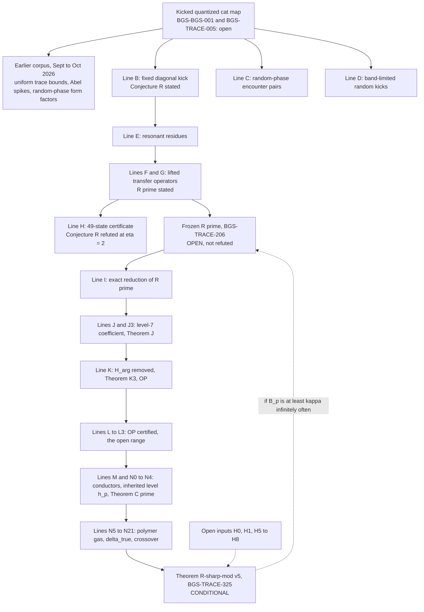

# BGS: a kicked quantized cat map and the open BGS frontier

[](record/claim_registry.md)
[](record/claim_registry.md)
[](record/claim_registry.md)
[](mathematics/open_questions.md)
[](record/claim_registry.md)
[](record/claim_registry.md)
[](formalization/README.md)
[](manuscript/BGS_unified.pdf)
[](LICENSE_POLICY.md)

[**Results**](RESULTS.md) · [Русский](README.ru.md) · [Research brief](RESEARCH.md) · [Claim registry](record/claim_registry.md) · [Mathematical introduction](docs/reader_guide.en.md) · [Theorem index](mathematics/results.md) · [Manuscript (PDF)](manuscript/BGS_unified.pdf) · [Corpus atlas](docs/corpus_atlas.md)

> **Abstract.** This repository studies the Bohigas–Giannoni–Schmit (BGS) conjecture for one explicitly specified kicked, quantized cat map on the torus. **The BGS limit for this map is not proved:** fixed-strength microscopic universality (BGS-BGS-001) and the model-specific signed trace estimate that would close the gap (BGS-TRACE-005) are both open. Around that target the programme registers 419 precisely scoped claims; 338 are proved at their stated scope (project proofs, many computer-assisted, many with an internal independent referee, none externally refereed). They include uniform trace bounds for the fixed kick, exact random-phase form factors, and a computer-assisted refutation of Conjecture R at η = 2 (BGS-TRACE-179). The current frontier is the corrected mean law R′ (BGS-TRACE-206), which is **open and not refuted**. The main recent result, **Theorem R♯-mod v5 (BGS-TRACE-325), is conditional**: it reduces the failure of frozen R′ along m = 3p to the explicitly listed open inputs H0, H1 and H5–H8.

The badge counts are static and are copied from [`record/claims.json`](record/claims.json) (registry updated 2026-11-01); the registry, not this page, decides every status ([SOURCE_OF_TRUTH.md](SOURCE_OF_TRUTH.md)). **GitHub Actions is not running on this repository** (account billing, as of 1 November 2026), so there is no CI badge: every check quoted here was run locally, and the logs are committed under [`evidence/executions/`](evidence/README.md).

## Contents

* [Status at a glance](#status-at-a-glance)
* [The problem](#the-problem): [what the conjecture asks](#what-the-conjecture-asks), [the exact model and target](#the-exact-model-and-target), [the frozen mean law R′](#the-frozen-mean-law-r-bgs-trace-206)
* [Main results](#main-results) and [Theorem R♯-mod v5](#the-main-current-result-theorem-r-mod-v5-conditional)
* [How the research lines fit together](#how-the-research-lines-fit-together)
* [What else is established, and what is missing](#what-else-is-established-and-what-is-missing)
* [Verification philosophy](#verification-philosophy)
* [Repository map](#repository-map)
* [How to reproduce](#how-to-reproduce)
* [Known issues](#known-issues)
* [Three reconstructed analytic results](#three-reconstructed-analytic-results)
* [Read, reproduce, and cite](#read-reproduce-and-cite)

## Status at a glance

| Registered state | Claims | Meaning |
|---|---:|---|
| proved | 338 | Project proof at the stated scope, including computer-assisted proofs; not external refereeing |
| verification-pending | 17 | Argument or computation exists; an independent check is outstanding |
| conditional | 21 | Proved implication from stated hypotheses that are themselves open |
| open | 42 | Conjecture, hypothesis or programme obligation without a proof |
| refuted | 1 | Shown false as stated (Conjecture R, BGS-TRACE-179) |
| **total** | **419** | |

144 non-open claims link Lean 4 files, out of 155 modules in `formalization/Bgs`. Lean certifies the finite or arithmetic statements named in each claim boundary, not the full analytic arguments.

## The problem

### What the conjecture asks

Bohigas, Giannoni and Schmit's [1984 paper](https://doi.org/10.1103/PhysRevLett.52.1) connected chaotic quantum spectra with universal random-matrix fluctuations. A rigorous theorem needs a specified quantum family, the correct symmetry sector, a justified unfolding, and a local correlation limit. Classical hyperbolicity alone does not automatically guarantee a particular symmetry class or a universal spectrum.

For unitary-class spectra, the reference point process is $\mathrm{Sine}_2$, whose determinantal kernel and distinct-point two-point correlation are

```math
K(x,y)=\frac{\sin\pi(x-y)}{\pi(x-y)},
\qquad
\rho_2(x,y)=1-|K(x,y)|^2.
```


*Analytic benchmark curves, **not measured data** from the deterministic map. The figure depicts pair correlation, not the nearest-neighbour spacing distribution.*

### The exact model and target

For odd $N\ge3$, the maintained family is

```math
S=\begin{pmatrix}3&4\\2&3\end{pmatrix},
\qquad
U_N=\exp(i\tau N A_N)M_N,
\qquad
\tau=10^{-80}.
```

Here $M_N$ is the specified quantization of the hyperbolic cat map, and $A_N$ the specified Weyl-quantized nonlinear kick. [The canonical model source](mathematics/fixed-map/fixed_map_resolvent_frontier.md) fixes conventions, exceptional dimensions, and symmetry questions. **The coupling remains fixed as $N\to\infty$**; replacing it with vanishing coupling, independent random phases, or noise changes the problem.

The following pair-moment reference in the prescribed trace hierarchy remains unproved for this family. Weak convergence to Sine₂ alone does not imply convergence of these unbounded pair moments without additional uniform-integrability control:

```math
L_N(s)=\frac{1}{N^2}\sum_{m\ge1}e^{-2sm/N}
\left|\mathrm{Tr}\,U_N^m\right|^2
\;\longrightarrow\;
\frac{1-e^{-2s}}{4s^2},
\qquad s>0.
```

The full [BGS-TRACE-005 obligation](mathematics/open_questions.md#b-prove-heisenberg-scale-desymmetrized-joint-trace-estimates) is stronger: correctly desymmetrized **signed factorial joint-trace comparison** for every fixed order and every compactly supported smooth Fourier test, at powers $m\asymp N$. The absolute value is taken **after the complete Fourier sum**, rather than term by term. The [trace-to-local-statistics bridge](mathematics/trace-bridge/trace_to_local_statistics_bridge.md) explains the further tightness/extension conditions.

The [operator-resolution continuation](mathematics/trace-bridge/microscopic_unitary_stability_20261027.md) transfers the original-family pair test through $O(N^{-2})$ matrix error using TRACE-113; it does not determine that limit. The complementary [short-trace barrier](mathematics/fixed-map/balanced_rounding_research_20261027.md) shows why polynomially many short traces and coarse quantum data alone are insufficient for a general quantizer. The [review](record/trace005_continuation_review.md) separates these author-checked proofs from prior results and remaining candidates.

### The frozen mean law R′ (BGS-TRACE-206)

The recent lines work with a simpler single-cosine kick, the k1 kick 0.9 cos 2πq at η = 2, with λ = 3 + 2√2. For odd m the Pell-type modulus h_m satisfies λ^m ≡ 1 (mod h_m). Conjecture R for the Line B kick (BGS-TRACE-179) predicted that a renormalised trace deviation is o(m). Line H shows that it fails at η = 2 (BGS-TRACE-209, computer-assisted), so BGS-TRACE-179 is registered as **refuted**. Line G then proposed a corrected mean law R′ for the k1 kick ([BGS-TRACE-206](mathematics/fixed-map/resonance_classification_lineG.md)). It subtracts the resonant contributions of a fixed primary set P* = {(±2, 8), (±2, 16)} at every included level d | h_m with 1 < d ≤ √h_m, and asserts that the remaining deviation W′_m is o(m).

The definition is **frozen**: inclusion rule, members and normalisation are fixed in the claim boundary, so later lines cannot tune it. Lines I–N study whether frozen R′ holds along m = 3p (p prime). **R′ is open. It is neither proved nor refuted.**

## Main results

A selection, with registry states. The complete list is [`record/claim_registry.md`](record/claim_registry.md); the generated summary is [RESULTS.md](RESULTS.md). Tags: [P] paper proof, [CA] interval or ball arithmetic, [CA-fp] floating point with derived a-priori rounding bounds, [P-arith] arithmetic implication, [H] hypothesis.

| Claim | State | Result | Lean | Source |
|---|---|---|---|---|
| BGS-BGS-001 | **open** | Fixed-strength microscopic BGS universality for the maintained frozen map | — | [model](mathematics/fixed-map/fixed_map_resolvent_frontier.md) |
| BGS-TRACE-005 | **open** | Signed Heisenberg-scale desymmetrized joint-trace estimate (the model-specific gap to BGS) | statement only | [open questions](mathematics/open_questions.md) |
| BGS-TRACE-113 | proved | Uniform power-trace bound for the original fixed-kick family (strict pressure gap) | — | [note](mathematics/fixed-map/fixed_kick_uniform_trace_bound.md) |
| BGS-TRACE-117 | proved | Kick-blind arithmetic spikes: the Abel pair statistic stays more than 1/2 from CUE at odd Pell returns | yes | [note](mathematics/fixed-map/kick_blind_arithmetic_spike.md) |
| BGS-TRACE-124 | proved | Every odd modulus lies above 3/4 or below 5/7 (pure cat map) | yes | [note](mathematics/fixed-map/odd_modulus_abel.md) |
| BGS-TRACE-127 | proved | Diagonal random-phase form factor at times one, two and three | yes | [note](mathematics/fixed-map/diagonal_phase_form_factor.md) |
| BGS-TRACE-143 | proved | Haar diagonal-phase cat map = random-phase DFT star graph; exact encounter-pair identity (Line C) | — | [note](mathematics/fixed-map/random_phase_encounter_pairs.md) |
| BGS-TRACE-149 | proved | Band-limited random kick: exact trace bridge (Line D) | yes | [note](mathematics/fixed-map/band_limited_kick_bridge.md) |
| BGS-TRACE-173 | proved | Certified exponential decay of χ_m for η in [1, 81.574] (computer-assisted; Line B) | yes | [note](mathematics/fixed-map/derandomized_fixed_kick.md) |
| BGS-TRACE-209 | proved | Conjecture R fails for the Line B kick at η = 2: W̃rest_m/m ≥ 1.4·10⁴ for odd m ≥ 47, 3 ∤ m (Line H, [CA]) | yes | [note](mathematics/fixed-map/lineH_49state_certificate.md) |
| BGS-TRACE-179 | **refuted** | Conjecture R as stated (o(m) uniformly on compact η-ranges) | — | [note](mathematics/fixed-map/derandomized_fixed_kick.md) |
| BGS-TRACE-206 | **open** | Conjecture R′ (corrected mean law, k1 kick, η = 2) | — | [note](mathematics/fixed-map/resonance_classification_lineG.md) |
| BGS-TRACE-213 | proved | Line I: exact reduction of R′ to (E″), (T″) and the dilation remainder (D), none of which is proved | — | [note](mathematics/fixed-map/lineI_rprime_reduction.md) |
| BGS-TRACE-225 | proved | Theorem J: the d = 7 contribution oscillates with growth ≥ 1.0184224^m (computer-assisted) | — | [note](mathematics/fixed-map/lineJ_d7_twisted_coefficient.md) |
| BGS-TRACE-235 | proved | Theorem K3: S⁺ contains infinitely many m = 3p in every unit class mod 56 | yes | [note](mathematics/fixed-map/lineK_harg_removal.md) |
| BGS-TRACE-244 | proved | Operator input OP for the four families (arb certificate) | yes | [note](mathematics/fixed-map/lineK_harg_removal.md) |
| BGS-TRACE-257 | proved | H_mean implies frozen R′ is false along m = 3p (implication only; H_mean, BGS-TRACE-256, is open) | — | [note](mathematics/fixed-map/lineL_op_open_range.md) |
| BGS-TRACE-283 | proved | Theorem N3: scarred conductors carry the slow orbit β = 1 | yes | [note](mathematics/fixed-map/lineMN_conductor_structure.md) |
| BGS-TRACE-296 | proved | Theorem C′: unit-β part at h_p, for p with h_p squarefree (squarefreeness is not proved for any p) | yes | [note](mathematics/fixed-map/lineN2N4_inherited_level.md) |
| **BGS-TRACE-325** | **conditional** | **Theorem R♯-mod v5**: conditional reduction of "frozen R′ fails along m = 3p" to H0, H1, H5–H8 | yes | [note](mathematics/fixed-map/lineN5N18_gas_conditional.md) |
| BGS-TRACE-326 | proved | H4 met: δ_true ≤ 5.0313·10⁻⁶ for all G ([P] + [CA-fp]) | yes | [note](mathematics/fixed-map/lineN5N18_gas_conditional.md) |
| BGS-TRACE-332 | conditional | Prop. K: H1 implies H3 (Kotecký–Preiss weight a = a(C)) | yes | [note](mathematics/fixed-map/lineN5N18_gas_conditional.md) |
| BGS-TRACE-333 | conditional | Gas vs Robin crossover with all rate budgets: first prime 3307 (C ≤ 0.082) / 1409 (C ≤ 8.8·10⁻⁴) | yes | [note](mathematics/fixed-map/lineN5N18_gas_conditional.md) |

### The main current result: Theorem R♯-mod v5 (conditional)

The canonical statement is [`THEOREM_DRAFT_v5.md`](computations/verification/lineN_theorem_draft/THEOREM_DRAFT_v5.md) (author v5 with the final referee lineN22 edits E1–E8); the registered claim is BGS-TRACE-325, and the manuscript chapter is [`lines_I_N_gas_theorem.tex`](manuscript/unified_sections/lines_I_N_gas_theorem.tex). For p prime and m = 3p, put

```math
B_p=\frac{n}{h_p}\Big[\big(2(1+\mathrm{Re}\,\Lambda'_{\mathrm{lo}})^{p}\,e^{-p(\delta+A_{\mathrm{bad}}^{\mathrm{KP}})}-1-|X_{\mathrm{tail}}|-|X_{\mathrm{cross}}|-|Y|-e^{-0.28p}\big)^{2}-1\Big]-I_p-\varepsilon_{16}-\varepsilon_{\mathrm{fl}}-\varepsilon_{\mathrm{other}} .
```

The gas lower bound inside the bracket is 2(1 + Re Λ′)^p e^{−p(δ + A_bad)} − 1, with Re Λ′_lo = 6.234·10⁻⁴ (BGS-TRACE-310), δ = δ_true ≤ 5.0313·10⁻⁶ (BGS-TRACE-326) and A_bad = A_bad^KP, the Kotecký–Preiss bad-cluster activity of Prop. K (BGS-TRACE-332), which depends on the constant C of H1. I_p = σ(K_p)/K_p − 1 is bounded by Robin's inequality. Under H0, H1 and H5–H8 at p, for p ≥ p_thr,

```math
\frac{W'_{3p}}{m}\;\ge\;-4+\frac1m\sum_{\rho=(\pm2,8)}S_\rho\,B_p,\qquad S_\rho\ge c\,1.13287^{m},
```

so **if B_p ≥ κ > 0 for infinitely many primes p ≥ p_thr, then W′_{3p}/m → ∞ and frozen R′ is false along m = 3p.** The theorem is [P mod inputs]; the step that puts A_bad^KP in the exponent is [P-sketch], and referee lineN22 judged it correct and necessary. It supersedes v4 (BGS-TRACE-299).

| Input | Content | Registry state |
|---|---|---|
| H0 | Standing package (Line F/J/J3/L16 trace representation; Prop. X′ architecture, BGS-TRACE-324; n_cert) | taken as given; BGS-TRACE-324 is verification-pending |
| H1 | Re-scoped by Line N20: bad-cluster joint (A, B) second moment, C ≤ 0.082 at J₀ = 12, plus near-collision constants | **open** ([BGS-TRACE-336](mathematics/fixed-map/lineN5N18_gas_conditional.md)) |
| H2 | Core interaction constant δ_int^core ≤ 5.14476·10⁻⁷ | met (BGS-TRACE-307, proved, [CA-fp]) |
| H3 | Kotecký–Preiss polymer weight | **open** (BGS-TRACE-301); no longer an input, since H1 implies it by Prop. K (BGS-TRACE-332, conditional) |
| H4 | Core-to-true conversion | **met**: δ_true ≤ 5.0313·10⁻⁶ (BGS-TRACE-302 via BGS-TRACE-326, proved) |
| H5 | Composite h_p, or p with h_p prime | **open** (BGS-TRACE-303) |
| H6 | Inputs of Theorem C′: explicit p₀, squarefree h_p | **open** (BGS-TRACE-304) |
| H7* | Levels other than h_p, growth below T′ = 1.42785 | **open** (BGS-TRACE-305) |
| H8 | Wrap-around points at composite h_p | **open** (BGS-TRACE-306) |

**Crossover (BGS-TRACE-333, conditional on H1, [P-arith]).** Under the idealisation tails = Y = X_cross = ε = 0, n/h_p := 1, the gas bound beats the Robin bound on inherited levels from the **first prime 3307** when C ≤ 0.082. This value is fragile: +1 % in A_bad^KP moves it to 3359. With C ≤ 8.8·10⁻⁴ the first prime is **1409**, and that value is robust up to a factor 2 in A_bad^KP. The crossover with the additive budgets is not computed.

> **R′ is NOT refuted.** Theorem R♯-mod v5 is a reduction. Its inputs H0, H1 and H5–H8 are open, and H7* is needed even when h_p is prime. No single-p inequality is proved in the large-p regime, and small-p data are numerical only.

## How the research lines fit together



*A research map, not a chain of proved implications. The dashed arrows are conditional. The repository labels its fixed-map lines B to N; there is no "Line A" label, and the earlier corpus is shown as one node.*

## What else is established, and what is missing

The programme contains independently distinguishable lines of work:

| Mathematical layer | Established in its stated scope | Not yet established |
|---|---|---|
| Spectral-to-trace bridge | Exact finite-dimensional combinatorics and conditional correlation criteria | Required model-specific signed joint-trace estimates |
| Actual map: intensity and paths | [FM-021](mathematics/fixed-map/position_chain_mixing.md) intensity mixing and cyclic ramp; [FM-022](mathematics/fixed-map/reversed_path_decay.md) reverse-path decay | All remaining coherent interference, including the negative plateau correction |
| Balanced microscopic analysis | [Phase Ward](mathematics/trace-bridge/phase_ward_identity.md) and [Schur-energy](mathematics/trace-bridge/balanced_pair_schur_reduction.md) exact identities | Their requisite absorbed overlap / microscopic radial limits |
| Traces and insertion calculus | Selected [WKB](mathematics/fixed-map/factorial_wkb_reduction.md), [ordered-diagonal](mathematics/fixed-map/factorial_ordered_diagonal.md), and [unmasked](mathematics/fixed-map/right_frame_unmasked_pinch_hierarchy.md) sectors | Complete high-switch signed remainder, masks and endpoints |
| Stochastic comparison | [FLOW-014](mathematics/fixed-map/circular_dyson_actual_start.md) and [FLOW-017](mathematics/fixed-map/coboundary_all_order_limit.md) noisy local laws on explicitly stated schedules | Removal of the noise for the original deterministic family |
| Other mathematics | [Cayley](mathematics/topics/cayley-arithmetic/README.md), [Pell](mathematics/topics/pell/README.md), [return](mathematics/topics/returns/README.md), resonance, locality and information results | A proved implication from their separate regimes to deterministic BGS |
| Lean formalization | The [Mathlib coverage map](formalization/MATHLIB_LAYER_RU.md) ties 29 existing and 39 adapted modules to precisely scoped finite, algebraic and selected scalar/reference results; a historical receipt records axiom checks of 589 declarations | The full analytic trace hierarchy and deterministic BGS limit |

The decisive obstacle is not a shortage of finite-dimensional identities: it is **controlled cancellation of signed Heisenberg-scale contributions** for the unchanged propagator. Neither a numerical spacing plot nor a result for a randomized auxiliary model closes that gap. Consult the [research brief](RESEARCH.md) for precise scope and [obligation board](mathematics/open_questions.md) for the remaining work.

### Why the signed plateau matters

For a Haar-distributed $V_N$ in the circular unitary ensemble, the exact positive-power reference is

```math
\mathbb E_{\mathrm{CUE}}\left|\mathrm{Tr}\,V_N^m\right|^2
=\min(m,N),\qquad m\ge1.
```

The cyclic linear term has normalized shape $x=m/N$, whereas the CUE reference is $\min(x,1)$. Above $x=1$, their difference is **$1-x<0$**. Thus reproducing a cyclic ramp alone cannot establish the required plateau: the remaining coherent, signed path contributions must supply a negative correction in aggregate. This is a necessary target, **not** a result already proved for the deterministic family.


*Analytic comparison (no simulation). The shaded region is the magnitude of the negative correction required relative to the cyclic linear contribution.*

## Verification philosophy

**One authority for status.** Only the registry state in [`record/claims.json`](record/claims.json) counts. Notes, this README, RESULTS.md and the manuscript are views of it. The [dated ledger](record/claim_ledger.md) explains each change, and [SOURCE_OF_TRUTH.md](SOURCE_OF_TRUTH.md) says how to resolve conflicts.

**Evidence tags.** Inside notes and theorem drafts:

| Tag | Meaning |
|---|---|
| [P] | Paper proof, written out (and refereed where stated) |
| [P-sketch] | Argument complete in outline only |
| [CA] | Computer-assisted with rigorous ball or interval arithmetic (arb) |
| [CA-fp] | IEEE binary64 with derived a-priori rounding bounds under the stated model; **not** [CA] |
| [P-arith] | Arithmetic implication, checked in floating point with exact integer parts and monotonicity |
| [N] | Numerics without error control: evidence, never proof, and never registered as proved |
| [H] | Hypothesis or heuristic |

A conditional theorem is exactly as strong as its weakest open input. Superseded or withdrawn values are kept in the drafts' errata sections and are not cited.

**Lean 4 formalization.** [`formalization/`](formalization/README.md) holds 155 modules under `formalization/Bgs` (2186 `theorem`/`lemma` declarations, counted by grep), pinned to `leanprover/lean4:v4.33.1` and Mathlib through `lake-manifest.json`. Lean checks the finite and arithmetic kernels named in each claim boundary, not the analytic arguments; 144 non-open claims link a Lean file. Build:

```sh
cd formalization && lake exe cache get && lake build Bgs
```

The last full local build ended "Build completed successfully (8862 jobs)" ([log](evidence/executions/20261101/lineNgas/v5_integration/lake_build_Bgs.log)); this PR does not change any Lean file. **No `sorry`** is allowed in the active graph, and the newer modules print their axioms (at most `propext`, `Classical.choice`, `Quot.sound`). **Legacy `native_decide`:** 88 uses in 12 older modules trust the compiler beyond the kernel axioms. The claim boundaries disclose this, and the Line B–N modules use none.

**Referee audits.** Every line from E onwards has an independent internal referee pass. There are 24 `referee/` folders under [`computations/verification/`](computations/verification/lineN16/referee/REPORT.md) (lineE to lineN16), and the final Line N referees lineN20, lineN21, lineN21b and lineN22 are in [`evidence/executions/20261101/lineNgas/referee/`](evidence/executions/20261101/lineNgas/v5_integration/README.md). Referee findings are applied verbatim and listed in the drafts. None of this is external peer review.

**Dependency gate.** No proved claim may depend on a non-proved claim. The gate [`proved_deps_gate_v5.py`](computations/verification/lineN_theorem_draft/integration_checks/proved_deps_gate_v5.py) is strict for BGS-TRACE-244..336, with one exception: the frozen definition of BGS-TRACE-206. Its last run returned GATE_OK ([log](computations/verification/lineN_theorem_draft/integration_checks/proved_deps_gate_v5.log)). Seven older violations on main are recorded there as out of scope.

**Frozen packets.** Author and referee packets under `computations/verification/line*/` are kept verbatim and pinned by sha256 ([registry](computations/maintenance/frozen_evidence_packets.json)). They record what was run; they are not maintained entry points.

## Repository map

```sh
BGS/
├── README.md, README.ru.md   # this page (English / Russian)
├── RESULTS.md                # generated one-page summary (render_results.py)
├── RESEARCH.md               # dated research brief
├── SOURCE_OF_TRUTH.md        # which surface decides what
├── record/                   # claims.json (the registry), ledger, errata, audits, generated views
├── mathematics/              # maintained proofs and their exact boundaries
│   └── fixed-map/            # the model, Lines B to N notes (line*.md)
├── computations/
│   ├── verification/         # checkers, audits; line*/ = frozen author and referee packets
│   │   └── lineN_theorem_draft/   # THEOREM_DRAFT v1 to v5, V5 packet, dependency gate
│   └── maintenance/          # renderers, manuscript builder, unit tests (tests/)
├── formalization/            # Lean 4 project (Bgs.lean, Bgs/*.lean, lakefile.toml)
├── manuscript/               # unified TeX source and the tracked BGS_unified.pdf
│   └── unified_sections/     # one .tex per section, incl. lines_I_N_gas_theorem.tex
├── evidence/                 # dated receipts: commands, hashes, logs
├── literature/               # exact-source checks, bibliography, priority notes
├── docs/                     # reader guides, conventions, corpus atlas
├── papers/                   # focused candidate paper scopes (not submissions)
├── supplement/               # supplementary fixed-map material
├── environment/              # runtime manifest
├── assets/figures/           # README and manuscript figures
└── archive/                  # historical snapshots, kept for provenance
```

## How to reproduce

All commands run from the repository root. Python dependencies are pinned in `requirements.txt`; the 1 November runs used a virtual environment with pandoc on `PATH`.

```sh
pip install -r requirements.txt
## registry and repository audits
python computations/verification/scientific_registry_audit.py
python computations/verification/repository_audit.py
## generated views must be in sync (each prints OK)
python computations/maintenance/render_results.py --check
python computations/maintenance/render_appendix_a.py --check
python computations/maintenance/render_claim_registry.py --check
## unit tests (40 files, 266 tests)
python -m unittest discover -s computations/maintenance/tests
## Lean
(cd formalization && lake exe cache get && lake build Bgs)
## manuscript PDF (pdflatex, or Tectonic via the TECTONIC variable)
python computations/maintenance/build_unified_manuscript.py --engine auto --output-dir out
```

The full list of 23 checkers (registry audit, bibliographic audit and self-test, eight render checks, frozen-packet checks, repository and spectral-edition audits, wave2/wave3 audits and source checks, manuscript references and the three sync checks) and their latest results are in [`evidence/executions/20261101/final_presentation/`](evidence/executions/20261101/final_presentation/README.md). The manuscript builder fails on any overfull box, unresolved reference or citation, or duplicate label, and records a manifest; `--publish` copies the verified PDF to `manuscript/`. More detail: [REPRODUCE_unified.md](REPRODUCE_unified.md).

## Known issues

* **No continuous integration.** GitHub Actions refused to start jobs on this repository as of 1 November 2026 (account billing). All check results quoted here and in recent PRs are local runs with committed logs.
* **Legacy `native_decide`.** 88 uses in 12 older Lean modules rely on native evaluation and therefore trust the compiler. The LineB–N modules use none.
* **Hash-pinned broken links.** 24 relative links in 11 files point to paths that later moved. Those files are byte-pinned by seals, manifests or receipts, or generated, and are left unedited on purpose; see [RESULTS.md](RESULTS.md#known-issues) for the list.
* **Frozen evidence packets.** 368 verbatim, sha256-pinned packet files are outside the assertion-entry policy and the SyntaxWarning compile step ([rationale](computations/maintenance/ASSERTION_POLICY.md)).
* **Thin evidence on a few claims.** BGS-TRACE-095 and BGS-TRACE-097 (conditional) list no verifier. BGS-RES-015 (proved) cites its own note as evidence and depends on the conditional BGS-RES-014 for a symbol identity that it recomputes directly.
* **The manuscript summarises Lines I–N.** Lines I–N (BGS-TRACE-211..336) are covered by one concise chapter that states results and registry states. Their proofs stay in the `mathematics/fixed-map/line*.md` notes and the packets.

## Three reconstructed analytic results

**Phase memory with reused coordinate phases — [BGS-TRACE-053](mathematics/trace-bridge/max_entry_phase_channel.md).**
For $S\in U(m)$, set $P_{ij}=|S_{ij}|^2$, $\delta=\max P_{ij}$,
$A=\Pi\mathrm{Ad}(S)$, and
$T_n=\mathbb E_D\mathrm{Ad}((DS)^n)$. Here $\Pi$ is diagonal pinching
and the same independent uniform diagonal phases $D$ are reused in every power.
$J_m$ has every entry $1/m$.
On the full complex Frobenius space, for $n\ge2$,

$$\|T_n-A^n\|_{2\to2}
\le(n!-1)\sqrt\delta+n!n(n-1)\delta.$$

The degree-two norm is exactly $\max_{i\ne j}|S_{ij}S_{ji}|\le\delta$.
If $\|P-J_m\|\le\rho<1$, averaged eigenspace pinching on traceless matrices
has norm $O_\rho(\log\log(1/\delta)/\log(1/\delta))$ as $\delta\to0$.
This operator-norm conclusion does not evaluate a microscopic spectral trace.

**Optimal matrix inner-function jets — [BGS-TRACE-054](mathematics/trace-bridge/sharp_inner_jet.md).**
Let $F=zG$ be a square finite rational inner matrix function and set
$T=F^*zF'\ge I$ on the circle, with $d\mu=d\theta/(2\pi)$. Without a
commutativity assumption, with $\dot T=dT/d\theta$,

$$\int\mathrm{Tr}(\dot T T^{-1}\dot T)\,d\mu
\le\frac13\int\mathrm{Tr}(T^3-T)\,d\mu,$$

$$\int\|F''T^{-1/2}\|_F^2\,d\mu
\le\frac43\int\mathrm{Tr}T^3\,d\mu
-2\int\mathrm{Tr}T^2\,d\mu
+\frac23\int\mathrm{Tr}T\,d\mu.$$

The leading coefficient $4/3$ is optimal in every matrix dimension; the
submission had $13/3$. Smooth localization has an explicit derivative penalty.
The proof does not supply a random-cavity cubic-delay moment.

**Normally absorbed scalar transport — [BGS-TRACE-056](mathematics/trace-bridge/phase_channel_real_flow.md).**
For deterministic unitary matrices $S_m$ with
$\delta_m=\max_{ij}|(S_m)_{ij}|^2\to0$ and
$\||S_m|^2-J_m\|\le\rho<1$, and a deterministic Hermitian $H_m$
independent of the reused random phases with
$\mathrm{Tr}H_m=m$ and $\mathrm{Tr}H_m^2\le C_Hm$, eigenphase
matching along $DS_m e^{ixH_m/m}$ compares the normalized scalar resolvent
in $L^1$ with that of $e^{ix/m}DS_m$. Convergence is locally uniform
for $\mathrm{Re}\,s>0$ and bounded real $x$, including each fixed derivative
in the absorbed scalar parameter $s$. Repeated eigenvalues are included.
The 11 October continuation proves physical-source comparison in $L^2$ and
every fixed normally absorbed source product under its stated hypotheses.
Higher physical-source products and the actual cavity hypotheses remain open;
no deterministic $D=I$ limit is proved.

These are self-contained project proofs with independent internal
reconstruction. External priority is not established. The
[submission review](literature/phase_channel_jet_sources_20261008.md) maps the
attached article to maintained results and explicitly pending candidates.
> **Status distinction — BGS-TRACE-055 is not a proved result.** In
> particular, BGS-TRACE-055's polylogarithmic deep-source hierarchy remains
> **verification-pending**, unlike the reconstructed TRACE-053/054/056
> above. Its registered source is a research checkpoint record
> (`record/research_checkpoint_20261008.md`), not a maintained proof in
> `mathematics/`, and it must not be cited as a project proof.

## Read, reproduce, and cite

For an accessible beginning, read the [mathematical background](docs/reader_guide.en.md). Then use the [theorem index](mathematics/results.md) or [topic map](mathematics/topics/README.md) to reach canonical proofs. The [claim registry](record/claims.json) controls registered status; the [dated ledger](record/claim_ledger.md) explains changes, and [SOURCE_OF_TRUTH.md](SOURCE_OF_TRUTH.md) defines how to resolve conflicting surfaces.

The [consolidated research manuscript](manuscript/README.md) ([PDF](manuscript/BGS_unified.pdf)) is a **living, full-length scientific account**. It is neither a completed proof of BGS nor a replacement for the proof sources. [Focused paper scopes](papers/README.md) are potential publication units, not submissions.

[Reproduction guide](REPRODUCE_unified.md) · [Computation and verification](computations/README.md) · [Formalization scope](formalization/README.md) · [Literature and priority](literature/README.md) · [Contributing](CONTRIBUTING.md) · [Reviewing](REVIEWING.md) · [Errata](ERRATA.md) · [Changelog](CHANGELOG.md)

**Citation.** Cite the specific result where available, and this repository for the corpus and the verification infrastructure. The metadata are in [CITATION.cff](CITATION.cff): Maksim Churilov, *BGS: arithmetic quantum chaos and spectral universality*, version research-2026.10.1, https://github.com/ChurilovMaksim/BGS. That version names the research-2026.10.1 release, not the current main branch.

**Licence.** Source code (`computations/`, `formalization/`) is released under the MIT License ([LICENSE](LICENSE)). Scholarly texts, the manuscript, mathematical exposition, registries and research data are released under CC BY 4.0 ([LICENSE-CC-BY-4.0.txt](LICENSE-CC-BY-4.0.txt)). The per-path map and its history are in [LICENSE_POLICY.md](LICENSE_POLICY.md).

*GPT 6 and Muse Spark 1.3 were used for repository work, verification, and code implementation. Project proof status does not imply independent external refereeing or an established novelty or priority claim.*
