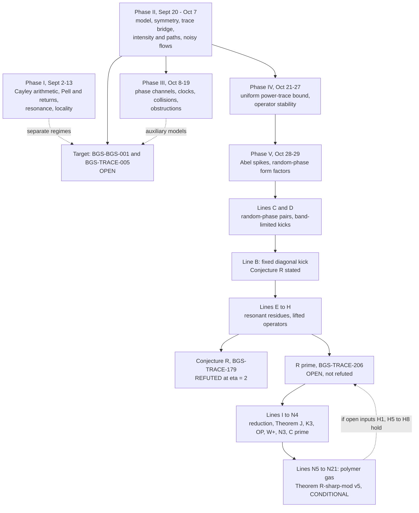

# BGS: a kicked quantized cat map, its arithmetic, and the open BGS frontier

[](https://doi.org/10.5281/zenodo.23919484)
[](record/claim_registry.md)
[](record/claim_registry.md)
[](record/claim_registry.md)
[](mathematics/open_questions.md)
[](record/claim_registry.md)
[](record/claim_registry.md)
[](formalization/README.md)
[](manuscript/BGS_unified.pdf)
[](LICENSE_POLICY.md)

[**Results**](RESULTS.md) · [Русский](README.ru.md) · [Status](STATUS.md) · [Research brief](RESEARCH.md) · [Claim registry](record/claim_registry.md) · [Mathematical introduction](docs/reader_guide.en.md) · [Theorem index](mathematics/results.md) · [Open problems](mathematics/open_questions.md) · [Manuscript (PDF)](manuscript/BGS_unified.pdf) · [Corpus atlas](docs/corpus_atlas.md)

> **Abstract.** This repository is a research programme on the Bohigas–Giannoni–Schmit (BGS) conjecture for one explicitly specified kicked, quantized cat map on the torus, $U_N=\exp(i\tau N A_N)M_N$ with $\tau=10^{-80}$ fixed. **The BGS limit for this map is not proved:** fixed-strength microscopic universality (BGS-BGS-001) and the signed Heisenberg-scale joint-trace estimate that would close the gap (BGS-TRACE-005) are both open. Between September and November 2026 the programme registered 419 precisely scoped claims; 338 are proved at their stated scope (project proofs, many computer-assisted, many checked by an internal independent referee, **none externally refereed**). The work falls into seven phases. (I) Finite-field and Cayley arithmetic, Pell/Floquet return laws, resonance cohomology and locality. (II) The fixed-map frontier: the exact model, its symmetries and algebraic spectrum, an exact trace-to-local-statistics bridge, intensity mixing and path cancellations, fixed-order trace sectors and noisy Dyson comparisons. (III) Phase channels, feedback clocks, collision laws and spectral obstructions. (IV) A uniform power-trace bound for the original family and operator-stability transfer. (V) Arithmetic Abel spikes of the pure cat map and exact random-phase form factors. (VI) Lines B–H on a fixed diagonal kick, ending in a computer-assisted refutation of Conjecture R at η = 2. (VII) Lines I–N on the corrected mean law R′ (BGS-TRACE-206), which is **open and not refuted**; their end point is the **conditional** Theorem R♯-mod v5 (BGS-TRACE-325). Every status on this page is copied from the registry.

The badge counts are static and are copied from [`record/claims.json`](record/claims.json) (registry updated 2026-11-01). The registry, not this page, decides every status ([SOURCE_OF_TRUTH.md](SOURCE_OF_TRUTH.md)). **GitHub Actions is not running on this repository** (account billing, as of 1 November 2026), so there is no CI badge. Every check quoted here was run locally, and the logs are committed under [`evidence/executions/`](evidence/README.md).

## Contents

1. [Status at a glance](#status-at-a-glance)
2. [The problem and the model](#the-problem-and-the-model)
3. [The research story, phase by phase](#the-research-story-phase-by-phase)
4. [Main results across the programme](#main-results-across-the-programme)
5. [Theorem R♯-mod v5 (conditional)](#theorem-r-mod-v5-conditional)
6. [What else is established, and what is missing](#what-else-is-established-and-what-is-missing): open problems and the frontier
7. [Methods and verification](#methods-and-verification)
8. [A map of the whole programme](#a-map-of-the-whole-programme)
9. [Repository map](#repository-map), [reader paths](#reader-paths), [how to reproduce](#how-to-reproduce), [known issues](#known-issues)
10. [Read, reproduce, and cite](#read-reproduce-and-cite)

## Status at a glance

| Registered state | Claims | Meaning |
|---|---:|---|
| proved | 338 | Project proof at the stated scope, including computer-assisted proofs; not external refereeing |
| verification-pending | 17 | Argument or computation exists; an independent check is outstanding |
| conditional | 21 | Proved implication from stated hypotheses that are themselves open |
| open | 42 | Conjecture, hypothesis or programme obligation without a proof |
| refuted | 1 | Shown false as stated (Conjecture R, BGS-TRACE-179) |
| **total** | **419** | |

The claims are spread across the whole programme. Phases I–V (September to 29 October 2026) hold 226 claims, 197 of them proved. Lines B–N (29 October to 1 November) hold 193 claims, 141 of them proved. The [phase table](#the-research-story-phase-by-phase) gives the split. 171 non-open claims link Lean 4 files, out of 190 modules in `formalization/Bgs`. Lean certifies the finite or arithmetic statements named in each claim boundary, not the full analytic arguments.

## The problem and the model

### What the conjecture asks

Bohigas, Giannoni and Schmit's [1984 paper](https://doi.org/10.1103/PhysRevLett.52.1) connected chaotic quantum spectra with universal random-matrix fluctuations. A rigorous theorem needs a specified quantum family, the correct symmetry sector, a justified unfolding, and a local correlation limit. Classical hyperbolicity alone does not guarantee a particular symmetry class or a universal spectrum. The 1984 evidence concerned the orthogonal class (Sinai billiards); the target here is the unitary class.

For unitary-class spectra the reference point process is $\mathrm{Sine}_2$, whose determinantal kernel and distinct-point two-point correlation are

```math
K(x,y)=\frac{\sin\pi(x-y)}{\pi(x-y)},
\qquad
\rho_2(x,y)=1-|K(x,y)|^2.
```


*Analytic benchmark curves, **not measured data** from the deterministic map. The figure depicts pair correlation, not the nearest-neighbour spacing distribution.*

### The exact model and target

For odd $N\ge3$ the maintained family is

```math
S=\begin{pmatrix}3&4\\2&3\end{pmatrix},
\qquad
U_N=\exp(i\tau N A_N)M_N,
\qquad
\tau=10^{-80}.
```

Here $M_N$ is the specified quantization of the hyperbolic cat map and $A_N$ the specified Weyl-quantized nonlinear kick. [The canonical model source](mathematics/fixed-map/fixed_map_resolvent_frontier.md) fixes conventions, exceptional dimensions and symmetry questions. **The coupling stays fixed as $N\to\infty$.** Replacing it with a vanishing coupling, independent random phases, a different kick or noise changes the problem. Many results below concern such neighbouring models on purpose, and each says so in its boundary.

The pair-moment reference in the prescribed trace hierarchy is unproved for this family. Weak convergence to Sine₂ alone does not give convergence of these unbounded pair moments without uniform-integrability control:

```math
L_N(s)=\frac{1}{N^2}\sum_{m\ge1}e^{-2sm/N}
\left|\mathrm{Tr}\,U_N^m\right|^2
\;\longrightarrow\;
\frac{1-e^{-2s}}{4s^2},
\qquad s>0.
```

The full [BGS-TRACE-005 obligation](mathematics/open_questions.md#b-prove-heisenberg-scale-desymmetrized-joint-trace-estimates) is stronger: a correctly desymmetrized **signed factorial joint-trace comparison** for every fixed order and every compactly supported smooth Fourier test, at powers $m\asymp N$, with the absolute value taken **after the complete Fourier sum**. The [trace-to-local-statistics bridge](mathematics/trace-bridge/trace_to_local_statistics_bridge.md) states the further tightness and extension conditions.

**Why the signed plateau matters.** For Haar-distributed $V_N$ in the circular unitary ensemble,

```math
\mathbb E_{\mathrm{CUE}}\left|\mathrm{Tr}\,V_N^m\right|^2
=\min(m,N),\qquad m\ge1.
```

The cyclic linear term proved for the actual map (BGS-FM-021) has normalized shape $x=m/N$, while the CUE reference is $\min(x,1)$. Above $x=1$ the difference is **$1-x<0$**, so the remaining coherent, signed path contributions must supply a negative correction in aggregate. This is a necessary target, **not** a result proved for the deterministic family.


*Analytic comparison (no simulation). The shaded region is the size of the negative correction required relative to the cyclic linear contribution.*

## The research story, phase by phase

The phases are chronological. Each has its own models, scales and hypotheses; they are **not** a chain of implications to BGS. Counts are registry states by phase (claim-ID ranges as listed). The lettered "Lines" B–N are the names the repository gives to the October–November fixed-kick work; there is no "Line A".

| Phase | Dates (2026) | Question | Claims | proved / pend. / cond. / open / refuted |
|---|---|---|---:|---|
| I. Arithmetic and side programmes | Sept 2–13 | Exact finite-field, Pell, return, resonance and locality theory around cat maps | 45 | 38 / 2 / 2 / 3 / 0 |
| II. Fixed-map frontier | Sept 20 – Oct 7 | What is exactly true for the unchanged $U_N$, and what is still needed for BGS | 89 | 85 / 0 / 2 / 2 / 0 |
| III. Phase channels, clocks, collisions | Oct 8–19 | Can phase-randomised or feedback models reach microscopic laws, and which shortcuts fail | 56 | 41 / 10 / 5 / 0 / 0 |
| IV. Physical-kick bounds and operator stability | Oct 21–27 | Uniform control of all power traces of the original family | 11 | 11 / 0 / 0 / 0 / 0 |
| V. Abel spikes, random-phase form factors, Lean | Oct 28–29 | Exact arithmetic of the pure cat map; exact short-time form factors of phase ensembles | 25 | 22 / 1 / 0 / 2 / 0 |
| VI. Lines B–H: fixed diagonal kick | Oct 29–30 | Does a derandomised kick reproduce the random-phase $2m$ law (Conjecture R)? | 68 | 42 / 2 / 6 / 17 / 1 |
| VII. Lines I–N: frozen R′ along $m=3p$ | Oct 31 – Nov 1 | Is the corrected mean law R′ true? | 125 | 99 / 2 / 6 / 18 / 0 |
| **total** | | | **419** | **338 / 17 / 21 / 42 / 1** |

Phase I: CAYLEY, RET, INFO, RES (except RES-006/007), FLOW-022..025, FM-034..037. Phase II: BGS-001, LOOP-001, RES-006/007, CUE-001, FUP-001, FORMAL-002/003, FM-001..031, FLOW-001..021, TRACE-001..029. Phase III: TRACE-053..105, FM-032/033, CUE-002. Phase IV: TRACE-106..116. Phase V: TRACE-117..142 and FORMAL-001. Phase VI: TRACE-143..210. Phase VII: TRACE-211..336. (IDs 030–052, 138, 139 and 334 are not registered.)

**Phase I — arithmetic and side programmes (September 2026).** The programme began with exact arithmetic around cat maps over finite fields. It proved a pair-key and fourth-moment reduction (BGS-CAYLEY-001), the Cayley additive-energy reduction (BGS-CAYLEY-002), a uniform subgroup-curve energy bound (BGS-CAYLEY-004), Gaussian limits of the Cayley–Jacobi trace (BGS-CAYLEY-006) and a magnetic-quotient semicircle law (BGS-CAYLEY-009). The sharp centered Cayley energy target (BGS-CAYLEY-005) stays open. The Pell/Floquet chapter proved harmonic return laws and a harmonic-scale transition for the kicked Pell propagator (BGS-RET-001, BGS-RET-002), a critical resonance law (BGS-FLOW-022) and a necessary kick scale (BGS-FLOW-025). Resonance cohomology gave sharp Fourier-line coercivity (BGS-RES-001), a full-lag Riesz gap for the frozen symbol under linear transport (BGS-RES-005) and a constructive radius-eight margin (BGS-RES-023); all-members analytic nondegeneracy (BGS-RES-003) stays open. Fixed-strength locality (BGS-FM-034, BGS-FM-036) shows what can be proved when the map is smoothly conjugate to an arithmetic one. These are global or compressed-observable laws, not microscopic statistics of $U_N$.

**Phase II — the fixed-map frontier (20 September to 7 October 2026).** This phase fixed the model and mapped the gap. Structural theorems: classical symmetry exclusions (BGS-FM-001), total nonvanishing of metaplectic minors and qualitative spectral simplicity (BGS-FM-008), nonvanishing of every power trace (BGS-FM-010), and the actual scalar commutant in every odd dimension except 7 (BGS-FM-024). The exact bridge: a partition–Möbius formula (BGS-TRACE-001), a Fourier trace representation of factorial statistics (BGS-TRACE-002), and sufficiency of a weighted joint-trace comparison for band-limited RMT correlations (BGS-TRACE-003, BGS-TRACE-004); a universal sharp Abel floor (BGS-TRACE-007); the conditional mixed-loop route (BGS-LOOP-001). Dynamics of the actual map: intensity mixing with a cyclic ramp (BGS-FM-021), reverse-path decay (BGS-FM-022), signed three- and four-block cancellations (BGS-TRACE-015, BGS-TRACE-016), and a fixed-order WKB reduction of the trace hierarchy (BGS-TRACE-017). Obstructions: absolute all-order comparison is impossible (BGS-TRACE-010). Noisy comparisons: an original-chain Sine₂ law from the actual start (BGS-FLOW-014) and all fixed factorial orders for the coboundary chain (BGS-FLOW-017), on explicitly stated noise schedules.

**Phase III — phase channels, feedback clocks and collisions (8–19 October 2026).** Reconstructed analytic results on phase memory (BGS-TRACE-053), sharp inner-function jets (BGS-TRACE-054) and absorbed scalar transport (BGS-TRACE-056); frozen circular phase laws in the three symmetry classes (BGS-TRACE-068) and an all-order critical CSE limit (BGS-TRACE-069); unconditional feedback flatness and fixed-order clock laws from deterministic starts (BGS-TRACE-080); exact Abel decomposition and square-root clock rigidity (BGS-TRACE-092); the Heisenberg Wick collision Poisson law (BGS-TRACE-094); and the implication from an all-order signed diagonal hierarchy to local Sine₂ (BGS-TRACE-086). Obstructions show that perfect intensity mixing, small reversal and simple spectrum do not determine microscopic statistics (BGS-TRACE-081), and that coherent return memory has a universal plateau (BGS-TRACE-082). The polylogarithmic deep-source hierarchy (BGS-TRACE-055) and most of the 19 October phase-ensemble work (BGS-TRACE-096 and BGS-TRACE-098..105) remain verification-pending.

**Phase IV — physical-kick bounds and operator stability (21–27 October 2026).** Uniform physical-kick trace decay (BGS-TRACE-106), global spectral distance of order $1/\log N$ (BGS-TRACE-110) and, centrally, a **uniform power-trace bound for the original family** with one dimension threshold for all iterates (BGS-TRACE-113). An $O(N^{-2})$ matrix error transfers the compact pair test (BGS-TRACE-116), while balanced rounding shows that polynomially many short traces cannot determine a local law for a general quantizer (BGS-TRACE-114).

**Phase V — Abel spikes and exact form factors (28–29 October 2026).** For the pure cat map the Abel pair statistic stays more than 1/2 from its CUE value at odd Pell returns, and the fixed kick preserves this up to $u_{201}$ (BGS-TRACE-117), extended at single dimensions by BGS-TRACE-118 and BGS-TRACE-119. The cat-map order controls the statistic (BGS-TRACE-120, BGS-TRACE-121), and every odd modulus lies above 3/4 or below 5/7 (BGS-TRACE-124). Exact random-phase results: the phase-averaged form factor (BGS-TRACE-126), the diagonal random-phase form factor at times one to three (BGS-TRACE-127), fixed-time limits for every hyperbolic cat map (BGS-TRACE-132) and the unitary value for momentum phases (BGS-TRACE-140); the revival laws BGS-TRACE-136 and BGS-TRACE-137 are open conjectures. The Aristotle integration adapted 39 Lean modules (BGS-FORMAL-001).

**Notation for Phases VI–VII.** Here $m$ is the power (discrete time) in $\mathrm{Tr}\,U^m$ and $\eta=\tau N$ is the effective kick strength. Line B replaces random phases by the fixed diagonal kick $K_\eta=\mathrm{diag}\,e^{i\eta f(q/N)}$ with a fixed 32-mode trigonometric polynomial $f$; from Line E on, the "k1 kick" is the single cosine $0.9\cos2\pi q$. $\lambda=3+2\sqrt2$ is the expanding eigenvalue of $S$, and for odd $m$, $h_m=\mathrm{Re}(1+\sqrt2)^m$ (1, 7, 41, 239, …), so $h_p$ is this number at $m=p$. $F_m$ is the mean of $|\mathrm{Tr}\,U^m/\mathrm{Tr}\,M_N^m|^2$ over an arithmetic phase (exact up to $O(1/N)$). R′ states $W'_m=F_m-\mathrm{RMT}_m-\mathrm{Res}_m=o(m)$, where $\mathrm{RMT}_m=4m-m^2/h_m$ and $\mathrm{Res}_m$ is the frozen resonant sum over divisors ("levels") $d\mid h_m$. The "Robin" term bounds a divisor-sum ratio by Robin's inequality. Exact definitions: [Line G note](mathematics/fixed-map/resonance_classification_lineG.md) and Section 126.1 of the manuscript.

**Phase VI — Lines B–H: the fixed diagonal kick and Conjecture R (29–30 October 2026).** Line C identified the Haar diagonal-phase cat map with a random-phase DFT star graph and classified the first off-diagonal pairs (BGS-TRACE-143, BGS-TRACE-145); the scaling-limit conjecture BGS-TRACE-148 is open. Line D gave an exact trace bridge for band-limited random kicks (BGS-TRACE-149) and $B_m^{\mathrm{sym}}<2m$ for odd $m$ (BGS-TRACE-154). Line B derandomised the kick: an exact Pell-norm trace formula (BGS-TRACE-163), Theorem N for eleven certified primes (BGS-TRACE-168), and certified decay of $\chi_m$ on $\eta\in[1,81.574]$ (BGS-TRACE-173); it stated **Conjecture R** (BGS-TRACE-179). Line E found resonant residues and finite-range violations for a single-cosine (k1) kick (BGS-TRACE-187); Line F proved the k1 analogue of R fails at η = 2 for every odd $m\ge15$ (BGS-TRACE-199); Line G proved a partial-trace law and the dilution identity (BGS-TRACE-203, BGS-TRACE-204) and stated the corrected law **R′** (BGS-TRACE-206). Line H certified a 49-state spectrum and proved that Conjecture R fails for the Line B kick at η = 2 (BGS-TRACE-209), so BGS-TRACE-179 is registered **refuted**.

**Phase VII — Lines I–N: frozen R′ along m = 3p (31 October to 1 November 2026).** R′ subtracts the resonant contributions of a fixed primary set at every included level and asserts the remainder is $o(m)$; its definition is **frozen** in the claim boundary, so later lines cannot tune it. Line I reduced R′ exactly to three open inputs (BGS-TRACE-213). Line J proved that the frozen $d=7$ contribution oscillates with growth at least $1.0184224^m$ (BGS-TRACE-225). Line K bypassed the irrationality hypothesis H_arg, without proving it, by showing the relevant set of $m=3p$ is infinite (BGS-TRACE-235), and Line L certified the operator input OP (BGS-TRACE-244); the open range then needs H_mean (BGS-TRACE-256, open; BGS-TRACE-257 is the implication). Lines M and N found the conductor structure: Theorem W⁺ (BGS-TRACE-280), scarred conductors carrying the slow orbit (BGS-TRACE-283) and Theorem C′ at the inherited level (BGS-TRACE-296, needs squarefree $h_p$, not proved for any $p$). Lines N5–N21 built the polymer-gas route to the conditional Theorem R♯-mod v5 (BGS-TRACE-325), [described below](#theorem-r-mod-v5-conditional). **R′ remains open.**

## Main results across the programme

A selection across all phases, with registry states. The complete list is [`record/claim_registry.md`](record/claim_registry.md); the generated summary is [RESULTS.md](RESULTS.md); theorem families with their limits are in [mathematics/results.md](mathematics/results.md). The Lean column says whether the claim links a Lean file (for open claims: statement only).

| Area | Claim | State | Result | Lean |
|---|---|---|---|---|
| **Target** | [BGS-BGS-001](mathematics/fixed-map/fixed_map_resolvent_frontier.md) | **open** | Fixed-strength microscopic BGS universality for the maintained map | — |
| | [BGS-TRACE-005](mathematics/open_questions.md) | **open** | Signed Heisenberg-scale desymmetrized joint-trace estimate | statement only |
| **Cayley arithmetic** (I) | [BGS-CAYLEY-002](mathematics/cayley-arithmetic/cayley_additive_energy.md) | proved | Cayley additive-energy reduction | yes |
| | [BGS-CAYLEY-006](mathematics/cayley-arithmetic/cayley_trace_gaussian_limit.md) | proved | Gaussian limits of the full Cayley–Jacobi trace | — |
| | [BGS-CAYLEY-005](mathematics/open_questions.md) | **open** | Sharp centered pointwise Cayley energy target | — |
| **Pell and returns** (I) | [BGS-RET-001](mathematics/pell/pell_harmonic_returns.md) | proved | Harmonic return law for the kicked Pell propagator | — |
| | [BGS-FLOW-022](mathematics/pell/pell_floquet_normal_form.md) | proved | Critical resonance law for the kicked Pell propagator | yes |
| | [BGS-RET-003](mathematics/returns/noncommuting_return_words.md) | conditional | All-orders quantum conjugacy for noncommuting return words | — |
| **Resonance** (I) | [BGS-RES-005](mathematics/resonance-cohomology/frozen_full_lag_resonance.md) | proved | Full-lag classical Riesz gap for the frozen symbol | — |
| | [BGS-RES-023](mathematics/resonance-cohomology/resonance_nondegeneracy_and_hessian.md) | proved | Constructive margin of the radius-eight certificate | — |
| | [BGS-RES-003](mathematics/open_questions.md) | **open** | All-members analytic resonance nondegeneracy | — |
| **Locality, information** (I) | [BGS-FM-034](mathematics/locality/fixed_strength_locality.md) | proved | Fixed-strength all-orders comparison for a coboundary kick | yes |
| | [BGS-INFO-001](mathematics/open_questions.md) | **open** | Full vanishing-noise tomography transition | — |
| **Trace bridge** (II) | [BGS-TRACE-003](mathematics/trace-bridge/trace_to_local_statistics_bridge.md) | proved | Weighted Heisenberg-scale joint-trace comparison suffices for band-limited RMT correlations | — |
| | [BGS-TRACE-004](mathematics/trace-bridge/bandlimited_correlation_extension.md) | proved | Every-compact-bandwidth comparison extends to Schwartz tests | — |
| | [BGS-TRACE-086](mathematics/trace-bridge/all_order_process_closure.md) | proved | All-order signed diagonal hierarchy implies local Sine₂ and moment UI (implication) | — |
| | [BGS-LOOP-001](mathematics/fixed-map/fixed_map_resolvent_frontier.md) | conditional | Full mixed loop hierarchy implies the target compact correlations | yes |
| **Structure of $U_N$** (II) | [BGS-FM-001](mathematics/fixed-map/fixed_model_symmetry_theorem.md) | proved | Classical symmetry exclusions for the frozen model | — |
| | [BGS-FM-008](mathematics/fixed-map/frozen_algebraic_spectral_simplicity.md) | proved | Nonvanishing metaplectic minors; qualitative spectral simplicity | — |
| | [BGS-FM-010](mathematics/fixed-map/frozen_arithmetic_trace_rigidity.md) | proved | Every power trace is nonzero; scalar returns classified | — |
| | [BGS-FM-024](mathematics/fixed-map/actual_seven_primary_commutant.md) | proved | Scalar joint commutant in every odd dimension except 7 | — |
| **Intensity, paths, sectors** (II) | [BGS-FM-021](mathematics/fixed-map/position_chain_mixing.md) | proved | Position-chain mixing and cyclic ramp for the actual map | — |
| | [BGS-FM-022](mathematics/fixed-map/reversed_path_decay.md) | proved | Reverse-path norm decay | — |
| | [BGS-TRACE-017](mathematics/fixed-map/factorial_wkb_reduction.md) | proved | Fixed-order WKB reduction of the factorial trace hierarchy | — |
| | [BGS-TRACE-010](mathematics/trace-bridge/signed_heisenberg_comparison.md) | proved | Absolute all-order comparison against CUE is impossible (obstruction) | — |
| **Noisy comparisons** (II) | [BGS-FLOW-014](mathematics/fixed-map/circular_dyson_actual_start.md) | proved | Circular Dyson relaxation and original-chain Sine₂ from the actual start | — |
| | [BGS-FLOW-017](mathematics/fixed-map/coboundary_all_order_limit.md) | proved | All fixed factorial orders for the actual-start coboundary chain | — |
| **Phase channels and clocks** (III) | [BGS-TRACE-068](mathematics/trace-bridge/phase_contraction.md) | proved | Frozen circular phase laws in the three symmetry classes | — |
| | [BGS-TRACE-080](mathematics/trace-bridge/unconditional_feedback_flatness.md) | proved | Unconditional feedback flatness and fixed-order clock laws | — |
| | [BGS-TRACE-094](mathematics/trace-bridge/wick_collision_poisson.md) | proved | Heisenberg Wick collision Poisson law | — |
| | [BGS-TRACE-081](mathematics/spectral-obstructions/flat_spectrum_obstruction.md) | proved | Perfect intensity mixing does not identify microscopic statistics (obstruction) | yes |
| | [BGS-TRACE-055](archive/record/research_checkpoint_20261008.md) | verification-pending | Submitted polylogarithmic deep-source hierarchy | — |
| **Original-family traces** (IV) | [BGS-TRACE-113](mathematics/fixed-map/fixed_kick_uniform_trace_bound.md) | proved | Uniform power-trace bound for the original family (strict pressure gap) | — |
| | [BGS-TRACE-116](mathematics/trace-bridge/microscopic_unitary_stability_20261027.md) | proved | Compact pair test transfers through $O(N^{-2})$ matrix error | — |
| | [BGS-TRACE-114](mathematics/fixed-map/balanced_rounding_research_20261027.md) | proved | Short traces do not determine a local law for a general quantizer (barrier) | — |
| **Cat-map arithmetic** (V) | [BGS-TRACE-117](mathematics/fixed-map/kick_blind_arithmetic_spike.md) | proved | Kick-blind spikes: Abel statistic more than 1/2 from CUE at odd Pell returns | yes |
| | [BGS-TRACE-124](mathematics/fixed-map/odd_modulus_abel.md) | proved | Every odd modulus lies above 3/4 or below 5/7 (pure cat map) | yes |
| **Random-phase ensembles** (V–VI) | [BGS-TRACE-127](mathematics/fixed-map/diagonal_phase_form_factor.md) | proved | Diagonal random-phase form factor at times one, two and three | yes |
| | [BGS-TRACE-143](mathematics/fixed-map/random_phase_encounter_pairs.md) | proved | Haar diagonal-phase cat map = random-phase DFT star graph (Line C) | — |
| | [BGS-TRACE-148](mathematics/fixed-map/random_phase_encounter_pairs.md) | **open** | Scaling limit of the Haar diagonal-phase form factor | — |
| | [BGS-TRACE-149](mathematics/fixed-map/band_limited_kick_bridge.md) | proved | Band-limited random kick: exact trace bridge (Line D) | yes |
| **Fixed kick, Conjecture R** (VI) | [BGS-TRACE-163](mathematics/fixed-map/derandomized_fixed_kick.md) | proved | Exact Pell-norm trace formula for the fixed diagonal kick (Line B) | yes |
| | [BGS-TRACE-173](mathematics/fixed-map/derandomized_fixed_kick.md) | proved | Certified decay of $\chi_m$ on $\eta\in[1,81.574]$ [CA] | yes |
| | [BGS-TRACE-199](mathematics/fixed-map/lifted_transfer_lineF.md) | proved | k1-kick analogue of R fails at η = 2 for odd $m\ge15$ [CA] (Line F) | — |
| | [BGS-TRACE-209](mathematics/fixed-map/lineH_49state_certificate.md) | proved | Conjecture R fails for the Line B kick at η = 2 [CA] (Line H) | yes |
| | [BGS-TRACE-179](mathematics/fixed-map/derandomized_fixed_kick.md) | **refuted** | Conjecture R as stated | — |
| | [BGS-TRACE-210](mathematics/fixed-map/derandomized_fixed_kick.md) | **open** | Conjecture R_NSW (along $m$ with $h_m$ prime) | — |
| **Frozen R′** (VII) | [BGS-TRACE-206](mathematics/fixed-map/resonance_classification_lineG.md) | **open** | Conjecture R′ (corrected mean law, k1 kick, η = 2) | — |
| | [BGS-TRACE-213](mathematics/fixed-map/lineI_rprime_reduction.md) | proved | Exact reduction of R′ to (E″), (T″) and (D), none proved (Line I) | — |
| | [BGS-TRACE-225](mathematics/fixed-map/lineJ_d7_twisted_coefficient.md) | proved | Theorem J: $d=7$ contribution grows at least like $1.0184224^m$ [CA] | — |
| | [BGS-TRACE-244](mathematics/fixed-map/lineK_harg_removal.md) | proved | Operator input OP for the four families [CA] | yes |
| | [BGS-TRACE-283](mathematics/fixed-map/lineMN_conductor_structure.md) | proved | Theorem N3: scarred conductors carry the slow orbit β = 1 | yes |
| | [BGS-TRACE-296](mathematics/fixed-map/lineN2N4_inherited_level.md) | proved | Theorem C′ for $p$ with $h_p$ squarefree (not known for any $p$) | yes |
| | [BGS-TRACE-325](mathematics/fixed-map/lineN5N18_gas_conditional.md) | **conditional** | Theorem R♯-mod v5 | yes |

Tags used inside notes: [P] paper proof, [CA] interval or ball arithmetic, [CA-fp] floating point with derived a-priori rounding bounds, [P-arith] arithmetic implication, [H] hypothesis.

### Three reconstructed analytic results

Three Phase III results are self-contained and need no knowledge of the model.

**Phase memory with reused coordinate phases — [BGS-TRACE-053](mathematics/trace-bridge/max_entry_phase_channel.md).** For $S\in U(m)$ set $P_{ij}=|S_{ij}|^2$, $\delta=\max P_{ij}$, $A=\Pi\mathrm{Ad}(S)$ and $T_n=\mathbb E_D\mathrm{Ad}((DS)^n)$, where $\Pi$ is diagonal pinching and the same independent uniform diagonal phases $D$ are reused in every power. On the full complex Frobenius space, for $n\ge2$,

$$\|T_n-A^n\|_{2\to2}\le(n!-1)\sqrt\delta+n!n(n-1)\delta.$$

The degree-two norm is exactly $\max_{i\ne j}|S_{ij}S_{ji}|\le\delta$. This operator-norm conclusion does not evaluate a microscopic spectral trace.

**Optimal matrix inner-function jets — [BGS-TRACE-054](mathematics/trace-bridge/sharp_inner_jet.md).** Let $F=zG$ be a square finite rational inner matrix function and $T=F^*zF'\ge I$ on the circle, with $d\mu=d\theta/(2\pi)$ and $\dot T=dT/d\theta$. Without a commutativity assumption,

$$\int\|F''T^{-1/2}\|_F^2\,d\mu\le\frac43\int\mathrm{Tr}T^3\,d\mu-2\int\mathrm{Tr}T^2\,d\mu+\frac23\int\mathrm{Tr}T\,d\mu,$$

and the leading coefficient $4/3$ is optimal in every matrix dimension (the submission had $13/3$).

**Normally absorbed scalar transport — [BGS-TRACE-056](mathematics/trace-bridge/phase_channel_real_flow.md).** For deterministic unitary $S_m$ with $\max_{ij}|(S_m)_{ij}|^2\to0$ and a spectral gap of $|S_m|^2$, and a deterministic Hermitian $H_m$ with $\mathrm{Tr}H_m=m$ and $\mathrm{Tr}H_m^2\le C_Hm$, eigenphase matching along $DS_m e^{ixH_m/m}$ compares the normalized scalar resolvent in $L^1$ with that of $e^{ix/m}DS_m$. No deterministic $D=I$ limit is proved.

These are project proofs with independent internal reconstruction; external priority is not established ([submission review](literature/phase_channel_jet_sources_20261008.md)). BGS-TRACE-055, from the same submission, is **verification-pending** and must not be cited as a project proof.

## Theorem R♯-mod v5 (conditional)

This is the end point of Phase VII and one result among many. The canonical statement is [`THEOREM_DRAFT_v5.md`](computations/verification/lineN_theorem_draft/THEOREM_DRAFT_v5.md) (author v5 with the referee lineN22 edits E1–E8); the claim is BGS-TRACE-325 and the manuscript summary is [`lines_I_N_gas_theorem.tex`](manuscript/unified_sections/lines_I_N_gas_theorem.tex). It supersedes v4 (BGS-TRACE-299).

For $p$ prime and $m=3p$, a quantity $B_p$ combines a polymer-gas lower bound $2(1+\mathrm{Re}\,\Lambda'_{\mathrm{lo}})^p e^{-p(\delta+A_{\mathrm{bad}}^{\mathrm{KP}})}-1$ with tail, cross and Robin-type terms. Here $\mathrm{Re}\,\Lambda'_{\mathrm{lo}}=6.234\cdot10^{-4}$ (BGS-TRACE-310), $\delta\le5.0313\cdot10^{-6}$ (BGS-TRACE-326) and $A_{\mathrm{bad}}^{\mathrm{KP}}$ is the Kotecký–Preiss bad-cluster activity of Prop. K (BGS-TRACE-332). Under H0, H1 and H5–H8 at $p$, for $p\ge p_{\mathrm{thr}}$,

```math
\frac{W'_{3p}}{m}\;\ge\;-4+\frac1m\sum_{\rho=(\pm2,8)}S_\rho\,B_p,\qquad S_\rho\ge c\,1.13287^{m},
```

so **if $B_p\ge\kappa>0$ for infinitely many primes, then frozen R′ fails along $m=3p$.** The theorem is [P mod inputs]; the step putting $A_{\mathrm{bad}}^{\mathrm{KP}}$ in the exponent is [P-sketch], judged correct by referee lineN22.

| Input | Content | Registry state |
|---|---|---|
| H0 | Standing package (trace representation; Prop. X′, BGS-TRACE-324) | taken as given; BGS-TRACE-324 is verification-pending |
| H1 | Bad-cluster joint second moment, $C\le0.082$ at $J_0=12$ | **open** (BGS-TRACE-336) |
| H2, H4 | Interaction constants | met (BGS-TRACE-307, BGS-TRACE-302 via BGS-TRACE-326) |
| H3 | Kotecký–Preiss weight | follows from H1 (BGS-TRACE-332, conditional) |
| H5–H8 | Composite $h_p$; Theorem C′ inputs; other levels; wrap-around points | **open** (BGS-TRACE-303..306) |

Under an idealisation of the additive terms, the gas bound beats the Robin bound from the first prime 3307 when $C\le0.082$, or 1409 when $C\le8.8\cdot10^{-4}$ (BGS-TRACE-333, conditional on H1). **R′ is not refuted:** the inputs are open, no single-$p$ inequality is proved in the large-$p$ regime, and small-$p$ data are numerical only.

## What else is established, and what is missing

The programme's layers, with what each established and what it leaves open:

| Layer | Established in its stated scope | Not yet established |
|---|---|---|
| Trace-to-statistics bridge | Exact combinatorics and conditional correlation criteria (BGS-TRACE-001..004, BGS-TRACE-086) | The model-specific signed joint-trace estimate (BGS-TRACE-005) |
| Actual map: structure | Symmetry exclusions, algebraic simplicity, nonzero traces, commutants (FM family) | Any quantitative eigenphase-gap or local statistic |
| Actual map: intensity and paths | Mixing, cyclic ramp, reverse-path decay, three/four-block cancellations | All remaining coherent interference, including the negative plateau correction |
| Fixed-order sectors | WKB, [ordered-diagonal](mathematics/fixed-map/factorial_ordered_diagonal.md) and [unmasked](mathematics/fixed-map/right_frame_unmasked_pinch_hierarchy.md) sectors; [phase Ward](mathematics/trace-bridge/phase_ward_identity.md) and [Schur-energy](mathematics/trace-bridge/balanced_pair_schur_reduction.md) identities | Complete high-switch signed remainder, masks and endpoints |
| Uniform traces | Power-trace bound for all iterates (BGS-TRACE-113) | Information at $m\propto N$, where the bound is uninformative |
| Stochastic comparison | Noisy local laws on explicit schedules (FLOW family); phase-ensemble and clock laws (Phase III) | Removal of the noise or phases for the deterministic family |
| Fixed-kick arithmetic | Exact trace formulas, transfer operators, refutation of R, reductions of R′ (Lines B–N) | R′ itself; R_NSW; the inputs of Theorem R♯-mod v5 |
| Arithmetic side programmes | [Cayley](mathematics/topics/cayley-arithmetic/README.md), [Pell](mathematics/topics/pell/README.md), [return](mathematics/topics/returns/README.md), resonance, locality and information results | The centered Cayley target, analytic nondegeneracy, the tomography transition; any implication to deterministic BGS |
| Lean formalization | The [Mathlib coverage map](formalization/MATHLIB_LAYER_RU.md) ties 29 existing and 39 adapted modules to scoped finite, algebraic and scalar results; later Line modules cover finite arithmetic cores | The full analytic trace hierarchy and the BGS limit |

**Open problems and the frontier.** The decisive obstacle is **controlled cancellation of signed Heisenberg-scale contributions** for the unchanged propagator (BGS-TRACE-005, hence BGS-BGS-001), not a shortage of finite-dimensional identities. Neither a numerical spacing plot nor a result for a randomized auxiliary model closes that gap. The other main open fronts, all registered:

* **Fixed kick:** frozen R′ (BGS-TRACE-206) and its inputs H_mean (BGS-TRACE-256), the Ω-hypothesis (BGS-TRACE-287), the isotropic part at $h_p$ (BGS-TRACE-298), H1 and H5–H8 of Theorem R♯-mod v5; R_NSW (BGS-TRACE-210).
* **Random-phase ensembles:** the scaling limit BGS-TRACE-148 and the revival conjectures BGS-TRACE-136, BGS-TRACE-137.
* **Arithmetic:** the centered Cayley energy target (BGS-CAYLEY-005); all-members analytic resonance nondegeneracy (BGS-RES-003); the vanishing-noise tomography transition (BGS-INFO-001).
* **Verification debt:** 17 verification-pending claims; ten are from Phase III (BGS-TRACE-055, BGS-TRACE-096 and BGS-TRACE-098..105).

The [obligation board](mathematics/open_questions.md) states each with its closure condition; the [research brief](RESEARCH.md) gives the dated detail.

## Methods and verification

**One authority for status.** Only the registry state in [`record/claims.json`](record/claims.json) counts. Notes, this README, RESULTS.md and the manuscript are views of it. The [dated ledger](record/claim_ledger.md) explains each change, and [SOURCE_OF_TRUTH.md](SOURCE_OF_TRUTH.md) says how to resolve conflicts. Claims are edited only in the registry; the human-readable views are regenerated by renderers with `--check` modes.

**Evidence tags.** Inside notes and theorem drafts:

| Tag | Meaning |
|---|---|
| [P] | Paper proof, written out (and refereed where stated) |
| [P-sketch] | Argument complete in outline only |
| [CA] | Computer-assisted with rigorous ball or interval arithmetic (arb) |
| [CA-fp] | IEEE binary64 with derived a-priori rounding bounds under the stated model; **not** [CA] |
| [P-arith] | Arithmetic implication, checked in floating point with exact integer parts and monotonicity |
| [N] | Numerics without error control: evidence, never proof, and never registered as proved |
| [H] | Hypothesis or heuristic |

A conditional theorem is exactly as strong as its weakest open input. Superseded values stay in the drafts' errata sections and in [ERRATA.md](ERRATA.md) (65 entries), and are not cited.

**Lean 4.** [`formalization/`](formalization/README.md) holds 190 modules under `formalization/Bgs` (2426 `theorem`/`lemma` declarations, counted by grep), pinned to `leanprover/lean4:v4.33.1` and Mathlib through `lake-manifest.json`. Lean checks the finite and arithmetic kernels named in each claim boundary, not the analytic arguments. The last full local build ended "Build completed successfully (8897 jobs)" ([log](evidence/executions/20261104/lean_batch6b/lake_build_Bgs.log)). No `sorry` is allowed in the active graph. **Legacy `native_decide`:** 37 uses in 8 older modules trust the compiler beyond the kernel axioms; the claim boundaries disclose this, and the Line B–N modules use none.

**Referees.** Phase II–III results carry dated internal reviews (Wave2 and Wave3 replays, the 7 October checkpoint, independent reconstructions). Every line from E onwards has an independent internal referee pass: 24 `referee/` folders under [`computations/verification/`](computations/verification/lineN16/referee/REPORT.md), plus the final Line N referees lineN20, lineN21, lineN21b and lineN22 in [`evidence/executions/20261101/lineNgas/`](evidence/executions/20261101/lineNgas/v5_integration/README.md). None of this is external peer review.

**Dependency gate.** No proved claim may depend on a non-proved claim. The gate [`proved_deps_gate_v5.py`](computations/verification/lineN_theorem_draft/integration_checks/proved_deps_gate_v5.py) is strict for BGS-TRACE-244..336, with one exception, the frozen definition of BGS-TRACE-206; its last run returned GATE_OK ([log](computations/verification/lineN_theorem_draft/integration_checks/proved_deps_gate_v5.log)). Seven older violations on main are recorded there as out of scope.

**Frozen packets.** Author and referee packets under `computations/verification/line*/` are kept verbatim and pinned by sha256 ([registry](computations/maintenance/frozen_evidence_packets.json): 39 directories, 368 files). They record what was run; they are not maintained entry points. Historical receipts and sealed replays (Wave2, Wave3) are likewise byte-pinned.

## A map of the whole programme



*A research map, not a chain of proved implications. Solid arrows mean "led to"; dashed arrows are separate regimes or conditional statements.*

## Repository map

```sh
BGS/
├── README.md, README.ru.md   # this page (English / Russian)
├── RESULTS.md, STATUS.md     # generated summaries (render_results.py, render_status.py)
├── RESEARCH.md               # dated research brief, newest first
├── SOURCE_OF_TRUTH.md        # which surface decides what
├── record/                   # claims.json (the registry), ledger, errata, audits, generated views
├── mathematics/              # maintained proofs and their exact boundaries
│   ├── topics/               # reading views by topic
│   ├── fixed-map/            # the model, Phases II-V notes, Lines B-N notes (line*.md)
│   ├── trace-bridge/         # bridge, phase channels, clocks, collisions
│   └── cayley-arithmetic/, pell/, returns/, resonance-cohomology/, locality/, ...
├── computations/
│   ├── verification/         # checkers, audits; line*/ = frozen author and referee packets
│   └── maintenance/          # renderers, manuscript builder, unit tests (tests/)
├── formalization/            # Lean 4 project (Bgs.lean, Bgs/*.lean)
├── manuscript/               # unified TeX source and the tracked BGS_unified.pdf
├── evidence/                 # dated receipts: commands, hashes, logs
├── literature/               # exact-source checks, bibliography, priority notes
├── docs/                     # reader guides, conventions, corpus atlas
├── papers/                   # focused candidate paper scopes (not submissions)
├── supplement/, environment/, assets/figures/
└── archive/                  # historical snapshots, kept for provenance
```

## Reader paths

* **Mathematician.** [Reader guide](docs/reader_guide.en.md) → [the model](mathematics/fixed-map/fixed_map_resolvent_frontier.md) and [trace bridge](mathematics/trace-bridge/trace_to_local_statistics_bridge.md) → [theorem index](mathematics/results.md) or [topic views](mathematics/topics/README.md) → [open problems](mathematics/open_questions.md) → the [manuscript](manuscript/BGS_unified.pdf).
* **Physicist.** The plateau discussion above → random-phase and form-factor results ([Line C](mathematics/fixed-map/random_phase_encounter_pairs.md), [Line D](mathematics/fixed-map/band_limited_kick_bridge.md), [diagonal phases](mathematics/fixed-map/diagonal_phase_form_factor.md)) → [Abel spikes](mathematics/fixed-map/kick_blind_arithmetic_spike.md) → [Conjecture R and its refutation](mathematics/fixed-map/lineH_49state_certificate.md). The priority notes in [literature/](literature/README.md) credit the prior physics (Gnutzmann–Seif, Berkolaiko–Keating, Boasman–Keating and others).
* **Verifier.** [SOURCE_OF_TRUTH.md](SOURCE_OF_TRUTH.md) → [`record/claims.json`](record/claims.json) and its [rendered registry](record/claim_registry.md) → [REVIEWING.md](REVIEWING.md) → [REPRODUCE_unified.md](REPRODUCE_unified.md) → [evidence receipts](evidence/README.md) → [formalization scope](formalization/README.md).

## How to reproduce

All commands run from the repository root. Python dependencies are pinned in `requirements.txt`; the sync checks need pandoc 3.12.1 on `PATH`.

```sh
pip install -r requirements.txt
## registry and repository audits
python computations/verification/scientific_registry_audit.py
python computations/verification/repository_audit.py
## generated views must be in sync (each prints OK)
python computations/maintenance/render_results.py --check
python computations/maintenance/render_status.py --check
python computations/maintenance/render_claim_registry.py --check
## unit tests (40 files, 266 tests)
python -m unittest discover -s computations/maintenance/tests
## Lean
(cd formalization && lake exe cache get && lake build Bgs)
## manuscript PDF (pdflatex, or Tectonic via the TECTONIC variable)
python computations/maintenance/build_unified_manuscript.py --engine auto --output-dir out
```

The full list of 23 checkers and their latest results is in the newest receipt under [`evidence/executions/20261101/`](evidence/executions/20261101/final_editorial/README.md). The manuscript builder fails on any overfull box, unresolved reference or citation, or duplicate label, and records a manifest; `--publish` copies the verified PDF to `manuscript/`. More detail: [REPRODUCE_unified.md](REPRODUCE_unified.md).

## Known issues

* **No continuous integration.** GitHub Actions refused to start jobs on this repository as of 1 November 2026 (account billing). All check results quoted here are local runs with committed logs.
* **Legacy `native_decide`.** 37 uses in 8 older Lean modules rely on native evaluation and therefore trust the compiler. The Line B–N modules use none.
* **Hash-pinned broken links.** 24 relative links in 11 files point to paths that later moved. Those files are byte-pinned by seals, manifests or receipts, or generated, and are left unedited on purpose; see [RESULTS.md](RESULTS.md#known-issues).
* **Thin evidence on a few claims.** BGS-TRACE-095 and BGS-TRACE-097 (conditional) list no verifier. BGS-RES-015 (proved) cites its own note as evidence and depends on the conditional BGS-RES-014 for a symbol identity that it recomputes directly.
* **Uneven manuscript depth.** Phases I–VI have full manuscript sections. Lines I–N (BGS-TRACE-211..336) are covered by one concise chapter that states results and registry states; their proofs stay in the `mathematics/fixed-map/line*.md` notes and the packets.
* **Pinned note titles.** Some Line notes (for example the Lines N5–N21 note, whose title still names v4) are pinned by the 1 November receipt and keep their original headings; the registry and this page name v5.

## Read, reproduce, and cite

For an accessible beginning, read the [mathematical background](docs/reader_guide.en.md). Then use the [theorem index](mathematics/results.md) or [topic map](mathematics/topics/README.md) to reach canonical proofs. The [claim registry](record/claims.json) controls registered status; the [dated ledger](record/claim_ledger.md) explains changes, and [SOURCE_OF_TRUTH.md](SOURCE_OF_TRUTH.md) defines how to resolve conflicting surfaces.

The [consolidated research manuscript](manuscript/README.md) ([PDF](manuscript/BGS_unified.pdf)) is a **living, full-length scientific account**. It is neither a completed proof of BGS nor a replacement for the proof sources. [Focused paper scopes](papers/README.md) are potential publication units, not submissions.

[Reproduction guide](REPRODUCE_unified.md) · [Computation and verification](computations/README.md) · [Formalization scope](formalization/README.md) · [Literature and priority](literature/README.md) · [Contributing](CONTRIBUTING.md) · [Reviewing](REVIEWING.md) · [Errata](ERRATA.md) · [Changelog](CHANGELOG.md)

**Citation.** Cite the specific result where available, and this repository for the corpus and the verification infrastructure. The metadata are in [CITATION.cff](CITATION.cff): Maksim Churilov, *BGS: arithmetic quantum chaos and spectral universality*, version research-2026.11.1, https://github.com/ChurilovMaksim/BGS, DOI [10.5281/zenodo.23919484](https://doi.org/10.5281/zenodo.23919484) (Zenodo archive of this release; all versions: [10.5281/zenodo.23919483](https://doi.org/10.5281/zenodo.23919483)). That version names the research-2026.11.1 release, not the current main branch.

**Licence.** Source code (`computations/`, `formalization/`) is released under the MIT License ([LICENSE](LICENSE)). Scholarly texts, the manuscript, mathematical exposition, registries and research data are released under CC BY 4.0 ([LICENSE-CC-BY-4.0.txt](LICENSE-CC-BY-4.0.txt)). The per-path map and its history are in [LICENSE_POLICY.md](LICENSE_POLICY.md).

*GPT 6 and Muse Spark 1.3 were used for repository work, verification, and code implementation. Project proof status does not imply independent external refereeing or an established novelty or priority claim.*
