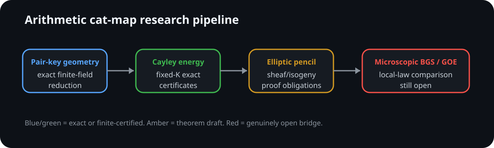

# Arithmetic quantum cat maps — exact reductions and the BGS frontier

[](https://github.com/ChurilovMaksim/WoW/actions/workflows/ci.yml)
[](manuscript/arithmetic_cat_map_moments.pdf)
[](formalization/)

This repository is a reproducible research programme on arithmetic quantum cat
maps, exact finite-field moment reductions, cyclotomic collision geometry, and
the still-open microscopic Bohigas--Giannoni--Schmit/RMT local-statistics
problem.

> **Status discipline.** [`record/claim_ledger.md`](record/claim_ledger.md) is
> the repository-wide claim authority. The workflow/reproducibility contract is
> [`record/research_operating_protocol.md`](record/research_operating_protocol.md).



## Pell Floquet continuation: actual propagator at recurrence times

The [self-contained normal-form proof](mathematics/pell_floquet_normal_form.md)
establishes a project theorem for the fixed map `T=((3,2),(4,3))`, including
composite Pell moduli. For the actual cosine-kicked propagator,
`epsilon=tau/sqrt(2K)` gives

```text
Tr_-(U_epsilon^(mK))/d -> exp(-m^2 tau^2/2),  d=(N-1)/2.
```

Thus the K-th power has a wrapped Gaussian spectral limit. The explicit
finite normal-form error is `12 epsilon^2/sqrt(K)` in normalized odd-space
Hilbert--Schmidt norm. Subcritical folded phases converge in W2 whenever
`epsilon sqrt(K) -> 0`; no isolated-cluster labelling is asserted.

This is recurrence-scale, not microscopic BGS universality. The classical
kick still tends to zero, K is logarithmic in N, and priority is not
established. The proof, [independent Python verifier](computations/verification/pell_floquet_regression.py),
[C++ pair verifier](computations/cpp/pell_pair_orthogonality.cpp), and
[scope-labelled numerical certificate](evidence/certificates/pell_floquet_audit.json)
are maintained together. The Lean contribution contains general cohomology
identities and finite pair-key certificates, not the analytic limit.

The corrected fourth-moment constant is `gamma=5.614220692151198071627965...`.
An [integer interval certificate](computations/verification/pell_gamma_interval.py)
now checks that decimal independently. The previously reported `5.612...`
was a transcription/provenance error, not the value of the stated series.
See [the continuation audit](record/floquet_continuation_20260905.md).

## Status at a glance — 5 September 2026

| Layer | Status | Current statement |
|---|---|---|
| Pair-key / fourth moment | **EXACT** | exact off-diagonal bijection, diagonal multiplicity, `B(t)` decomposition and total count |
| Cayley reduction | **EXACT** | mixed layer is additive energy of `A=c(H\{1})` |
| Best uniform pointwise bound | **EXACT + EXTERNAL-THEOREM** | `E_+(A)<34K^(8/3)` in the maintained range |
| Fixed-product rows | **EXACT** | `Delta<=4 I_K(K-1)(K-2)` |
| Exact general order-three support | **EXACT + EXTERNAL-THEOREM** | fixed-degree real-trace `Lambda'_K^(3)` detects split `I>=3` |
| Characteristic-zero intercept rigidity | **EXACT + EXTERNAL-THEOREM** | every affine intercept fibre has size at most `2`; all double fibres classified |
| General scalar support | **EXACT** | row shift resultant has `ord_0=I`; `I>=3 iff c_0=c_1=c_2=0` |
| Cyclotomic-unit matching | **EXACT** | row intersections are `W_r(b)=V_r(a) mod q` |
| Inverse reflection | **EXACT** | `I_-1=2 deg gcd(E,O)` |
| Inverse pair-sum factorization | **EXACT** | `R_-(Z)=2^mF(Z/2)S(Z)^2`; `I_-1=2 ord_0S` |
| Inverse two-scalar support | **EXACT** | `I_-1>=3 iff S(0)=S'(0)=0`; exact support `Theta_K` |
| Translated half-degree resultant | **EXACT** | `S(Z)=+-Res(E_Z,O_Z)`; support is resultant + translation derivative |
| Pointwise quadratic subfamily | **EXACT** | outside exact order-three support, `E_+(A)<=11(K-1)(K-2)` |
| Per-ratio split support mass | **EXACT** | `sum log p=O(K^3)` for each fixed ratio |
| Global split-prime mass | **EXACT** | explicit deterministic `O(K^4)` budget |
| Split density-one exact baseline | **EXACT + EXTERNAL-THEOREM** | fixed `theta<1/5` |
| Minimal-extension Frobenius amplification | **EXACT** | `ord_K(p)` divides non-forced excess |
| Minimal-extension density-one baseline | **EXACT + EXTERNAL-THEOREM** | unrestricted prime pairs, fixed `theta<1/3` |
| Full Cayley/Jacobi trace | **EXACT** | exact second/fourth trace moments |
| Corrected off/off elliptic layer | **EXACT + EXTERNAL-THEOREM** | `Var O << pE_+(A)+K^2p+K^4sqrt(p)+K^4` |
| Trace-to-local-statistics bridge | **EXACT** | microscopic factorial statistics are exact Heisenberg-scale trace sums |
| Sharp split pointwise energy | **OPEN** | `(K-1)^4/p+O(K^(2+o(1)))` |
| Heisenberg-scale desymmetrized trace comparison | **OPEN** | required spectral estimate not proved |
| Microscopic BGS/GOE/COE | **OPEN** | no universality theorem claimed |

The concise theorem index is [`mathematics/results.md`](mathematics/results.md).

## Exact fourth-moment bottleneck

For odd prime `p`, `H<=F_p^*` of order `K`, the pair-key geometry gives

```text
B(t)=O(t)+2(p-2)C_H(t)+(p-2)^2 1_{t=0},
```

and, with

```text
c(h)=(h+1)/(h-1),
A=c(H\{1}),
```

both nontrivial fluctuation layers are controlled by `E_+(A)`.  The corrected
off/off theorem is

```text
Var_{t!=0} O(t)
 << pE_+(A)+K^2p+K^4sqrt(p)+K^4.
```

The strongest maintained uniform pointwise bound is

```text
E_+(A)<34K^(8/3)
```

for `100<K<p^(3/4)/3`; the sharp split target is

```text
E_+(A)=(K-1)^4/p+O(K^(2+o(1))).
```

## Exact row support

Fixed-product rows isolate non-forced excess:

```text
Delta_K(p)<=4 I_K(p)(K-1)(K-2).
```

The exact maximal-real construction removes the unique invalid
characteristic-zero trace and keeps fixed polynomial degree.  Its first three
subresultants define `Lambda_(K,r)^(3)`, with

```text
p|Lambda_(K,r)^(3)
iff
some row pair in ratio class [r] has I>=3
```

for split primes. Hence outside `Lambda'_K^(3)`,

```text
I_K(p)<=2,
Delta_K(p)<=8(K-1)(K-2),
E_+(A)<=11(K-1)(K-2).
```

Older dehomogenized `D'/G'` invariants are retained only as one-way
obstructions because specialization can drop degree at projective infinity.

## Characteristic-zero fibres and general scalar support

For

```text
t_a=zeta^a+zeta^(-a),
s_a=zeta^a-zeta^(-a),
gamma_r(a,b)=t_b-(s_r/s_1)t_a,
```

Bass's prime-conductor cyclotomic-unit theorem gives a complete
characteristic-zero fibre classification: every fibre of `gamma_r` has at
most two points.  For non-inverse ratios the doubletons are exactly the
step-two family

```text
([a],   [a+1-r]),
([a+2], [a+1+r]).
```

Thus finite order-three support is not a hidden characteristic-zero
degeneracy.

Finite row intersections are explicitly

```text
W_r(b)=V_r(a) mod q
```

between products of cyclotomic units.  Equivalently, the scalar shift
resultant

```text
mathcal R_(K,r)(Z)
 =Res_T(P_1(T),R_r(alpha_r T+beta_r+Z))
 =c_0+c_1Z+c_2Z^2+...
```

satisfies

```text
ord_0 mathcal R_(K,r)=I_(1,r),
I>=3 iff c_0=c_1=c_2=0 mod q.
```

The resulting three-generator support `Omega` has the same split rational-prime
support as `Lambda`.  For each fixed ratio,

```text
sum_(I_r(p)>=3) log p=O(K^3).
```

## Inverse class: perfect square and two scalars

The inverse ratio `r=-1` is substantially more rigid.  Put

```text
F(X)=P(tau+X)=E(X^2)+X O(X^2).
```

The reflection theorem gives

```text
I_-1(q)=2 deg gcd(E,O mod q).
```

The inverse shift resultant factors universally as

```text
R_-(Z)=Res_X(F(X),F(Z-X))
      =2^m F(Z/2) S(Z)^2,
S(Z)=prod_(i<j)(Z-x_i-x_j),
```

where `x_i` are the roots of `F`.  Since `2^mF(0)` is a unit at split
`p!=K`,

```text
I_-1(q)=2 ord_0 S,
I_-1(q)>=3 iff S(0)=S'(0)=0 mod q.
```

Thus inverse order-three support is a **two-scalar** problem.  The contraction
of `(S(0),S'(0))` is `Theta_K`; it has the same split support as the older
half-degree reflection support `Xi_K`, though valuations may differ.

Even better, translating by half the target pair sum gives

```text
F_Z(X)=F(X+Z/2)=E_Z(X^2)+X O_Z(X^2),
S(Z)=+-Res_Y(E_Z,O_Z).
```

Therefore the two scalars are a half-degree resultant and its translation
derivative:

```text
S(0)=+-Res(E,O),
S'(0)=+-d/dZ Res(E_Z,O_Z)|_(Z=0),
```

with first-order deformation

```text
dE_Z/dZ|_0=(O+2Y O')/2,
dO_Z/dZ|_0=E'.
```

This replaces the full degree-`m^2` symbolic resultant by one `O(K)`-size
Sylvester determinant over dual numbers.  In the exact SymPy reference path,
this changes the `K=17` calculation from roughly 51 s for the full resultant to
about 0.58 s for the translated half-degree route; at `K=23` the latter remains
around 6 s and Smith normal form becomes the bottleneck.

Exact prime-to-`2K` anchors are

```text
Theta'_7=1,
Theta'_11=1,
Theta'_13=5,
Theta'_17=1,
Theta'_19=37,
Theta'_23=47^2*137.
```

For `K=23`, `Xi'_23=47*137`: split prime support agrees, valuations do not.
See
[`mathematics/cayley_inverse_pair_sum_factorization.md`](mathematics/cayley_inverse_pair_sum_factorization.md).

## Global / minimal-extension arithmetic

Every maintained cleared prime-order collision polynomial has

```text
Res(Phi_K,P)=K^3M^2.
```

The canonical difference polynomial classifies split exceptions and has exact
fourth-power discriminant structure.  The global split weighted budget is
explicitly `O(K^4)`.  For split prime pairs `K~X^theta,p~X`, this yields
normalized double-average excess tending to zero for fixed `theta<1/3`, and an
exact density-one baseline for fixed `theta<1/5`.

For arbitrary rational `p!=2,K`, let `f=ord_K(p)` and work in `F_(p^f)`.  Every
non-forced collision Frobenius orbit has size exactly `f`, so

```text
f | Delta_K^ext(p).
```

The all-prime budget plus PNT/Brun--Titchmarsh yields density-one exact baseline
for unrestricted prime pairs for fixed `theta<1/3`.  This does not improve the
split slice, where `f=1`.

## Microscopic spectral closure

For an `N x N` unitary matrix, partition-Mobius inversion and Poisson summation
give exact microscopic factorial correlation formulas in joint traces.  In
particular,

```text
C_(2,N)(U;phi)
 =N^(-2) sum_m phihat(m/N)(|Tr U^m|^2-N).
```

Band-limited microscopic statistics therefore require trace information for
`|m|=Theta(N)`, the Heisenberg scale.  The deterministic Fourier bridge is
closed.  The open spectral theorem is a weighted joint-trace comparison for
the correct desymmetrized block, plus a uniform high-frequency tail for general
Schwartz tests.

## Verification stack


The maintained CI runs exact Python/SymPy regressions, independent C++20
verifiers, all active Lean 4 modules, and a fresh TeX build.  Representative
commands are

```bash
python -m pip install -r requirements.txt
python computations/verification/repository_audit.py
python computations/verification/current_regression.py
python computations/verification/cayley_product_row_real_trace_ideal.py
python computations/verification/cayley_trace_intercept_shift_resultant.py
python computations/verification/cayley_product_row_reflection.py
python computations/verification/cayley_inverse_pair_sum_factorization.py
python computations/verification/cayley_frobenius_extension.py
python computations/verification/offoff_elliptic_spike_regression.py

cmake -S . -B build -DCMAKE_BUILD_TYPE=Release
cmake --build build -j
./build/fourth_moment_pair_key_verifier
./build/cayley_energy_verifier
./build/cayley_trace_intercept_rigidity
./build/cayley_trace_intercept_rigidity --extended

cd formalization && lake build
```

Exact calculation records are retained under `evidence/`; source audits under
`literature/`; the active article under `manuscript/`.

## Current open targets

The arithmetic closure target is now a **common-divisor theorem for small
cyclotomic scalar systems**, not another generic incidence estimate. A
sufficient form remains

```text
P_split^+(Lambda'_K^(3))<=K^(4+o(1)),
```

or an equivalent largest-prime theorem for `Omega` / inverse `Theta`.

Independently, microscopic BGS requires Heisenberg-scale desymmetrized joint
trace estimates and high-frequency tail control.  Full BGS/GOE/COE
universality remains **OPEN**.

## Magnetic-quotient audit (2026-09-05)

The [complete derivation](mathematics/magnetic_quotient_semicircle.md) gives an
all-order Weyl trace identity, an explicit antiunitary real gauge, and a
restricted **global** semicircle law for odd compressed observables when
prime subgroup orders satisfy `K -> infinity`, `K=o(log p)`.
This regime is proved impossible for the orders of one fixed hyperbolic cat
map. No microscopic BGS/GOE law or priority claim is asserted.

The [referee audit](record/referee_audit_20260905.md) records independently
reproduced false triple-filter assertions in draft PR #13 and distinguishes
execution coverage from a complete proof audit. The empirical CDF diagnostic
now checks both sides of every jump; its numerical output is regenerated.

Reproduce the new algebra with:

```sh
g++ -std=c++20 -O2 computations/cpp/magnetic_word_verifier.cpp -o /tmp/magnetic_word_verifier
OPENBLAS_NUM_THREADS=1 python computations/verification/magnetic_quotient_regression.py --cpp /tmp/magnetic_word_verifier
python computations/verification/cdf_sup_regression.py
cd formalization && lake build
```

The Lean module contains four finite certificates, not the analytic theorem.
The unified research publication workflow builds the companion TeX/PDF,
exact JSON certificate and finite global-spectrum illustration from maintained sources.
The source audit explicitly leaves full literature priority open.
