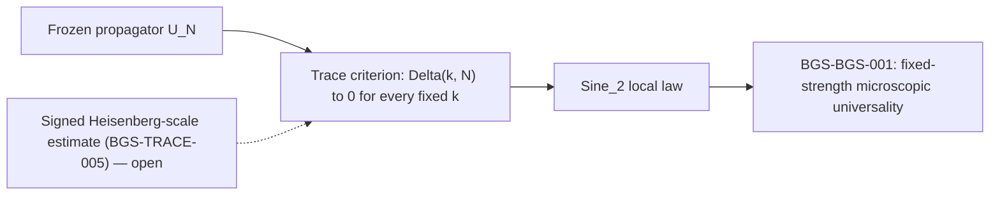
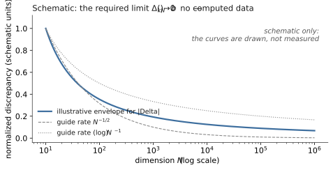
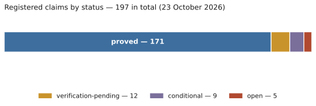

# BGS — quantum chaos and spectral universality

[Русский](README.ru.md) · [Research overview](RESEARCH.md) · [Corpus atlas](docs/corpus_atlas.md) · [Mathematical introduction](docs/reader_guide.en.md) · [Theorem index](mathematics/results.md) · [Open obligations](mathematics/open_questions.md) · [Complete manuscript](manuscript/README.md) · [Reproduction guide](REPRODUCE_unified.md)

The **Bohigas–Giannoni–Schmit conjecture** is a central question in quantum chaos: under appropriate dynamical and symmetry conditions, why should the microscopic energy-level statistics of deterministic chaotic systems agree with random-matrix theory? This repository develops exact mathematics, counterexamples, and reproducible verification around this question, especially for one explicitly specified quantum torus map. It is a research programme in progress — a body of proved reductions, exact finite computations, conditional theorems and precisely stated open obligations — not a claim that the conjecture has been solved.

> [!IMPORTANT]
> **Scientific status (23 October 2026):** The microscopic BGS limit for the fixed deterministic map below is **open**. Several related theorems have project proofs in their precisely stated regimes; none is a proof of universality for all chaotic systems. The [22 October repository review](record/audits/repository_recheck_20261022/report.md) records its exact verification scope. [Registered status](record/claims.json) · [Open proof obligations](mathematics/open_questions.md).

<div align="center">


*Research map, not a chain of proved implications: the final arrow is the missing mathematical step.*

[](record/claims.json)
[](manuscript/README.md)
[](formalization/README.md)
[](formalization/README.md)

</div>

*GPT 6 and Muse Spark 1.3 were used for repository work, verification, and code implementation.*

## At a glance

| Item | State of record |
|---|---|
| Model | The frozen propagator $U_N=\exp(i\tau N A_N)M_N$ for odd $N\ge3$, with $\tau=10^{-80}$ fixed as $N\to\infty$; $M_N$ quantizes the hyperbolic cat map with matrix $S$, and $A_N$ is the Weyl quantization of one explicit nonlinear kick symbol |
| Central open claim | [BGS-BGS-001](mathematics/fixed_map_resolvent_frontier.md): fixed-strength microscopic BGS universality for this map — **open** |
| Decisive missing estimate | [BGS-TRACE-005](mathematics/open_questions.md#b-prove-heisenberg-scale-desymmetrized-joint-trace-estimates): model-specific signed Heisenberg-scale desymmetrized joint-trace estimate — **open** |
| Claim registry | 197 registered claims as of 23 October 2026: 171 proved, 12 verification-pending, 9 conditional, 5 open ([record/claims.json](record/claims.json)) |
| Consolidated manuscript | A living research monograph; the current three-pass build has 324 pages ([manuscript/README.md](manuscript/README.md)) |
| Lean formalization | 25 modules under `formalization/Bgs/` on Lean 4.33.1 with Mathlib v4.33.1: finite certificates and algebraic kernels, plus the *statement* of BGS-TRACE-005 — not a proof of it |
| Corrections | 59 numbered errata ([ERRATA.md](ERRATA.md)), each tied to the claim or source it corrects |

## Contents

- [What the conjecture asks](#what-the-conjecture-asks)
- [The exact model and target](#the-exact-model-and-target)
- [Notation](#notation)
- [What a proof requires](#what-a-proof-requires)
- [The compendium in brief](#the-compendium-in-brief)
- [Map of the programme](#map-of-the-programme)
- [What else is established, and what is missing](#what-else-is-established-and-what-is-missing)
- [Three reconstructed analytic results](#three-reconstructed-analytic-results)
- [Open and conditional problems](#open-and-conditional-problems)
- [Status discipline](#status-discipline)
- [Verification and reproducibility](#verification-and-reproducibility)
- [Lean formalization](#lean-formalization)
- [Repository map](#repository-map)
- [Timeline of the programme](#timeline-of-the-programme)
- [Reading guide](#reading-guide)
- [Literature anchors](#literature-anchors)
- [Read, reproduce, and cite](#read-reproduce-and-cite)

## What the conjecture asks

Bohigas, Giannoni and Schmit's [1984 paper](https://doi.org/10.1103/PhysRevLett.52.1) connected chaotic quantum spectra with universal random-matrix fluctuations. Their chaotic-billiard computation crystallized the conjectural connection; turning it into mathematics is a different and harder task. A rigorous theorem needs a specified quantum family, the correct symmetry sector, a justified unfolding, and a local correlation limit. Classical hyperbolicity alone does not automatically guarantee a particular symmetry class or a universal spectrum.

Concretely, a proof of a BGS-type theorem must fix, before any estimate is attempted:

- the deterministic quantum family, with all parameters and conventions;
- the symmetry block being studied (desymmetrization);
- the unfolding convention that normalizes the mean local density to one;
- the local test class (which correlation functions, which test functions);
- the random-matrix comparison ensemble;
- the range of trace and time scales under control;
- and the exact limiting statement.

### Symmetry classes and the reference process

The comparison ensemble is determined by symmetry, not by visual resemblance to a histogram. Quantum systems with a suitable antiunitary (time-reversal) symmetry are expected to follow orthogonal-class statistics (GOE/COE); systems without such a symmetry follow the unitary class (GUE/CUE); symplectic statistics arise with half-integer spin and time-reversal symmetry. The maintained model in this repository belongs to the unitary class: its classical map is analytic Anosov with only power ($C^1$) commuters and no ($C^1$) reversor, so no inherited classical symmetry explains or alters the expected unitary-class law.

For unitary-class spectra, the reference point process is $\mathrm{Sine}_2$, whose determinantal kernel and distinct-point two-point correlation are

```math
K(x,y)=\frac{\sin\pi(x-y)}{\pi(x-y)},
\qquad
\rho_2(x,y)=1-|K(x,y)|^2.
```


*Analytic benchmark curves, **not measured data** from the deterministic map. The figure depicts pair correlation, not the nearest-neighbour spacing distribution.*



*The same analytic benchmark in animated form: the curve $\rho_2(x)=1-|K(x,0)|^2$ drawing itself against the Poisson level. Analytic curves, **not measured data**; if the animation does not play, the static frame is the complete picture.*

### Why Heisenberg time is unavoidable

Microscopic statistics live at the scale of one mean level spacing, $O(N^{-1})$ in eigenphase. Fourier duality turns that small spectral scale into a long-time condition. For the maintained pair normalization one has the exact finite-$N$ identity

```math
C_{2,N}(U;\phi)
=
\frac{1}{N^2}
\sum_{m\in\mathbb Z}
\widehat{\phi}(m/N)
\left(
|\mathrm{Tr}\,U^m|^2-N
\right),
```

so if $\widehat{\phi}$ is supported in a fixed compact interval $[-c,c]$, the sum still ranges over $|m|\le cN$. Compact microscopic Fourier support does **not** reduce the problem to short times; it rescales the Fourier mode by $N$. The hierarchy of scales is therefore rigid:

| Scale | Typical information | Enough for microscopic BGS? |
|---|---|---|
| $m=O(1)$ | fixed-time semiclassics, finite moments | no |
| $m=O(\log N)$ | arithmetic returns, Ehrenfest-type regimes | no |
| $m=o(N)$ | substantial sub-Heisenberg trace information | still no in general |
| $m=\Theta(N)$ | Heisenberg window | **required** by microscopic Fourier tests |
| spacing $O(N^{-1})$ | local eigenphase statistics | the target scale |

This is why the problem is a long-time quantum problem even though it is phrased as a small-scale spectral problem, and why neither a numerical spacing plot nor a short-time trace formula can settle it.

## The exact model and target

For odd $N\ge3$, indices lie in $\mathbb Z/N\mathbb Z$ and $e_N(t)=\exp(2\pi i t/N)$. The maintained family is defined by raw modular Weyl operators

```math
(T_N(a,b)\psi)(x)=e_N\bigl(b(x+\overline{2}a)\bigr)\psi(x+a),
\qquad
(M_N)_{xy}=N^{-1/2}e_N\bigl(-\overline{8}(3x^2-2xy+3y^2)\bigr),
```

where $\overline{2}$ and $\overline{8}$ are the inverses of $2$ and $8$ modulo $N$, and by the classical data

```math
S=\begin{pmatrix}3&4\\2&3\end{pmatrix},
\qquad
U_N=\exp(i\tau N A_N)M_N,
\qquad
\tau=10^{-80}.
```

Here $M_N$ is the specified quantization of the hyperbolic cat map with matrix $S$, and $A_N$ is the Weyl quantization of $f-\frac{1}{10}$, where, with $e^{i\alpha_0}=(-3+4i)/5$,

```math
r(q)=(1-\cos 14\pi q)(1+\cos 2\pi q),
\qquad
f(q,p)=\cos 14\pi q+\frac{r(q)}{10}
+\frac{r(q)\sin 2\pi q}{100}
+\frac{r(q)\cos(2\pi p-\alpha_0)}{100}.
```

The Fourier coefficients of $f-\frac{1}{10}$ are placed on the operators $T_N(l,k)$; passing to the ordinary Weyl rule introduces the sign $\mathrm{W}_N(k,l)=(-1)^{kl}T_N(l,k)$ and shifts the last term of the symbol accordingly. [The canonical model source](mathematics/fixed_map_resolvent_frontier.md) fixes conventions, exceptional dimensions, and symmetry questions. Centering changes only a common spectral rotation. **The coupling remains fixed as $N\to\infty$**; replacing it with vanishing coupling, independent random phases, or noise changes the problem. The quantum exponent contains $\tau N$, so the asymptotic problem eventually leaves every regime that is perturbative merely because $\tau$ is numerically small.

Three features of the model deserve emphasis.

- **Frozen strength.** The kick strength $\tau$ does not depend on $N$. Shrinking-coupling returns, arithmetic averages, coordinate-phase ensembles and noisy dynamics in this repository have their own conclusions; a comparison with this frozen propagator must itself be proved, never assumed.
- **Exceptional dimensions.** The arithmetic of the cat map creates exceptional dimensions and subsequences (notably $N=7$ and the Pell dimensions) where commutants, multiplicities or return structures differ. Maintained statements name their exceptional sets explicitly instead of averaging over them.
- **Desymmetrization.** The comparison is made for the correctly reduced spectral block of the actual propagator. The pair commutant of the model is classified for every odd $N\ge3$ except $N=7$ (BGS-FM-024, proved), with separate kick-simplicity and literal-time multiplicity results (BGS-FM-025, BGS-FM-026, proved); full simplicity of $U_N$ is not inferred from pair irreducibility.

## Notation

The symbols below are used throughout the repository with these fixed meanings; the [reader guide](docs/reader_guide.en.md) carries the fuller glossary.

| Symbol | Meaning |
|---|---|
| $N$ | Odd dimension $N\ge3$; the Hilbert-space dimension and semiclassical parameter |
| $S$ | The classical hyperbolic cat-map matrix $\begin{pmatrix}3&4\\2&3\end{pmatrix}$ |
| $T_N(a,b)$ | Raw modular Weyl operator on $\mathbb Z/N\mathbb Z$ |
| $M_N$ | The specified quantization of the cat map with matrix $S$ |
| $f$ | The explicit nonlinear kick symbol on the torus (with $r(q)$ and $\alpha_0$ as defined above) |
| $A_N$ | The Weyl quantization of $f-\frac{1}{10}$ |
| $\tau$ | The frozen kick strength, $\tau=10^{-80}$, fixed as $N\to\infty$ |
| $U_N$ | The maintained propagator $\exp(i\tau N A_N)M_N$ |
| $p_n$ | The power trace $\mathrm{Tr}\,U_N^n$, with $p_0=N$ and $p_{-n}=\overline{p_n}$ |
| $D_U(m)$ | The distinct-index (factorial) joint trace over a multi-index $m$, via partition–Möbius inversion of the $p_n$ |
| $T_{N,b}$ | The Toeplitz reference matrix with entries $N^{-1}\widehat b((i-j)/N)$ |
| $e_k(T_{N,b})$ | The $k$-th elementary symmetric function of the eigenvalues of $T_{N,b}$; the exact finite-$N$ Haar $U(N)$ reference |
| $\Delta_{k,N}(b)$ | The order-$k$ discrepancy $M_{k,N}^{U}(b)-e_k(T_{N,b})$ whose vanishing for all fixed $k\ge2$ and admissible $b$ is the sufficient criterion |
| $L_N(s)$ | The Laplace-weighted pair statistic whose limit $\frac{1-e^{-2s}}{4s^2}$ is the necessary two-point reference |
| $\delta_*$ | The mandatory negative plateau mass $\int_1^2(t-1)w(t)\,dt\ge2^{-17}e^{-64/7}$ in the $k=2$ test |
| $\mathrm{Sine}_2$ | The determinantal unitary-class reference process with kernel $K(x,y)=\frac{\sin\pi(x-y)}{\pi(x-y)}$ |

## What a proof requires

The target is convergence of the local eigenphase point process of $U_N$ to $\mathrm{Sine}_2$. The programme's bridge layer — exact and proved — reduces this to trace estimates, and states precisely which estimate is missing.



### The necessary pair reference

Even a necessary two-point reference remains unproved for this family:

```math
L_N(s)=\frac{1}{N^2}\sum_{m\ge1}e^{-2sm/N}
\left|\mathrm{Tr}\,U_N^m\right|^2
\;\longrightarrow\;
\frac{1-e^{-2s}}{4s^2},
\qquad s>0.
```

There is an exact adjoint-resolvent reformulation of the same limit (BGS-RES-006, proved): with $\mathcal U_N(X)=U_NXU_N^*$ on Hilbert–Schmidt space and $\mathcal D_N=\frac{N^2}{4}(2I-\mathcal U_N-\mathcal U_N^*)$, the identity $1+2L_N(s)=N\sinh(s/N)\cosh(s/N)\,T_N(N\sinh(s/N))$ holds for every unitary matrix, where $T_N(s)=\frac1N\mathrm{Tr}_{HS}(\mathcal D_N+s^2I)^{-1}$. This is a reformulation, not progress toward the estimate: it supplies no bound for $T_N(s)$ for the prescribed $U_N$ and no higher-order comparison.

### The all-orders criterion

The bridge from traces to local statistics is closed. Exact partition–Möbius inversion expresses distinct-index spectral sums through products of power traces (BGS-TRACE-001, proved); the microscopic Fourier representation of factorial statistics is exact (BGS-TRACE-002); a weighted Heisenberg-scale joint-trace comparison is sufficient for band-limited microscopic random-matrix correlations (BGS-TRACE-003); comparison on every compact bandwidth extends to all Schwartz correlation tests (BGS-TRACE-004); and the all-order signed hierarchy implies the local $\mathrm{Sine}_2$ law together with local moment control, with no separate uniform-integrability premise (BGS-TRACE-086). What is missing is exactly the model-specific input to this chain.

That input is BGS-TRACE-005. In the self-contained formulation of the [standalone task](record/remaining_breakthrough_task_20261021.md), write $p_n=\mathrm{Tr}\,U_N^n$ and, for a multi-index $m=(m_1,\dots,m_k)$,

```math
D_U(m)=\sum_{\pi}
\left[\prod_{B\in\pi}(-1)^{|B|-1}(|B|-1)!\right]
\prod_{B\in\pi}p_{\sum_{a\in B}m_a},
\qquad
M_{k,N}^{U}(b)=\frac{1}{k!N^k}
\sum_{\substack{m\in\mathbb Z^k\\ \sum_a m_a=0}}
\prod_{a}\widehat b(m_a/N)\,D_U(m),
```

the sums running over set partitions $\pi$ of $\{1,\dots,k\}$, with $p_0=N$ and $p_{-n}=\overline{p_n}$. With $(T_{N,b})_{ij}=N^{-1}\widehat b((i-j)/N)$ and $e_k$ the elementary symmetric function of its eigenvalues — the exact finite-$N$ Haar $U(N)$ reference — the criterion is

```math
\Delta_{k,N}(b)=M_{k,N}^{U}(b)-e_k(T_{N,b})\;\longrightarrow\;0
\qquad\text{for every fixed }k\ge2\text{ and every admissible }b.
```

Admissible tests are real $b\in\mathcal S(\mathbb R)$ with $b\ge0$, $\sup b<1$ and $\widehat b\in C_c^\infty(\mathbb R)$. The Fourier indices in the sum have order $N$, not $\log N$; the absolute value is taken **after the complete signed sum**, rather than term by term; and no uniformity in growing $k$ is demanded. The full [BGS-TRACE-005 obligation](mathematics/open_questions.md#b-prove-heisenberg-scale-desymmetrized-joint-trace-estimates) is thus: correctly desymmetrized **signed factorial joint-trace comparison** for every fixed order and every compactly supported smooth Fourier test, at powers $m\asymp N$. A simultaneous unaveraged all-order *absolute* strengthening is not the target — it is excluded by a proved universal obstruction (BGS-TRACE-010). The [trace-to-local-statistics bridge](mathematics/trace_to_local_statistics_bridge.md) explains the further tightness and extension conditions, and the criterion is sufficient for the Laplace-functional form of the local law without an additional uniform-integrability hypothesis.



*Schematic only: the curve is an illustrative envelope for the required limit $\Delta_{k,N}(b)\to0$, drawn — not computed from the model, and not data.*

### The first open test and the plateau correction

The first open case is $k=2$. For an explicit admissible test $b_*$ built from $\phi(\xi)=e^{-1/(1-\xi^2)}\mathbf 1_{|\xi|<1}$ (in the notation of the standalone task), with $w=|\widehat b_*|^2$, the required statement is

```math
\Delta_{2,N}(b_*)=N^{-2}\sum_{1\le m<2N}w(m/N)
\bigl(|\mathrm{Tr}\,U_N^m|^2-\min(m,N)\bigr)\longrightarrow0.
```

Decomposing $|\mathrm{Tr}\,U_N^m|^2$ over cyclic words into a rotational part $D_{m,N}$ and the remaining coherent part $Y_{m,N}$, the pair task is equivalent — once the stated intensity estimate for the original matrices is in place — to $Y_{m,N}$ supplying a definite negative plateau correction:

```math
N^{-2}\sum_{m<2N}w(m/N)Y_{m,N}\longrightarrow-\delta_*,
\qquad
\delta_*:=\int_1^2(t-1)w(t)\,dt\ge2^{-17}e^{-64/7}>0.
```

Vanishing of the whole coherent remainder would therefore give the *wrong* answer: it would continue the linear ramp past Heisenberg time. The negative correction is a necessary target, **not** a result already proved for the deterministic family.

### Why the signed plateau matters

For a Haar-distributed $V_N$ in the circular unitary ensemble, the exact positive-power reference is

```math
\mathbb E_{\mathrm{CUE}}\left|\mathrm{Tr}\,V_N^m\right|^2
=\min(m,N),\qquad m\ge1.
```

The cyclic linear term has normalized shape $x=m/N$, whereas the CUE reference is $\min(x,1)$. Above $x=1$, their difference is **$1-x<0$**. Thus reproducing a cyclic ramp alone cannot establish the required plateau: the remaining coherent, signed path contributions must supply a negative correction in aggregate.


*Analytic comparison (no simulation). The shaded region is the magnitude of the negative correction required relative to the cyclic linear contribution.*

### Common misreadings

The [standalone task statement](record/remaining_breakthrough_task_20261021.md) fixes the following points explicitly; each is a way the problem is often mis-stated, and each mis-statement changes the problem.

> [!WARNING]
> None of the following counts as progress on BGS-TRACE-005: replacing the fixed $\tau$ by a vanishing $\tau_N$; adding independent coordinate phases, noise, or averaging over $N$ or over a parameter; restricting to prime $N$; or proving the pair test alone.

- **The coupling is frozen.** $\tau=10^{-80}$ is small but fixed; the quantum exponent contains $\tau N$, so the asymptotic problem is not perturbative in $\tau$, and a shrinking-coupling analogue is a different theorem.
- **No added randomness.** The only permitted averaging is the single common spectral shift in the local-law formulation; independent phases, noise and ensemble averaging define comparison models, not this one.
- **The pair test is not sufficient.** The $k=2$ case is the first open test of the criterion, not the criterion: all fixed orders $k\ge2$ are required, and pair control alone does not imply the higher factorial correlations.
- **The modulus comes after the sum.** $\Delta_{k,N}(b)$ is the discrepancy of a complete signed sum; bounding summands term by term targets an absolute strengthening that a proved obstruction (BGS-TRACE-010) excludes.
- **The figures are benchmarks, not measurements.** Every curve on this page is an analytic reference or an explicitly labelled schematic; none is numerical data from the deterministic map, and no spacing histogram can substitute for the estimate.

## The compendium in brief

The consolidated manuscript ([`manuscript/BGS_unified.tex`](manuscript/BGS_unified.tex), 324 pages in the current build) is a *continuing research monograph*: ninety-eight section files assembled in a fixed order, each carrying its own hypotheses, symmetry class, time scale and spectral object. This synopsis follows the build order and groups the sections into their logical blocks. It retells the manuscript; it does not re-judge it — where a block's statements are conditional, restricted to a special regime, or still open, the synopsis says so, and the [registry](record/claims.json) remains the authority on status. The front matter's own warning applies to the whole: the blocks are **not** combined into a universality claim.

### Scope and the dependency contract

The front matter fixes the programme's terms before any theorem: the deterministic microscopic target, the three spectral objects kept distinct throughout (the frozen propagator's eigenphases, compressed observables, and auxiliary ensemble laws), the Weyl and perturbation conventions, and an explicit ledger of what is *proved, imported, checked, or unresolved*. It states the precise universality obligation — the statement a proof of BGS for this map would have to discharge — and closes with a reading map for the continuing programme. Everything after it is written against this contract: a later section may discharge an item on the ledger, but may not quietly change its scope.

### The arithmetic core: pair keys, Cayley energy, and the bridge

The first five parts develop the finite-field machinery. Pair-key geometry classifies the collisions of Cayley-type pair sums; the Cayley energy receives a uniform bound, and prime-order rigidity is extracted from square resultants and discriminants. Fixed-product rows and exact split support, characteristic-zero affine-intercept rigidity, cyclotomic-unit matching and the pair-sum polynomial as a translated half-degree resultant sharpen the classification, and a global split-prime budget with minimal-extension Frobenius control completes the arithmetic picture. The fifth part changes register: it proves the exact trace-to-local-statistics bridge on which the analytic programme rests. The sharp centered energy target of this line (BGS-CAYLEY-005) remains open, and the registry keeps the strongest pointwise bounds at their stated — partly verification-pending — scope.

### Cayley trace limits, the row frontier, and magnetic quotients

Four sections continue the arithmetic line in a limit direction. The full Cayley–Jacobi trace has Gaussian limits; the row frontier reformulates the underlying algebra intrinsically — principal subresultants are sufficient, and the obstruction locus is a Sylvester/Fitting locus rather than an artefact of coordinates; the collision family obeys a scaling rigidity. The magnetic chapter is deliberately narrower: for magnetic quotients it establishes a global semicircle regime in its restricted setting — a compressed-observable statement, kept separate from the frozen propagator's microscopic law by the front matter's own separation of spectral objects.

### Exact spectra for general hyperbolic matrices

A single chapter computes exact finite spectra for arbitrary hyperbolic matrices and states what finite spectral data determine. Its transfer content is conditional in form: the programme's record is explicit that no verbatim transfer from these finite spectra to the frozen map's local statistics exists, and the chapter is read under that caveat rather than as a step toward the local law.

### Pell blocks and harmonic transitions

Three chapters study one fixed Pell cat map at harmonic scale. Global spectral blocks are identified on the Pell data; a harmonic-scale transition is proved for the map's spectral organization; and return laws for the kicked Pell cat map are derived at the same scale. The results are exact about the structures they name — blocks, transitions, returns — and their boundary is equally explicit: harmonic-scale organization of a specially structured map is not the microscopic law of the maintained propagator, and fixed classical strength with growing replicas remains a separate obligation elsewhere in the corpus.

### Return laws: gas, position, phase — and their obstruction

The six return chapters form the compendium's largest classical block. Fixed-harmonic returns are computed from a convergent complex gas; analytic and smooth position kicks yield resonances and return asymptotics; a return-trace comparison covers general smooth phase-space symbols; general analytic kicks give regularity of return averages; and a sharp regularity boundary is proved for every hyperbolic toral automorphism — the point at which return laws of this kind provably stop. The block closes with its own obstruction chapter: short quantum returns, intensity loss, and what they imply for local spectral limits. Read together, the block is a complete account of what return methods give and where they end; none of it is promoted to a microscopic law for $U_N$.

### Floquet normal forms, weighted echoes, and coboundary kicks

The arithmetic Floquet normal form and its critical recurrence law occupy four parts, followed by weighted echoes with a resonance comb and fixed-polynomial (Edgeworth-type) corrections. The coboundary chapters then isolate a second-order recurrence scale for a coboundary kick and compute the exact fourth moment of the generated two-species observable. These chapters concern specially conjugate or classically scaled systems: their normal forms and moment identities are exact, and the front matter's separation applies — conclusions here transfer to the frozen quantum propagator only through arguments made elsewhere, not by proximity in the volume.

### Fourier alphabets, smooth tails, and mixed resonances

A middle group treats the harmonic-analytic inputs. Finite Fourier alphabets carry a cohomological variance theory; infinite Fourier tails obey a smooth recurrence law; smooth residual kicks admit a quantified compensation; mixed first- and second-order resonance fields are analyzed jointly; and compensated kicks are controlled on dimension-proportional time windows. The common discipline is quantification: every compensation names its budget, so the reader can see which estimates could feed a Heisenberg-scale argument and which are confined to shorter windows.

### Locality at fixed strength, robustness, and sharp resonance control

Seven locality parts develop the fixed-classical-strength locality theory and its all-orders comparison, the analytic heart of the corpus's semiclassical side. Around them sit four control chapters: microscopic stability above the mean-spacing error scale (robustness); Poisson rigidity with a quantitative quantum lower bound; the sharp resonance minimum on a hyperbolic Fourier orbit; sharp multiorbit coercivity together with an exact radius-three counterexample that delimits it; and quantitative transversality, which proves the *absence* of a bandwidth-only bound. The counterexample and the no-go statement are part of the content, not asides: they mark where this machinery provably stops.

### Resonance nondegeneracy: cohomology, Hessians, and the radius-eight computation

Eight nondegeneracy parts build the resonance theory: arbitrary-phase nondegeneracy with a local Hessian obstruction, carried through to the orbit-resolved coefficient system whose radius-eight instance is the programme's largest exact computation — the 5,704-deduction certificate behind BGS-RES-022 (verification-pending) and the constructive margin BGS-RES-023 (proved), neither extrapolated beyond the fixed Pell matrix and radius 8. Two companion chapters widen the setting: temporal Poisson brackets in dynamical cohomology, and smooth resonance rigidity on finitely many hyperbolic Fourier orbits. The all-members analytic nonlinear question (BGS-RES-003) remains open and is stated as such.

### Spectral modules and noncommuting return words

The spectral-modules chapter develops filter roots and exact quantum cycles as an algebraic toolkit. The return-words chapter constructs an explicit higher-order exceptional family for noncommuting return words: the registered example (BGS-RET-004, proved on its exact finite certificate) shows the phenomenon concretely, while the all-orders conjugacy statement for such words remains conditional (BGS-RET-003) — the chapter keeps the example and the general claim at their different strengths.

### The audit chapter and the remaining positive problem

Unusually for a monograph, the compendium contains its own audit: the verification-and-provenance chapter records the repeated checks of the consolidation, the proof-review findings and the conservative corrections they forced, the literature boundary, and the consolidation and reproducibility contract — and then states the remaining positive problem in its sharpest current form. A short final addendum records the consolidation state. This chapter is the manuscript's own version of the discipline the registry enforces externally.

### Shell rigidity and aperture tomography

Five chapters form the quantum-information block. Holomorphic shell rigidity with normal jets comes with an annular obstruction; an exact-identification theorem is paired with the proof that it implies no power-law stability bound; finite-rank bosonic states are tomographed from complete Husimi shells; and aperture-dependent minimax tomography is solved sharply for coherent-state tests and again for censored and full heterodyne detection. The block's open member is the full vanishing-noise transition (BGS-INFO-001). These are complete results about estimation, presented as such — they neither use nor support the spectral claim.

### The fixed-map frontier: exact reductions and the remaining estimate

The final third of the volume is the central line itself, in dated layers. A spectral-resolution chapter first fixes two exact tests any proposed BGS argument must pass. The fixed-map frontier section — the largest in the book — then gives the exact reductions and isolates the remaining estimate; the September 2026 continuation adds the symmetry, crossover and resonance-coercivity results, and the actual-path theorems record position-chain mixing and the two scoped path contributions (BGS-FM-021, BGS-FM-022). A run of short sections develops the insertion calculus: three- and four-block unmarking, the rank-two four-cut kernel, finite-order WKB reduction with its local analytic boundary, the rotated-box representation at finite Heisenberg bandwidth, paired-phase reductions, homoclinic potentials, the collective occupation hierarchy, the ordered-diagonal and Hamming low-switch residuals, and the two checked checkpoints — the signed phase-trace checkpoint and the complete unmasked pinch closure with its deconvolution boundary. The seven-primary commutant is computed for the actual matrices, literal-time multiplicity bounds are proved, and the isospectral clock control supplies the all-order moment-channel falsifier.

### The dated continuations: checkpoints, jets, and the trace closure

The October 2026 continuations layer the most recent work onto the frontier. The phase-channel and jet sections give the reconstructed phase-memory bound, the absorbed scalar real-flow comparison, and the sharp matrix-inner jet constant (BGS-TRACE-053, BGS-TRACE-054, BGS-TRACE-056), with the deep-source hierarchy of BGS-TRACE-055 kept verification-pending beside them. The 11 October research edition contributes the maximal microscopic paths with compatible circular phase laws, Green compression with shrinking stopped intensity gaps, and the second moment of the complete two-step feedback increment. The 16 October integration follows, with Abel rigidity and the flat equal-edge Gaussian comparison (BGS-TRACE-092, BGS-TRACE-093, BGS-TRACE-094); the phase-cluster continuation of 19 October states its remaining signed boundary rather than closing it. The 21 October sections add uniform physical-kick decay with controlled polynomial replacement and the final spectral corpus of one-step returns and weighted Pell curvature; the closing section of 22 October completes the inserted-trace closure with global spectral matching of order $1/\log N$ (BGS-TRACE-106–BGS-TRACE-113, BGS-FM-020). The volume ends where the programme stands: the reductions are exact, the inputs are proved at their scopes, and the signed Heisenberg-scale comparison — BGS-TRACE-005 — is the isolated, still-open step.

*Position in the literature.* The compendium's bibliography (73 entries) separates three roles that survey accounts often merge: imported inputs, cited with exact locators in [literature/external_dependencies.json](literature/external_dependencies.json); neighbouring theory (the Anosov transfer-operator and quantum-cat-map literature of the [anchors](#literature-anchors) below) against which the fixed-map claims must be read; and the project's own results, for which external priority is not established. The synopsis above keeps the same separation.

## Map of the programme

The corpus is not one argument but several distinguishable lines of work, with different models, scales and hypotheses. They are not a chain of implications to BGS; each retains its own regime and its own boundary. The [corpus atlas](docs/corpus_atlas.md) and the [theorem index](mathematics/results.md) give the complete navigation.

| Line of work | What it contains | Its stated boundary |
|---|---|---|
| Fixed deterministic map | The frozen propagator: quantum structure, commutants, intensity and path theorems for the actual matrices | The signed Heisenberg-scale comparison (BGS-TRACE-005) is open |
| Trace identities and microscopic limits | Exact factorial partition identities, the trace-to-local-statistics bridge, Abel and Laplace criteria | Pair control alone does not imply every higher factorial correlation |
| Cayley arithmetic and finite-field geometry | Pair keys, energy reductions, curve bounds, resultant support, arithmetic trace laws | The sparse centered $K^{2+o(1)}$ energy target (BGS-CAYLEY-005) is open; arithmetic averaging is not a fixed-matrix law |
| Arithmetic return laws | Recurrence, parity and return-law theorems on stated arithmetic subsequences | A global return law does not determine unfolded local statistics |
| Pell, echoes and harmonic transitions | Exact recurrence structures and controlled perturbative models along Pell data | Fixed classical strength, growing replicas and full local-law transfer remain separate obligations |
| Resonance, cohomology and regularity | Orbit-resolved resonance nondegeneracy, Wiener stability, coboundary rigidity, finite certificates | The all-members analytic nonlinear question (BGS-RES-003) is open; finite certificates do not prove unrestricted analytic limits |
| Locality and Fourier tails | Symbol-class locality estimates with explicit approximation budgets, couplings and time ranges | These estimates do not supply the missing signed spectral hierarchy |
| Spectral obstruction tests | Counterexamples and falsifiers: rounding, clock spectra, intensity-mixing families (BGS-TRACE-081, BGS-TRACE-082, proved) | A failed shortcut does not refute BGS; each witness retains the strongest positive statement that survives it |
| Identifiability and information theory | Tomography and moment-class identifiability under stated observation models | The full vanishing-noise transition (BGS-INFO-001) is open; these results do not establish BGS |
| Foundations and conventions | The source-of-truth hierarchy, corrected Weyl conventions, registry discipline | Historical exposition never overrides a later correction |

### The lines in fuller form

**Fixed deterministic map.** This is the central line: the unchanged propagator $U_N$ and its own spectral structure. The maintained results classify the pair commutant for every odd $N\ge3$ except $N=7$ (BGS-FM-024), control the intensity and cyclic path contributions of the actual matrices (BGS-FM-021, BGS-FM-022), and bound power traces uniformly at all times (BGS-TRACE-113) — at strengths that are honest about their range: the uniform bound is uninformative exactly where it matters, at $m\asymp N$. Structural and algebraic control of the model is therefore complete in several directions while the signed Heisenberg-scale comparison, BGS-TRACE-005, remains the open core.

**Trace identities and microscopic limits.** This line owns the bridge: exact partition–Möbius identities (BGS-TRACE-001), the microscopic Fourier representation (BGS-TRACE-002), the sufficiency criteria (BGS-TRACE-003, BGS-TRACE-004) and the all-order closure (BGS-TRACE-086), together with the Abel and Laplace reformulations such as the adjoint-resolvent identity of BGS-RES-006. Its theorems are exact or conditional in form — they convert the local law into trace estimates and back — and they deliberately separate the attainable signed target from an absolute strengthening that a proved obstruction (BGS-TRACE-010) rules out. Pair control alone does not imply every higher factorial correlation; that gap is stated, not elided.

**Cayley arithmetic and finite-field geometry.** A separate arithmetic programme: pair keys, energy reductions, curve bounds from external inputs such as Corvaja–Zannier, resultant support and arithmetic trace laws over finite fields. Each proof keeps its prime, subgroup-size and noncentral-row restrictions, and the line's open target is the sharp centered energy $E_+(A)=(K-1)^4/p+O(K^{2+o(1)})$ of BGS-CAYLEY-005, with current pointwise bounds at the $K^{8/3}$ scale still verification-pending (BGS-CAYLEY-003). Arithmetic averaging over a family is a theorem about that family; it is not a microscopic law for one fixed matrix.

**Arithmetic return laws.** Recurrence, parity and return-law theorems hold on stated arithmetic subsequences and at stated perturbation scales, where the arithmetic of the cat map — Pell structure, exceptional dimensions — can be exploited exactly. Their boundary is sharp: a global return law constrains returns, not the unfolded local statistics, and no return theorem in the corpus is promoted to a local law.

**Pell, echoes and harmonic transitions.** Along Pell data the corpus builds exact recurrence structures — coboundary and Floquet normal forms, echo decompositions, harmonic transitions — and controlled perturbative models in which amplitudes can be followed explicitly. Quantum kick amplitude and classical coupling are distinguished in every statement. Fixed classical strength, growing replicas and the complete transfer of a local law remain separate obligations, and the line does not borrow conclusions across that boundary.

**Resonance, cohomology and regularity.** This line separates oriented from signed frequency orbits, finite support from infinite orbit families, and linear transport from the nonlinear frozen dynamics. It contains the programme's largest exact computation, the radius-eight nondegeneracy certificate behind BGS-RES-022 and BGS-RES-023, as well as Wiener stability and coboundary rigidity results. Its open member is BGS-RES-003, the all-members analytic nonlinear question; the generic Wiener, Sobolev and finite-support cases are closed, and finite certificates are never presented as proofs of unrestricted analytic limits.

**Locality and Fourier tails.** Symbol-class locality estimates with explicit approximation budgets: couplings, time ranges and error terms are part of each statement, so a reader can see exactly how far an estimate reaches. These are the estimates one would want to feed into a Heisenberg-scale argument; they do not themselves supply the missing signed spectral hierarchy, and they cannot be extended to Heisenberg time by naming a semiclassical limit.

**Spectral obstruction tests.** The corpus maintains its own falsifiers: rounding constructions, clock spectra, and intensity-mixing families (BGS-TRACE-081, BGS-TRACE-082) that satisfy substantial partial hypotheses while violating the target conclusion, and thereby kill specific shortcuts. A failed shortcut does not refute BGS — each witness is kept together with the strongest positive statement that survives it, which is what makes the line useful rather than merely negative.

**Identifiability and information theory.** Tomography and moment-class identifiability under stated observation models — photon-moment constraints, aperture, rank and measurement access determine each conclusion. Its open member is BGS-INFO-001, the full vanishing-noise transition for the moment class. These are separate mathematical applications of the corpus's moment machinery; they neither use nor establish BGS.

**Foundations and conventions.** The quiet line that keeps the others honest: the source-of-truth hierarchy, the corrected ordinary-Weyl conventions, the registry discipline and the errata record. Its working rule is that historical exposition never overrides a later correction — a convention fixed in an erratum is the convention, wherever an older text disagrees.

## What else is established, and what is missing

Within the central line, the established and the missing can be separated layer by layer:

| Mathematical layer | Established in its stated scope | Not yet established |
|---|---|---|
| Spectral-to-trace bridge | Exact finite-dimensional combinatorics and conditional correlation criteria (BGS-TRACE-001–BGS-TRACE-004, BGS-TRACE-086) | Required model-specific signed joint-trace estimates |
| Actual map: intensity and paths | [FM-021](mathematics/position_chain_mixing.md) intensity mixing and cyclic ramp; [FM-022](mathematics/reversed_path_decay.md) reverse-path decay | All remaining coherent interference, including the negative plateau correction |
| Balanced microscopic analysis | [Phase Ward](mathematics/phase_ward_identity.md) and [Schur-energy](mathematics/balanced_pair_schur_reduction.md) exact identities | Their requisite absorbed overlap / microscopic radial limits |
| Traces and insertion calculus | Selected [WKB](mathematics/factorial_wkb_reduction.md), [ordered-diagonal](mathematics/factorial_ordered_diagonal.md), and [unmasked](mathematics/right_frame_unmasked_pinch_hierarchy.md) sectors (BGS-TRACE-017, BGS-TRACE-019, BGS-TRACE-020, BGS-TRACE-021) | Complete high-switch signed remainder, masks and endpoints |
| Source and insertion calculus, continued | Qualified Ward control and the complete unmasked pinch hierarchy (BGS-TRACE-027, BGS-TRACE-028, BGS-TRACE-029) | The signed marked/high-switch and undamped endpoint sectors |
| Stochastic comparison | [FLOW-014](mathematics/circular_dyson_actual_start.md) and [FLOW-017](mathematics/coboundary_all_order_limit.md) noisy local laws on explicitly stated schedules | Removal of the noise for the original deterministic family |
| Other mathematics | [Cayley](mathematics/topics/cayley-arithmetic/README.md), [Pell](mathematics/topics/pell/README.md), [return](mathematics/topics/returns/README.md), resonance, locality and information results | A proved implication from their separate regimes to deterministic BGS |

The decisive obstacle is not a shortage of finite-dimensional identities: it is **controlled cancellation of signed Heisenberg-scale contributions** for the unchanged propagator. Consult the [research brief](RESEARCH.md) for precise scope and the [obligation board](mathematics/open_questions.md) for the remaining work.

### Recent fixed-map results and their boundaries

The latest fixed-map results have project proofs with explicit time and scale limits:

| Result | Established scope | Boundary |
|---|---|---|
| [Inserted trace, TRACE-109](mathematics/finite_grid_one_step_trace_20261021.md) | Finite-grid corrected amplitude; inserted trace error $O(N^{-1})$ | Selected insertion, not the full signed hierarchy |
| [Spectral distance, TRACE-110](mathematics/spectral_orbit_distance_20261021.md) | Global $O(1/\log N)$ matching; matching lower order along Pell dimensions | Macroscopic matching does not imply microscopic statistics |
| [Displacement density, TRACE-112](mathematics/displacement_density_trace_bound_20261021.md) | Uniform classical density control and an independent logarithmic-time trace route | No Heisenberg-time cancellation |
| [Uniform power trace, TRACE-113](mathematics/fixed_kick_uniform_trace_bound_20261021.md) | $\lvert\mathrm{Tr}\,U_N^m\rvert\le Ca^m$, $1<a<\sqrt{3+2\sqrt2}$, with one size threshold for all $m$ | The bound is uninformative at $m\asymp N$ |
| [Physical-kick bounds, TRACE-106/107](mathematics/physical_kick_trace_decay.md) | Uniform trace decay with exponent $1/9$; all-order polynomial approximation with exact Pell alias limits | Approximation control is not the signed hierarchy |
| [One-step and Pell data, TRACE-108/111](mathematics/spectral_research/README.md) | Quartic one-step coordinate return; full weighted initial gradient/Hessian and forced early inflection | Initial data do not evaluate the signed remainder |
| [Original-rate closure, FM-020](mathematics/original_channel_gap.md) | The original two-copy rate question is closed at its stated scope | Not nonlinear quenched control, higher-copy rates, or deterministic transfer |

The [fourteen-round research edition](mathematics/spectral_research/README.md) preserves 535 supplied source units with thematic reading paths and a [standalone remaining task](record/remaining_breakthrough_task_20261021.md). Full-depth feedback control (BGS-TRACE-080, proved) gives unconditional entry flatness and fixed-order clock laws from any deterministic unitary startup satisfying its stated intensity hypotheses, at its stated cutoff; it supplies startup inputs, not the initial microscopic law.

### A principal computation: resonance nondegeneracy and the ND.10 margin

The resonance line contains the programme's largest exact computation. For the fixed Pell matrix and Fourier radius at most $8$ — the $288$-real-dimensional space $P_8$ — a deposited certificate of $5{,}704$ deductions (P $3{,}293$; S $1{,}077$; D $1{,}229$; F $105$) over $1{,}475$ orbit equations eliminates all $144$ complex variables. The registry separates the two claims this supports:

- **BGS-RES-023 (proved)** — the constructive margin. The printed compilation rule, implemented in exact rational arithmetic over the deposited certificate, produces an integer $B$ with $712$ binary digits; since $B\le2^{714}$, the printed constant $\frac{\pi^2}{41472}\cdot2^{-2^{715}}$ in the (ND.10) lower bound is verified a fortiori. The premise this consumes from BGS-RES-022 — the certificate-validity statement alone — was re-verified end-to-end on 23 October 2026: the maintained Boolean replay passes, reproduces the deposited replay record in every field, and rejects its four negative controls. The original author's margin report remains undeposited, and this is recorded on the claim rather than smoothed over.
- **BGS-RES-022 (verification-pending)** — the radius-eight nondegeneracy statement itself (ND.3), registered as pending until its full closure condition, an independent replay recorded as evidence, is discharged in the registry's own terms.

Neither claim is extrapolated beyond the fixed matrix and radius $8$.

### The auxiliary phase ensemble

The auxiliary phase ensemble uses a Fourier seed of dimension $N=p^{2d}$, odd prime $p$, and independent uniform phases. Its scaled trace time $t=m/N$ is separate from the fixed kick strength in the deterministic model.

| Theorem family | Established scope | Remaining implication |
|---|---|---|
| [Signed phase cluster sums](mathematics/phase_ensemble_continuation_20261019.md) | Author proofs, registered verification pending: total-defect-two sum for $0<t<1$; arbitrary counts of clusters of individual defects at most two for $0<t<1/9$, with uniform $O(N^{-1})$ error | Higher connected types and frozen-model transfer |
| [Positive Cauchy projections](mathematics/cauchy_positive_source_boundary_20261019.md) | Author proofs, registered verification pending: exact scalar laws and explicit separation of full matrix laws | Positive projections alone do not identify the spectral law |
| [Abel clock rigidity](mathematics/abel_clock_rigidity_20261016.md), [flat collision law](mathematics/wick_collision_poisson_20261016.md) | Sharp square-root stability (BGS-TRACE-092) and the auxiliary Wick ratio $B/G\to e^{-\alpha^2}$ with the flat Heisenberg collision law (BGS-TRACE-093, BGS-TRACE-094) | Physical non-flat signed comparison |
| [All-order process implication](mathematics/all_order_process_closure_20261015.md) | Complete signed hierarchy implies local Sine2 and local moment control (BGS-TRACE-086) | The physical hierarchy remains open |
| [Full-depth feedback](mathematics/unconditional_feedback_flatness_20261013.md) | Entry/intensity bounds and fixed-order clocks under named startup inputs and cutoff (BGS-TRACE-080) | Initial microscopic law and signed transfer |

The rows distinguish proved project results from deposited author proofs whose registered verification is pending. Consult the [complete registry](record/claim_registry.md) for each state and its exact boundary. The Gaussian benchmark is classical; external priority is not established. [Detailed research brief](RESEARCH.md) · [Review history](record/README.md) · [Repository reconciliation](record/audits/repository_recheck_20261022/report.md).

## Three reconstructed analytic results

**Phase memory with reused coordinate phases — [BGS-TRACE-053](mathematics/max_entry_phase_channel.md).**
For $S\in U(m)$, set $P_{ij}=|S_{ij}|^2$, $\delta=\max P_{ij}$,
$A=\Pi\mathrm{Ad}(S)$, and
$T_n=\mathbb E_D\mathrm{Ad}((DS)^n)$. Here $\Pi$ is diagonal pinching
and the same independent uniform diagonal phases $D$ are reused in every power.
$J_m$ has every entry $1/m$.
On the full complex Frobenius space, for $n\ge2$,

```math
\|T_n-A^n\|_{2\to2}
\le(n!-1)\sqrt\delta+n!n(n-1)\delta.
```

The degree-two norm is exactly $\max_{i\ne j}|S_{ij}S_{ji}|\le\delta$.
If $\|P-J_m\|\le\rho<1$, averaged eigenspace pinching on traceless matrices
has norm $O_\rho(\log\log(1/\delta)/\log(1/\delta))$ as $\delta\to0$.
This operator-norm conclusion does not evaluate a microscopic spectral trace.

**Optimal matrix inner-function jets — [BGS-TRACE-054](mathematics/sharp_inner_jet.md).**
Let $F=zG$ be a square finite rational inner matrix function and set
$T=F^*zF'\ge I$ on the circle, with $d\mu=d\theta/(2\pi)$. Without a
commutativity assumption, with $\dot T=dT/d\theta$,

```math
\int\mathrm{Tr}(\dot T T^{-1}\dot T)\,d\mu
\le\frac13\int\mathrm{Tr}(T^3-T)\,d\mu,
```

```math
\int\|F''T^{-1/2}\|_F^2\,d\mu
\le\frac43\int\mathrm{Tr}T^3\,d\mu
-2\int\mathrm{Tr}T^2\,d\mu
+\frac23\int\mathrm{Tr}T\,d\mu.
```

The leading coefficient $4/3$ is optimal in every matrix dimension; the
submission had $13/3$. Smooth localization has an explicit derivative penalty.
The proof does not supply a random-cavity cubic-delay moment.

**Normally absorbed scalar transport — [BGS-TRACE-056](mathematics/phase_channel_real_flow.md).**
For deterministic unitary matrices $S_m$ with
$\delta_m=\max_{ij}|(S_m)_{ij}|^2\to0$ and
$\||S_m|^2-J_m\|\le\rho<1$, and a deterministic Hermitian $H_m$
independent of the reused random phases with
$\mathrm{Tr}H_m=m$ and $\mathrm{Tr}H_m^2\le C_Hm$, eigenphase
matching along $DS_m e^{ixH_m/m}$ compares the normalized scalar resolvent
in $L^1$ with that of $e^{ix/m}DS_m$. Convergence is locally uniform
for $\mathrm{Re}\,s>0$ and bounded real $x$, including each fixed derivative
in the absorbed scalar parameter $s$. Repeated eigenvalues are included.
The 11 October continuation proves physical-source comparison in $L^2$ and
every fixed normally absorbed source product under its stated hypotheses.
Higher physical-source products and the actual cavity hypotheses remain open;
no deterministic $D=I$ limit is proved.

These are self-contained project proofs with independent internal
reconstruction. External priority is not established. The
[submission review](literature/phase_channel_jet_sources_20261008.md) maps the
attached article to maintained results and explicitly pending candidates.
> **Status distinction — BGS-TRACE-055 is not a proved result.** In
> particular, BGS-TRACE-055's polylogarithmic deep-source hierarchy remains
> **verification-pending**, unlike the reconstructed TRACE-053/054/056
> above. Its registered source is a research checkpoint record
> (`record/research_checkpoint_20261008.md`), not a maintained proof in
> `mathematics/`, and it must not be cited as a project proof.

## Open and conditional problems

The registry holds exactly five open claims. Each is stated here at its registered scope; the [obligation board](mathematics/open_questions.md) carries the full text and closure conditions.

| Claim | Open problem |
|---|---|
| BGS-BGS-001 | Fixed-strength microscopic BGS universality for the maintained frozen map: prove the signed joint-trace comparison (or an equivalent mixed-resolvent hierarchy) for every fixed order and Fourier weight, then verify the unfolding and symmetry-class hypotheses |
| BGS-TRACE-005 | The model-specific signed Heisenberg-scale desymmetrized joint-trace estimate on which BGS-BGS-001 depends; its first open test is the $k=2$ case above, with the mandatory negative plateau correction |
| BGS-CAYLEY-005 | The sharp centered pointwise Cayley energy target $E_+(A)=(K-1)^4/p+O(K^{2+o(1)})$; current pointwise bounds reach the $K^{8/3}$ scale (BGS-CAYLEY-003, verification-pending) but not the quadratic scale in the sparse regime |
| BGS-RES-003 | All-members analytic resonance nondegeneracy: prove that the stated nonlinear coboundary equation has no nonconstant real-analytic solution, or construct one; generic Wiener, Sobolev and finite-support cases are closed |
| BGS-INFO-001 | The full vanishing-noise tomography transition: determine matching minimax upper and lower transitions for the full moment class as the channel noise vanishes with the copy budget |

Nine further claims are **conditional** — proved relative to explicitly named premises, and labelled conditional in the registry rather than promoted.

<details>
<summary>The nine conditional claims</summary>

BGS-FM-004 (three-orientation mixed-resolvent lower barrier), BGS-LOOP-001 (full mixed loop hierarchy), BGS-TRACE-060 (all fixed conditional clock powers), BGS-TRACE-073 (stopped intensity/reversal gap propagation), BGS-FM-033 (all-label-scale one-step Weyl overlap), BGS-TRACE-095 (dimension-uniform deep feedback Gaussian limit), BGS-TRACE-097 (full positive Heisenberg path-current limit), BGS-RES-014 (full Riesz criterion for the two-variable resonance lattice), BGS-RET-003 (all-orders quantum conjugacy for noncommuting return words).

</details>

Twelve claims are **verification-pending** — deposited author proofs whose registered verification is not complete. Pending is a statement about the verification record, not a conjecture that the proofs fail; equally, a pending claim must not be cited as proved.

<details>
<summary>The twelve verification-pending claims</summary>

BGS-CAYLEY-003, BGS-TRACE-055, BGS-TRACE-096, BGS-TRACE-098, BGS-TRACE-099, BGS-TRACE-100, BGS-TRACE-101, BGS-TRACE-102, BGS-TRACE-103, BGS-TRACE-104, BGS-TRACE-105 and BGS-RES-022.

</details>

## Status discipline

Registered status is a controlled vocabulary, and the registry — not any narrative page, including this one — is its authority. [SOURCE_OF_TRUTH.md](SOURCE_OF_TRUTH.md) fixes the resolution order when surfaces disagree: the machine-readable [registry](record/claims.json) first, then its generated human-readable surface [record/claim_registry.md](record/claim_registry.md), then the dated [ledger](record/claim_ledger.md), then the authoritative proof sources in `mathematics/`. A manuscript, a review, or a README cannot strengthen a registered claim.

The four states of the vocabulary:

| State | Meaning |
|---|---|
| proved | The claim has a project proof (or an exact certificate, or a checked external input) at its stated scope, recorded with its evidence and verifiers |
| verification-pending | A proof is deposited, but the registered verification of that proof is not complete; the claim must not be cited as proved |
| conditional | The claim is proved relative to explicitly named premises that are themselves not discharged |
| open | No proof is registered; the claim is an outstanding obligation with a stated closure condition |



*The registered state of the corpus as of 23 October 2026, counted mechanically from [record/claims.json](record/claims.json): 171 proved, 12 verification-pending, 9 conditional, 5 open.*

The registry by family, as of 23 October 2026:

| Family | Claims | Proved | Verification-pending | Conditional | Open |
|---|---|---|---|---|---|
| BGS-TRACE | 90 | 75 | 10 | 4 | 1 |
| BGS-FM | 36 | 34 | 0 | 2 | 0 |
| BGS-FLOW | 25 | 25 | 0 | 0 | 0 |
| BGS-RES | 23 | 20 | 1 | 1 | 1 |
| BGS-CAYLEY | 10 | 8 | 1 | 0 | 1 |
| BGS-RET | 4 | 3 | 0 | 1 | 0 |
| BGS-FORMAL | 3 | 3 | 0 | 0 | 0 |
| BGS-CUE | 2 | 2 | 0 | 0 | 0 |
| BGS-BGS | 1 | 0 | 0 | 0 | 1 |
| BGS-FUP | 1 | 1 | 0 | 0 | 0 |
| BGS-INFO | 1 | 0 | 0 | 0 | 1 |
| BGS-LOOP | 1 | 0 | 0 | 1 | 0 |
| **Total** | **197** | **171** | **12** | **9** | **5** |

Corrections are public and numbered: [ERRATA.md](ERRATA.md) records 59 errata, each tied to the claim or source it corrects, and the registry's history is preserved rather than rewritten. Historical claim rows are sealed by an epoch-preservation mechanism: a later package may relocate a sealed claim's sources only by registering an explicit, reviewed amendment in the same commit; it may not silently edit the sealed record. Statuses are never raised by rephrasing — a claim's state changes only through the scientific re-verification procedure, in which strengthening or completing a proof is attempted first and a downgrade follows only a documented failed attempt.

## Verification and reproducibility

Analytic proof, external theorem with an exact locator, finite computation and formal kernel are distinct kinds of evidence here, and the repository keeps them distinct. The maintained verification layer is built on the following discipline.

- **Exact arithmetic for load-bearing checks.** Finite identities that carry weight are checked in exact rational or integer arithmetic (Python/SymPy and exact fractions; independent C++20 kernels), not in floating point. Where a control is diagnostic rather than load-bearing — high-precision quadrature, 60-digit mpmath evaluations — its record says so.
- **Independent replays.** Sealed integration packets (the wave2 and wave3 checked replays, the balanced-pair Schur replay) re-execute deposited computations against source bindings whose hashes authenticate every input; a replay that cannot authenticate its inputs fails closed.
- **Negative controls.** Verifiers ship with falsifiers: mutated inputs, wrong branches and known-bad spectra must be rejected, and a control that stops rejecting is itself a failure. Several headline results in the corpus are negative controls of exactly this kind (BGS-TRACE-081, BGS-TRACE-082).
- **Dated execution records.** Executions are deposited under `evidence/` with commands, hashes and their actual scope. A historical receipt certifies the revision it ran on; it is not silently extended to later sources.
- **Sealed historical packets as provenance.** The 16 October 2026 Abel/Gaussian and Wick/Poisson packets pin the sources of their date. Their pins are provenance, not a live gate: they are not refreshed when later waves edit shared files, and both verifiers pass under their original pins on era-consistent snapshots of the tree.

The instruments, and what each one can and cannot certify:

| Instrument | What it certifies | What it cannot certify |
|---|---|---|
| Exact rational/integer computation | The finite identity or enumeration it evaluates, exactly | Any limit, uniformity or asymptotic statement |
| Independent replay against hash bindings | That deposited code, run on authenticated inputs, reproduces the deposited outputs | That the underlying theorem is true |
| Negative controls | That a checker still rejects mutated inputs and known-bad branches | That the accepted branch is correct |
| Lean kernel (with printed axioms) | The exact proposition stated in the module, modulo its printed axiom list | The informal analytic corpus around it |
| Interval arithmetic (where used) | Enclosures for the specific quantities it bounds | Quantities outside the enclosure run |


A reader can run the current gates from the repository root:

```sh
python3 computations/verification/repository_audit.py
python3 computations/verification/scientific_registry_audit.py
python3 computations/maintenance/render_claim_registry.py --check
python3 computations/maintenance/verify_workspace.py
(cd formalization && lake build)
python3 computations/maintenance/build_unified_manuscript.py --output-dir build/unified-paper
```

The [reproduction guide](REPRODUCE_unified.md) gives environment pins and the whole-workspace procedure; the [computation guide](computations/README.md) indexes the verifier families and their boundaries. Passing a computation cannot supply a missing analytic limit, and no CI pass, source file, or agreement between implementations establishes an asymptotic theorem by itself.

## Lean formalization

The formalization layer (`formalization/`, claim BGS-FORMAL-001) is a finite-certificate and algebraic-kernel layer on Lean 4.33.1 with Mathlib v4.33.1. There are 25 active modules under `formalization/Bgs/`, each with a stated scope in the [formalization README](formalization/README.md): exact finite certificates such as the seven-primary GF(5) array certificate (BGS-FORMAL-003) and the bounded rank-two four-cut certificate (BGS-FORMAL-002), finite Cayley energy certificates at explicit parameters, Pell and torus bookkeeping kernels, and small arithmetic leaves of larger analytic arguments.

> [!NOTE]
> **Statement, not a proof.** `formalization/Bgs/TraceStatement.lean` formalizes the *statement* of BGS-TRACE-005 only. It contains definitions and propositions, no theorems about the criterion, and the claim remains **open**.

One module is deliberately different. `formalization/Bgs/TraceStatement.lean` contains the **statement** of BGS-TRACE-005 — the definitions of the frozen propagator family, of the admissible tests, of $\Delta_{k,N}(b)$, and the criterion, the $k=2$ test and the plateau form as propositions. It contains no theorems and no proofs, and the claim remains open; its registry entry records the pointer as statement-formalization, nothing more.

The trust boundary is explicit. Large finite propositions in several modules use `native_decide`; their acceptance includes trust in native compilation and evaluation, and printed axiom lists expose those dependencies. Ordinary symbolic proofs retain their separately printed dependencies. No active module proves a general analytic limit, an eigenvector-overlap estimate, or BGS; a Lean theorem certifies the proposition in its source, and the informal analytic corpus is substantially larger.

## Repository map

| Directory | Contents |
|---|---|
| `mathematics/` | Maintained proofs and their exact boundaries, including the [topic navigator](mathematics/topics/README.md) and the [theorem index](mathematics/results.md) |
| `manuscript/` | The consolidated research monograph rooted at `BGS_unified.tex`, with its build and synchronization contracts |
| `record/` | The claim registry, dated ledger, errata data, audits and integration records — the programme's book of record |
| `computations/` | Verification gates, exact and diagnostic computations, maintenance tooling (Python, C++20, Wolfram sources) |
| `formalization/` | The Lean 4 formalization: active modules, drafts, and the toolchain pin |
| `evidence/` | Dated execution records with hashes, commands and actual execution scope |
| `literature/` | The maintained bibliography, external dependency records with exact locators, and source/priority checks |
| `supplement/` | Full derivations, programs and finite certificates accompanying the fixed-map frontier |
| `papers/` | Focused publication scopes referring to canonical sources; potential publication units, not asserted submissions |
| `docs/` | Reader guides, the corpus atlas, the editorial guide and the governance record |
| `archive/` | Material retired from the active tree during the repository restructure, preserved with a manifest per package (`archive/MANIFEST-*.md`) recording old path, blob hash and source commit for every moved file; `archive/history/2026/` holds the pre-restructure historical layer |

## Timeline of the programme

The dated arc below is taken from the repository's own [scientific changelog](CHANGELOG.md), its errata record and the registry; it records changes of scientific state, not routine edits.

| Date | Development |
|---|---|
| 2026-09-21 | Fixed-map continuation: the fixed-model symmetry theorem, the full-symbol odd-Pell crossover and the three-orientation resolvent barrier are promoted at their stated scopes; fixed-strength microscopic BGS is recorded as open |
| 2026-09-22 | The repository is institutionalized: the canonical BGS identity, the source-of-truth hierarchy, the machine-readable claim registry and the stable claim-ID namespace are established |
| 2026-09-22–23 | Finite-orbit and frozen-kick boundaries: BGS-RES-004, BGS-TRACE-006, BGS-RES-005 and BGS-FM-005 fix what finite-orbit data and the classical symbol do and do not imply |
| 2026-10-01 | Folded-square refinement of resonant cubic control (BGS-TRACE-012), with finite Fourier, convex-count, Gram and noncommuting controls |
| 2026-10-04 | Actual-start comparison and circular relaxation: BGS-FLOW-012, BGS-FLOW-013 and BGS-FLOW-014 place noisy local laws on explicitly stated schedules; deterministic noise removal stays open |
| 2026-10-06 | Collective-diffusion and Weyl-transfer continuations (BGS-FM-018, BGS-FM-019); the radius-eight resonance certificate behind the ND line is deposited |
| 2026-10-07 | The wave2 and wave3 checked replay packets are deposited as sealed integration records |
| 2026-10-11 | The fourteen-round spectral research edition is assembled (535 source units); the execution packet of this date records the Python/C++ controls, the Lean build and the manuscript build for that revision |
| 2026-10-15–16 | The all-order process closure is recorded, and the Abel/Gaussian and Wick/Poisson integration packets are sealed under the source pins of their date |
| 2026-10-19 | The phase-ensemble continuation is integrated; BGS-TRACE-095–BGS-TRACE-105 are added with explicit conditional and auxiliary boundaries |
| 2026-10-20 | Repository reconciliation across navigation, bibliography and dependency views; the scientific-repair round that produces the current errata epoch begins |
| 2026-10-21 | ND.10 is closed by reconstruction (ERR-051): the margin report is rebuilt from the deposited radius-eight certificate in exact rational arithmetic and registered as BGS-RES-023; the downgrade alternative is not applied |
| 2026-10-21/22 | Trace closure: the 535-unit spectral edition is integrated with BGS-TRACE-106–BGS-TRACE-113; global spectral matching reaches order $1/\log N$, including a Pell lower order |
| 2026-10-22 | Full repository recheck: all 6,563 files of main are authenticated, five missing external dependencies and thirty missing source anchors are repaired, and no claim state is changed |
| 2026-10-23 | The premise BGS-RES-023 consumes from BGS-RES-022 is re-verified end-to-end and the discharge is recorded in the registry; the restructure completes its archiving phase under `archive/`, and `TraceStatement.lean` states BGS-TRACE-005 in Lean — a statement, not a proof |

## Reading guide

Three entry paths cover most readers; the [mathematical introduction](docs/reader_guide.en.md) gives the full background treatment, including notation, the glossary and the standard objections.

| Path | Sequence |
|---|---|
| **The mathematician** | [Reader guide](docs/reader_guide.en.md) → [the canonical model source](mathematics/fixed_map_resolvent_frontier.md) → [the trace-to-local-statistics bridge](mathematics/trace_to_local_statistics_bridge.md) → [position-chain mixing](mathematics/position_chain_mixing.md) → [the phase Ward identity](mathematics/phase_ward_identity.md) → [the open obligations](mathematics/open_questions.md); from there, the [theorem index](mathematics/results.md) and the topic navigator lead to every maintained proof with its boundary |
| **The verifier** | [Reproduction guide](REPRODUCE_unified.md) → [computation guide](computations/README.md) → the two audit programs above → for any single claim, its `verifiers` and `evidence` fields in [record/claims.json](record/claims.json), which name the exact programs and deposited records that support its registered state |
| **The formalizer** | [Formalization README](formalization/README.md) → `formalization/Bgs/TraceStatement.lean` for the open statement → [the seven-primary certificate note](formalization/seven_primary_certificate.md) for the trust semantics of the finite certificates → `(cd formalization && lake build)` to reproduce the active graph |

## Literature anchors

The full maintained bibliography is [literature/bibliography.md](literature/bibliography.md); load-bearing external results are pinned, with exact locators, in [literature/external_dependencies.json](literature/external_dependencies.json). The anchors most often needed to place this programme are:

- O. Bohigas, M. J. Giannoni and C. Schmit, *Characterization of Chaotic Quantum Spectra and Universality of Level Fluctuation Laws*, Phys. Rev. Lett. **52** (1984), 1–4. [doi:10.1103/PhysRevLett.52.1](https://doi.org/10.1103/PhysRevLett.52.1) — the conjecture's source.
- F. Faure and M. Tsujii, *Prequantum transfer operator for symplectic Anosov diffeomorphism*, Astérisque **375** (2015), ix+222 pp.; arXiv:1206.0282 — the transfer-operator theory for Anosov maps against which fixed-map claims must be read.
- R. Bowen and D. Ruelle, *The Ergodic Theory of Axiom A Flows*, Invent. Math. **29** (1975), 181–202. [doi:10.1007/BF01389848](https://doi.org/10.1007/BF01389848) — thermodynamic formalism background for trace and return structures.
- J. P. Keating and F. Mezzadri, *Pseudo-symmetries of Anosov maps and spectral statistics*, Nonlinearity **13** (2000), 747–775. [doi:10.1088/0951-7715/13/3/313](https://doi.org/10.1088/0951-7715/13/3/313) — why arithmetic maps need care with symmetry sectors.
- P. Corvaja and U. Zannier, *Greatest common divisors of $u-1$, $v-1$ in positive characteristic and rational points on curves over finite fields*, J. Eur. Math. Soc. **15** (2013), 1927–1942. [doi:10.4171/JEMS/409](https://doi.org/10.4171/JEMS/409) — an external input to the Cayley curve bounds.
- I. V. Vyugin and S. Makarychev, *Solutions of polynomial equation over $\mathbf F_p$ and new bounds of additive energy*, arXiv:1504.01354 (2015) — the earlier energy route that the Cayley line compares against.
- P. Kurlberg and Z. Rudnick, *On the distribution of matrix elements for the quantum cat map*, Ann. of Math. **161** (2005), 489–507. [doi:10.4007/annals.2005.161.489](https://doi.org/10.4007/annals.2005.161.489) — the arithmetic degeneracies of quantum cat maps that make desymmetrization and exceptional dimensions unavoidable.
- B. Collins and P. Śniady, *Integration with respect to the Haar measure on unitary, orthogonal and symplectic groups*, Commun. Math. Phys. **264** (2006), 773–795 — the Haar-integration calculus behind the finite-$N$ reference $e_k(T_{N,b})$.
- S. Dyatlov and M. Jezéquel, *Semiclassical measures for higher-dimensional quantum cat maps*, Ann. Henri Poincaré **25** (2024), 1545–1605. [doi:10.1007/s00023-023-01309-x](https://doi.org/10.1007/s00023-023-01309-x) — the modern semiclassical theory of cat maps neighbouring the fixed-map line.

External priority for the reconstructed results is not established, and neighbouring-literature roles (imported input, interpretation, source check) are kept separate in the bibliography.

## Read, reproduce, and cite

For an accessible beginning, read the [mathematical background](docs/reader_guide.en.md). Then use the [theorem index](mathematics/results.md) or [topic map](mathematics/topics/README.md) to reach canonical proofs. The [claim registry](record/claims.json) controls registered status; the [dated ledger](record/claim_ledger.md) explains changes, and [SOURCE_OF_TRUTH.md](SOURCE_OF_TRUTH.md) defines how to resolve conflicting surfaces.

The [consolidated research manuscript](manuscript/README.md) is a **living, full-length scientific account**, intentionally retained while the research continues; it is neither a completed proof of BGS nor a replacement for proof sources. [Focused paper scopes](papers/README.md) are separate, potential publication units rather than asserted submissions.

[Reproduction guide](REPRODUCE_unified.md) · [Computation and verification](computations/README.md) · [Formalization scope](formalization/README.md) · [Literature and priority](literature/README.md) · [Contributing](CONTRIBUTING.md) · [How to cite](CITATION.cff)

The [11 October 2026 execution packet](archive/evidence/executions/20261011/chat-research/fresh/README.md) records exact Python/C++ controls, the Lean build and the manuscript build for that revision; dated packets since then record their own scopes. **Lean verifies selected finite/algebraic kernels, not the complete analytic corpus or BGS.** Project proof status does not imply independent external refereeing or an established novelty/priority claim.
