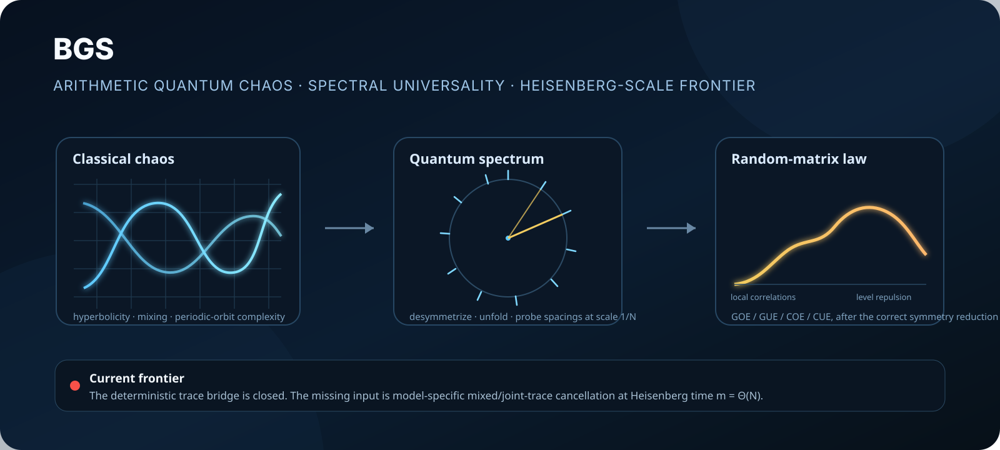
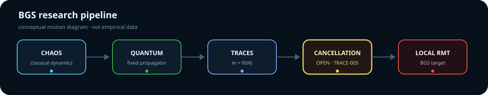
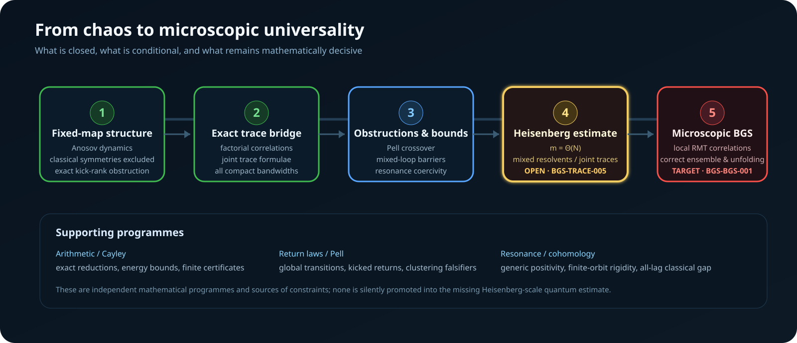
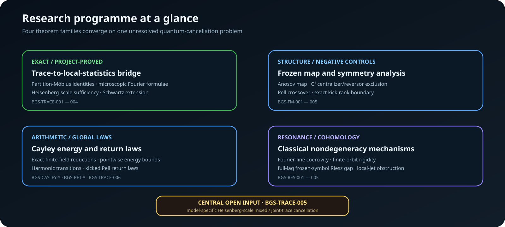
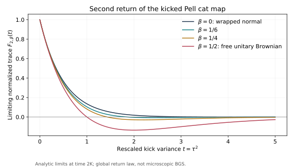

# BGS — Arithmetic Quantum Chaos and Spectral Universality

  

  <strong>A long-term research programme on the Bohigas–Giannoni–Schmit conjecture, arithmetic quantum maps, and the mechanism by which deterministic chaos may produce universal microscopic spectra.</strong>

  <a href="#the-bgs-problem">The problem</a> ·
  <a href="#the-maintained-fixed-map">Fixed map</a> ·
  <a href="#the-exact-trace-bridge">Trace bridge</a> ·
  <a href="#what-has-been-established">Results</a> ·
  <a href="#the-central-open-frontier">Open frontier</a> ·
  <a href="#selected-project-figures">Figures</a> ·
  <a href="#repository-and-reproducibility">Repository</a>

> **Scientific status — 23 September 2026.**  
> The maintained fixed-strength microscopic BGS problem is **open**. The repository contains exact reductions, project proofs, externally sourced theorem inputs with hypothesis maps, formal finite kernels, finite certificates, numerical diagnostics, explicit counterexamples to insufficient proof strategies, and a consolidated research manuscript. None of these is promoted into a full BGS theorem without the missing Heisenberg-scale dynamical estimate.

## Abstract

The **Bohigas–Giannoni–Schmit (BGS) conjecture** predicts that, once ordinary symmetries are removed and the mean density is normalized, quantum systems with chaotic classical dynamics exhibit the same *local* spectral statistics as the appropriate random-matrix ensemble. The prediction is simple to state and notoriously difficult to prove: classical hyperbolicity and mixing are macroscopic dynamical properties, while BGS asks about eigenvalue correlations at the mean-spacing scale, where one must control quantum propagation for times comparable with the Hilbert-space dimension.

This repository develops a rigorous programme around that gap. Its current laboratory is an explicit nonlinear perturbation of a hyperbolic quantum cat map. The programme has already closed the deterministic passage from microscopic correlation functions to weighted products of traces, isolated symmetry and arithmetic obstructions, proved several global return and crossover laws, established new classical resonance/cohomology results, and built exact finite-field/Cayley reductions. The remaining fixed-map bottleneck is now sharply stated: prove **model-specific mixed-resolvent or joint-trace cancellation at Heisenberg time** for the actual frozen propagator.

### Historical origin

The programme takes its name from the 1984 paper by O. Bohigas, M. J. Giannoni, and C. Schmit, [*Characterization of Chaotic Quantum Spectra and Universality of Level Fluctuation Laws*](https://doi.org/10.1103/PhysRevLett.52.1), *Physical Review Letters* **52**, 1–4. Their Sinai-billiard computation exhibited level fluctuations consistent with the Gaussian orthogonal ensemble and crystallized the universality conjecture now associated with BGS. The modern question is not whether such agreement can be observed numerically, but under what hypotheses it can be **proved for deterministic quantum systems** and which symmetry class and unfolding are correct.

For a broader source map — quantum cat maps, semiclassical inputs, arithmetic obstructions, random-matrix characterization theorems, and the exact external results used here — see the maintained [literature bibliography](literature/bibliography.md).

  

Conceptual motion diagram. It summarizes the logical route; it is not numerical evidence.

## The BGS problem

### From classical chaos to quantum spectra

A classical chaotic system stretches and folds phase space, has exponentially proliferating orbit structures, and typically loses detailed memory of initial data. Quantization replaces the classical evolution by an operator acting on a Hilbert space. For an \(N\)-dimensional quantum map one obtains a unitary propagator

\[
U_N\psi_j=e^{i\theta_j}\psi_j,
\]

so the spectrum is a set of eigenphases \(\theta_1,\dots,\theta_N\) on the circle.

BGS asks a much more delicate question than whether the classical system is chaotic: **after desymmetrization and unfolding, do the spacings and higher local correlations of the \(\theta_j\) converge to the universal laws of random matrix theory?**

The relevant random-matrix ensemble is determined by the symmetry class. In a map without an antiunitary/reversing symmetry one expects a unitary-class law; with a suitable time-reversal symmetry the orthogonal class is the natural comparison. A rigorous theorem must fix that symmetry reduction and unfolding *before* taking the limit.

### What “microscopic” means

The average eigenphase spacing is of order \(1/N\). A microscopic statistic therefore zooms into windows of that scale rather than looking only at the global spectral density.

This distinction is essential. A system may have a correct global limiting density, Gaussian moments of selected observables, or convincing finite spacing histograms and still fail the microscopic BGS law. The repository contains exact counterexamples demonstrating several versions of this logical gap.

### Why the conjecture is hard

Classical mixing is not itself a theorem about eigenphase spacings. Semiclassical trace formulae relate dynamics to traces of powers of the propagator, but microscopic spectral tests probe powers all the way out to the **Heisenberg scale**

\[
m=\Theta(N).
\]

Fixed-time Egorov estimates, \(o(N)\)-time trace information, finitely many moments, and global return laws therefore do not close the problem. The central difficulty is a long-time *quantum cancellation mechanism* strong enough to reproduce the target random-matrix joint-trace statistics.

## The maintained fixed map

The principal fixed-family laboratory is

\[
U_N=\exp(i\tau N A_N)\,M_N,
\qquad
\tau=10^{-80},
\]

where \(M_N\) is the quantization of the hyperbolic cat map

\[
S=
\begin{pmatrix}
3&4\\
2&3
\end{pmatrix},
\]

and \(A_N\) is the explicitly maintained quantization of the nonlinear kick symbol.

The value of \(\tau\) is extraordinarily small but **fixed**. This matters: the quantum exponent contains \(\tau N\), so the large-\(N\) regime is not uniformly perturbative. The project therefore distinguishes carefully between shrinking-kick regimes, bounded crossover regimes, logarithmic return times, and the genuine fixed-strength semiclassical limit.

For the actual classical frozen map, the maintained project proof establishes analyticity and Anosov dynamics in the relevant small-coupling range, excludes ordinary \(C^1\) centralizers beyond powers of the map, excludes a \(C^1\) reversor, and excludes the relevant affine \(C^1\) conjugacies. A separate exact result gives the frozen kick generator an eigenvalue-multiplicity bound \(\le \gcd(N,7)\) and the rank inequality

\[
\operatorname{rank}(U_N-zM_N)\ge N-\gcd(N,7)
\]

for the stated odd-dimensional regime. These results remove important classical and low-rank explanations of spectral rigidity, but they do **not** imply long-time trace cancellation.

## The exact trace bridge

One of the central achievements of the programme is that the deterministic “spectral side” of the BGS implication is explicit.

For a unitary \(N\times N\) matrix and a microscopic pair test \(\phi\), the maintained normalization gives

\[
C_{2,N}(U;\phi)
=
\frac{1}{N^2}
\sum_{m\in\mathbb Z}
\widehat{\phi}(m/N)
\left(
|\operatorname{Tr}U^m|^2-N
\right).
\]

Higher factorial correlations are given by exact partition–Möbius sums of products of traces. Thus compact Fourier support at microscopic scale still requires control of powers \(|m|=\Theta(N)\).

This converts an imprecise slogan — “chaos should imply random matrices” — into a concrete theorem strategy:

1. desymmetrize the correct quantum block;
2. prove weighted joint-trace comparison with the target ensemble for every compact Fourier support at Heisenberg scale;
3. use the exact trace bridge to obtain band-limited microscopic correlations;
4. use positivity/occupation bounds to extend every-compact-bandwidth convergence to Schwartz tests;
5. add the separately stated hypotheses needed for the desired point-process or spacing conclusion.

The bridge in steps 3–4 is closed. Step 2 is the central open input.

  

## What has been established

The project is broader than a single proof attempt. Several theorem families have been developed because they either close a necessary layer, identify a genuine obstruction, or rule out a tempting but insufficient route.

  

| Programme | Current contribution | What it buys | Boundary |
|---|---|---|---|
| **Trace bridge** · BGS-TRACE-001–004 | Exact partition–Möbius formulae, microscopic Fourier representation, Heisenberg-scale sufficiency, every-bandwidth Schwartz extension | Reduces microscopic universality to explicit weighted joint traces | Does not provide the dynamical trace estimate |
| **Fixed map** · BGS-FM-001–005 | Symmetry theorem, odd-Pell crossover, moment/transfer controls, conditional three-orientation barrier, exact kick-rank boundary | Removes several structural obstructions and sharply locates the hard fixed-strength regime | The actual \(m=\Theta(N)\) mixed cancellation is unproved |
| **Loop/resolvent route** · BGS-LOOP-001 | Exact low-order identities and a conditional all-order characterization route | Provides an analytic language for the desired local law | Approximate mixed loop equations for the deterministic propagator remain open |
| **Resonance/cohomology** · BGS-RES-001–005 | Fourier-line coercivity, local-jet obstruction, finite-orbit rigidity, full-lag classical Riesz gap for the physical frozen symbol under linear transport | Rules out broad classes of classical degeneracy and identifies what a counterexample would need to exploit | Classical/nonlinear-to-quantum transfer is not automatic |
| **Arithmetic/Cayley** · BGS-CAYLEY-001–005 | Exact fourth-moment reductions, additive-energy formulation, pointwise \(K^{8/3}\)-scale bounds, uniform subgroup-curve bounds, sharp centered target isolated | Gives a deep arithmetic model of collision/energy mechanisms | The centered \(K^{2+o(1)}\) pointwise target is still open and is not equivalent to BGS |
| **Return laws / Pell** · BGS-RET-001–002, BGS-TRACE-006 | Global harmonic transition, actual kicked-propagator return laws, clustered Abel lower bounds and a simple-spectrum Heisenberg-window falsifier | Separates global recurrence information from microscopic universality and supplies exact negative controls | Logarithmic-time/global laws do not determine the Heisenberg-scale local spectrum |

### Recent structural advances

The 23 September continuation adds two particularly sharp fixed-model facts. First, the **full-lag classical resonance bound** for the actual frozen physical symbol controls every positive lag under the linear cat transport, with a singular lower bound at least \(7\pi/2\), stable under the stated weighted-Wiener perturbation ball. Second, the **frozen kick-rank theorem** gives the exact multiplicity/rank boundary above. Together with the earlier finite-orbit rigidity theorem, these results make classical degeneracy and simple low-rank explanations substantially less plausible.

At the same time, BGS-TRACE-006 shows why one must not overinterpret clustering or Abel-transform divergence: there are explicit simple spectra with strong clustering signatures while the positive-time Heisenberg-window form factor tends to zero. The desired mixed estimate must therefore use the actual dynamics of the frozen quantum map.

## What does **not** count as a BGS proof

The repository deliberately keeps several seductive but invalid shortcuts visible because they are reusable lessons:

- finite GOE/CUE-looking histograms are evidence, not an asymptotic theorem;
- global semicircle, Gaussian, wrapped-normal, or free-unitary-Brownian laws do not determine local eigenphase statistics;
- fixed moments and finitely many loop identities do not identify the microscopic point process;
- trace information restricted to \(o(N)\) times is insufficient;
- one orientation of loop equations at one spectral height can vanish for non-CUE spectra;
- clustering, spacing collapse, or Abel divergence alone does not imply the required positive-time form factor;
- classical nondegeneracy is not itself quantum Heisenberg-time cancellation.

These failures are recorded formally in the [retraction/correction record](record/retractions.md) and, where useful, by explicit counterexamples in the mathematical notes.

## The central open frontier

The direct fixed-map bottleneck is the stable claim **BGS-TRACE-005**:

> Prove the correctly desymmetrized weighted Heisenberg-scale joint-trace comparison — or an equivalently strong mixed-resolvent hierarchy — for the actual frozen propagator, uniformly on every compact Fourier support.

In pair form, the desired comparison has the schematic shape

\[
\frac{1}{N^2}
\sum_m
w(m/N)
\left(
|\operatorname{Tr}U_N^m|^2
-
\mathbb E_{\mathrm{RMT}}
|\operatorname{Tr}V_N^m|^2
\right)
\longrightarrow 0,
\]

with the symmetry block, unfolding convention, test class, and target ensemble fixed precisely. Higher correlations require the corresponding joint products of traces.

Closing this estimate, together with the already established deterministic bridge and the remaining point-process hypotheses, would close **BGS-BGS-001** for the maintained fixed model.

### What a successful closure would give

A proof at this frontier would do more than add another asymptotic formula. It would provide:

- a rigorous microscopic random-matrix theorem for an explicit deterministic nonlinear chaotic quantum map;
- a transparent mechanism connecting long-time quantum dynamics to local spectral universality;
- a reusable diagnostic for separating genuine dynamical universality from arithmetic, symmetry, recurrence, and clustering obstructions;
- a template that could be tested on broader classes of chaotic quantizations.

It would **not**, by itself, prove every formulation of the BGS conjecture for every chaotic Hamiltonian. The programme keeps the distinction between a model theorem and the full conjectural landscape explicit.

## Selected project figures

The following are maintained project figures, not decorative illustrations.

  
  

  <strong>Left:</strong> exact clock/dimer pair measures with identical low-frequency data on a fixed band but different microscopic correlations. <strong>Right:</strong> proved analytic second-return limits in the harmonic Pell regime — a global return law, explicitly not a microscopic BGS theorem.

  

  Finite Cayley-trace laws. This maintained figure is explicitly numerical/illustrative; the asymptotic Gaussian theorem has its own stated regime and neither the finite plots nor that full-trace law imply local spectral universality.

## How the pieces fit together

There are two kinds of progress in this repository.

The first kind **closes arrows**: exact trace identities, deterministic extension theorems, symmetry classification, finite-field reductions, or rigorous return laws. These become stable claims with explicit scope.

The second kind **eliminates false arrows**: counterexamples showing that a proposed statistic, time scale, loop orientation, perturbative regime, or classical argument cannot by itself imply BGS. These negative results are treated as part of the scientific output rather than discarded failed work.

That combination is intentional. In a problem where many partial signatures look “random-matrix-like,” the ability to prove that a route is insufficient is nearly as important as proving a new positive estimate.

---

## Repository and reproducibility

The remainder of this README is the operational layer. The scientific narrative above should be readable without knowing the repository layout.

### Recommended reading order

For a mathematical reader or referee:

1. [Current results](mathematics/results.md) — concise theorem index and exact scope.
2. [Open obligations](mathematics/open_questions.md) — the current frontier, especially BGS-TRACE-005.
3. [Trace-to-local-statistics bridge](mathematics/trace_to_local_statistics_bridge.md) — the exact microscopic reduction.
4. [Fixed-map frontier](mathematics/fixed_map_resolvent_frontier.md) — the maintained frozen-model route.
5. [Stable claim registry](record/claim_registry.md) and [dependency graph](record/scientific_dependency_graph.md).
6. [Unified research manuscript](manuscript/BGS_unified.tex).
7. [Literature map](literature/bibliography.md) and [external theorem registry](literature/external_dependencies.json).
8. [Retractions and corrections](record/retractions.md).

### Scientific authority

The repository uses a deliberately strict hierarchy:

- [record/claim_ledger.md](record/claim_ledger.md) is the sole authority for current claim status and scope;
- [record/claims.json](record/claims.json) supplies stable core IDs and cross-links;
- maintained proofs live in [mathematics/](mathematics/README.md);
- external load-bearing theorems are pinned in [literature/external_dependencies.json](literature/external_dependencies.json);
- formalization, computation, evidence, and manuscript text cannot silently strengthen the claim ledger.

The compact authority map is in [SOURCE_OF_TRUTH.md](SOURCE_OF_TRUTH.md).

### Reproducing the maintained verification surface

Start with the fail-closed metadata and structural gates:

~~~sh
python computations/verification/scientific_registry_audit.py
python computations/verification/repository_audit.py
~~~

Then build and execute the maintained Python/C++ verification surface:

~~~sh
python -m pip install -r requirements.txt
cmake -S . -B build/cmake -DCMAKE_BUILD_TYPE=Release
cmake --build build/cmake --parallel

python computations/maintenance/verify_workspace.py \
  --build build/cmake \
  --logs build/verification-logs \
  --output build/workspace-verification.json
~~~

Build the active Lean project:

~~~sh
(cd formalization && lake build)
~~~

Check generated manuscript sections and build the canonical manuscript:

~~~sh
python computations/maintenance/sync_return_sections.py --check
python computations/maintenance/sync_finite_orbit_section.py --check
python computations/maintenance/sync_fixed_map_section.py --check
python computations/maintenance/build_unified_manuscript.py \
  --output-dir build/unified-paper
~~~

See [REPRODUCE_unified.md](REPRODUCE_unified.md) and [environment/runtime-manifest.json](environment/runtime-manifest.json) for the full execution contract.

### Repository map

| Area | Purpose |
|---|---|
| [mathematics/](mathematics/README.md) | Authoritative theorem statements, proofs, reductions, counterexamples, and open questions |
| [manuscript/](manuscript/README.md) | Canonical consolidated research manuscript |
| [papers/](papers/README.md) | Focused publication candidate scopes without duplicated proof authority |
| [literature/](literature/bibliography.md) | Literature boundary and theorem-level external dependencies |
| [formalization/](formalization/README.md) | Lean 4 algebraic kernels and finite certificates |
| [computations/](computations/README.md) | Verification, exact computation, independent implementations, and diagnostics |
| [evidence/](evidence/provenance.md) | Promoted finite certificates, numerical/reference data, and execution provenance |
| [record/](record/README.md) | Claim authority, audits, corrections, research process, and historical decisions |
| [supplement/fixed_map/](supplement/fixed_map/README.md) | Detailed fixed-map derivations and replayable evidence |
| [assets/](assets/) | Maintained figures and README visual material |

### Publication, citation, and review

The canonical long-form programme manuscript is [manuscript/BGS_unified.tex](manuscript/BGS_unified.tex). Focused paper scopes live under [papers/](papers/README.md).

Citation metadata: [CITATION.cff](CITATION.cff)  
Contribution protocol: [CONTRIBUTING.md](CONTRIBUTING.md)  
Referee protocol: [REVIEWING.md](REVIEWING.md)  
Research roadmap: [ROADMAP.md](ROADMAP.md)  
Release policy: [RELEASES.md](RELEASES.md)

### Authorship and scope

Maintainer and manuscript author: **Maksim Churilov**.

This repository does not claim a proof of the general BGS conjecture, external priority for the entire corpus, or independent referee validation of every project theorem. Its purpose is to push a concrete microscopic universality problem as far as possible while making the boundary between proved mathematics, imported theorems, formal/finite verification, numerical evidence, conditional reductions, and open obligations inspectable.
