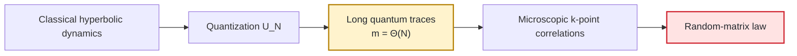
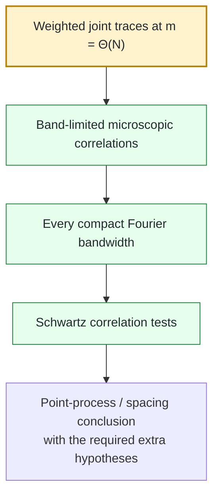

# Bohigas–Giannoni–Schmit programme

### Arithmetic quantum chaos, trace statistics, and microscopic spectral universality

<p align="center">
  <strong>English</strong> · <a href="README.ru.md">Русский</a>
</p>

> **Status — 23 September 2026.** The fixed-strength microscopic BGS statement for the maintained frozen quantum map is **open**. The repository contains project proofs, exact reductions, externally sourced theorem inputs, formal finite kernels, reproducible computations, and explicit counterexamples to insufficient proof strategies. The current status authority is the [claim ledger](record/claim_ledger.md).

The **Bohigas–Giannoni–Schmit (BGS) conjecture** is one of the central universality problems in quantum chaos: after the correct symmetry reduction and unfolding, should a deterministic quantum system with chaotic classical dynamics exhibit the same *local* spectral statistics as the corresponding random-matrix ensemble?

This repository develops that question for an explicit nonlinear perturbation of a hyperbolic quantum cat map. The programme is no longer at the stage of asking vaguely whether the spectrum “looks random”. The deterministic bridge from microscopic correlations to long quantum traces is explicit; several classical, arithmetic, and low-order obstructions have been isolated or eliminated; and the remaining fixed-map bottleneck is now sharply formulated as a **Heisenberg-scale joint-trace / mixed-resolvent estimate**.

| | |
|---|---|
| **Problem** | Prove microscopic random-matrix statistics for an explicit deterministic chaotic quantum map. |
| **What is already closed** | Exact trace-to-correlation identities, every-bandwidth extension, structural fixed-map results, several arithmetic/return/resonance theorems, and explicit negative controls. |
| **Central missing input** | **BGS-TRACE-005**: model-specific cancellation for trace powers $m=\Theta(N)$, or an equivalent mixed-resolvent hierarchy. |
| **Terminal target** | **BGS-BGS-001**: fixed-strength microscopic BGS universality for the maintained frozen map. |

---

## 1. The problem in one page

### Classical chaos

A classical Hamiltonian system or symplectic map may be strongly chaotic: nearby trajectories separate rapidly, stable and unstable directions coexist, and periodic orbits proliferate. For a hyperbolic map, this structure is mathematically explicit.

The guiding question of quantum chaos is what remains of that complexity after quantization.

### Quantization

For an $N$-dimensional quantum map, one step of evolution is represented by a unitary matrix $U_N$. Its eigenvalues lie on the unit circle:

```math
U_N\psi_j=e^{i\theta_j}\psi_j,
\qquad
j=1,\ldots,N.
```

The eigenphases $\theta_j$ form the quantum spectrum.

The average angular spacing is of order $2\pi/N$. BGS is therefore not a statement about the global density of eigenvalues. It concerns what happens after zooming into the **mean-spacing scale**.

A schematic unfolded coordinate is

```math
x_j=\frac{N}{2\pi}\bigl(\theta_j-\theta_0\bigr).
```

The question is whether the local point process formed by the $x_j$ converges to the random-matrix point process dictated by the actual symmetry class.

### Historical origin

BGS originates in the 1984 paper by O. Bohigas, M. J. Giannoni and C. Schmit:

> *Characterization of Chaotic Quantum Spectra and Universality of Level Fluctuation Laws*, Physical Review Letters **52** (1984), 1–4.  
> DOI: [10.1103/PhysRevLett.52.1](https://doi.org/10.1103/PhysRevLett.52.1)

Their computation for a chaotic billiard crystallized the conjectural link between classical chaos and random-matrix level statistics. The modern mathematical task is much sharper: identify a deterministic family, fix the symmetry reduction and unfolding, and prove the microscopic limit.



The highlighted step is the present bottleneck: classical chaos does not automatically provide the required cancellation of quantum traces at times proportional to $N$.

---

## 2. What microscopic universality means

A pair statistic may be written schematically as

```math
\frac{1}{N}
\sum_{j\neq k}
\phi\!\left(
\frac{N}{2\pi}(\theta_j-\theta_k)
\right),
```

with a sufficiently regular test function $\phi$.

Higher correlations probe tuples of distinct unfolded eigenphases. In the unitary symmetry class the local reference process is the sine-kernel/CUE process; other symmetry classes lead to different local limits.

This distinction matters because many much weaker statements can hold without BGS:

- the global empirical spectral measure can converge;
- selected observables can have Gaussian or semicircular limits;
- finitely many moments can agree with a random-matrix model;
- spacing histograms can look convincing at moderate dimension;
- logarithmic-time return laws can be exact;
- clustering statistics can diverge in the “right-looking” direction.

None of these determines the microscopic point process.

---

## 3. Why Heisenberg time is unavoidable

The key mechanism is Fourier duality.

For the maintained pair normalization, the exact trace identity is

```math
C_{2,N}(U;\phi)
=
\frac{1}{N^2}
\sum_{m\in\mathbb Z}
\widehat{\phi}(m/N)
\left(
|\mathrm{Tr}U^m|^2-N
\right).
```

If $\widehat{\phi}$ is supported in a fixed interval $[-c,c]$, then the sum still uses powers

```math
|m|\le cN.
```

So microscopic Fourier support does **not** reduce the problem to short times. It rescales the Fourier mode by $N$.

For Haar unitary matrices $V_N\in U(N)$ the exact second-moment benchmark is

```math
\mathbb E_{\mathrm{CUE}}
\left|\mathrm{Tr}V_N^m\right|^2
=
\min(|m|,N).
```

Therefore a deterministic BGS proof must reproduce the correct weighted trace statistics throughout the **Heisenberg window** $m=\Theta(N)$.

This is the reason fixed-time semiclassics, $O(\log N)$ return laws, and even broad $o(N)$ trace information do not close the microscopic problem.

<p align="center">
  
</p>

*Exact negative control.* Agreement on one fixed Fourier band does not determine the microscopic pair law. This is why the maintained extension theorem requires convergence on every compact bandwidth, not on one selected support.

---

## 4. The maintained frozen model

The principal family is

```math
U_N=\exp(i\tau N A_N)\,M_N,
\qquad
\tau=10^{-80},
```

where $M_N$ quantizes the hyperbolic cat map

```math
S=
\begin{pmatrix}
3&4\\
2&3
\end{pmatrix},
```

and $A_N$ is the maintained Weyl quantization of an explicit nonlinear kick symbol.

The small parameter $\tau$ is **fixed** as $N\to\infty$. That point is essential: the exponent contains $\tau N$, so fixed strength is not a uniformly perturbative large-$N$ regime.

This separates the main problem from shrinking-kick limits such as $\tau_NN\to0$.

### Structural information already available

For the maintained model, the project currently records, in their exact stated scopes:

- an analytic Anosov classical map;
- elimination of ordinary $C^1$ centralizers beyond powers of the map;
- absence of a $C^1$ reversor in the relevant regime;
- exclusion of the relevant affine $C^1$ conjugacies;
- an exact frozen-kick eigenvalue-multiplicity bound;
- a corresponding low-rank obstruction;
- Pell crossover laws and explicit return regimes;
- classical resonance/cohomology coercivity results.

These substantially narrow the space of simple obstructions. They do not, by themselves, control the quantum spectrum at Heisenberg time.

---

## 5. The exact deterministic bridge

The strongest conceptual part of the programme is the exact passage from local spectral observables to trace products.

### Core trace claims

| Claim | Status | Content |
|---|---|---|
| **BGS-TRACE-001** | **proved** | Exact partition–Möbius formula for distinct-index spectral sums |
| **BGS-TRACE-002** | **proved** | Microscopic Fourier representation in terms of quantum traces |
| **BGS-TRACE-003** | **proved** | Heisenberg-scale joint-trace comparison is sufficient for band-limited microscopic RMT correlations |
| **BGS-TRACE-004** | **proved** | Every-compact-bandwidth convergence extends to Schwartz correlation tests |
| **BGS-TRACE-005** | **open** | Model-specific Heisenberg-scale joint-trace / mixed-resolvent estimate |
| **BGS-TRACE-006** | **proved** | Clustered Abel lower bound plus a simple-spectrum Heisenberg-window falsifier |

For higher correlations, partition-lattice Möbius inversion produces constrained products of traces,

```math
\prod_{\nu=1}^{r}\mathrm{Tr}U_N^{m_\nu},
```

with linear relations among the Fourier modes.

Thus the deterministic side of the implication is already explicit:



The first box is the unresolved model-specific input.

---

## 6. Main theorem families

A useful way to read the repository is by theorem family rather than by directory.

| Programme | Current achievement | Logical boundary |
|---|---|---|
| **Frozen map** | symmetry theorem, Pell crossover, exact moment controls, conditional mixed-resolvent barrier, kick-rank boundary | no Heisenberg-time quantum cancellation yet |
| **Trace bridge** | exact finite-$N$ identities and sufficiency theorems | dynamical estimate remains open |
| **Resonance / cohomology** | Fourier-line coercivity, local-jet obstruction, finite-orbit rigidity, full-lag classical Riesz gap | classical nondegeneracy does not automatically imply quantum BGS |
| **Cayley arithmetic** | exact fourth-moment reductions and $K^{8/3}$-scale energy bounds | sharp centered $K^{2+o(1)}$ pointwise target remains open |
| **Pell / return laws** | rigorous global transitions and kicked return laws on arithmetic subsequences | logarithmic/global laws are not microscopic universality |
| **Negative controls** | explicit spectra defeating short-trace, one-bandwidth, one-orientation, clustering, and low-order tests | rule out false proof routes rather than proving BGS |

<details>
<summary><strong>Fixed-map results in more detail</strong></summary>

**BGS-FM-001** proves the maintained classical symmetry theorem in the stated small-coupling range.

**BGS-FM-002** gives the odd-Pell full-symbol Gaussian crossover. Its exact variance is

```math
\sigma^2=\frac{1650797}{4000000}=0.41269925.
```

A necessary escape condition for CUE pair behaviour in that crossover family is

```math
|\epsilon_K|\sqrt K\longrightarrow\infty.
```

The actual frozen scaling eventually lies outside the proved bounded crossover window.

**BGS-FM-003** gives finite-spectrum moment inequalities, a repeated-clock loop-test falsifier, and perturbation-transfer bounds.

**BGS-FM-004** gives a quantitative three-orientation barrier under explicit mixed-residual hypotheses; those hypotheses remain unproved for the actual frozen propagator.

**BGS-FM-005** gives the exact frozen-kick multiplicity/rank boundary, including

```math
\mathrm{rank}(U_N-zM_N)
\ge
N-\gcd(N,7)
```

in the stated odd-dimensional regime.

</details>

<details>
<summary><strong>Arithmetic / Cayley branch</strong></summary>

The fourth-moment problem is reduced to additive energy of a Cayley-transformed subgroup set. The current sharp centered target is

```math
E_+(A)
=
\frac{(K-1)^4}{p}
+
O\!\left(K^{2+o(1)}\right).
```

This is **BGS-CAYLEY-005** and remains open.

A major correction in this branch is conceptual: eliminating every exceptional collision is too strong. The correct target is centered energy control, not zero exceptional collisions.

</details>

<details>
<summary><strong>Resonance / cohomology branch</strong></summary>

The project proves sharp coercivity for Fourier-line observables in the stated ranges, a local polynomial counterexample showing why local jets cannot solve the torus problem, smooth finite-orbit lag independence, and a full-lag uniform classical Riesz gap for the physical frozen symbol under linear cat transport.

The remaining all-observable analytic nondegeneracy problem is **BGS-RES-003**.

These results constrain classical degeneracy mechanisms; they do not replace the missing quantum estimate.

</details>

---

## 7. What has been ruled out

The repository deliberately preserves exact counterexamples to attractive but invalid shortcuts.

| Insufficient route | Why it fails |
|---|---|
| **Finite moments** | spectra can agree on substantial low-order information and differ microscopically |
| **One fixed Fourier bandwidth** | low-frequency agreement does not determine the full local pair law |
| **Short or sub-Heisenberg traces** | microscopic Fourier tests still require modes of order $N$ |
| **Same-half-plane / one-orientation loop identities** | some residuals vanish for every spectrum |
| **Low-order loop equations** | repeated-clock examples can satisfy them without approaching CUE |
| **Global return laws** | global/logarithmic-time information does not determine local eigenphase statistics |
| **Clustering or Abel divergence** | simple spectra can display them while the positive-time Heisenberg-window form factor vanishes |
| **Finite random-matrix-looking histograms** | numerical resemblance is evidence, not an asymptotic theorem |
| **Classical nondegeneracy alone** | a classical Riesz gap does not automatically become quantum trace cancellation |

The permanent scientific correction record is [record/retractions.md](record/retractions.md); the compact reader-facing index is [ERRATA.md](ERRATA.md).

---

## 8. The central open frontier

The current fixed-map bottleneck is **BGS-TRACE-005**:

> **Prove the correctly desymmetrized weighted Heisenberg-scale joint-trace comparison, or an analytically equivalent mixed-resolvent hierarchy, for the actual frozen propagator, uniformly on every compact Fourier support.**

For the pair statistic, the desired comparison has the schematic form

```math
\frac{1}{N^2}
\sum_{m\in\mathbb Z}
w(m/N)
\left[
|\mathrm{Tr}U_N^m|^2
-
\mathbb E_{\mathrm{RMT}}
|\mathrm{Tr}V_N^m|^2
\right]
\longrightarrow 0.
```

Higher correlations require the corresponding constrained joint products.

Two research languages are maintained:

1. **direct joint-trace comparison**;
2. **mixed resolvent / loop hierarchy** strong enough to force the same local law.

The second route is represented conditionally by **BGS-LOOP-001**; its model-specific residual decay is still open.

### Why this is the right bottleneck

The project has already supplied exact examples showing that weaker information can be misleading. The missing estimate must use the **actual frozen quantum dynamics**, not merely the existence of classical chaos, clustering, a global law, or a few identities.

---

## 9. What closing the frontier would give

A proof of **BGS-TRACE-005** in the required scope would make the existing trace bridge operational for the fixed map. After the exact symmetry-block, unfolding, and point-process bookkeeping, it would lead to **BGS-BGS-001**.

That would amount to:

- a rigorous microscopic random-matrix theorem for an explicit deterministic nonlinear chaotic quantum map;
- a concrete mechanism connecting long-time quantum dynamics to local spectral universality;
- a model in which arithmetic returns, nonlinear perturbations, classical resonance, and quantum trace statistics can be tracked within one framework;
- a reusable blueprint for testing universality in other deterministic quantum maps.

It would **not** automatically prove every formulation of the BGS conjecture for every chaotic Hamiltonian. This project distinguishes a strong model theorem from the full universality conjecture.

---

## 10. Selected project figures

The figures below are maintained scientific outputs, not decorative README artwork.

<p align="center">
  
</p>

**Return-law obstruction.** The figure belongs to the maintained return/local-limit analysis. It illustrates why a global or arithmetic return law can constrain — but does not determine — the microscopic local process.

<p align="center">
  
</p>

**Harmonic Pell transition.** This is a genuine project theorem/figure in its stated arithmetic regime. Its scale and observable are global; it is not presented as local BGS evidence.

<p align="center">
  
</p>

**Finite Cayley trace diagnostics.** These numerical distributions are a diagnostic view of the arithmetic branch. The associated asymptotic theorem has a separate precise regime, and neither the finite plot nor the global Gaussian law implies microscopic universality.

---

## 11. Literature and scientific context

The maintained [bibliography](literature/bibliography.md) separates four roles:

- external results used as actual theorem inputs;
- neighbouring literature used for context;
- rigorous BGS-type universality results in other model classes;
- claims whose exact hypotheses have been checked against the project setting.

The machine-readable load-bearing dependencies are in [literature/external_dependencies.json](literature/external_dependencies.json).

The programme is intentionally conservative about transfer. Quantum ergodicity, eigenfunction equidistribution, matrix-element statistics, global trace laws, and universality in quantum graphs or other special models are relevant context, but none is silently promoted into a theorem for the maintained frozen map.

---

## 12. Repository and reproducibility

The scientific narrative above is the front door. Operational information lives here, at the end.

<details>
<summary><strong>Recommended reading order</strong></summary>

1. [Current results](mathematics/results.md)
2. [Open mathematical obligations](mathematics/open_questions.md)
3. [Trace-to-local-statistics bridge](mathematics/trace_to_local_statistics_bridge.md)
4. [Fixed-map resolvent frontier](mathematics/fixed_map_resolvent_frontier.md)
5. [Stable claim registry](record/claim_registry.md)
6. [Scientific dependency graph](record/scientific_dependency_graph.md)
7. [Unified manuscript](manuscript/BGS_unified.tex)
8. [Literature map](literature/bibliography.md)
9. [Retractions / corrections](record/retractions.md)

</details>

<details>
<summary><strong>Source-of-truth hierarchy</strong></summary>

- [record/claim_ledger.md](record/claim_ledger.md) is the sole authority for current claim status and scope.
- [record/claims.json](record/claims.json) assigns stable core IDs and cross-layer links.
- Maintained proof notes live in [mathematics/](mathematics/README.md).
- Load-bearing external theorem inputs are pinned in [literature/external_dependencies.json](literature/external_dependencies.json).
- Formalization, computation, evidence, README prose, and manuscript text cannot strengthen the ledger.

See [SOURCE_OF_TRUTH.md](SOURCE_OF_TRUTH.md).

</details>

<details>
<summary><strong>Reproduce the maintained verification surface</strong></summary>

```sh
python computations/verification/scientific_registry_audit.py
python computations/verification/repository_audit.py

python -m pip install -r requirements.txt
cmake -S . -B build/cmake -DCMAKE_BUILD_TYPE=Release
cmake --build build/cmake --parallel

python computations/maintenance/verify_workspace.py \
  --build build/cmake \
  --logs build/verification-logs \
  --output build/workspace-verification.json

(cd formalization && lake build)

python computations/maintenance/sync_return_sections.py --check
python computations/maintenance/sync_finite_orbit_section.py --check
python computations/maintenance/sync_fixed_map_section.py --check
python computations/maintenance/build_unified_manuscript.py \
  --output-dir build/unified-paper
```

Full contract: [REPRODUCE_unified.md](REPRODUCE_unified.md) and [environment/runtime-manifest.json](environment/runtime-manifest.json).

</details>

<details>
<summary><strong>Repository map</strong></summary>

| Area | Role |
|---|---|
| [mathematics/](mathematics/README.md) | theorem statements, proofs, reductions, counterexamples, open questions |
| [manuscript/](manuscript/README.md) | canonical long-form research manuscript |
| [papers/](papers/README.md) | focused publication candidates without duplicated proof authority |
| [literature/](literature/bibliography.md) | bibliography and theorem-level external dependencies |
| [formalization/](formalization/README.md) | Lean 4 algebraic/finite kernels |
| [computations/](computations/README.md) | verification, independent implementations, numerical diagnostics |
| [evidence/](evidence/provenance.md) | promoted finite/numerical evidence and provenance |
| [record/](record/README.md) | claims, audits, corrections, scientific history, governance |
| [supplement/fixed_map/](supplement/fixed_map/README.md) | detailed fixed-map derivations and replayable evidence |

</details>

<details>
<summary><strong>Publication, citation, and review</strong></summary>

- Canonical manuscript: [manuscript/BGS_unified.tex](manuscript/BGS_unified.tex)
- Focused paper scopes: [papers/](papers/README.md)
- Citation metadata: [CITATION.cff](CITATION.cff)
- Contribution protocol: [CONTRIBUTING.md](CONTRIBUTING.md)
- Referee protocol: [REVIEWING.md](REVIEWING.md)
- Roadmap: [ROADMAP.md](ROADMAP.md)
- Release policy: [RELEASES.md](RELEASES.md)

</details>

---

Maintainer and manuscript author: **Maksim Churilov**.

This repository does not claim a proof of the general BGS conjecture, external priority for the entire corpus, or independent referee validation of every project theorem. Its purpose is to push a concrete microscopic-universality problem as far as possible while making the boundary between proof, external input, formal/finite verification, numerical evidence, conditional reduction, and open obligation explicit.
