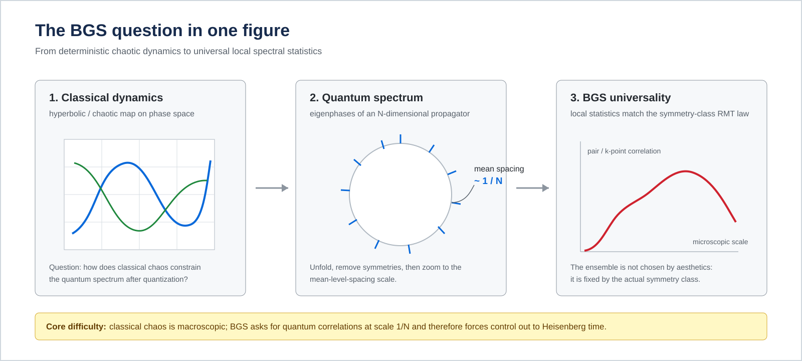
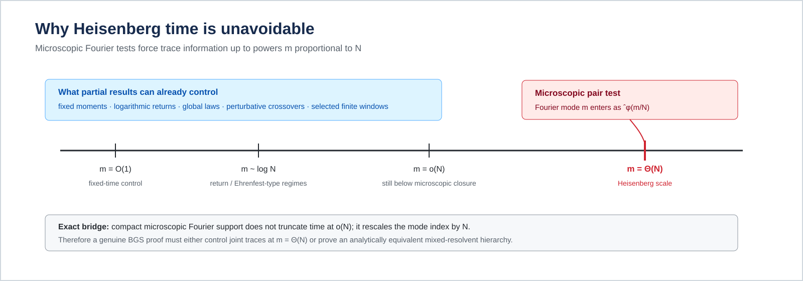
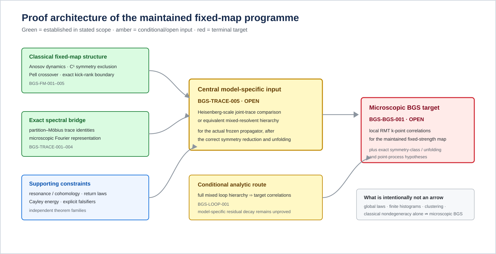

# BGS — Arithmetic Quantum Chaos and Spectral Universality

  <strong>English</strong> · <a href="README.ru.md">Русский</a>

  <strong>A long-term mathematical research programme on the Bohigas–Giannoni–Schmit conjecture, explicit chaotic quantum maps, and the mechanism by which deterministic dynamics may generate universal microscopic spectra.</strong>

> **Current scientific status — 23 September 2026.**  
> The maintained fixed-strength microscopic BGS problem is **OPEN**. The repository contains exact reductions, project proofs in explicitly stated scopes, external-theorem applications with hypothesis maps, finite certificates, formal algebraic kernels, numerical diagnostics, and counterexamples to insufficient proof strategies. None of these is promoted into a full BGS theorem without the missing model-specific Heisenberg-scale quantum estimate.

  

### Abstract

The Bohigas–Giannoni–Schmit conjecture predicts that a quantum system whose classical limit is chaotic should, after removal of ordinary symmetries and suitable unfolding, exhibit the same **local spectral statistics** as the corresponding random-matrix ensemble. The phrase “local” is decisive: the mean level spacing is of order $1/N$, so a microscopic limit probes eigenvalue correlations on a scale that shrinks with the Hilbert-space dimension.

This repository develops a rigorous research programme around that transition. Its principal laboratory is an explicit nonlinear perturbation of a hyperbolic quantum cat map,

$$
U_N=\exp(i\tau N A_N)\,M_N,
\qquad
\tau=10^{-80},
$$

with $\tau$ fixed as $N\to\infty$. The programme has already closed the deterministic passage from microscopic correlation functions to weighted products of quantum traces, established several structural theorems for the frozen map, proved arithmetic return and crossover laws, obtained exact finite-field/Cayley reductions, developed resonance/cohomology obstructions, and constructed explicit falsifiers for several tempting shortcuts.

The unresolved fixed-map input is now sharply isolated:

$$
\boxed{\text{model-specific mixed/joint-trace cancellation for }m=\Theta(N)}
$$

for the actual desymmetrized frozen propagator. This is stable claim **BGS-TRACE-005**. Closing it, together with the already established deterministic bridge and the required symmetry/unfolding hypotheses, would close the maintained fixed-map target **BGS-BGS-001**.

### Status at a glance

| Layer | Status | Precise role |
|---|---|---|
| Deterministic trace bridge | **Established** | Converts microscopic correlation tests into weighted trace products and identifies the Heisenberg-scale requirement |
| Frozen classical map | **Established in stated scope** | Analytic Anosov dynamics; ordinary classical symmetry obstructions substantially reduced |
| Arithmetic / return / resonance branches | **Established in stated scopes** | Supply exact reductions, transition laws, coercive estimates, and falsifiers |
| Full mixed loop hierarchy | **Conditional** | Would characterize the target local law if model-specific mixed residuals were controlled |
| Model-specific Heisenberg estimate | **OPEN** | BGS-TRACE-005 — the central missing quantum input |
| Fixed-map microscopic universality | **OPEN** | BGS-BGS-001 — terminal target for the maintained frozen model |

---

### Contents

1. [The BGS conjecture from first principles](#the-bgs-conjecture-from-first-principles)
2. [What “microscopic universality” means](#what-microscopic-universality-means)
3. [Why Heisenberg time appears](#why-heisenberg-time-appears)
4. [The maintained fixed model](#the-maintained-fixed-model)
5. [The exact trace-to-local-statistics bridge](#the-exact-trace-to-local-statistics-bridge)
6. [What has been established](#what-has-been-established)
7. [What has been ruled out](#what-has-been-ruled-out)
8. [The central open frontier](#the-central-open-frontier)
9. [What a successful closure would mean](#what-a-successful-closure-would-mean)
10. [Selected scientific figures](#selected-scientific-figures)
11. [Repository, verification, and publication](#repository-verification-and-publication)

---

## The BGS conjecture from first principles

### Classical chaos

A deterministic Hamiltonian system or symplectic map may be strongly chaotic: trajectories separate exponentially, stable and unstable directions coexist, periodic orbits proliferate, and long-time classical observables exhibit mixing-like behaviour. For maps, hyperbolicity is particularly clean because one can study iterates of a fixed transformation rather than continuous-time flow.

The classical side of the present programme begins with a hyperbolic toral automorphism and a small nonlinear kick. At the classical level the resulting frozen map remains analytic and Anosov in the stated perturbative range.

Classical chaos, however, is not yet a statement about a quantum spectrum.

### Quantization

For an $N$-dimensional quantum map, the one-step evolution is a unitary operator $U_N$. Its eigenvalues lie on the unit circle,

$$
U_N\psi_j=e^{i\theta_j}\psi_j,
\qquad
j=1,\ldots,N.
$$

The spectral data are therefore the eigenphases

$$
0\le \theta_1,\ldots,\theta_N<2\pi.
$$

At global scale, many very different spectra can look similar. BGS concerns the opposite regime: the scale of a **single mean spacing**.

### Historical origin

The programme takes its name from the 1984 work of O. Bohigas, M. J. Giannoni, and C. Schmit, who observed random-matrix-type level fluctuations in a chaotic quantum billiard and formulated the universality principle now associated with BGS:

> chaotic classical dynamics should lead, after the correct symmetry reduction and unfolding, to universal local quantum spectral statistics of random-matrix type.

The original paper is:

O. Bohigas, M. J. Giannoni, C. Schmit, *Characterization of Chaotic Quantum Spectra and Universality of Level Fluctuation Laws*, Physical Review Letters **52** (1984), 1–4, DOI: [10.1103/PhysRevLett.52.1](https://doi.org/10.1103/PhysRevLett.52.1).

The modern mathematical problem is not to reproduce another convincing histogram. It is to prove the universality limit for a deterministic family while identifying exactly which ensemble, symmetry block, unfolding, time scale, and test class are legitimate.

---

## What microscopic universality means

### Unfolding and mean spacing

On the unit circle the mean angular spacing is approximately $2\pi/N$. After unfolding to unit mean spacing, one studies local configurations such as

$$
x_j=\frac{N}{2\pi}(\theta_j-\theta_0),
$$

modulo the precise centering/unfolding convention.

A microscopic observable sees intervals of length $O(1/N)$ in the original phase variable. That is fundamentally different from a global density theorem.

### Pair and higher correlations

A typical pair statistic can be written schematically as

$$
\frac1N
\sum_{j\ne k}
\phi\!\left(
\frac{N}{2\pi}(\theta_j-\theta_k)
\right),
$$

for a sufficiently regular test function $\phi$.

Higher $k$-point correlations ask whether tuples of distinct unfolded eigenphases converge to the corresponding random-matrix point process.

The target depends on symmetry. In the unitary class the local benchmark is the sine-kernel/CUE family; with an appropriate antiunitary symmetry the orthogonal class is relevant. A rigorous statement must determine the symmetry class from the operator, not choose it retrospectively from a numerical fit.

### Global resemblance is not enough

The following are all strictly weaker than microscopic BGS:

- convergence of the global empirical spectral measure;
- Gaussian or semicircular limits for selected observables;
- finitely many moments;
- a visually convincing spacing histogram at moderate $N$;
- a return law at logarithmic time;
- a cluster or Abel-transform divergence;
- a short-time trace estimate.

The repository contains exact constructions demonstrating several of these failures.

---

## Why Heisenberg time appears

The decisive observation is Fourier duality.

For the maintained pair normalization, the exact identity is

$$
C_{2,N}(U;\phi)
=
\frac{1}{N^2}
\sum_{m\in\mathbb Z}
\widehat{\phi}(m/N)
\left(
|\operatorname{Tr}U^m|^2-N
\right).
$$

If $\widehat{\phi}$ is supported in a fixed compact interval, then $\widehat{\phi}(m/N)$ samples

$$
|m|\le cN.
$$

So even a compactly supported microscopic Fourier test demands information on powers proportional to $N$.

For Haar unitary matrices $V_N\in U(N)$ one has the exact benchmark

$$
\mathbb E\left|\operatorname{Tr}V_N^m\right|^2
=
\min(|m|,N).
$$

Thus the deterministic fixed-map problem is not merely to show that traces are “small”. One needs the **correct weighted joint statistics** over the entire Heisenberg window.

  

This is why fixed-time semiclassics, $m=O(\log N)$ return laws, and even broad $o(N)$ information do not by themselves imply BGS.

---

## The maintained fixed model

The principal laboratory is

$$
U_N=\exp(i\tau N A_N)\,M_N,
\qquad
\tau=10^{-80},
$$

where $M_N$ quantizes the hyperbolic cat map

$$
S=
\begin{pmatrix}
3&4\\
2&3
\end{pmatrix},
$$

and $A_N$ is the maintained Weyl quantization of an explicit nonlinear symbol.

Two features matter immediately.

#### 1. The classical perturbation is tiny but fixed

The parameter $\tau$ does **not** go to zero with $N$. Hence the exponent contains $\tau N$, and the large-$N$ problem is not uniformly perturbative.

This separates the target regime from shrinking-kick asymptotics such as

$$
\tau_N N\to0.
$$

A proof in a vanishing-strength family is informative, but it is not automatically a proof for the frozen model.

#### 2. Arithmetic returns coexist with nonlinear dynamics

The underlying cat map has strong arithmetic structure. Pell-type subsequences produce exact or near returns and therefore create a natural laboratory for testing whether global recurrence signatures genuinely control local statistics.

One major theme of the project is to identify which arithmetic mechanisms are real obstructions and which disappear before the microscopic scale is reached.

---

## The exact trace-to-local-statistics bridge

The deterministic spectral reduction is one of the most mature parts of the programme.

For distinct-index $k$-point sums, partition-lattice Möbius inversion expresses microscopic factorial statistics exactly in terms of products of traces

$$
\operatorname{Tr}U_N^{m_1},
\ldots,
\operatorname{Tr}U_N^{m_r},
$$

with linear constraints among the Fourier modes.

The maintained bridge has four core layers.

#### BGS-TRACE-001 — exact partition–Möbius formula

Distinct-index spectral sums are converted into trace products by an exact finite-$N$ combinatorial identity.

#### BGS-TRACE-002 — microscopic Fourier representation

After unfolding, compact support of the rescaled Fourier transform forces trace powers up to order $N$.

#### BGS-TRACE-003 — Heisenberg-scale sufficiency

If the correctly weighted joint traces of the deterministic propagator match the target random-matrix joint traces on every fixed compact Fourier support, then the corresponding band-limited microscopic correlations converge.

#### BGS-TRACE-004 — extension to Schwartz tests

Under the maintained positivity/normalization hypotheses, convergence on **every** compact Fourier bandwidth extends to Schwartz correlation tests.

The word “every” matters. A single fixed bandwidth is not enough; the repository contains an exact counterexample.

  

---

## What has been established

The current programme is best read as a collection of theorem families with explicit logical boundaries.

### 1. Fixed-map structure

**BGS-FM-001 — frozen-model classical symmetry theorem.**  
For the maintained small-coupling regime, the classical map is analytic and Anosov; the ordinary $C^1$ centralizer is reduced to powers of the map, no $C^1$ reversor survives, and the relevant affine $C^1$ conjugacies are excluded.

**Boundary:** this does not exclude $N$-dependent quantum commutants or prove Heisenberg-time cancellation.

**BGS-FM-002 — odd-Pell full-symbol Gaussian crossover.**  
Along the odd Pell subsequence, the normalized period-average of the full kick symbol has a Gaussian fixed-moment limit, with exact variance

$$
\sigma^2=\frac{1650797}{4000000}=0.41269925.
$$

If the scaled kick parameter satisfies $\epsilon_K\sqrt K\to t$, the normalized recurrence traces have an explicit Gaussian crossover. A necessary condition for CUE pair behaviour is

$$
|\epsilon_K|\sqrt K\to\infty.
$$

**Boundary:** the frozen regime $\epsilon_K=\tau N_K$ eventually lies outside the proved bounded crossover window.

**BGS-FM-003 — exact moment controls and transfer bounds.**  
Finite-spectrum inequalities and repeated-clock falsifiers show that several low-order or one-orientation loop tests can be satisfied by non-CUE spectra.

**BGS-FM-004 — three-orientation mixed-resolvent barrier.**  
Under explicit residual-decay hypotheses, one obtains a quantitative lower barrier for the Abel pair statistic. The theorem is conditional because those residuals have not been controlled for the frozen propagator.

**BGS-FM-005 — exact frozen-kick rank boundary.**  
For odd $N$, the frozen generator has eigenvalue multiplicity at most $\gcd(N,7)$, giving

$$
\operatorname{rank}(U_N-zM_N)\ge N-\gcd(N,7)
$$

in the exact stated regime.

**Boundary:** a rank obstruction is not a local spectral universality theorem.

### 2. Resonance and cohomology

The resonance programme asks whether low variance could come from an underlying classical coboundary or degeneracy.

**BGS-RES-001** proves sharp Fourier-line coercivity in the stated Sobolev classes.

**BGS-RES-002** constructs a local polynomial coboundary obstruction, showing that purely local fixed-point jets cannot settle the global torus problem.

**BGS-RES-004** proves smooth finite-orbit lag independence for finite unions of signed frequency orbits.

**BGS-RES-005** gives a full-lag uniform classical Riesz gap for the actual frozen physical symbol under the linear cat transport, stable under the stated weighted-Wiener perturbation ball.

**Open BGS-RES-003:** the every-observable analytic nondegeneracy problem remains unresolved.

These results make simple classical degeneracy increasingly implausible, but they still do not produce the missing quantum Heisenberg-time estimate.

### 3. Arithmetic and Cayley energy

The arithmetic branch converts fourth-moment problems into finite-field additive-energy questions.

**BGS-CAYLEY-001** gives the pair-key/fourth-moment reduction.

**BGS-CAYLEY-002** turns the mixed term into a Cayley additive-energy problem.

**BGS-CAYLEY-003** and **004** provide pointwise $K^{8/3}$-scale bounds in explicit subgroup/curve regimes using mapped external theorems.

The sharp centered target is

$$
E_+(A)
=
\frac{(K-1)^4}{p}
+
O\!\left(K^{2+o(1)}\right),
$$

recorded as **BGS-CAYLEY-005 — OPEN**.

A major correction in this branch was conceptual: eliminating every exceptional collision is too strong and is not the right objective. Large exceptional primes can coexist with only constant excess energy. The correct target is centered energy control.

### 4. Return laws and Pell regimes

The project proves global spectral/observable laws on explicit arithmetic subsequences.

**BGS-RET-001** gives a harmonic return law for the actual kicked Pell propagator at fixed multiplicity and logarithmic return time.

**BGS-RET-002** gives a harmonic-scale global transition for compressed observables in the fixed Pell cat map.

These are rigorous and interesting, but their time scale is not Heisenberg time.

### 5. Clustered Abel statistics and falsifiers

**BGS-TRACE-006** provides two complementary facts.

First, clustered spectra in sufficiently narrow arcs force a divergent Abel-type statistic.

Second, there are explicit **simple spectra** with the same clustering/Abel divergence while the positive-time form factor tends to zero uniformly on each window

$$
m\in[aN,bN],
\qquad
0<a<b.
$$

Therefore clustering alone cannot be the missing BGS mechanism.

---

## What has been ruled out

This repository treats negative results as first-class research output. Several plausible proof strategies have been shown to be insufficient.

#### Fixed moments are not enough

Two spectra may agree on a long initial range of traces and still have different microscopic pair statistics.

#### A single Fourier bandwidth is not enough

Agreement for one fixed compact support does not imply full Schwartz convergence. The bandlimit must be allowed to grow through an exhaustion argument.

#### One-sided or same-half-plane loop equations are not enough

Some loop residuals vanish identically for every spectrum; only genuinely mixed orientations carry local spectral information.

#### Low-order loop identities are not enough

Explicit repeated-clock spectra can satisfy substantial finite collections of identities without approaching the CUE point process.

#### Global return laws are not enough

Logarithmic-time or harmonic return distributions may be exactly computable while the microscopic spectrum remains undetermined.

#### Finite random-matrix resemblance is not enough

Numerical histograms are useful diagnostics and falsification tools, but they do not establish an asymptotic local law.

#### Classical nondegeneracy is not enough

Even a strong classical Riesz gap does not automatically become quantum trace cancellation at $m=\Theta(N)$.

The permanent correction record is maintained in [record/retractions.md](record/retractions.md) and the reader-facing index in [ERRATA.md](ERRATA.md).

---

## The central open frontier

The direct fixed-map bottleneck is **BGS-TRACE-005**:

> prove the correctly desymmetrized weighted Heisenberg-scale joint-trace comparison, or an analytically equivalent mixed-resolvent hierarchy, for the actual frozen propagator, uniformly on every compact Fourier support.

For the pair statistic, the desired statement is schematically

$$
\frac{1}{N^2}
\sum_{m\in\mathbb Z}
w(m/N)
\left[
|\operatorname{Tr}U_N^m|^2
-
\mathbb E_{\mathrm{RMT}}
|\operatorname{Tr}V_N^m|^2
\right]
\longrightarrow0,
$$

for an appropriate class of compactly supported weights $w$ and the **correct** random-matrix symmetry class.

Higher correlations require the corresponding constrained products

$$
\prod_{\nu=1}^r \operatorname{Tr}U_N^{m_\nu}
$$

with Fourier-mode relations generated by the partition structure.

There are two equivalent research languages currently maintained:

1. **direct joint-trace comparison**;
2. **mixed resolvent / loop hierarchy** strong enough to force the same local law.

The second language is encoded conditionally in **BGS-LOOP-001**. The model-specific residual decay is still open.

---

## What a successful closure would mean

If BGS-TRACE-005 were proved in the required scope, the repository would already contain most of the deterministic machinery needed to pass to microscopic correlations. One would then need to finish the exact symmetry-block, unfolding, and point-process bookkeeping for the target statement BGS-BGS-001.

A successful fixed-map theorem would provide:

- a rigorous local random-matrix law for an explicit deterministic nonlinear chaotic quantum map;
- a transparent mechanism connecting long-time deterministic quantum dynamics with local spectral universality;
- a model where arithmetic returns, nonlinear perturbations, classical resonance, and quantum trace statistics can all be tracked explicitly;
- a reusable framework for distinguishing genuine universality mechanisms from false numerical or global signatures.

It would **not** by itself prove the BGS conjecture for every chaotic Hamiltonian or every quantization. The project deliberately distinguishes a deep model theorem from the universal conjectural landscape.

---

## Selected scientific figures

The figures below come from the maintained computation/exposition layer. Their captions state their actual evidentiary role.

  
  

**Left — exact counterexample.** Two spectral configurations can agree on a prescribed low-frequency band while having different microscopic pair statistics. This is why BGS-TRACE-004 requires every compact bandwidth, not one fixed support.

**Right — analytic return law.** The kicked Pell family has a rigorously controlled logarithmic-time return regime. It is a theorem about return statistics, not a microscopic BGS theorem.

  

**Finite Cayley trace illustration.** This figure is numerical/diagnostic. The asymptotic theorem has its own precisely stated arithmetic regime, and neither the finite plot nor the global Gaussian law implies local spectral universality.

---

## Relation to the broader BGS landscape

The repository is intentionally conservative about scope.

Quantum graphs, special arithmetic maps, semiclassical trace expansions, random band/unitary ensembles, and other model classes provide rigorous BGS-type results or strong analogies in specific settings. Those results are scientifically important, but they do not automatically transfer to the maintained frozen nonlinear cat-map family.

Likewise, classical Anosov dynamics, quantum ergodicity, eigenfunction equidistribution, and matrix-element statistics are related but logically distinct from microscopic eigenphase spacing.

The maintained [literature bibliography](literature/bibliography.md) separates:

- results imported as actual theorem inputs;
- neighbouring literature used for context;
- model-specific universality theorems that do not directly apply here;
- claims whose exact hypotheses have been independently checked.

---

## Repository, verification, and publication

The scientific exposition above is the front door. The rest of the repository is organized to make every serious claim auditable.

### Recommended reading order

1. [Current results](mathematics/results.md) — theorem index and exact scope.
2. [Open obligations](mathematics/open_questions.md) — unresolved mathematical frontier.
3. [Trace-to-local-statistics bridge](mathematics/trace_to_local_statistics_bridge.md).
4. [Fixed-map frontier](mathematics/fixed_map_resolvent_frontier.md).
5. [Core claim registry](record/claim_registry.md).
6. [Scientific dependency graph](record/scientific_dependency_graph.md).
7. [Unified manuscript](manuscript/BGS_unified.tex).
8. [Literature map](literature/bibliography.md).
9. [Retractions and corrections](record/retractions.md).

### Source-of-truth hierarchy

Current status is controlled by [record/claim_ledger.md](record/claim_ledger.md).

The machine-readable [record/claims.json](record/claims.json) assigns stable core IDs and cross-layer links, but cannot strengthen the ledger. Maintained mathematical proofs live under [mathematics/](mathematics/README.md). External load-bearing theorems are pinned in [literature/external_dependencies.json](literature/external_dependencies.json).

Formalization, computations, evidence files, README prose, and the manuscript are subordinate to the current claim ledger.

See [SOURCE_OF_TRUTH.md](SOURCE_OF_TRUTH.md).

### Reproducibility

Start with the cheap fail-closed gates:

~~~sh
python computations/verification/scientific_registry_audit.py
python computations/verification/repository_audit.py
~~~

Build and execute the maintained Python/C++ verification surface:

~~~sh
python -m pip install -r requirements.txt

cmake -S . -B build/cmake -DCMAKE_BUILD_TYPE=Release
cmake --build build/cmake --parallel

python computations/maintenance/verify_workspace.py \
  --build build/cmake \
  --logs build/verification-logs \
  --output build/workspace-verification.json
~~~

Build the Lean project:

~~~sh
(cd formalization && lake build)
~~~

Check generated manuscript sections and build the canonical manuscript:

~~~sh
python computations/maintenance/sync_return_sections.py --check
python computations/maintenance/sync_finite_orbit_section.py --check
python computations/maintenance/sync_fixed_map_section.py --check
python computations/maintenance/build_unified_manuscript.py \
  --output-dir build/unified-paper
~~~

See [REPRODUCE_unified.md](REPRODUCE_unified.md) and [environment/runtime-manifest.json](environment/runtime-manifest.json) for the complete execution contract.

### Repository map

| Area | Purpose |
|---|---|
| [mathematics/](mathematics/README.md) | Authoritative theorem statements, proofs, reductions, counterexamples, open problems |
| [manuscript/](manuscript/README.md) | Canonical consolidated research manuscript |
| [papers/](papers/README.md) | Focused publication candidate scopes without duplicated proof authority |
| [literature/](literature/bibliography.md) | Literature boundary and theorem-level external dependencies |
| [formalization/](formalization/README.md) | Lean 4 algebraic/finite kernels and explicit trust boundary |
| [computations/](computations/README.md) | Exact verification, independent implementations, regressions, diagnostics |
| [evidence/](evidence/provenance.md) | Promoted finite certificates, numerical/reference data, execution provenance |
| [record/](record/README.md) | Claim authority, audits, corrections, research history, governance |
| [supplement/fixed_map/](supplement/fixed_map/README.md) | Detailed fixed-map derivations and replayable evidence |
| [assets/](assets/) | Maintained project figures and README diagrams |

### Publication and review

The long-form programme manuscript is [manuscript/BGS_unified.tex](manuscript/BGS_unified.tex). Focused paper scopes are maintained under [papers/](papers/README.md).

- Citation metadata: [CITATION.cff](CITATION.cff)
- Contribution protocol: [CONTRIBUTING.md](CONTRIBUTING.md)
- Referee protocol: [REVIEWING.md](REVIEWING.md)
- Research roadmap: [ROADMAP.md](ROADMAP.md)
- Release policy: [RELEASES.md](RELEASES.md)

### Authorship and scope

Maintainer and manuscript author: **Maksim Churilov**.

This repository does not claim:

- a proof of the general BGS conjecture for all chaotic systems;
- external priority for the entire project corpus;
- independent referee validation of every project theorem;
- that numerical resemblance is proof;
- that formalized finite kernels cover the analytic BGS problem.

Its purpose is to push a concrete microscopic universality problem as far as possible while keeping the boundary between proof, external input, formal/finite verification, numerical evidence, conditional reduction, and open obligation explicit.
