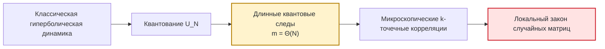
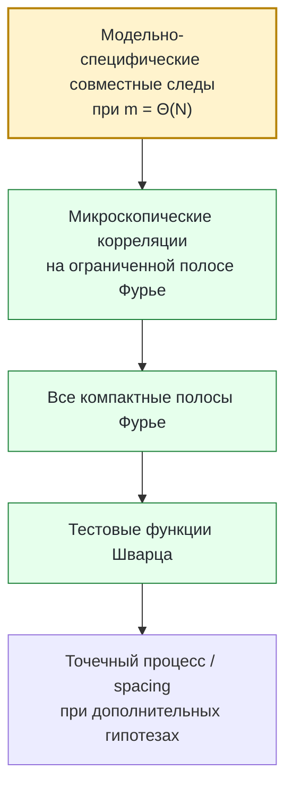
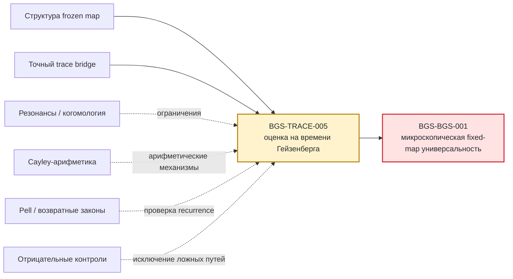

# Программа Бохигаса–Джаннони–Шмита

### Арифметический квантовый хаос, статистика следов и микроскопическая спектральная универсальность

<p align="center">
  <a href="README.md">English</a> · <strong>Русский</strong>
</p>

> **Научный статус — 24 сентября 2026 года.**  
> Микроскопическая BGS-гипотеза при фиксированной силе возмущения для поддерживаемого квантового отображения остаётся **ОТКРЫТОЙ**. В репозитории собраны проектные доказательства, точные редукции, применения внешних теорем с явным сопоставлением гипотез, формализованные конечномерные ядра, воспроизводимые вычисления и точные контрпримеры к недостаточным стратегиям доказательства. Единственный источник текущего статуса утверждений — [реестр статусов](record/claim_ledger.md).

**Гипотеза Бохигаса–Джаннони–Шмита (BGS)** спрашивает, должны ли детерминированные квантовые системы с хаотическим классическим пределом после правильного разложения по симметриям и развёртки спектра обладать универсальной **локальной спектральной статистикой**, описываемой теорией случайных матриц.

Этот репозиторий исследует задачу для явного нелинейного возмущения гиперболического квантового cat map. Его цель — не накапливать вокруг BGS убедительные численные картинки, а разложить проблему на точные математические слои, доказать те части, которые можно закрыть, построить контрпримеры к недостаточным сокращениям и изолировать оставшееся модельно-специфическое препятствие.

| Карточка статьи | Текущая программа |
|---|---|
| **Область** | квантовый хаос · спектральная теория · динамические системы · теория случайных матриц · арифметическая комбинаторика |
| **Классическая система** | нелинейное возмущение гиперболического автоморфизма тора |
| **Квантовое семейство** | конечномерные унитарные пропагаторы $U_N$ |
| **Микроскопический масштаб** | среднее расстояние между собственными фазами $O(N^{-1})$ |
| **Временной масштаб, вынужденный локальными тестами** | время Гейзенберга $m=\Theta(N)$ |
| **Основной random-matrix эталон** | круговая/унитарная статистика после правильного учёта симметрий |
| **Главный открытый вход** | **BGS-TRACE-005** — модельно-специфическое сокращение совместных следов или смешанных резольвент на масштабе Гейзенберга |
| **Конечная fixed-map цель** | **BGS-BGS-001** — микроскопическая универсальность для поддерживаемого frozen-семейства |
| **Источник статуса** | [record/claim_ledger.md](record/claim_ledger.md) |
| **Длинная рукопись** | [manuscript/BGS_unified.tex](manuscript/BGS_unified.tex) |

<details>
<summary><strong>Содержание</strong></summary>

1. Обзор
2. Предыстория: классический хаос, квантование и BGS
3. Математическая формулировка микроскопической универсальности
4. Почему неизбежно время Гейзенберга
5. Поддерживаемая фиксированная квантовая модель
6. Обозначения и масштабы
7. Точный переход от следов к локальной статистике
8. Архитектура исследовательской программы
9. Установленные семейства теорем
10. Отрицательные результаты и исключённые сокращения
11. Главный открытый фронтир
12. Что даст успешное закрытие
13. Доказательства, вычисления, формализация и границы доверия
14. Избранные проектные графики
15. История развития программы
16. Глоссарий
17. Часто задаваемые вопросы
18. Литература и место программы в общей картине BGS
19. Репозиторий и воспроизводимость

</details>

---

## 1. Обзор

Вся программа организована вокруг простой по форме, но глубокой цепочки переходов:



Первые два перехода структурны: классическое отображение задано явно, квантовое семейство тоже задано явно. Последний переход в значительной степени становится детерминированным после получения достаточно сильной информации о следах. Главная трудность — выделенный переход: доказать правильное сокращение и совместную статистику **фактических детерминированных квантовых следов** на временах порядка размерности гильбертова пространства.

### Статус в одном экране

| Слой | Статус | Смысл |
|---|---|---|
| Структура фиксированной классической карты | **установлена в заявленной области** | аналитическая Anosov-динамика; обычные классические симметрийные препятствия существенно сокращены |
| Точные тождества для следов | **доказано** | микроскопические спектральные функционалы переводятся во взвешенные произведения следов |
| Продолжение по всем полосам Фурье | **доказано** | сходимость на всех компактных полосах продолжается на тестовые функции Шварца при заявленных гипотезах |
| Арифметическая / Pell / резонансная ветки | **доказано в заявленных областях** | точные редукции, переходы, оценки коэрцитивности, законы возврата и препятствия |
| Полная mixed-loop иерархия | **условно** | определила бы целевой локальный закон при контроле модельно-специфических смешанных остатков |
| Модельно-специфическая оценка на времени Гейзенберга | **ОТКРЫТО** | **BGS-TRACE-005** |
| Микроскопическая BGS для fixed map | **ОТКРЫТО** | **BGS-BGS-001** |

Проект поэтому **не** заявляет, что BGS решена. Его главный организационный результат — в том, что недостающая импликация теперь сформулирована точно.

---

## 2. Предыстория: классический хаос, квантование и BGS

### Классический хаос

Классическая гамильтонова система или симплектическое отображение может быть хаотическим в нескольких взаимосвязанных смыслах: близкие траектории быстро расходятся, существуют устойчивые и неустойчивые направления, число периодических орбит быстро растёт, а долгосрочная динамика перемешивает информацию по фазовому пространству.

Для равномерно гиперболических систем эти идеи приобретают жёсткую математическую форму. Гиперболический целочисленный автоморфизм тора — канонический пример.

### Квантование

Для $N$-мерного квантового отображения один шаг эволюции задаётся унитарным оператором $U_N$. Его собственные значения лежат на единичной окружности:

```math
U_N\psi_j=e^{i\theta_j}\psi_j,
\qquad
j=1,\ldots,N.
```

Фазы $\theta_j$ образуют квантовый спектр.

На глобальном масштабе очень разные спектры могут выглядеть сходно. BGS интересует противоположный режим — масштаб **одного среднего расстояния между уровнями**.

### Историческое происхождение

Гипотеза получила название по работе О. Бохигаса, М. Джаннони и К. Шмита 1984 года:

> *Characterization of Chaotic Quantum Spectra and Universality of Level Fluctuation Laws*, Physical Review Letters **52** (1984), 1–4.  
> DOI: [10.1103/PhysRevLett.52.1](https://doi.org/10.1103/PhysRevLett.52.1)

Их вычисления для хаотического биллиарда сделали явной предполагаемую связь между классическим хаосом и статистикой уровней случайных матриц.

Современная математическая постановка намного строже, чем вопрос «похожа ли гистограмма на GOE/GUE/CUE?». Доказательство обязано точно задать:

- детерминированное квантовое семейство;
- исследуемый блок симметрии;
- правило развёртки спектра;
- класс локальных тестовых функций;
- сравниваемый ансамбль случайных матриц;
- диапазон времён/степеней следа;
- и точную предельную формулировку.

---

## 3. Математическая формулировка микроскопической универсальности

### Масштаб среднего расстояния

На единичной окружности среднее угловое расстояние имеет порядок $2\pi/N$. Схематическая локальная координата возле фазы $\theta_0$:

```math
x_j
=
\frac{N}{2\pi}
\bigl(\theta_j-\theta_0\bigr).
```

Микроскопическая универсальность относится к предельному точечному процессу, образованному $x_j$ при $N\to\infty$.

### Парная статистика

Типичный парный функционал имеет вид

```math
\frac{1}{N}
\sum_{j\neq k}
\phi\!\left(
\frac{N}{2\pi}(\theta_j-\theta_k)
\right),
```

где $\phi$ — достаточно регулярная тестовая функция.

Парная статистика фиксирует отталкивание уровней и двухточечные корреляции. Высшие $k$-точечные статистики проверяют настоящую многоточечную локальную структуру.

### Класс симметрии

Ансамбль для сравнения определяется симметриями системы, а не визуальным сходством данных.

Для унитарных квантовых отображений без релевантной antiunitary/reversing symmetry естественным эталоном является круговой унитарный ансамбль. Если сохраняется подходящая симметрия обращения времени, возникает orthogonal class.

Поэтому fixed-map программа явно разделяет:

1. **устранение классических симметрий**;
2. **разложение квантового пространства по блокам симметрии**;
3. **сравнение локальной статистики с RMT**.

Теорема не имеет права перепрыгнуть второй шаг.

### Язык точечных процессов

На наиболее сильном уровне требуется сходимость локальных factorial correlation functions либо эквивалентная сходимость точечного процесса при достаточном контроле плотности/occupancy.

Распределение расстояний между соседними уровнями — уже производный объект. Одной корреляции низкого порядка для него в общем случае недостаточно.

---

## 4. Почему неизбежно время Гейзенберга

Центральный структурный факт — двойственность Фурье.

Для принятой в проекте нормировки парного функционала имеется точное конечномерное тождество

```math
C_{2,N}(U;\phi)
=
\frac{1}{N^2}
\sum_{m\in\mathbb Z}
\widehat{\phi}(m/N)
\left(
|\mathrm{Tr}U^m|^2-N
\right).
```

Если $\widehat{\phi}$ поддержана в фиксированном компактном интервале $[-c,c]$, сумма всё равно использует

```math
|m|\le cN.
```

Следовательно, компактная микроскопическая Fourier-support **не** сводит задачу к малым временам. Индекс Фурье масштабируется вместе с $N$.

Для Хаарово-случайной унитарной матрицы $V_N\in U(N)$

```math
\mathbb E_{\mathrm{CUE}}
\left|
\mathrm{Tr}V_N^m
\right|^2
=
\min(|m|,N).
```

Это точный эталон второго момента в унитарном классе.

### Иерархия масштабов

| Масштаб | Типичная информация | Достаточно для микроскопической BGS? |
|---|---|---|
| $m=O(1)$ | fixed-time semiclassics, конечные моменты | **нет** |
| $m=O(\log N)$ | арифметические возвраты, Ehrenfest-type режимы | **нет** |
| $m=o(N)$ | значительная sub-Heisenberg информация | **в общем случае всё ещё нет** |
| $m=\Theta(N)$ | окно Гейзенберга | **вынуждается микроскопическими Fourier-тестами** |
| расстояние $O(N^{-1})$ | локальная статистика собственных фаз | **целевой масштаб** |

Поэтому задача о малом спектральном масштабе одновременно является задачей о длинном квантовом времени.

<p align="center">
  
</p>

**Точный отрицательный контроль.** Одной фиксированной полосы Фурье недостаточно для определения микроскопического парного закона. Поэтому поддерживаемая теорема продолжения требует сходимости на **каждой** компактной полосе.

---

## 5. Поддерживаемая фиксированная квантовая модель

Основное семейство:

```math
U_N
=
\exp(i\tau N A_N)\,M_N,
\qquad
\tau=10^{-80}.
```

Здесь $M_N$ квантует гиперболический cat map

```math
S=
\begin{pmatrix}
3&4\\
2&3
\end{pmatrix},
```

а $A_N$ — зафиксированное в проекте квантование Вейля явного нелинейного kick-symbol.

### Почему чрезвычайно маленькое фиксированное $\tau$ всё равно существенно

Классический параметр возмущения $\tau$ очень мал, но **фиксирован** при $N\to\infty$. В квантовой экспоненте стоит $\tau N$.

Поэтому целевая задача не эквивалентна режиму исчезающей связи, например

```math
\tau_NN\longrightarrow0.
```

По этой причине программа различает:

- weak/shrinking kick;
- ограниченный crossover;
- логарифмические времена возврата;
- и настоящий frozen fixed-strength предел.

### Почему именно cat map?

Эта модель одновременно обладает:

- явной гиперболичностью;
- богатой арифметической структурой;
- конечномерным квантованием;
- точными подпоследовательностями возврата;
- явным переносом Fourier modes;
- и достаточной жёсткостью, чтобы строить контрпримеры к ложным критериям универсальности.

Именно арифметическая структура, делающая модель вычислимой, одновременно создаёт серьёзные препятствия — поэтому это хороший стресс-тест для BGS.

---

## 6. Обозначения и масштабы

| Обозначение | Смысл |
|---|---|
| $N$ | размерность гильбертова пространства / основной semiclassical scale |
| $U_N$ | полный frozen квантовый пропагатор |
| $M_N$ | квантование гиперболического cat map |
| $A_N$ | квантованный генератор нелинейного kick |
| $\tau$ | фиксированная сила kick, в проекте $10^{-80}$ |
| $\theta_j$ | собственные фазы $U_N$ |
| $m$ | индекс времени/степени в $\mathrm{Tr}U_N^m$ |
| $\phi$ | локальная тестовая функция |
| $\widehat{\phi}$ | её преобразование Фурье |
| $V_N$ | random-matrix объект для сравнения |
| $C_{2,N}$ | принятый парный корреляционный функционал |
| $K$ | периодический/Pell-параметр в арифметических ветках |
| $p$ | простое конечного поля в Cayley-ветке |

### Часто используемые выражения

- **microscopic** — масштаб одного среднего расстояния, $O(N^{-1})$;
- **Heisenberg scale** — времена/степени $m=\Theta(N)$;
- **frozen** — сила возмущения фиксирована, а не стремится к нулю вместе с $N$;
- **desymmetrized** — выбран правильный неприводимый блок симметрии;
- **band-limited** — rescaled Fourier transform теста имеет компактный носитель;
- **joint traces** — произведения нескольких следов с ограничениями на индексы Фурье.

---

## 7. Точный переход от следов к локальной статистике

Детерминированная спектральная редукция — одна из наиболее зрелых частей программы.

### Базовые trace claims

| Claim | Статус | Содержание |
|---|---|---|
| **BGS-TRACE-001** | **доказано** | точная формула Мёбиуса по решётке разбиений для спектральных сумм по различным индексам |
| **BGS-TRACE-002** | **доказано** | микроскопическое представление Фурье через квантовые следы |
| **BGS-TRACE-003** | **доказано** | сравнения совместных следов на масштабе Гейзенберга достаточно для band-limited RMT-корреляций |
| **BGS-TRACE-004** | **доказано** | сходимость на всех компактных полосах продолжается на тестовые функции Шварца |
| **BGS-TRACE-005** | **открыто** | модельно-специфическая оценка совместных следов / смешанных резольвент на масштабе Гейзенберга |
| **BGS-TRACE-006** | **доказано** | Abel-нижняя оценка для кластеров и простой контрпример на Heisenberg window |

Для высших корреляций обращение Мёбиуса по решётке разбиений приводит к ограниченным произведениям

```math
\prod_{\nu=1}^{r}
\mathrm{Tr}U_N^{m_\nu},
```

с линейными соотношениями между индексами $m_\nu$.

Логическая схема выглядит так:



Первый блок — текущий модельно-специфический разрыв.

---

## 8. Архитектура исследовательской программы

Несколько веток существуют потому, что BGS может давать ложные сигналы или ломаться по разным причинам.



Эти ветки **не** считаются одним линейным доказательством. Некоторые дают прямые prerequisites, другие — независимые теоремы, screening препятствий или контрпримеры против overclaiming.

---

## 9. Установленные семейства теорем

### 9.1 Структура фиксированной модели

**BGS-FM-001 — теорема о классических симметриях.**  
В заявленном диапазоне малой связи классическая карта аналитична и Anosov; обычный $C^1$ centralizer сводится к степеням карты, исключён $C^1$ reversor, исключены соответствующие affine $C^1$ conjugacies.

**Граница:** это не исключает все возможные $N$-зависимые квантовые коммутанты и не даёт Heisenberg-scale trace cancellation.

**BGS-FM-002 — full-symbol crossover на odd-Pell подпоследовательности.**  
Нормированное period-average имеет Gaussian fixed-moment limit с точной дисперсией

```math
\sigma^2
=
\frac{1650797}{4000000}
=
0.41269925.
```

Необходимое условие выхода к CUE-поведению парной статистики в доказанном crossover family:

```math
|\epsilon_K|\sqrt K
\longrightarrow\infty.
```

Фактический frozen scaling в конечном счёте выходит за область bounded crossover theorem.

**BGS-FM-003 — moment controls и transfer bounds.**  
Точные конечномерные неравенства и repeated-clock constructions показывают недостаточность нескольких low-order loop tests.

**BGS-FM-004 — three-orientation mixed-resolvent barrier.**  
При явных mixed-residual hypotheses получается количественный lower barrier.

**Граница:** сами residual estimates пока не доказаны для фактического frozen propagator.

**BGS-FM-005 — frozen-kick rank boundary.**  
В заявленном нечётномерном режиме

```math
\mathrm{rank}(U_N-zM_N)
\ge
N-\gcd(N,7).
```

Это исключает широкий класс простых низкоранговых объяснений спектральной структуры.

**BGS-FM-006 — граница нелинейного давления для скобок.**
Нормировка физических наблюдаемых, дающая равномерную оценку для линейной
карты на всех временах, не даёт такой верхней оценки для реальной
нелинейной карты; см. [доказательство и предпосылки](mathematics/nonlinear_bracket_pressure.md).

**BGS-FM-007 — редукция с семью разрезами при исходной фиксированной связи.**
Удаление семи малых рёбер из *генератора* Якоби даёт полный пропагатор
$V_N$ с $\|U_N-V_N\|_1=O(\tau/N)$. Для $U_N$ и $V_N$ эквивалентны
микроскопические синус-ядерные пределы каждого фиксированного порядка;
разница парных и абелевых статистик составляет $O(\tau/\log N)$ без
предположения об универсальности. Полный $V_N$ по-прежнему связывает
все семь путей; см. [доказательство](mathematics/frozen_seven_cut_reduction.md).

**BGS-FM-008 и BGS-FM-009 — качественная спектральная жёсткость.**
При нечётном $7\nmid N$ [доказательство для алгебраического
времени](mathematics/frozen_algebraic_spectral_simplicity.md) даёт простой
спектр и исключает точные совпадения степеней собственных значений.
[Целочисленный сертификат](mathematics/frozen_common_antireversor_certificate.md)
исключает *общий* антиунитарный реверсор пары $(A_N,M_N)$ при нечётном
$N\ne7$. Ни одно из этих утверждений не даёт равномерной оценки зазоров
между фазами либо оценок следов на временах порядка $N$. Точные границы
и проверки изложены в [рецензии на представленную статью](record/submitted_article_review_20260924.md).

**BGS-FM-010 и BGS-FM-011 — точные следы и оценка зазора.**
[Теорема об арифметике следов](mathematics/frozen_arithmetic_trace_rigidity.md)
доказывает $\operatorname{Tr}U_N^m\ne0$ для всех нечётных $N$ и
положительных $m$; скалярная степень возникает только при $N=7$.
[Эффективная оценка зазора](mathematics/frozen_effective_gap_floor.md)
при $7\nmid N$ положительна, но несравнимо слабее масштаба среднего
расстояния между фазами. Верхние оценки следов и парный предел BGS
остаются открытыми. В [рецензии на два следующих текста](record/two_continuations_review_20260924.md)
отмечены повторы прежних результатов и отсутствие упомянутого в
материалах альтернативного вычислительного сертификата.

---

### 9.2 Резонансы и когомология

Резонансная ветка спрашивает, не может ли кажущаяся случайность разрушаться из-за того, что наблюдаемая почти является классическим coboundary.

Ключевые результаты:

- sharp Fourier-line coercivity;
- local-jet obstruction, показывающий недостаточность чисто локальных аргументов;
- finite-orbit resonance rigidity;
- full-lag classical Riesz gap для физического frozen symbol под линейным transport.

Открытая every-observable analytic nondegeneracy problem — **BGS-RES-003**.

**Граница:** классическая недегенеративность сама по себе не является quantum Heisenberg-time theorem.

---

### 9.3 Арифметика и Cayley energy

Арифметическая ветка переводит задачи четвёртого момента в конечнополевые задачи об аддитивной энергии.

Текущая точная центрированная цель:

```math
E_+(A)
=
\frac{(K-1)^4}{p}
+
O\!\left(K^{2+o(1)}\right),
```

записана как **BGS-CAYLEY-005 — OPEN**.

В этой ветке уже зафиксирована важная концептуальная коррекция: требование устранить каждое exceptional collision — неправильная и слишком сильная цель. Большие exceptional primes могут сосуществовать лишь с константным excess energy. Правильная задача — centered energy control.

---

### 9.4 Pell и законы возврата

Проект доказывает явные глобальные законы на арифметических подпоследовательностях, включая:

- harmonic-scale observable transitions;
- kicked Pell propagator returns;
- логарифмические recurrence formulas.

Это строгие глобальные теоремы, но их временной масштаб отличается от микроскопической BGS.

---

### 9.5 Clustered Abel statistics

**BGS-TRACE-006** объединяет два взаимодополняющих факта:

1. достаточно сильная спектральная кластеризация заставляет расходиться Abel-type statistic;
2. существуют явные **простые спектры** с аналогичной кластеризацией, но их positive-time Heisenberg-window form factor стремится к нулю.

Следовательно, кластеризация — полезная диагностика, но не замена недостающей динамической оценке.

---

## 10. Отрицательные результаты и исключённые сокращения

Один из принципов репозитория: опровергнутый путь доказательства остаётся научной информацией и не должен исчезать после исправления.

| Заманчивое сокращение | Почему недостаточно |
|---|---|
| **Конечное число моментов** | спектры могут совпадать по многим низким порядкам и различаться микроскопически |
| **Одна компактная полоса Фурье** | fixed-band agreement не определяет полную локальную корреляцию |
| **Короткие следы** | microscopic Fourier tests требуют $m=\Theta(N)$ |
| **Sub-Heisenberg traces** | даже широкий контроль при $o(N)$ в общем случае не определяет локальный point process |
| **Одна loop orientation** | часть residuals тождественно исчезает для любого спектра |
| **Low-order loop equations** | repeated-clock examples удовлетворяют значительным конечным системам без перехода к CUE |
| **Глобальные законы возврата** | logarithmic/global recurrence не определяет local spacing |
| **Одна кластеризация** | clustered simple spectra могут иметь неправильный Heisenberg-window form factor |
| **Красивые finite-$N$ RMT-гистограммы** | численное сходство — evidence, а не asymptotic theorem |
| **Одна классическая недегенеративность** | classical Riesz gap не превращается автоматически в quantum trace cancellation |
| **Устранение всех арифметических исключений** | слишком сильная цель; правильный объект — centered energy |

Постоянный журнал исправлений: [record/retractions.md](record/retractions.md). Компактный читательский индекс: [ERRATA.md](ERRATA.md).

---

## 11. Главный открытый фронтир

Прямой bottleneck fixed-map программы — **BGS-TRACE-005**:

> **Доказать взвешенное сравнение совместных следов после правильного разложения по симметриям на масштабе Гейзенберга — либо аналитически эквивалентную иерархию смешанных резольвент — для фактического frozen propagator, равномерно на каждом компактном носителе преобразования Фурье.**

Для парной статистики желаемое сравнение имеет схематический вид

```math
\frac{1}{N^2}
\sum_{m\in\mathbb Z}
w(m/N)
\left[
|\mathrm{Tr}U_N^m|^2
-
\mathbb E_{\mathrm{RMT}}
|\mathrm{Tr}V_N^m|^2
\right]
\longrightarrow0.
```

Высшие корреляции требуют соответствующих constrained joint products.

### Два поддерживаемых языка одного фронтира

**Прямой язык следов**

Доказать weighted joint-trace comparison с целевым ensemble на каждой компактной microscopic Fourier support.

**Язык резольвент / loop equations**

Доказать all-order иерархию действительно mixed resolvent residuals, достаточно сильную для идентификации того же локального процесса.

Второй путь условно кодируется claim **BGS-LOOP-001**.

### Почему именно это — правильный bottleneck

В репозитории уже есть точные примеры, показывающие, что более слабые признаки могут вводить в заблуждение. Поэтому финальная оценка обязана использовать **фактическую frozen quantum dynamics**, а не только:

- классический хаос;
- глобальные законы возврата;
- арифметические mixing heuristics;
- low-order identities;
- кластеризацию;
- или finite random-matrix resemblance.

---

## 12. Что даст успешное закрытие

Доказательство **BGS-TRACE-005** в требуемой области сделает существующий детерминированный trace bridge рабочим для fixed map.

После точного учёта symmetry block, unfolding и point-process bookkeeping это приведёт к **BGS-BGS-001**.

Успешная fixed-map theorem даст:

- строгий микроскопический random-matrix law для явного детерминированного нелинейного хаотического квантового отображения;
- конкретный механизм связи длинновременной детерминированной квантовой динамики с локальной спектральной универсальностью;
- модель, в которой в одной системе отслеживаются арифметические возвраты, нелинейное возмущение, классические резонансы и quantum trace statistics;
- переносимую архитектуру для проверки BGS-type universality в других детерминированных quantum maps.

Это **не** станет автоматически доказательством всех формулировок BGS для каждого хаотического гамильтониана и любого квантования. Программа принципиально различает сильную модельную теорему и полную universality conjecture.

---

## 13. Доказательства, вычисления, формализация и границы доверия

Разные слои репозитория отвечают на разные научные вопросы.

| Слой | Что может установить | Чего не устанавливает сам по себе |
|---|---|---|
| **Математическая proof note** | теорему при заявленных гипотезах | внешнюю рецензию или более широкий scope |
| **Импортированная внешняя теорема** | корректную импликацию после проверки гипотез | применимость без hypothesis map |
| **Lean kernel / finite certificate** | формализованное алгебраическое или конечномерное утверждение | весь аналитический BGS-аргумент, если он не формализован |
| **Exact computation** | конечное тождество / конечномерную проверку | асимптотическую теорему без отдельного доказательства |
| **Numerical experiment** | evidence, диагностику, falsification | universality theorem |
| **Regression test** | стабильность реализации и evidence files | математическую истинность недоказанной теоремы |
| **Manuscript exposition** | связное изложение | независимый status authority |
| **Claim ledger** | текущий статус/границы claims | доказательство само по себе |

### Словарь статусов

- **proved** — имеется поддерживаемое проектное доказательство в заявленной области;
- **conditional** — импликация доказана при явных гипотезах, ещё не установленных для целевой модели;
- **open** — нерешённое математическое обязательство;
- **verification-pending** — source есть, но текущий verification contract неполон;
- **retracted/superseded** — сохранено для provenance, но не входит в текущую поверхность утверждений.

Слово “proved” здесь означает **доказано в поддерживаемой аргументации репозитория**, а не “независимо отрецензировано и опубликовано”, если это не указано отдельно.

---

## 14. Избранные проектные графики

Ниже — научные outputs проекта, а не декоративные изображения README.

<p align="center">
  
</p>

**Препятствие из возвратных законов.** Глобальная или арифметическая recurrence information ограничивает спектр, но не определяет микроскопический point process.

<p align="center">
  
</p>

**Harmonic Pell transition.** Строгий проектный результат в заявленном арифметическом режиме. Масштаб и observable здесь глобальны, не микроскопичны.

<p align="center">
  
</p>

**Finite Cayley trace diagnostics.** Численные evidence для арифметической ветки. Ни finite plot, ни глобальный Gaussian law не дают локальную universality.

---

## 15. История развития программы

Репозиторий сохраняет датированные исследовательские записи, а не переписывает историю после каждого исправления.

Избранные milestones:

| Дата | Зафиксированное развитие |
|---|---|
| **4–8 сентября 2026** | frontier passes, литературные проверки, referee-style audits, консолидация claims |
| **9–13 сентября 2026** | Cayley trace review, Pell harmonic transition/return reviews, return obstruction и local-limit analysis |
| **16–20 сентября 2026** | fixed-map attachment audit, recovery audit, fixed-map publication pass |
| **21 сентября 2026** | сводный research handoff; microscopic BGS при фиксированной силе остаётся открытой |
| **22 сентября 2026** | finite-orbit resonance audits и Abel-window research pass |
| **23 сентября 2026** | frozen full-lag resonance review, frozen kick-rank review, общая научная консолидация репозитория |

Основные записи:

- [record/final_research_handoff_20260921.md](record/final_research_handoff_20260921.md)
- [record/finite_orbit_proof_audit_20260922.md](record/finite_orbit_proof_audit_20260922.md)
- [record/abel_window_research_20260922.md](record/abel_window_research_20260922.md)
- [record/frozen_full_lag_review_20260923.md](record/frozen_full_lag_review_20260923.md)
- [record/frozen_rank_review_20260923.md](record/frozen_rank_review_20260923.md)
- [record/history/2026/repository_hygiene_20260923.md](record/history/2026/repository_hygiene_20260923.md)

[Журнал ретракций](record/retractions.md) не менее важен: ложные или superseded routes сохраняются, а не удаляются молча.

---

## 16. Глоссарий

| Термин | Значение в этом репозитории |
|---|---|
| **Anosov map** | равномерно гиперболическая классическая динамическая система |
| **BGS** | гипотеза универсальности Бохигаса–Джаннони–Шмита |
| **CUE** | круговой унитарный ансамбль, основной random-matrix benchmark для унитарных спектров |
| **desymmetrization** | выделение правильного symmetry block до сравнения спектров |
| **unfolding** | нормировка локальной средней плотности уровней к единице |
| **microscopic scale** | масштаб одного среднего расстояния, $O(N^{-1})$ |
| **Heisenberg time** | квантовое время/индекс следа порядка $N$ |
| **trace form factor** | статистика, построенная из $|\mathrm{Tr}U_N^m|^2$ |
| **mixed resolvent** | резольвентное выражение, связывающее противоположные аналитические ориентации и способное нести локальную спектральную информацию |
| **loop equation** | алгебраическое/аналитическое тождество для резольвентных observables |
| **Pell subsequence** | арифметическая подпоследовательность с особенно явной return structure cat map |
| **Cayley energy** | additive-energy problem после преобразования Кэли в арифметической ветке четвёртого момента |
| **Riesz gap** | coercive lower bound, препятствующая линейной дегенерации семейства классических сдвигов |
| **falsifier / negative control** | явный пример, показывающий недостаточность предложенного критерия |

---

## 17. Часто задаваемые вопросы

### Решена ли BGS в этом репозитории?

**Нет.** Fixed-strength microscopic claim **BGS-BGS-001** остаётся открытым.

### Какая одна теорема сейчас важнее всего?

**BGS-TRACE-005**: модельно-специфическое сравнение совместных следов на масштабе Гейзенберга или эквивалентная смешанная резольвентная оценка для фактического frozen propagator.

### Почему $\tau=10^{-80}$ нельзя считать просто нулём?

Потому что $\tau$ фиксировано, а $N$ растёт. В квантовой экспоненте стоит $\tau N$, поэтому асимптотическая задача в конечном счёте выходит из любого uniformly perturbative режима, основанного лишь на малости числа $\tau$.

### Почему нельзя решить задачу одной большой численной серией?

Конечные спектры могут выглядеть random-matrix-like по причинам, не переживающим предел $N\to\infty$. Численные experiments отлично подходят для falsification и diagnostics, но не заменяют uniform asymptotic theorem.

### Зачем брать cat map, если он арифметический?

Потому что он одновременно явный, гиперболический, квантуемый и арифметически структурированный. Универсальные механизмы и препятствия здесь можно видеть явно, а не скрывать в black-box dynamics.

### Почему так много побочных направлений?

Потому что разные ложные маршруты ломаются по разным причинам. Arithmetic energy, return laws, resonance, symmetry и resolvent identities тестируют разные потенциальные препятствия.

### Следует ли BGS из classical mixing?

Нет. Недостающая информация — квантовое сокращение на Heisenberg scale.

### Достаточно ли совпадения $\mathbb E|\mathrm{Tr}V_N^m|^2$ для нескольких $m$?

Нет. Микроскопические тесты требуют взвешенного семейства степеней вплоть до $m=\Theta(N)$, а высшие корреляции требуют joint products.

### Что здесь будет считаться настоящим прорывом?

Доказательство, закрывающее **BGS-TRACE-005** для фактической frozen model с правильным symmetry block и uniformity, достаточной для точного trace bridge.

---

## 18. Литература и место программы в общей картине BGS

Поддерживаемая [библиография](literature/bibliography.md) разделяет несколько ролей:

1. внешние результаты, реально импортируемые в доказательства;
2. соседнюю литературу для интерпретации;
3. строгие BGS-type universality theorems в других модельных классах;
4. source checks, использованные для проверки гипотез теорем или публикационных данных.

Важные разграничения:

- quantum ergodicity не равна microscopic eigenphase universality;
- equidistribution eigenfunctions не является spacing theorem;
- matrix-element fluctuations не являются local eigenvalue statistics;
- universality theorems для quantum graphs — настоящие BGS-type результаты в своём классе, но не переносятся автоматически на smooth/arithmetic quantum maps;
- semiclassical trace expansions до Heisenberg time не закрывают fixed-map problem автоматически.

Load-bearing external dependencies зафиксированы в [literature/external_dependencies.json](literature/external_dependencies.json).

---

## 19. Репозиторий и воспроизводимость

Научная часть выше должна читаться как самостоятельная wiki-страница. Операционная информация собрана здесь.

<details>
<summary><strong>Рекомендуемый порядок чтения</strong></summary>

1. [Текущие результаты](mathematics/results.md)
2. [Открытые математические обязательства](mathematics/open_questions.md)
3. [Trace-to-local-statistics bridge](mathematics/trace_to_local_statistics_bridge.md)
4. [Fixed-map resolvent frontier](mathematics/fixed_map_resolvent_frontier.md)
5. [Stable claim registry](record/claim_registry.md)
6. [Scientific dependency graph](record/scientific_dependency_graph.md)
7. [Unified manuscript](manuscript/BGS_unified.tex)
8. [Literature map](literature/bibliography.md)
9. [Retractions and corrections](record/retractions.md)

</details>

<details>
<summary><strong>Иерархия источников истины</strong></summary>

- [record/claim_ledger.md](record/claim_ledger.md) — единственный источник текущего статуса и scope claims;
- [record/claims.json](record/claims.json) задаёт стабильные core IDs и межслойные ссылки;
- поддерживаемые proof notes находятся в [mathematics/](mathematics/README.md);
- внешние load-bearing theorem inputs зафиксированы в [literature/external_dependencies.json](literature/external_dependencies.json);
- formalization, computation, evidence, README и manuscript не могут молча усиливать claim ledger.

Краткая схема: [SOURCE_OF_TRUTH.md](SOURCE_OF_TRUTH.md).

</details>

<details>
<summary><strong>Воспроизвести поддерживаемую поверхность проверок</strong></summary>

```sh
python computations/verification/scientific_registry_audit.py
python computations/verification/repository_audit.py

python -m pip install -r requirements.txt

cmake -S . -B build/cmake -DCMAKE_BUILD_TYPE=Release
cmake --build build/cmake --parallel

python computations/maintenance/verify_workspace.py \
  --build build/cmake \
  --logs build/verification-logs \
  --output build/workspace-verification.json

(cd formalization && lake build)

python computations/maintenance/sync_return_sections.py --check
python computations/maintenance/sync_finite_orbit_section.py --check
python computations/maintenance/sync_fixed_map_section.py --check
python computations/maintenance/build_unified_manuscript.py \
  --output-dir build/unified-paper
```

Полный execution contract: [REPRODUCE_unified.md](REPRODUCE_unified.md) и [environment/runtime-manifest.json](environment/runtime-manifest.json).

</details>

<details>
<summary><strong>Карта репозитория</strong></summary>

| Раздел | Назначение |
|---|---|
| [mathematics/](mathematics/README.md) | формулировки теорем, доказательства, редукции, контрпримеры, открытые задачи |
| [manuscript/](manuscript/README.md) | каноническая длинная исследовательская рукопись |
| [papers/](papers/README.md) | сфокусированные кандидаты публикаций без дублирования proof authority |
| [literature/](literature/bibliography.md) | библиография и theorem-level external dependencies |
| [formalization/](formalization/README.md) | Lean 4 algebraic/finite kernels |
| [computations/](computations/README.md) | verification, независимые реализации, numerical diagnostics |
| [evidence/](evidence/provenance.md) | отобранные finite/numerical evidence и provenance |
| [record/](record/README.md) | claims, audits, corrections, scientific history, governance |
| [supplement/fixed_map/](supplement/fixed_map/README.md) | детальные fixed-map derivations и replayable evidence |

</details>

<details>
<summary><strong>Публикации, цитирование и review</strong></summary>

- Каноническая рукопись: [manuscript/BGS_unified.tex](manuscript/BGS_unified.tex)
- Сфокусированные paper scopes: [papers/](papers/README.md)
- Метаданные цитирования: [CITATION.cff](CITATION.cff)
- Протокол внесения изменений: [CONTRIBUTING.md](CONTRIBUTING.md)
- Протокол рецензирования: [REVIEWING.md](REVIEWING.md)
- Дорожная карта: [ROADMAP.md](ROADMAP.md)
- Политика выпусков: [RELEASES.md](RELEASES.md)

</details>

---

Сопровождение репозитория и автор рукописи: **Maksim Churilov**.

Репозиторий не заявляет доказательство общей гипотезы BGS для всех хаотических систем, внешний приоритет на весь корпус или независимую referee validation каждой проектной теоремы. Его цель — максимально продвинуть конкретную задачу микроскопической универсальности, оставляя явной границу между доказательством, внешним theorem input, formal/finite verification, numerical evidence, conditional reduction и открытым mathematical obligation.
