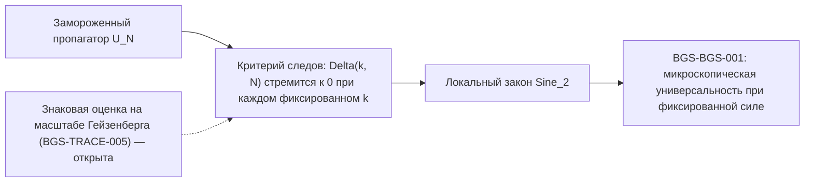
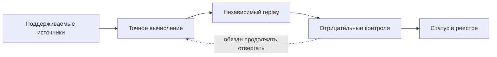

# BGS — квантовый хаос и универсальность спектральной статистики

[English](README.md) · [Научный обзор](RESEARCH.md) · [Карта корпуса](docs/corpus_atlas.md) · [Математическое введение](docs/reader_guide.ru.md) · [Указатель теорем](mathematics/results.md) · [Открытые задачи](mathematics/open_questions.md) · [Полная рукопись](manuscript/README.md) · [Руководство по воспроизведению](REPRODUCE_unified.md)

**Гипотеза Бохигаса — Джаннони — Шмита** — одна из центральных проблем квантового хаоса: почему при надлежащих динамических и симметрийных условиях микроскопическая статистика энергетических уровней детерминированных хаотических систем должна согласовываться с теорией случайных матриц? Репозиторий содержит точные результаты, контрпримеры и воспроизводимые проверки, прежде всего для одного строго фиксированного квантового отображения тора. Это продолжающаяся исследовательская программа — совокупность доказанных редукций, точных конечных вычислений, условных теорем и точно сформулированных открытых обязательств, — а не утверждение, что гипотеза решена.

> [!IMPORTANT]
> **Научный статус (23 октября 2026 года):** микроскопический предел BGS для рассматриваемого детерминированного отображения **остаётся открытым**. Ряд вспомогательных теорем доказан внутри проекта при явно оговорённых условиях, но это не доказательство универсальности для всех хаотических систем. [Ревизия от 22 октября](record/audits/repository_recheck_20261022/report.md) указывает точную область проверки. [Реестр статусов](record/claims.json) · [Открытые задачи](mathematics/open_questions.md).

<div align="center">


*Исследовательская карта, а не цепочка доказанных импликаций: последний переход ещё не установлен.*

[](record/claims.json)
[](manuscript/README.md)
[](formalization/README.md)
[](formalization/README.md)

</div>

*Для работы с репозиторием, проверок и реализации кода использовались GPT 6 и Muse Spark 1.3.*

## Коротко о главном

| Пункт | Зафиксированное состояние |
|---|---|
| Модель | Замороженный пропагатор $U_N=\exp(i\tau N A_N)M_N$ при нечётных $N\ge3$, где $\tau=10^{-80}$ фиксировано при $N\to\infty$; $M_N$ — квантование гиперболического отображения кота с матрицей $S$, а $A_N$ — Вейлево квантование одного явно заданного нелинейного символа возмущения |
| Центральное открытое утверждение | [BGS-BGS-001](mathematics/fixed_map_resolvent_frontier.md): микроскопическая универсальность BGS при фиксированной силе связи для этого отображения — **открыто** |
| Решающая недостающая оценка | [BGS-TRACE-005](mathematics/open_questions.md#b-prove-heisenberg-scale-desymmetrized-joint-trace-estimates): знаковая совместная оценка следов на масштабе Гейзенберга после разделения симметрий для исходной модели — **открыта** |
| Реестр утверждений | 197 зарегистрированных утверждений на 23 октября 2026 года: 171 доказано, 12 ожидают проверки, 9 условных, 5 открытых ([record/claims.json](record/claims.json)) |
| Сводная рукопись | Развивающаяся научная монография; текущая трёхпроходная сборка — 324 страницы ([manuscript/README.md](manuscript/README.md)) |
| Формализация в Lean | 25 модулей в `formalization/Bgs/` на Lean 4.33.1 с Mathlib v4.33.1: конечные сертификаты и алгебраические ядра, а также *формулировка* BGS-TRACE-005 — но не её доказательство |
| Исправления | 59 пронумерованных эррат ([ERRATA.md](ERRATA.md)), каждая привязана к исправляемому утверждению или источнику |

## Содержание

- [О чём гипотеза](#о-чём-гипотеза)
- [Точная модель и цель](#точная-модель-и-цель)
- [Обозначения](#обозначения)
- [Что требуется для доказательства](#что-требуется-для-доказательства)
- [Компендиум вкратце](#компендиум-вкратце)
- [Карта программы](#карта-программы)
- [Другие результаты и оставшийся разрыв](#другие-результаты-и-оставшийся-разрыв)
- [Три восстановленных аналитических результата](#три-восстановленных-аналитических-результата)
- [Открытые и условные задачи](#открытые-и-условные-задачи)
- [Дисциплина статусов](#дисциплина-статусов)
- [Проверка и воспроизводимость](#проверка-и-воспроизводимость)
- [Формализация в Lean](#формализация-в-lean)
- [Карта репозитория](#карта-репозитория)
- [Хронология программы](#хронология-программы)
- [Путеводитель читателя](#путеводитель-читателя)
- [Литературные ориентиры](#литературные-ориентиры)
- [Чтение, воспроизведение и цитирование](#чтение-воспроизведение-и-цитирование)

## О чём гипотеза

[Работа 1984 года](https://doi.org/10.1103/PhysRevLett.52.1) связала спектры квантовых хаотических систем с универсальными флуктуациями случайных матриц. Их вычисление для хаотического бильярда кристаллизовало гипотетическую связь; превращение её в математику — отдельная и более трудная задача. Строгая теорема требует точного квантового семейства, правильного сектора симметрии, обоснованной развёртки спектра и локального корреляционного предела. Одна лишь классическая гиперболичность не определяет автоматически класс симметрии или универсальный спектр.

Конкретно, доказательство теоремы типа BGS обязано зафиксировать до всякой оценки:

- детерминированное квантовое семейство со всеми параметрами и конвенциями;
- изучаемый блок симметрии (разделение симметрий);
- конвенцию развёртки, нормирующую среднюю локальную плотность на единицу;
- класс локальных тестов (какие корреляционные функции, какие пробные функции);
- ансамбль случайных матриц для сравнения;
- диапазон контролируемых масштабов следов и времён;
- и точную формулировку предельного утверждения.

### Классы симметрии и эталонный процесс

Ансамбль сравнения определяется симметрией, а не внешним сходством с гистограммой. Для квантовых систем с подходящей антиунитарной симметрией (обращением времени) ожидается статистика ортогонального класса (GOE/COE); без такой симметрии — унитарного класса (GUE/CUE); симплектическая статистика возникает при полуцелом спине и симметрии обращения времени. Рассматриваемая здесь модель принадлежит унитарному классу: её классическое отображение аналитично по Аносову, имеет лишь степенные ($C^1$) коммутаторы и не имеет ($C^1$) реверсора, поэтому никакая унаследованная классическая симметрия не объясняет и не изменяет ожидаемый закон унитарного класса.

Для унитарного класса эталоном является детерминантный процесс $\mathrm{Sine}_2$ с ядром и парной корреляцией различных точек

```math
K(x,y)=\frac{\sin\pi(x-y)}{\pi(x-y)},
\qquad
\rho_2(x,y)=1-|K(x,y)|^2.
```


*Аналитические эталонные кривые, **не численные данные** основной модели. Показана парная корреляция, а не распределение расстояний между соседними уровнями.*


*Тот же аналитический эталон в анимированной форме: кривая $\rho_2(x)=1-|K(x,0)|^2$ рисует сама себя на фоне пуассоновского уровня. Аналитические кривые, **не численные данные**; если анимация не воспроизводится, статичный кадр является полной картиной.*

### Почему время Гейзенберга неизбежно

Микроскопическая статистика живёт на масштабе одного среднего расстояния между уровнями, $O(N^{-1})$ по собственной фазе. Двойственность Фурье превращает этот малый спектральный масштаб в условие на большие времена. Для принятой парной нормировки справедливо точное тождество при конечном $N$:

```math
C_{2,N}(U;\phi)
=
\frac{1}{N^2}
\sum_{m\in\mathbb Z}
\widehat{\phi}(m/N)
\left(
|\mathrm{Tr}\,U^m|^2-N
\right),
```

поэтому если $\widehat{\phi}$ сосредоточена на фиксированном компактном отрезке $[-c,c]$, сумма всё равно пробегает $|m|\le cN$. Компактная фурье-поддержка на микроскопическом масштабе **не** сводит задачу к малым временам; она лишь перенормирует фурье-моду множителем $N$. Иерархия масштабов поэтому жёстка:

| Масштаб | Типичная информация | Достаточно ли для микроскопической BGS? |
|---|---|---|
| $m=O(1)$ | полуклассика при фиксированном времени, конечные моменты | нет |
| $m=O(\log N)$ | арифметические возвраты, режимы типа Эренфеста | нет |
| $m=o(N)$ | существенная информация о следах ниже масштаба Гейзенберга | в общем случае всё ещё нет |
| $m=\Theta(N)$ | окно Гейзенберга | **требуется** микроскопическими фурье-тестами |
| расстояние $O(N^{-1})$ | локальная статистика собственных фаз | целевой масштаб |

Именно поэтому задача является задачей о больших временах, хотя сформулирована как утверждение о малом спектральном масштабе, и ни график расстояний между уровнями, ни формула следов на малых временах её не решают.

## Точная модель и цель

При нечётных $N\ge3$ индексы лежат в $\mathbb Z/N\mathbb Z$, а $e_N(t)=\exp(2\pi i t/N)$. Изучаемое семейство задаётся сырыми модулярными операторами Вейля

```math
(T_N(a,b)\psi)(x)=e_N\bigl(b(x+\overline{2}a)\bigr)\psi(x+a),
\qquad
(M_N)_{xy}=N^{-1/2}e_N\bigl(-\overline{8}(3x^2-2xy+3y^2)\bigr),
```

где $\overline{2}$ и $\overline{8}$ — обратные к $2$ и $8$ по модулю $N$, и классическими данными

```math
S=\begin{pmatrix}3&4\\2&3\end{pmatrix},
\qquad
U_N=\exp(i\tau N A_N)M_N,
\qquad
\tau=10^{-80}.
```

Здесь $M_N$ — фиксированное квантование гиперболического отображения кота с матрицей $S$, а $A_N$ — Вейлево квантование функции $f-\frac{1}{10}$, где при $e^{i\alpha_0}=(-3+4i)/5$

```math
r(q)=(1-\cos 14\pi q)(1+\cos 2\pi q),
\qquad
f(q,p)=\cos 14\pi q+\frac{r(q)}{10}
+\frac{r(q)\sin 2\pi q}{100}
+\frac{r(q)\cos(2\pi p-\alpha_0)}{100}.
```

Коэффициенты Фурье функции $f-\frac{1}{10}$ ставятся на операторы $T_N(l,k)$; переход к обычному правилу Вейля вносит знак $\mathrm{W}_N(k,l)=(-1)^{kl}T_N(l,k)$ и соответственно сдвигает последнее слагаемое символа. [Каноническое описание](mathematics/fixed_map_resolvent_frontier.md) уточняет конвенции, исключительные размерности и симметрии. Центрирование меняет лишь общий поворот спектра. **Связь остаётся фиксированной при $N\to\infty$**: замена её на исчезающее возмущение, независимые случайные фазы или шум меняет задачу. Квантовый показатель содержит $\tau N$, поэтому асимптотическая задача в конце концов выходит из всякого режима, возмущательного лишь в силу численной малости $\tau$.

Три особенности модели заслуживают подчёркивания.

- **Замороженная сила связи.** Сила возмущения $\tau$ не зависит от $N$. Возвраты при убывающей связи, арифметические усреднения, ансамбли координатных фаз и шумовая динамика в этом репозитории имеют собственные выводы; сравнение с замороженным пропагатором должно доказываться, а не предполагаться.
- **Исключительные размерности.** Арифметика отображения кота создаёт исключительные размерности и подпоследовательности (прежде всего $N=7$ и размерности Пелля), где коммутанты, кратности или структуры возвратов иные. Поддерживаемые утверждения явно называют свои исключительные множества вместо усреднения по ним.
- **Разделение симметрий.** Сравнение производится для правильно редуцированного спектрального блока фактического пропагатора. Парный коммутант модели классифицирован для всех нечётных $N\ge3$, кроме $N=7$ (BGS-FM-024, доказано), при отдельных результатах о простоте для возмущения и о кратностях на буквальном времени (BGS-FM-025, BGS-FM-026, доказаны); полная простота $U_N$ из неприводимости пары не выводится.

## Обозначения

Ниже перечислены символы, используемые во всём репозитории в этих фиксированных значениях; [руководство читателя](docs/reader_guide.ru.md) содержит более полный глоссарий.

| Символ | Значение |
|---|---|
| $N$ | Нечётная размерность $N\ge3$; размерность гильбертова пространства и полуклассический параметр |
| $S$ | Классическая матрица гиперболического отображения кота $\begin{pmatrix}3&4\\2&3\end{pmatrix}$ |
| $T_N(a,b)$ | Сырой модулярный оператор Вейля на $\mathbb Z/N\mathbb Z$ |
| $M_N$ | Фиксированное квантование отображения кота с матрицей $S$ |
| $f$ | Явный нелинейный символ возмущения на торе (с $r(q)$ и $\alpha_0$, определёнными выше) |
| $A_N$ | Вейлево квантование функции $f-\frac{1}{10}$ |
| $\tau$ | Замороженная сила возмущения, $\tau=10^{-80}$, фиксированная при $N\to\infty$ |
| $U_N$ | Поддерживаемый пропагатор $\exp(i\tau N A_N)M_N$ |
| $p_n$ | След степени $\mathrm{Tr}\,U_N^n$, при $p_0=N$ и $p_{-n}=\overline{p_n}$ |
| $D_U(m)$ | Совместный след по различным индексам (факториальный) для мультииндекса $m$, через инверсию разбиений–Мёбиуса следов $p_n$ |
| $T_{N,b}$ | Эталонная матрица Тёплица с элементами $N^{-1}\widehat b((i-j)/N)$ |
| $e_k(T_{N,b})$ | $k$-я элементарная симметрическая функция собственных значений $T_{N,b}$; точный конечномерный эталон Хаара $U(N)$ |
| $\Delta_{k,N}(b)$ | Расхождение порядка $k$: $M_{k,N}^{U}(b)-e_k(T_{N,b})$, чьё исчезновение для всех фиксированных $k\ge2$ и допустимых $b$ является достаточным критерием |
| $L_N(s)$ | Парная статистика с лапласовским весом, чей предел $\frac{1-e^{-2s}}{4s^2}$ является необходимым парным эталоном |
| $\delta_*$ | Обязательная отрицательная масса плато $\int_1^2(t-1)w(t)\,dt\ge2^{-17}e^{-64/7}$ в тесте $k=2$ |
| $\mathrm{Sine}_2$ | Детерминантный эталонный процесс унитарного класса с ядром $K(x,y)=\frac{\sin\pi(x-y)}{\pi(x-y)}$ |

## Что требуется для доказательства

Цель — сходимость локального точечного процесса собственных фаз $U_N$ к $\mathrm{Sine}_2$. Мостовой слой программы — точный и доказанный — сводит это к оценкам следов и точно указывает, какой оценки не хватает.



### Необходимый парный эталон

Даже следующий необходимый парный эталон для данного семейства пока не доказан:

```math
L_N(s)=\frac{1}{N^2}\sum_{m\ge1}e^{-2sm/N}
\left|\mathrm{Tr}\,U_N^m\right|^2
\;\longrightarrow\;
\frac{1-e^{-2s}}{4s^2},
\qquad s>0.
```

Существует точная переформулировка того же предела через присоединённый резольвент (BGS-RES-006, доказано): при $\mathcal U_N(X)=U_NXU_N^*$ на пространстве Гильберта–Шмидта и $\mathcal D_N=\frac{N^2}{4}(2I-\mathcal U_N-\mathcal U_N^*)$ тождество $1+2L_N(s)=N\sinh(s/N)\cosh(s/N)\,T_N(N\sinh(s/N))$ справедливо для всякой унитарной матрицы, где $T_N(s)=\frac1N\mathrm{Tr}_{HS}(\mathcal D_N+s^2I)^{-1}$. Это переформулировка, а не продвижение к оценке: она не даёт ни оценки $T_N(s)$ для предписанного $U_N$, ни сравнения высших порядков.

### Критерий всех порядков

Мост от следов к локальной статистике замкнут. Точная инверсия разбиений–Мёбиуса выражает суммы по различным индексам через произведения следов степеней (BGS-TRACE-001, доказано); микроскопическое фурье-представление факториальной статистики точно (BGS-TRACE-002); взвешенное сравнение совместных следов на масштабе Гейзенберга достаточно для полосно-ограниченных микроскопических корреляций случайных матриц (BGS-TRACE-003); сравнение на каждой компактной полосе продолжается на все шварцевские корреляционные тесты (BGS-TRACE-004); а знаковая иерархия всех порядков влечёт локальный закон $\mathrm{Sine}_2$ вместе с контролем локальных моментов, без отдельной предпосылки равномерной интегрируемости (BGS-TRACE-086). Не хватает ровно модельного входа в эту цепочку.

Этот вход — BGS-TRACE-005. В самостоятельной формулировке [отдельной постановки задачи](record/remaining_breakthrough_task_20261021.md) положим $p_n=\mathrm{Tr}\,U_N^n$ и для мультииндекса $m=(m_1,\dots,m_k)$

```math
D_U(m)=\sum_{\pi}
\left[\prod_{B\in\pi}(-1)^{|B|-1}(|B|-1)!\right]
\prod_{B\in\pi}p_{\sum_{a\in B}m_a},
\qquad
M_{k,N}^{U}(b)=\frac{1}{k!N^k}
\sum_{\substack{m\in\mathbb Z^k\\ \sum_a m_a=0}}
\prod_{a}\widehat b(m_a/N)\,D_U(m),
```

где суммы берутся по разбиениям $\pi$ множества $\{1,\dots,k\}$, при $p_0=N$ и $p_{-n}=\overline{p_n}$. При $(T_{N,b})_{ij}=N^{-1}\widehat b((i-j)/N)$ и $e_k$ — элементарной симметрической функции её собственных значений, то есть точном конечномерном эталоне Хаара $U(N)$, — критерий имеет вид

```math
\Delta_{k,N}(b)=M_{k,N}^{U}(b)-e_k(T_{N,b})\;\longrightarrow\;0
\qquad\text{для каждого фиксированного }k\ge2\text{ и каждого допустимого }b.
```

Допустимые тесты — вещественные $b\in\mathcal S(\mathbb R)$ с $b\ge0$, $\sup b<1$ и $\widehat b\in C_c^\infty(\mathbb R)$. Фурье-индексы в сумме имеют порядок $N$, а не $\log N$; абсолютная величина берётся **после полной знаковой суммы**, а не для каждого слагаемого отдельно; равномерность по растущему $k$ не требуется. Полная задача [BGS-TRACE-005](mathematics/open_questions.md#b-prove-heisenberg-scale-desymmetrized-joint-trace-estimates) такова: **знаковое факториальное сравнение совместных следов** после правильного разделения симметрий, для всех фиксированных порядков и гладких тестов с компактной фурье-поддержкой при $m\asymp N$. Одновременное неусреднённое *абсолютное* усиление всех порядков целью не является — оно исключено доказанной универсальной обструкцией (BGS-TRACE-010). [Переход от следов к локальной статистике](mathematics/trace_to_local_statistics_bridge.md) описывает дополнительные условия плотности и продолжения, а критерий достаточен для локального закона в форме функционала Лапласа без дополнительной предпосылки равномерной интегрируемости.


*Только схема: кривая — иллюстративная огибающая требуемого предела $\Delta_{k,N}(b)\to0$; она нарисована, а не вычислена по модели, и не является данными.*

### Первый открытый тест и поправка плато

Первый открытый случай — $k=2$. Для явного допустимого теста $b_*$, построенного из $\phi(\xi)=e^{-1/(1-\xi^2)}\mathbf 1_{|\xi|<1}$ (в обозначениях отдельной постановки), при $w=|\widehat b_*|^2$ требуемое утверждение имеет вид

```math
\Delta_{2,N}(b_*)=N^{-2}\sum_{1\le m<2N}w(m/N)
\bigl(|\mathrm{Tr}\,U_N^m|^2-\min(m,N)\bigr)\longrightarrow0.
```

При разложении $|\mathrm{Tr}\,U_N^m|^2$ по циклическим словам на вращательную часть $D_{m,N}$ и оставшуюся когерентную часть $Y_{m,N}$ парная задача эквивалентна — при наличии заявленной интенсивностной оценки для исходных матриц — тому, что $Y_{m,N}$ даёт определённую отрицательную поправку плато:

```math
N^{-2}\sum_{m<2N}w(m/N)Y_{m,N}\longrightarrow-\delta_*,
\qquad
\delta_*:=\int_1^2(t-1)w(t)\,dt\ge2^{-17}e^{-64/7}>0.
```

Исчезновение всего когерентного остатка дало бы поэтому *неверный* ответ: оно продолжило бы линейный рост за время Гейзенберга. Отрицательная поправка — необходимое условие, **но не доказанный результат** для исходного детерминированного семейства.

### Почему требуется знаковое плато

Для случайной матрицы $V_N$ из кругового унитарного ансамбля справедлив точный эталон при положительных степенях:

```math
\mathbb E_{\mathrm{CUE}}\left|\mathrm{Tr}\,V_N^m\right|^2
=\min(m,N),\qquad m\ge1.
```

Нормированная форма циклического линейного вклада — $x=m/N$, тогда как эталон CUE равен $\min(x,1)$. При $x>1$ разность составляет **$1-x<0$**. Поэтому одного циклического роста недостаточно для нужного плато: остальные когерентные знаковые вклады должны в сумме дать отрицательную поправку.


*Аналитическое сравнение, не симуляция. Закрашена величина отрицательной поправки относительно циклического линейного вклада.*

### Распространённые неверные прочтения

[Самостоятельная постановка задачи](record/remaining_breakthrough_task_20261021.md) фиксирует следующие пункты явно; каждый из них — способ, которым задачу часто формулируют неверно, и каждое такое искажение меняет задачу.

> [!WARNING]
> Ничто из следующего не считается продвижением по BGS-TRACE-005: замена фиксированного $\tau$ на исчезающее $\tau_N$; добавление независимых координатных фаз, шума или усреднения по $N$ или по параметру; ограничение простыми $N$; доказательство одного лишь парного теста.

- **Связь заморожена.** $\tau=10^{-80}$ мало, но фиксировано; квантовый показатель содержит $\tau N$, поэтому асимптотическая задача не является возмущательной по $\tau$, а аналог с убывающей связью — другая теорема.
- **Никакой добавленной случайности.** Единственное разрешённое усреднение — общий спектральный сдвиг в формулировке локального закона; независимые фазы, шум и усреднение по ансамблю определяют модели сравнения, а не эту.
- **Парный тест недостаточен.** Случай $k=2$ — первый открытый тест критерия, а не сам критерий: требуются все фиксированные порядки $k\ge2$, и парный контроль сам по себе не влечёт высшие факториальные корреляции.
- **Модуль берётся после суммы.** $\Delta_{k,N}(b)$ — расхождение полной знаковой суммы; оценка слагаемых по отдельности нацелена на абсолютное усиление, которое исключено доказанной обструкцией (BGS-TRACE-010).
- **Фигуры — эталоны, а не измерения.** Каждая кривая на этой странице — аналитический эталон или явно помеченная схема; ни одна не является численными данными детерминированного отображения, и никакая гистограмма расстояний не заменяет оценку.

## Компендиум вкратце

Сводная рукопись ([`manuscript/BGS_unified.tex`](manuscript/BGS_unified.tex), 324 страницы в текущей сборке) — *продолжающаяся исследовательская монография*: девяносто восемь файлов разделов, собранных в фиксированном порядке, каждый со своими гипотезами, классом симметрии, масштабом времени и спектральным объектом. Этот обзор следует порядку сборки и группирует разделы в их логические блоки. Он пересказывает рукопись, а не переоценивает её: где утверждения блока условны, ограничены специальным режимом или всё ещё открыты, обзор говорит об этом, а авторитетом по статусам остаётся [реестр](record/claims.json). Предупреждение самой рукописи относится к целому: блоки **не** объединяются в утверждение универсальности.

### Область и контракт зависимостей

Вводная часть фиксирует условия программы до всякой теоремы: детерминированную микроскопическую цель, три спектральных объекта, различаемых на всём протяжении (собственные фазы замороженного пропагатора, сжатые наблюдаемые и законы вспомогательных ансамблей), конвенции Вейля и возмущения и явный журнал того, что *доказано, импортировано, проверено или не разрешено*. Она формулирует точное обязательство универсальности — утверждение, которое доказательство BGS для этого отображения обязано было бы снять, — и завершается картой чтения продолжающейся программы. Всё последующее написано по этому контракту: более поздний раздел может снять пункт журнала, но не может тихо изменить его область.

### Арифметическое ядро: парные ключи, энергия Кэли и мост

Первые пять частей развивают аппарат конечных полей. Геометрия парных ключей классифицирует коллизии парных сумм типа Кэли; энергия Кэли получает равномерную оценку, а жёсткость простого порядка извлекается из квадратных результантов и дискриминантов. Строки фиксированного произведения и точная расщеплённая поддержка, жёсткость аффинных пересечений в характеристике нуль, сопоставление циклотомических единиц и полином парных сумм как сдвинутый результант половинной степени уточняют классификацию, а глобальный бюджет расщеплённых простых чисел с контролем Фробениуса минимальных расширений завершает арифметическую картину. Пятая часть меняет регистр: она доказывает точный мост от следов к локальной статистике, на котором стоит аналитическая программа. Острая центрированная цель энергии этой линии (BGS-CAYLEY-005) остаётся открытой, а реестр держит сильнейшие поточечные оценки в их заявленной — отчасти ожидающей проверки — области.

### Пределы следов Кэли, граница строк и магнитные факторы

Четыре раздела продолжают арифметическую линию в предельном направлении. Полный след Кэли–Якоби имеет гауссовы пределы; граница строк переформулирует лежащую в основе алгебру внутренним образом — главных субрезультантов достаточно, а локус обструкции является локусом Сильвестра/Фиттинга, а не артефактом координат; семейство коллизий подчиняется жёсткости масштабирования. Магнитная глава намеренно уже: для магнитных факторов она устанавливает глобальный полукруговой режим в его ограниченной постановке — утверждение о сжатых наблюдаемых, удерживаемое отдельно от микроскопического закона замороженного пропагатора собственным разделением спектральных объектов вводной части.

### Точные спектры для общих гиперболических матриц

Одна глава вычисляет точные конечные спектры для произвольных гиперболических матриц и формулирует, что конечные спектральные данные определяют. Её переносное содержание условно по форме: запись программы явно говорит, что дословного переноса с этих конечных спектров на локальную статистику замороженного отображения не существует, и глава читается под этой оговоркой, а не как шаг к локальному закону.

### Блоки Пелля и гармонические переходы

Три главы изучают одно фиксированное отображение кота Пелля на гармоническом масштабе. Глобальные спектральные блоки идентифицированы на данных Пелля; доказан гармонический переход в спектральной организации отображения; и законы возвратов для возмущённого отображения кота Пелля выведены на том же масштабе. Результаты точны относительно структур, которые они называют, — блоки, переходы, возвраты, — и их граница равно явна: гармоническая организация специально структурированного отображения — не микроскопический закон поддерживаемого пропагатора, а фиксированная классическая сила с растущими репликами остаётся отдельным обязательством в другом месте корпуса.

### Законы возвратов: газ, позиция, фаза — и их обструкция

Шесть глав о возвратах образуют крупнейший классический блок компендиума. Возвраты при фиксированной гармонике вычисляются из сходящегося комплексного газа; аналитические и гладкие позиционные возмущения дают резонансы и асимптотики возвратов; сравнение следов возвратов покрывает общие гладкие символы фазового пространства; общие аналитические возмущения дают регулярность средних возвратов; и острая граница регулярности доказана для каждого гиперболического автоморфизма тора — точка, в которой законы возвратов этого рода доказуемо заканчиваются. Блок завершается собственной главой обструкции: короткие квантовые возвраты, потеря интенсивности и их следствия для локальных спектральных пределов. В совокупности блок — полное изложение того, что методы возвратов дают и где они кончаются; ничто из этого не повышается до микроскопического закона для $U_N$.

### Нормальные формы Флоке, взвешенные эхо и кограничные возмущения

Арифметическая нормальная форма Флоке и её критический закон рекуррентности занимают четыре части, за которыми следуют взвешенные эхо с резонансной гребёнкой и поправками фиксированных полиномов (типа Эджворта). Кограничные главы затем выделяют масштаб рекуррентности второго порядка для кограничного возмущения и вычисляют точный четвёртый момент порождённой наблюдаемой двух видов. Эти главы касаются специально сопряжённых или классически масштабируемых систем: их нормальные формы и тождества моментов точны, и действует разделение вводной части — выводы переносятся здесь на замороженный квантовый пропагатор только через аргументы, сделанные в другом месте, а не по соседству в томе.

### Алфавиты Фурье, гладкие хвосты и смешанные резонансы

Средняя группа обрабатывает гармонико-аналитические входы. Конечные алфавиты Фурье несут когомологическую теорию дисперсии; бесконечные хвосты Фурье подчиняются гладкому закону рекуррентности; гладкие остаточные возмущения допускают количественную компенсацию; смешанные резонансные поля первого и второго порядка анализируются совместно; а компенсированные возмущения контролируются на окнах времени, пропорциональных размерности. Общая дисциплина — квантификация: каждая компенсация называет свой бюджет, поэтому читатель видит, какие оценки могли бы питать аргумент на масштабе Гейзенберга, а какие ограничены более короткими окнами.

### Локальность при фиксированной силе, устойчивость и острый контроль резонансов

Семь частей о локальности развивают теорию локальности при фиксированной классической силе и её сравнение всех порядков — аналитическое сердце полуклассической стороны корпуса. Вокруг них стоят четыре контрольные главы: микроскопическая устойчивость выше масштаба ошибки среднего расстояния (устойчивость); пуассоновская жёсткость с количественной квантовой нижней оценкой; острый резонансный минимум на гиперболической орбите Фурье; острая мультиорбитная коэрцитивность вместе с точным контрпримером радиуса три, её ограничивающим; и количественная трансверсальность, доказывающая *отсутствие* оценки, зависящей только от полосы. Контрпример и запрещающее утверждение — часть содержания, а не отступления: они отмечают, где этот аппарат доказуемо останавливается.

### Резонансная невырожденность: когомологии, гессианы и вычисление радиуса восемь

Восемь частей о невырожденности строят теорию резонансов: невырожденность при произвольной фазе с локальной гессиановой обструкцией, доведённая до поорбитно разрешённой системы коэффициентов, чей случай радиуса восемь — крупнейшее точное вычисление программы: сертификат из 5 704 дедукций, стоящий за BGS-RES-022 (ожидает проверки) и конструктивным запасом BGS-RES-023 (доказано), ни одно из которых не экстраполируется за пределы фиксированной матрицы Пелля и радиуса 8. Две сопутствующие главы расширяют постановку: временные скобки Пуассона в динамических когомологиях и гладкая резонансная жёсткость на конечном числе гиперболических орбит Фурье. Вопрос о невырожденности для всех аналитических членов (BGS-RES-003) остаётся открытым и заявлен как таковой.

### Спектральные модули и некоммутирующие слова возвратов

Глава о спектральных модулях развивает корни фильтров и точные квантовые циклы как алгебраический инструментарий. Глава о словах возвратов строит явное исключительное семейство высшего порядка для некоммутирующих слов возвратов: зарегистрированный пример (BGS-RET-004, доказано на его точном конечном сертификате) показывает явление конкретно, тогда как утверждение о сопряжённости всех порядков для таких слов остаётся условным (BGS-RET-003) — глава удерживает пример и общее утверждение на их различных уровнях силы.

### Глава аудита и оставшаяся положительная задача

Необычно для монографии, компендиум содержит собственный аудит: глава проверки и provenance записывает повторные проверки консолидации, находки рецензирования доказательств и вынужденные ими консервативные исправления, границу литературы и контракт консолидации и воспроизводимости — а затем формулирует оставшуюся положительную задачу в её острейшей текущей форме. Короткое финальное дополнение фиксирует состояние консолидации. Эта глава — собственная версия рукописи той дисциплины, которую реестр навязывает извне.

### Жёсткость оболочек и апертурная томография

Пять глав образуют блок квантовой информации. Голоморфная жёсткость оболочек с нормальными джетами идёт с кольцевой обструкцией; теорема точной идентификации спарена с доказательством, что она не влечёт степенной оценки устойчивости; конечномерные бозонные состояния томографируются по полным оболочкам Хусими; а апертурно-зависимая минимаксная томография решена остро для тестов когерентными состояниями и снова для цензурированного и полного гетеродинного детектирования. Открытый член блока — полный переход при исчезающем шуме (BGS-INFO-001). Это завершённые результаты об оценивании, представленные как таковые, — они не используют и не поддерживают спектральное утверждение.

### Граница фиксированного отображения: точные редукции и оставшаяся оценка

Последняя треть тома — само центральное направление в датированных слоях. Глава спектрального разрешения сначала фиксирует два точных теста, которые любой предложенный аргумент BGS обязан пройти. Раздел границы фиксированного отображения — крупнейший в книге — затем даёт точные редукции и выделяет оставшуюся оценку; продолжение сентября 2026 года добавляет результаты о симметрии, кроссовере и резонансной коэрцитивности, а теоремы о фактических путях записывают смешивание позиционной цепочки и два ограниченных вклада путей (BGS-FM-021, BGS-FM-022). Ряд коротких разделов развивает исчисление вставок: размаркировка трёх и четырёх блоков, ядро четырёх разрезов ранга два, редукция ВКБ конечного порядка с её локальной аналитической границей, представление повёрнутого ящика при конечной полосе Гейзенберга, редукции спаренных фаз, гомоклинические потенциалы, иерархия коллективных заселённостей, остаток упорядоченных диагоналей и низких переключений Хэмминга и две проверенные контрольные точки — знаковая контрольная точка фазы и следа и полное замыкание пинчинга без масок с его границей деконволюции. Коммутант семи простых вычислен для фактических матриц, доказаны оценки кратностей на буквальном времени, а контроль изоспектральных часов поставляет фальсификатор моментных каналов всех порядков.

### Датированные продолжения: контрольные точки, джеты и замыкание следов

Продолжения октября 2026 года наслаивают новейшую работу на границу. Разделы о фазовых каналах и джетах дают реконструированную оценку фазовой памяти, сравнение поглощённого скалярного вещественного потока и острую константу джетов матричных внутренних функций (BGS-TRACE-053, BGS-TRACE-054, BGS-TRACE-056), при иерархии глубокого источника BGS-TRACE-055, удерживаемой рядом как ожидающая проверки. Исследовательское издание 11 октября вносит максимальные микроскопические пути с совместимыми круговыми фазовыми законами, сжатие Грина с сокращающимися остановленными зазорами интенсивностей и второй момент полного двухшагового приращения обратной связи. Следует интеграция 16 октября с абелевой жёсткостью и плоским гауссовым сравнением равных рёбер (BGS-TRACE-092, BGS-TRACE-093, BGS-TRACE-094); продолжение фазовых кластеров 19 октября заявляет свою оставшуюся знаковую границу, а не закрывает её. Разделы 21 октября добавляют равномерное затухание физического возмущения с контролируемой полиномиальной заменой и финальный спектральный корпус одношаговых возвратов и взвешенной кривизны Пелля; завершающий раздел 22 октября завершает замыкание вставленного следа с глобальным сопоставлением спектров порядка $1/\log N$ (BGS-TRACE-106–BGS-TRACE-113, BGS-FM-020). Том заканчивается там, где стоит программа: редукции точны, входы доказаны в их областях, а знаковое сравнение на масштабе Гейзенберга — BGS-TRACE-005 — изолированный, всё ещё открытый шаг.

*Положение в литературе.* Библиография компендиума (73 записи) разделяет три роли, которые обзорные изложения часто смешивают: импортированные входы, цитируемые с точными локаторами в [literature/external_dependencies.json](literature/external_dependencies.json); соседнюю теорию (литературу об операторах переноса Аносова и квантовых отображениях кота из [ориентиров](#литературные-ориентиры) ниже), на фоне которой должны читаться утверждения о фиксированных отображениях; и собственные результаты проекта, для которых внешний приоритет не установлен. Приведённый выше обзор сохраняет то же разделение.

## Карта программы

Корпус — не один аргумент, а несколько различимых направлений с разными моделями, масштабами и гипотезами. Они не образуют цепочки импликаций к BGS; каждое сохраняет собственный режим и собственную границу. [Карта корпуса](docs/corpus_atlas.md) и [указатель теорем](mathematics/results.md) дают полную навигацию.

| Направление | Содержание | Заявленная граница |
|---|---|---|
| Фиксированное детерминированное отображение | Замороженный пропагатор: квантовая структура, коммутанты, теоремы об интенсивностях и путях для фактических матриц | Знаковое сравнение на масштабе Гейзенберга (BGS-TRACE-005) открыто |
| Тождества следов и микроскопические пределы | Точные факториальные тождества разбиений, мост от следов к локальной статистике, критерии Абеля и Лапласа | Парный контроль сам по себе не влечёт каждую высшую факториальную корреляцию |
| Арифметика Кэли и геометрия конечных полей | Парные ключи, редукции энергии, оценки кривых, результантная поддержка, арифметические законы следов | Острая центрированная цель энергии $K^{2+o(1)}$ (BGS-CAYLEY-005) открыта; арифметическое усреднение — не закон для фиксированной матрицы |
| Арифметические законы возвратов | Теоремы о рекуррентности, чётности и законах возвратов на заявленных арифметических подпоследовательностях | Глобальный закон возвратов не определяет развёрнутую локальную статистику |
| Пелль, эхо и гармонические переходы | Точные рекуррентные структуры и контролируемые возмущательные модели на данных Пелля | Фиксированная классическая сила, растущие реплики и полный перенос локального закона остаются отдельными обязательствами |
| Резонансы, когомологии и регулярность | Резонансная невырожденность по орбитам, устойчивость Винера, жёсткость кограниц, конечные сертификаты | Вопрос о невырожденности для всех аналитических членов (BGS-RES-003) открыт; конечные сертификаты не доказывают неограниченные аналитические пределы |
| Локальность и хвосты Фурье | Оценки локальности по классам символов с явными бюджетами приближения, связями и диапазонами времён | Эти оценки не дают недостающей знаковой спектральной иерархии |
| Тесты спектральных обструкций | Контрпримеры и фальсификаторы: округление, часовые спектры, семейства со смешиванием интенсивностей (BGS-TRACE-081, BGS-TRACE-082, доказаны) | Несостоявшийся короткий путь не опровергает BGS; каждый свидетель сохраняет сильнейшее положительное утверждение, его пережившее |
| Идентифицируемость и теория информации | Томография и идентифицируемость классов моментов при заявленных моделях наблюдения | Полный переход при исчезающем шуме (BGS-INFO-001) открыт; эти результаты не устанавливают BGS |
| Основания и конвенции | Иерархия источников истины, исправленные конвенции Вейля, дисциплина реестра | Историческое изложение никогда не отменяет более позднего исправления |

### Направления подробнее

**Фиксированное детерминированное отображение.** Центральное направление: неизменённый пропагатор $U_N$ и его собственная спектральная структура. Поддерживаемые результаты классифицируют парный коммутант для всех нечётных $N\ge3$, кроме $N=7$ (BGS-FM-024), контролируют интенсивности и циклические вклады путей фактических матриц (BGS-FM-021, BGS-FM-022) и равномерно оценивают следы степеней при всех временах (BGS-TRACE-113) — с силой, честной относительно своего диапазона: равномерная оценка неинформативна ровно там, где это важно, при $m\asymp N$. Структурный и алгебраический контроль модели поэтому завершён в нескольких направлениях, тогда как знаковое сравнение на масштабе Гейзенберга, BGS-TRACE-005, остаётся открытым ядром.

**Тождества следов и микроскопические пределы.** Это направление владеет мостом: точные тождества разбиений–Мёбиуса (BGS-TRACE-001), микроскопическое фурье-представление (BGS-TRACE-002), критерии достаточности (BGS-TRACE-003, BGS-TRACE-004) и замыкание всех порядков (BGS-TRACE-086), а также абелевы и лапласовские переформулировки, такие как тождество присоединённого резольвента BGS-RES-006. Его теоремы точны или условны по форме — они переводят локальный закон в оценки следов и обратно — и намеренно отделяют достижимую знаковую цель от абсолютного усиления, которое исключено доказанной обструкцией (BGS-TRACE-010). Парный контроль сам по себе не влечёт каждую высшую факториальную корреляцию; этот разрыв заявлен, а не обойдён.

**Арифметика Кэли и геометрия конечных полей.** Отдельная арифметическая программа: парные ключи, редукции энергии, оценки кривых из внешних входов, таких как Корваджа–Заньер, результантная поддержка и арифметические законы следов над конечными полями. Каждое доказательство сохраняет свои ограничения на простое число, размер подгруппы и нецентральные строки, а открытая цель направления — острая центрированная энергия $E_+(A)=(K-1)^4/p+O(K^{2+o(1)})$ утверждения BGS-CAYLEY-005, при текущих поточечных оценках масштаба $K^{8/3}$, всё ещё ожидающих проверки (BGS-CAYLEY-003). Арифметическое усреднение по семейству — теорема об этом семействе; это не микроскопический закон для одной фиксированной матрицы.

**Арифметические законы возвратов.** Теоремы о рекуррентности, чётности и законах возвратов выполнены на заявленных арифметических подпоследовательностях и при заявленных масштабах возмущения, где арифметика отображения кота — структура Пелля, исключительные размерности — может быть использована точно. Их граница остра: глобальный закон возвратов ограничивает возвраты, а не развёрнутую локальную статистику, и ни одна теорема о возвратах в корпусе не повышается до локального закона.

**Пелль, эхо и гармонические переходы.** На данных Пелля корпус строит точные рекуррентные структуры — кограничные и флокеевские нормальные формы, разложения эха, гармонические переходы — и контролируемые возмущательные модели, в которых амплитуды можно проследить явно. Квантовая амплитуда возмущения и классическая связь различаются в каждом утверждении. Фиксированная классическая сила, растущие реплики и полный перенос локального закона остаются отдельными обязательствами, и направление не заимствует выводы через эту границу.

**Резонансы, когомологии и регулярность.** Это направление разделяет ориентированные и знаковые частотные орбиты, конечную поддержку и бесконечные семейства орбит, линейный перенос и нелинейную замороженную динамику. Оно содержит крупнейшее точное вычисление программы — сертификат резонансной невырожденности радиуса восемь, стоящий за BGS-RES-022 и BGS-RES-023, — а также результаты об устойчивости Винера и жёсткости кограниц. Его открытый член — BGS-RES-003, вопрос о невырожденности для всех аналитических членов; общие случаи Винера, Соболева и конечной поддержки закрыты, а конечные сертификаты никогда не выдаются за доказательства неограниченных аналитических пределов.

**Локальность и хвосты Фурье.** Оценки локальности по классам символов с явными бюджетами приближения: связи, диапазоны времён и члены ошибок являются частью каждого утверждения, поэтому читатель видит, как далеко простирается оценка. Это именно те оценки, которые хотелось бы подать на вход аргумента на масштабе Гейзенберга; сами они недостающую знаковую спектральную иерархию не поставляют и не могут быть продлены на время Гейзенберга называнием полуклассического предела.

**Тесты спектральных обструкций.** Корпус поддерживает собственные фальсификаторы: конструкции округления, часовые спектры и семейства со смешиванием интенсивностей (BGS-TRACE-081, BGS-TRACE-082), удовлетворяющие существенным частичным гипотезам, но нарушающие целевой вывод, и тем самым убивающие конкретные короткие пути. Несостоявшийся короткий путь не опровергает BGS — каждый свидетель сохраняется вместе с сильнейшим положительным утверждением, его пережившим, что и делает направление полезным, а не просто отрицательным.

**Идентифицируемость и теория информации.** Томография и идентифицируемость классов моментов при заявленных моделях наблюдения — ограничения на моменты фотонов, апертура, ранг и доступ к измерениям определяют каждый вывод. Её открытый член — BGS-INFO-001, полный переход при исчезающем шуме для класса моментов. Это отдельные математические приложения моментного аппарата корпуса; они не используют и не устанавливают BGS.

**Основания и конвенции.** Тихое направление, которое держит остальные честными: иерархия источников истины, исправленные конвенции обычного Вейля, дисциплина реестра и запись эррат. Его рабочее правило: историческое изложение никогда не отменяет более позднее исправление — конвенция, зафиксированная в эррате, и есть конвенция, где бы более старый текст ни расходился.

## Другие результаты и оставшийся разрыв

Внутри центрального направления установленное и недостающее разделяются послойно:

| Математический слой | Установлено в указанной области | Пока не установлено |
|---|---|---|
| Переход от спектра к следам | Точная конечномерная комбинаторика и условные критерии корреляций (BGS-TRACE-001–BGS-TRACE-004, BGS-TRACE-086) | Знаковые совместные оценки для исходной модели |
| Основная модель: интенсивности и пути | [FM-021](mathematics/position_chain_mixing.md) — смешивание и циклический рост; [FM-022](mathematics/reversed_path_decay.md) — подавление обратных путей | Вся оставшаяся когерентная интерференция, включая отрицательную поправку плато |
| Сбалансированная микроскопика | Точные тождества [Уорда](mathematics/phase_ward_identity.md) и [энергии Шура](mathematics/balanced_pair_schur_reduction.md) | Нужные предельные оценки перекрытий и радиальной энергии |
| Следы и вставки | Отдельные [WKB](mathematics/factorial_wkb_reduction.md)-секторы, [упорядоченные диагонали](mathematics/factorial_ordered_diagonal.md) и [иерархия без масок](mathematics/right_frame_unmasked_pinch_hierarchy.md) (BGS-TRACE-017, BGS-TRACE-019, BGS-TRACE-020, BGS-TRACE-021) | Полный знаковый остаток высоких переключений, маски и границы |
| Исчисление источников и вставок, продолжение | Квалифицированный контроль Уорда и полная иерархия пинчинга без масок (BGS-TRACE-027, BGS-TRACE-028, BGS-TRACE-029) | Знаковые маркированные секторы высоких переключений и недемпфированные границы |
| Стохастическое сравнение | Шумовые локальные законы [FLOW-014](mathematics/circular_dyson_actual_start.md) и [FLOW-017](mathematics/coboundary_all_order_limit.md) при разных явно указанных режимах | Снятие шума для исходного детерминированного семейства |
| Другие математические результаты | [Кэли](mathematics/topics/cayley-arithmetic/README.md), [Пелль](mathematics/topics/pell/README.md), [возвраты](mathematics/topics/returns/README.md), резонансы, локальность и информация | Строгая импликация из отдельных режимов к детерминированной BGS |

Решающая трудность — не отсутствие конечномерных тождеств, а **контроль знаковых сокращений на времени Гейзенберга** для неизменённого пропагатора. Точные границы результатов приведены в [научном обзоре](RESEARCH.md), а список незакрытых импликаций — в [постановке открытых задач](mathematics/open_questions.md).

### Последние результаты для основной модели и их границы

Последние результаты для основной модели имеют доказательства проекта с явными ограничениями масштаба:

| Результат | Установленная область | Граница |
|---|---|---|
| [Вставленный след, TRACE-109](mathematics/finite_grid_one_step_trace_20261021.md) | Исправленная амплитуда на конечной сетке; ошибка вставленного следа $O(N^{-1})$ | Отдельная вставка, а не полная знаковая иерархия |
| [Спектральное расстояние, TRACE-110](mathematics/spectral_orbit_distance_20261021.md) | Глобальное сопоставление $O(1/\log N)$ и совпадающий нижний порядок на размерах Пелля | Макроскопическое сопоставление не даёт микроскопической статистики |
| [Плотность смещения, TRACE-112](mathematics/displacement_density_trace_bound_20261021.md) | Равномерный классический контроль и независимый путь к следам на логарифмическом времени | Нет сокращений на времени Гейзенберга |
| [Следы всех степеней, TRACE-113](mathematics/fixed_kick_uniform_trace_bound_20261021.md) | $\lvert\mathrm{Tr}\,U_N^m\rvert\le Ca^m$, $1<a<\sqrt{3+2\sqrt2}$, с одним порогом размерности для всех $m$ | При $m\asymp N$ оценка неинформативна |
| [Оценки физического возмущения, TRACE-106/107](mathematics/physical_kick_trace_decay.md) | Равномерное затухание следов с показателем $1/9$; полиномиальная аппроксимация всех порядков с точными порогами алиасов Пелля | Контроль аппроксимации — не знаковая иерархия |
| [Одношаговые данные и данные Пелля, TRACE-108/111](mathematics/spectral_research/README.md) | Квартичный одношаговый возврат координаты; полный взвешенный начальный градиент/гессиан и вынужденный ранний перегиб | Начальные данные не вычисляют знаковый остаток |
| [Закрытие исходной скорости, FM-020](mathematics/original_channel_gap.md) | Вопрос об исходной двухкопийной скорости закрыт в заявленной области | Не нелинейный закалённый контроль, не скорости высших копий и не детерминированный перенос |

[Тематическое издание четырнадцати раундов](mathematics/spectral_research/README.md) сохраняет 535 исходных единиц исследования и [самостоятельную постановку оставшейся задачи](record/remaining_breakthrough_task_20261021.md). Контроль обратной связи на полной глубине (BGS-TRACE-080, доказано) даёт безусловную плоскостность элементов и законы часов фиксированного порядка для любого детерминированного унитарного старта, удовлетворяющего заявленным интенсивностным гипотезам, при заявленном пороге глубины; он поставляет начальные входы, а не начальный микроскопический закон.

### Крупное вычисление: резонансная невырожденность и запас ND.10

Линия резонансов содержит крупнейшее точное вычисление программы. Для фиксированной матрицы Пелля и радиуса Фурье не более $8$ — пространство $P_8$ вещественной размерности $288$ — депонированный сертификат из $5{,}704$ дедукций (P $3{,}293$; S $1{,}077$; D $1{,}229$; F $105$) по $1{,}475$ орбитальным уравнениям исключает все $144$ комплексные переменные. Реестр разделяет два утверждения, которые это поддерживает:

- **BGS-RES-023 (доказано)** — конструктивный запас. Напечатанное правило компиляции, реализованное в точной рациональной арифметике по депонированному сертификату, даёт целое $B$ из $712$ двоичных цифр; поскольку $B\le2^{714}$, напечатанная константа $\frac{\pi^2}{41472}\cdot2^{-2^{715}}$ в нижней оценке (ND.10) подтверждена с запасом (a fortiori). Предпосылка, потребляемая из BGS-RES-022, — только утверждение о действительности сертификата — была перепроверена сквозным образом 23 октября 2026 года: поддерживаемый булев replay проходит, воспроизводит депонированную запись replay во всех полях и отвергает свои четыре отрицательных контроля. Исходный отчёт автора о запасе остаётся недепонированным, и это зафиксировано на карточке утверждения, а не сглажено.
- **BGS-RES-022 (ожидает проверки)** — само утверждение о резонансной невырожденности радиуса восемь (ND.3), зарегистрированное как ожидающее, пока его полное условие закрытия — независимый replay, записанный как свидетельство, — не будет выполнено в терминах самого реестра.

Ни одно из утверждений не экстраполируется за пределы фиксированной матрицы и радиуса $8$.

### Вспомогательный фазовый ансамбль

Во вспомогательном фазовом ансамбле размерность фурье-матрицы равна $N=p^{2d}$ при нечётном простом $p$, а фазы независимы и равномерны. Здесь $t=m/N$ — масштабированное время следа; сила кика в детерминированной модели выше остаётся фиксированной.

| Семейство теорем | Установленный результат | Оставшийся переход |
|---|---|---|
| [Знаковые кластерные суммы](mathematics/phase_ensemble_continuation_20261019.md) | Авторские доказательства; проверка по реестру не завершена: полный сектор суммарного дефекта 2 при $0<t<1$; любое число кластеров индивидуального дефекта не более 2 при $0<t<1/9$, с равномерной ошибкой $O(N^{-1})$ | Высшие связанные типы и перенос на замороженный оператор |
| [Положительные проекции Коши](mathematics/cauchy_positive_source_boundary_20261019.md) | Авторские доказательства; проверка по реестру не завершена: точные скалярные законы и явное разделение полных матричных законов | Положительных проекций недостаточно для спектрального закона |
| [Абелева устойчивость часового спектра](mathematics/abel_clock_rigidity_20261016.md), [закон столкновений](mathematics/wick_collision_poisson_20261016.md) | Оптимальная оценка через квадратный корень (BGS-TRACE-092) и вспомогательное отношение Вика $B/G\to e^{-\alpha^2}$ с плоским законом столкновений Гейзенберга (BGS-TRACE-093, BGS-TRACE-094) | Физическое знаковое сравнение вне плоского сектора |
| [Переход от полной иерархии к процессу](mathematics/all_order_process_closure_20261015.md) | Полная знаковая иерархия влечёт локальный Sine2 и контроль локальных моментов (BGS-TRACE-086) | Физическая иерархия остаётся открытой |
| [Исключение каналов на полной глубине](mathematics/unconditional_feedback_flatness_20261013.md) | Оценки элементов и интенсивностей, законы часов при оговорённых начальных условиях и пороге глубины (BGS-TRACE-080) | Начальный микроскопический закон и знаковый перенос |

В таблице различаются доказанные результаты проекта и сохранённые авторские доказательства с незавершённой проверкой по реестру. Статусы и точные границы даны в [полном реестре](record/claim_registry.md). Гауссов эталон известен ранее; внешний приоритет не установлен. [Подробный научный обзор](RESEARCH.md) · [История проверок](record/README.md) · [Ревизия репозитория](record/audits/repository_recheck_20261022/report.md).

## Три восстановленных аналитических результата

**Фазовая память при повторном использовании тех же фаз — [BGS-TRACE-053](mathematics/max_entry_phase_channel.md).**
Для $S\in U(m)$ положим $P_{ij}=|S_{ij}|^2$, $\delta=\max P_{ij}$,
$A=\Pi\mathrm{Ad}(S)$ и
$T_n=\mathbb E_D\mathrm{Ad}((DS)^n)$. Здесь $\Pi$ — диагональное
пинчирование, а независимые равномерные диагональные фазы $D$ остаются теми
же во всех степенях; все элементы $J_m$ равны $1/m$.
На всём комплексном пространстве Фробениуса при $n\ge2$

```math
\|T_n-A^n\|_{2\to2}
\le(n!-1)\sqrt\delta+n!n(n-1)\delta.
```

При $n=2$ норма равна $\max_{i\ne j}|S_{ij}S_{ji}|\le\delta$.
Если $\|P-J_m\|\le\rho<1$, усреднённое пинчирование по собственным
подпространствам на бесследовых матрицах имеет норму
$O_\rho(\log\log(1/\delta)/\log(1/\delta))$ при $\delta\to0$.
Эта оценка операторной нормы ещё не вычисляет микроскопический спектральный след.

**Оптимальные производные матричных внутренних функций — [BGS-TRACE-054](mathematics/sharp_inner_jet.md).**
Пусть $F=zG$ — квадратная конечная рациональная внутренняя матричная функция,
$T=F^*zF'\ge I$ на окружности и $d\mu=d\theta/(2\pi)$.
При $\dot T=dT/d\theta$, без предположения коммутативности

```math
\int\mathrm{Tr}(\dot T T^{-1}\dot T)\,d\mu
\le\frac13\int\mathrm{Tr}(T^3-T)\,d\mu,
```

```math
\int\|F''T^{-1/2}\|_F^2\,d\mu
\le\frac43\int\mathrm{Tr}T^3\,d\mu
-2\int\mathrm{Tr}T^2\,d\mu
+\frac23\int\mathrm{Tr}T\,d\mu.
```

Главный коэффициент $4/3$ оптимален в каждой матричной размерности; во
вложении стояло $13/3$. Гладкая локализация сохраняет явную поправку с
производной веса. Доказательство само по себе не даёт кубического момента
задержки случайной полости.

**Перенос скалярного источника при обычном поглощении — [BGS-TRACE-056](mathematics/phase_channel_real_flow.md).**
Для последовательности детерминистических унитарных $S_m$ с
$\delta_m=\max_{ij}|(S_m)_{ij}|^2\to0$ и
$\||S_m|^2-J_m\|\le\rho<1$, а также эрмитовых $H_m$,
независимых от повторно используемых случайных фаз, при
$\mathrm{Tr}H_m=m$ и $\mathrm{Tr}H_m^2\le C_Hm$ сопоставление
собственных фаз вдоль $DS_m e^{ixH_m/m}$ даёт $L^1$-сравнение
нормированного скалярного резольвентного источника с источником
$e^{ix/m}DS_m$. Сходимость локально равномерна при
$\mathrm{Re}\,s>0$ и ограниченных вещественных $x$, включая
каждую фиксированную производную по поглощённому скалярному параметру $s$.
Учтены кратные собственные значения. Продолжение от 11 октября доказывает
сравнение физических источников в $L^2$ и все фиксированные произведения
нормально поглощённых источников при указанных в нём условиях. Высшие
произведения физических источников и гипотезы для фактической полости
остаются открытыми; предел для детерминистического $D=I$ не доказан.

Это самостоятельные доказательства проекта с независимым внутренним
восстановлением. Внешний приоритет не установлен.
[Разбор вложенной статьи](literature/phase_channel_jet_sources_20261008.md)
сопоставляет её утверждения с действующими результатами и кандидатами,
ожидающими проверки. В частности, полилогарифмическая иерархия глубокого
источника BGS-TRACE-055 **ещё не прошла доказательную проверку**.

## Открытые и условные задачи

В реестре ровно пять открытых утверждений. Каждое приведено здесь в его зарегистрированной области; [доска обязательств](mathematics/open_questions.md) содержит полный текст и условия закрытия.

| Утверждение | Открытая задача |
|---|---|
| BGS-BGS-001 | Микроскопическая универсальность BGS при фиксированной силе связи для поддерживаемого замороженного отображения: доказать знаковое сравнение совместных следов (или эквивалентную иерархию смешанных резольвент) для каждого фиксированного порядка и фурье-веса, затем проверить гипотезы развёртки и класса симметрии |
| BGS-TRACE-005 | Знаковая совместная оценка следов на масштабе Гейзенберга после разделения симметрий для исходной модели, от которой зависит BGS-BGS-001; её первый открытый тест — случай $k=2$ выше, с обязательной отрицательной поправкой плато |
| BGS-CAYLEY-005 | Острая центрированная поточечная цель энергии Кэли $E_+(A)=(K-1)^4/p+O(K^{2+o(1)})$; текущие поточечные оценки достигают масштаба $K^{8/3}$ (BGS-CAYLEY-003, ожидает проверки), но не квадратичного масштаба в разреженном режиме |
| BGS-RES-003 | Невырожденность резонансов для всех аналитических членов: доказать, что указанное нелинейное кограничное уравнение не имеет непостоянного вещественно-аналитического решения, или построить такое решение; общие случаи Винера, Соболева и конечной поддержки закрыты |
| BGS-INFO-001 | Полный переход томографии при исчезающем шуме: определить совпадающие минимаксные верхний и нижний переходы для полного класса моментов, когда шум канала исчезает с бюджетом копий |

Ещё девять утверждений **условны** — доказаны относительно явно названных предпосылок и помечены в реестре как условные, а не повышены.

<details>
<summary>Девять условных утверждений</summary>

BGS-FM-004 (нижний барьер смешанного резольвента трёх ориентаций), BGS-LOOP-001 (полная иерархия смешанных петель), BGS-TRACE-060 (все фиксированные условные степени часов), BGS-TRACE-073 (распространение зазора интенсивностей/обращений при остановке), BGS-FM-033 (одношаговое перекрытие Вейля всех масштабов меток), BGS-TRACE-095 (равномерный по размерности гауссов предел глубокой обратной связи), BGS-TRACE-097 (полный положительный предел тока путей Гейзенберга), BGS-RES-014 (полный критерий Рисса для двумерной резонансной решётки), BGS-RET-003 (квантовая сопряжённость всех порядков для некоммутирующих слов возвратов).

</details>

Двенадцать утверждений **ожидают проверки** — депонированные авторские доказательства, чья зарегистрированная проверка не завершена. Ожидание — утверждение о записи проверки, а не предположение, что доказательства неверны; равным образом ожидающее утверждение нельзя цитировать как доказанное.

<details>
<summary>Двенадцать утверждений, ожидающих проверки</summary>

BGS-CAYLEY-003, BGS-TRACE-055, BGS-TRACE-096, BGS-TRACE-098, BGS-TRACE-099, BGS-TRACE-100, BGS-TRACE-101, BGS-TRACE-102, BGS-TRACE-103, BGS-TRACE-104, BGS-TRACE-105 и BGS-RES-022.

</details>

## Дисциплина статусов

Зарегистрированный статус — контролируемый словарь, и его авторитетом является реестр, а не какая-либо повествовательная страница, включая эту. [SOURCE_OF_TRUTH.md](SOURCE_OF_TRUTH.md) фиксирует порядок разрешения при расхождении поверхностей: сначала машиночитаемый [реестр](record/claims.json), затем его генерируемая человекочитаемая поверхность [record/claim_registry.md](record/claim_registry.md), затем датированный [журнал](record/claim_ledger.md), затем авторитетные источники доказательств в `mathematics/`. Рукопись, обзор или README не могут усилить зарегистрированное утверждение.

Четыре состояния словаря:

| Состояние | Значение |
|---|---|
| доказано (proved) | Утверждение имеет доказательство проекта (или точный сертификат, или проверенный внешний вход) в заявленной области, записанное с его свидетельствами и верификаторами |
| ожидает проверки (verification-pending) | Доказательство депонировано, но зарегистрированная проверка этого доказательства не завершена; утверждение нельзя цитировать как доказанное |
| условное (conditional) | Утверждение доказано относительно явно названных предпосылок, которые сами не сняты |
| открытое (open) | Доказательство не зарегистрировано; утверждение — открытое обязательство с заявленным условием закрытия |


*Зарегистрированное состояние корпуса на 23 октября 2026 года, подсчитано механически из [record/claims.json](record/claims.json): 171 доказано, 12 ожидают проверки, 9 условных, 5 открытых.*

Реестр по семействам на 23 октября 2026 года:

| Семейство | Утверждений | Доказано | Ожидают проверки | Условных | Открытых |
|---|---|---|---|---|---|
| BGS-TRACE | 90 | 75 | 10 | 4 | 1 |
| BGS-FM | 36 | 34 | 0 | 2 | 0 |
| BGS-FLOW | 25 | 25 | 0 | 0 | 0 |
| BGS-RES | 23 | 20 | 1 | 1 | 1 |
| BGS-CAYLEY | 10 | 8 | 1 | 0 | 1 |
| BGS-RET | 4 | 3 | 0 | 1 | 0 |
| BGS-FORMAL | 3 | 3 | 0 | 0 | 0 |
| BGS-CUE | 2 | 2 | 0 | 0 | 0 |
| BGS-BGS | 1 | 0 | 0 | 0 | 1 |
| BGS-FUP | 1 | 1 | 0 | 0 | 0 |
| BGS-INFO | 1 | 0 | 0 | 0 | 1 |
| BGS-LOOP | 1 | 0 | 0 | 1 | 0 |
| **Итого** | **197** | **171** | **12** | **9** | **5** |

Исправления публичны и пронумерованы: [ERRATA.md](ERRATA.md) содержит 59 эррат, каждая привязана к исправляемому утверждению или источнику, а история реестра сохраняется, а не переписывается. Исторические строки утверждений запечатаны механизмом сохранения эпох: более поздний пакет может переместить источники запечатанного утверждения только зарегистрировав явную, рецензированную поправку в том же коммите; молча редактировать запечатанную запись он не может. Статусы никогда не повышаются перефразированием — состояние утверждения меняется только через процедуру научной перепроверки, в которой сначала предпринимается усиление или завершение доказательства, а понижение следует лишь за документированной неудачной попыткой.

## Проверка и воспроизводимость

Аналитическое доказательство, внешняя теорема с точным локатором, конечное вычисление и формальное ядро — различные виды свидетельств, и репозиторий сохраняет это различие. Поддерживаемый слой проверки построен на следующей дисциплине.

- **Точная арифметика для несущих проверок.** Конечные тождества, несущие вес, проверяются в точной рациональной или целочисленной арифметике (Python/SymPy и точные дроби; независимые ядра C++20), а не в плавающей точке. Где контроль диагностический, а не несущий, — высокоточные квадратуры, вычисления mpmath с 60 знаками, — его запись говорит об этом.
- **Независимые replay.** Запечатанные интеграционные пакеты (проверенные replay wave2 и wave3, replay сбалансированных пар Шура) повторно исполняют депонированные вычисления по привязкам источников, чьи хэши аутентифицируют каждый вход; replay, не способный аутентифицировать свои входы, завершается отказом.
- **Отрицательные контроли.** Верификаторы поставляются с фальсификаторами: мутированные входы, неверные ветви и заведомо плохие спектры должны отвергаться, а контроль, переставший отвергать, сам является отказом. Несколько заглавных результатов корпуса — отрицательные контроли именно этого рода (BGS-TRACE-081, BGS-TRACE-082).
- **Датированные записи исполнений.** Исполнения депонируются в `evidence/` с командами, хэшами и их фактической областью. Историческая квитанция удостоверяет ревизию, на которой она выполнена; она молча не распространяется на более поздние источники.
- **Запечатанные исторические пакеты как provenance.** Пакеты от 16 октября 2026 года (Абель/Гаусс и Вик/Пуассон) пинят источники своей даты. Их пины — provenance, а не живой гейт: они не обновляются, когда более поздние волны редактируют общие файлы, и оба верификатора проходят под исходными пинами на согласованных с эпохой снимках дерева.

Инструменты и то, что каждый из них может и не может удостоверять:

| Инструмент | Что удостоверяет | Чего удостоверять не может |
|---|---|---|
| Точное рациональное/целочисленное вычисление | Конечное тождество или перечисление, которое оно вычисляет, — точно | Никакой предел, равномерность или асимптотическое утверждение |
| Независимый replay по хэш-привязкам | Что депонированный код на аутентифицированных входах воспроизводит депонированные выходы | Что лежащая в основе теорема верна |
| Отрицательные контроли | Что проверяющий по-прежнему отвергает мутированные входы и заведомо плохие ветви | Что принятая ветвь корректна |
| Ядро Lean (с напечатанными аксиомами) | Точное предложение, сформулированное в модуле, с точностью до его напечатанного списка аксиом | Неформальный аналитический корпус вокруг него |
| Интервальная арифметика (где используется) | Включения для конкретных величин, которые она ограничивает | Величины вне прогона включений |



Читатель может запустить текущие гейты из корня репозитория:

```sh
python3 computations/verification/repository_audit.py
python3 computations/verification/scientific_registry_audit.py
python3 computations/maintenance/render_claim_registry.py --check
python3 computations/maintenance/verify_workspace.py
(cd formalization && lake build)
python3 computations/maintenance/build_unified_manuscript.py --output-dir build/unified-paper
```

[Руководство по воспроизведению](REPRODUCE_unified.md) даёт пины окружения и процедуру для всего рабочего пространства; [руководство по вычислениям](computations/README.md) индексирует семейства верификаторов и их границы. Прохождение вычисления не может поставить недостающий аналитический предел, и ни проход CI, ни файл источника, ни согласие реализаций сами по себе не устанавливают асимптотическую теорему.

## Формализация в Lean

Слой формализации (`formalization/`, утверждение BGS-FORMAL-001) — слой конечных сертификатов и алгебраических ядер на Lean 4.33.1 с Mathlib v4.33.1. Имеется 25 активных модулей в `formalization/Bgs/`, каждый с заявленной областью в [README формализации](formalization/README.md): точные конечные сертификаты, такие как сертификат семи простых чисел по массивам GF(5) (BGS-FORMAL-003) и ограниченный сертификат четырёх разрезов ранга два (BGS-FORMAL-002), конечные сертификаты энергии Кэли при явных параметрах, ядра учёта Пелля и тора, а также малые арифметические листья больших аналитических аргументов.

> [!NOTE]
> **Формулировка, а не доказательство.** `formalization/Bgs/TraceStatement.lean` формализует только *формулировку* BGS-TRACE-005. Он содержит определения и предложения (Prop), но не теоремы о критерии, и утверждение остаётся **открытым**.

Один модуль намеренно иной. `formalization/Bgs/TraceStatement.lean` содержит **формулировку** BGS-TRACE-005 — определения замороженного семейства пропагаторов, допустимых тестов, $\Delta_{k,N}(b)$, а также критерий, тест $k=2$ и форму плато как предложения (Prop). Он не содержит теорем и доказательств, и утверждение остаётся открытым; его запись в реестре фиксирует указатель как формализацию формулировки, не более.

Граница доверия явна. Большие конечные предложения в нескольких модулях используют `native_decide`; их принятие включает доверие к нативной компиляции и вычислению, а напечатанные списки аксиом обнажают эти зависимости. Обычные символьные доказательства сохраняют свои отдельно напечатанные зависимости. Ни один активный модуль не доказывает общий аналитический предел, оценку перекрытий собственных векторов или BGS; теорема Lean удостоверяет предложение в её источнике, а неформальный аналитический корпус существенно больше.

## Карта репозитория

| Каталог | Содержание |
|---|---|
| `mathematics/` | Поддерживаемые доказательства и их точные границы, включая [тематический навигатор](mathematics/topics/README.md) и [указатель теорем](mathematics/results.md) |
| `manuscript/` | Сводная исследовательская монография с корнем `BGS_unified.tex`, её контракты сборки и синхронизации |
| `record/` | Реестр утверждений, датированный журнал, данные эррат, аудиты и записи интеграций — книга записей программы |
| `computations/` | Проверочные гейты, точные и диагностические вычисления, инструменты сопровождения (Python, C++20, источники Wolfram) |
| `formalization/` | Формализация Lean 4: активные модули, черновики и пин тулчейна |
| `evidence/` | Датированные записи исполнений с хэшами, командами и фактической областью исполнения |
| `literature/` | Поддерживаемая библиография, записи внешних зависимостей с точными локаторами, проверки источников и приоритета |
| `supplement/` | Полные выводы, программы и конечные сертификаты, сопровождающие границу фиксированного отображения |
| `papers/` | Сфокусированные публикационные области, ссылающиеся на канонические источники; потенциальные публикационные единицы, а не заявленные подачи |
| `docs/` | Руководства читателя, карта корпуса, редакционное руководство и запись управления |
| `archive/` | Материал, выведенный из активного дерева при перестройке репозитория, сохранённый с манифестом на каждый пакет (`archive/MANIFEST-*.md`), фиксирующим старый путь, хэш блоба и коммит-источник для каждого перемещённого файла; `archive/history/2026/` содержит дореформенный исторический слой |

## Хронология программы

Датированная дуга ниже взята из собственного [научного журнала изменений](CHANGELOG.md) репозитория, его записи эррат и реестра; она фиксирует изменения научного состояния, а не рутинные правки.

| Дата | Событие |
|---|---|
| 2026-09-21 | Продолжение для фиксированного отображения: теорема о симметрии фиксированной модели, кроссовер полного символа на нечётных размерностях Пелля и резольвентный барьер трёх ориентаций повышены в заявленных областях; микроскопическая BGS при фиксированной силе зафиксирована как открытая |
| 2026-09-22 | Репозиторий институционализирован: установлены каноническая идентичность BGS, иерархия источников истины, машиночитаемый реестр утверждений и стабильное пространство имён claim-ID |
| 2026-09-22–23 | Границы конечных орбит и замороженного возмущения: BGS-RES-004, BGS-TRACE-006, BGS-RES-005 и BGS-FM-005 фиксируют, что данные конечных орбит и классический символ влекут, а что нет |
| 2026-10-01 | Уточнение резонансного кубического контроля свёрнутым квадратом (BGS-TRACE-012), с конечными контролями Фурье, выпуклого подсчёта и Грама |
| 2026-10-04 | Сравнение с фактическим стартом и круговая релаксация: BGS-FLOW-012, BGS-FLOW-013 и BGS-FLOW-014 помещают шумовые локальные законы на явно заявленные расписания; детерминированное снятие шума остаётся открытым |
| 2026-10-06 | Продолжения коллективной диффузии и переноса Вейля (BGS-FM-018, BGS-FM-019); депонирован сертификат резонансной невырожденности радиуса восемь, стоящий за линией ND |
| 2026-10-07 | Проверенные replay-пакеты wave2 и wave3 депонированы как запечатанные интеграционные записи |
| 2026-10-11 | Собрано тематическое издание четырнадцати раундов спектральных исследований (535 исходных единиц); исполнительный пакет этой даты фиксирует контроли Python/C++, сборку Lean и сборку рукописи для той ревизии |
| 2026-10-15–16 | Зафиксировано замыкание процесса всех порядков, а интеграционные пакеты Абеля/Гаусса и Вика/Пуассона запечатаны под пинами источников своей даты |
| 2026-10-19 | Интегрировано продолжение фазового ансамбля; BGS-TRACE-095–BGS-TRACE-105 добавлены с явными условными и вспомогательными границами |
| 2026-10-20 | Сверка репозитория по навигации, библиографии и представлениям зависимостей; начинается раунд научного ремонта, производящий текущую эпоху эррат |
| 2026-10-21 | ND.10 закрыта реконструкцией (ERR-051): отчёт о запасе восстановлен из депонированного сертификата радиуса восемь в точной рациональной арифметике и зарегистрирован как BGS-RES-023; вариант понижения не применён |
| 2026-10-21/22 | Замыкание следов: издание из 535 единиц интегрировано с BGS-TRACE-106–BGS-TRACE-113; глобальное сопоставление спектров достигает порядка $1/\log N$, включая нижний порядок на размерностях Пелля |
| 2026-10-22 | Полная ревизия репозитория: все 6 563 файла main аутентифицированы, восстановлены пять отсутствующих внешних зависимостей и тридцать отсутствующих якорей источников, и ни одно состояние утверждения не изменено |
| 2026-10-23 | Предпосылка, потребляемая BGS-RES-023 из BGS-RES-022, перепроверена сквозным образом, и её снятие записано в реестре; перестройка завершает фазу архивации в `archive/`, а `TraceStatement.lean` формулирует BGS-TRACE-005 в Lean — формулировку, а не доказательство |

## Путеводитель читателя

Три входных пути покрывают большинство читателей; [математическое введение](docs/reader_guide.ru.md) даёт полное фоновое изложение, включая обозначения, глоссарий и стандартные возражения.

| Путь | Последовательность |
|---|---|
| **Математик** | [Руководство читателя](docs/reader_guide.ru.md) → [канонический источник модели](mathematics/fixed_map_resolvent_frontier.md) → [мост от следов к локальной статистике](mathematics/trace_to_local_statistics_bridge.md) → [смешивание позиционной цепочки](mathematics/position_chain_mixing.md) → [тождество Уорда для фаз](mathematics/phase_ward_identity.md) → [открытые обязательства](mathematics/open_questions.md); оттуда [указатель теорем](mathematics/results.md) и тематический навигатор ведут к каждому поддерживаемому доказательству с его границей |
| **Верификатор** | [Руководство по воспроизведению](REPRODUCE_unified.md) → [руководство по вычислениям](computations/README.md) → две аудиторские программы выше → для любого отдельного утверждения его поля `verifiers` и `evidence` в [record/claims.json](record/claims.json), называющие точные программы и депонированные записи, поддерживающие его зарегистрированное состояние |
| **Формализатор** | [README формализации](formalization/README.md) → `formalization/Bgs/TraceStatement.lean` для открытой формулировки → [записка о сертификате семи простых чисел](formalization/seven_primary_certificate.md) о семантике доверия конечных сертификатов → `(cd formalization && lake build)` для воспроизведения активного графа |

## Литературные ориентиры

Полная поддерживаемая библиография — [literature/bibliography.md](literature/bibliography.md); несущие внешние результаты запинены с точными локаторами в [literature/external_dependencies.json](literature/external_dependencies.json). Ориентиры, чаще всего нужные для размещения этой программы:

- O. Bohigas, M. J. Giannoni and C. Schmit, *Characterization of Chaotic Quantum Spectra and Universality of Level Fluctuation Laws*, Phys. Rev. Lett. **52** (1984), 1–4. [doi:10.1103/PhysRevLett.52.1](https://doi.org/10.1103/PhysRevLett.52.1) — источник гипотезы.
- F. Faure and M. Tsujii, *Prequantum transfer operator for symplectic Anosov diffeomorphism*, Astérisque **375** (2015), ix+222 pp.; arXiv:1206.0282 — теория операторов переноса для отображений Аносова, на фоне которой должны читаться утверждения о фиксированных отображениях.
- R. Bowen and D. Ruelle, *The Ergodic Theory of Axiom A Flows*, Invent. Math. **29** (1975), 181–202. [doi:10.1007/BF01389848](https://doi.org/10.1007/BF01389848) — фон термодинамического формализма для структур следов и возвратов.
- J. P. Keating and F. Mezzadri, *Pseudo-symmetries of Anosov maps and spectral statistics*, Nonlinearity **13** (2000), 747–775. [doi:10.1088/0951-7715/13/3/313](https://doi.org/10.1088/0951-7715/13/3/313) — почему арифметические отображения требуют осторожности с секторами симметрии.
- P. Corvaja and U. Zannier, *Greatest common divisors of $u-1$, $v-1$ in positive characteristic and rational points on curves over finite fields*, J. Eur. Math. Soc. **15** (2013), 1927–1942. [doi:10.4171/JEMS/409](https://doi.org/10.4171/JEMS/409) — внешний вход для оценок кривых Кэли.
- I. V. Vyugin and S. Makarychev, *Solutions of polynomial equation over $\mathbf F_p$ and new bounds of additive energy*, arXiv:1504.01354 (2015) — более ранний маршрут энергии, с которым сравнивается линия Кэли.
- P. Kurlberg and Z. Rudnick, *On the distribution of matrix elements for the quantum cat map*, Ann. of Math. **161** (2005), 489–507. [doi:10.4007/annals.2005.161.489](https://doi.org/10.4007/annals.2005.161.489) — арифметические вырождения квантовых отображений кота, делающие разделение симметрий и исключительные размерности неизбежными.
- B. Collins and P. Śniady, *Integration with respect to the Haar measure on unitary, orthogonal and symplectic groups*, Commun. Math. Phys. **264** (2006), 773–795 — исчисление интегрирования по Хаару, стоящее за конечномерным эталоном $e_k(T_{N,b})$.
- S. Dyatlov and M. Jezéquel, *Semiclassical measures for higher-dimensional quantum cat maps*, Ann. Henri Poincaré **25** (2024), 1545–1605. [doi:10.1007/s00023-023-01309-x](https://doi.org/10.1007/s00023-023-01309-x) — современная полуклассическая теория отображений кота, соседняя с направлением фиксированного отображения.

Внешний приоритет для восстановленных результатов не установлен, а роли соседней литературы (импортированный вход, интерпретация, проверка источника) в библиографии сохраняются разделёнными.

## Чтение, воспроизведение и цитирование

Начните с [математического введения](docs/reader_guide.ru.md), затем воспользуйтесь [указателем теорем](mathematics/results.md) или [тематической картой](mathematics/topics/README.md). Зарегистрированные статусы определяет [реестр утверждений](record/claims.json), а [хронологический журнал](record/claim_ledger.md) объясняет изменения; а [SOURCE_OF_TRUTH.md](SOURCE_OF_TRUTH.md) задаёт порядок разрешения разночтений.

[Полная исследовательская рукопись](manuscript/README.md) — **развивающееся научное изложение**, специально сохраняемое по мере продолжения работы; это не завершённое доказательство BGS и не замена исходным математическим доказательствам. [Отдельные публикационные направления](papers/README.md) обозначают возможные самостоятельные статьи, а не уже состоявшиеся публикации.

[Воспроизведение](REPRODUCE_unified.md) · [Вычисления](computations/README.md) · [Границы Lean-формализации](formalization/README.md) · [Литература и приоритет](literature/README.md) · [Порядок участия](CONTRIBUTING.md) · [Цитирование](CITATION.cff)

[Пакет проверки от 11 октября 2026 года](archive/evidence/executions/20261011/chat-research/fresh/README.md) содержит точные проверки Python и C++, сборку Lean и рукописи на эту дату; датированные пакеты с тех пор фиксируют свои области. **Lean проверяет отдельные конечные и алгебраические фрагменты, но не всю аналитическую работу и не BGS.** Внутренние доказательства ещё не означают независимого внешнего рецензирования или установленного научного приоритета.
