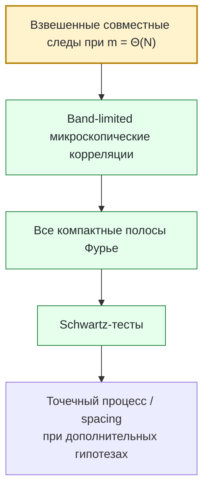

# Программа Бохигаса–Джаннони–Шмита

### Арифметический квантовый хаос, статистика следов и микроскопическая спектральная универсальность

<p align="center">
  <a href="README.md">English</a> · <strong>Русский</strong>
</p>

> **Статус — 23 сентября 2026 года.** Микроскопическая BGS-гипотеза при фиксированной силе возмущения для поддерживаемого квантового отображения остаётся **открытой**. В репозитории собраны проектные доказательства, точные редукции, применения внешних теорем, формализованные конечные ядра, воспроизводимые вычисления и явные контрпримеры к недостаточным стратегиям доказательства. Текущий статус утверждений задаётся [реестром статусов](record/claim_ledger.md).

**Гипотеза Бохигаса–Джаннони–Шмита (BGS)** — одна из центральных задач теории квантового хаоса: должны ли локальные спектральные статистики детерминированной квантовой системы с хаотическим классическим пределом после правильного учёта симметрий и нормировки совпадать со статистиками соответствующего ансамбля случайных матриц?

Этот репозиторий исследует вопрос для явного нелинейного возмущения гиперболического квантового отображения тора. Программа уже вышла далеко за рамки вопроса «похож ли спектр на случайный»: детерминированный переход от микроскопических корреляций к длинным квантовым следам выписан точно; ряд классических, арифметических и низкопорядковых препятствий изолирован или устранён; а главный оставшийся барьер сформулирован как **оценка совместных следов / смешанных резольвент на масштабе времени Гейзенберга**.

| | |
|---|---|
| **Задача** | Доказать микроскопическую статистику случайных матриц для явного детерминированного хаотического квантового отображения. |
| **Что уже закрыто** | Точные тождества «следы → корреляции», переход по всем компактным полосам Фурье, структурные результаты для фиксированной модели, ряд арифметических/возвратных/резонансных теорем и отрицательные контрольные примеры. |
| **Главный недостающий вход** | **BGS-TRACE-005**: модельно-специфическое сокращение следов для степеней $m=\Theta(N)$ либо эквивалентная смешанная резольвентная иерархия. |
| **Конечная цель** | **BGS-BGS-001**: микроскопическая BGS-универсальность при фиксированной силе возмущения для поддерживаемой модели. |

---

## 1. Постановка задачи

### Классический хаос

Классическая гамильтонова система или симплектическое отображение может быть сильно хаотическим: близкие траектории быстро расходятся, сосуществуют устойчивые и неустойчивые направления, а число периодических орбит быстро растёт. Для гиперболического отображения эта структура задаётся особенно явно.

Главный вопрос квантового хаоса — что остаётся от этой сложности после квантования.

### Квантование

Для $N$-мерного квантового отображения один шаг эволюции задаётся унитарной матрицей $U_N$. Её собственные значения лежат на единичной окружности:

```math
U_N\psi_j=e^{i\theta_j}\psi_j,
\qquad
j=1,\ldots,N.
```

Фазы $\theta_j$ образуют квантовый спектр.

Среднее угловое расстояние между соседними уровнями имеет порядок $2\pi/N$. Поэтому BGS — не теорема о глобальной плотности собственных значений. Она относится к масштабу **одного среднего расстояния**.

Схематически нормированная локальная координата имеет вид

```math
x_j=\frac{N}{2\pi}\bigl(\theta_j-\theta_0\bigr).
```

Вопрос состоит в том, сходится ли локальный точечный процесс, образованный $x_j$, к процессу случайных матриц, соответствующему реальному классу симметрии системы.

### Историческое происхождение

Гипотеза получила название по работе О. Бохигаса, М. Джаннони и К. Шмита 1984 года:

> *Characterization of Chaotic Quantum Spectra and Universality of Level Fluctuation Laws*, Physical Review Letters **52** (1984), 1–4.  
> DOI: [10.1103/PhysRevLett.52.1](https://doi.org/10.1103/PhysRevLett.52.1)

Их вычисления для хаотического биллиарда сделали явной предполагаемую связь между классическим хаосом и статистикой уровней случайных матриц. Современная математическая задача намного строже: выбрать детерминированное семейство, точно зафиксировать класс симметрии и нормировку и доказать микроскопический предел.


Выделенный переход — текущий барьер: сам по себе классический хаос не даёт требуемого сокращения квантовых следов на временах порядка $N$.

---

## 2. Что означает микроскопическая универсальность

Типичный парный функционал можно схематически записать как

```math
\frac{1}{N}
\sum_{j\neq k}
\phi\!\left(
\frac{N}{2\pi}(\theta_j-\theta_k)
\right),
```

где $\phi$ — достаточно регулярная тестовая функция.

Высшие корреляции исследуют наборы различных нормированных собственных фаз. В унитарном классе локальным эталоном служит sine-kernel/CUE-процесс; другие классы симметрии приводят к другим локальным пределам.

Это различие принципиально, потому что следующие утверждения значительно слабее BGS:

- может сходиться глобальная эмпирическая спектральная мера;
- отдельные наблюдаемые могут иметь гауссов или полукруговой предел;
- конечное число моментов может совпадать с моделью случайных матриц;
- гистограмма расстояний при умеренном $N$ может выглядеть убедительно;
- закон возврата на логарифмическом времени может быть точным;
- статистика кластеризации может расходиться «в правильную сторону».

Ни одно из этих свойств не определяет микроскопический точечный процесс.

---

## 3. Почему неизбежно время Гейзенберга

Ключевой механизм — преобразование Фурье.

Для принятой в проекте нормировки парного функционала имеется точное тождество

```math
C_{2,N}(U;\phi)
=
\frac{1}{N^2}
\sum_{m\in\mathbb Z}
\widehat{\phi}(m/N)
\left(
|\operatorname{Tr}U^m|^2-N
\right).
```

Если $\widehat{\phi}$ поддержана в фиксированном интервале $[-c,c]$, сумма всё равно использует степени

```math
|m|\le cN.
```

Следовательно, компактная поддержка микроскопического преобразования Фурье **не** сводит задачу к малым временам. Она масштабирует индекс Фурье с $N$.

Для Haar-случайной унитарной матрицы $V_N\in U(N)$ точный эталон второго момента имеет вид

```math
\mathbb E_{\mathrm{CUE}}
\left|\operatorname{Tr}V_N^m\right|^2
=
\min(|m|,N).
```

Поэтому детерминированное доказательство BGS должно воспроизвести правильную взвешенную статистику следов во всём **окне Гейзенберга** $m=\Theta(N)$.

Именно поэтому полуклассика при фиксированном времени, законы возврата при $O(\log N)$ и даже широкая информация при $o(N)$ сами по себе не закрывают микроскопическую задачу.

<p align="center">
  
</p>

*Точный отрицательный контроль.* Совпадение на одной фиксированной полосе Фурье не определяет микроскопический парный закон. Поэтому поддерживаемая теорема продолжения требует сходимости на каждой компактной полосе, а не на одной заранее выбранной.

---

## 4. Поддерживаемая фиксированная модель

Основное семейство:

```math
U_N=\exp(i\tau N A_N)\,M_N,
\qquad
\tau=10^{-80},
```

где $M_N$ квантует гиперболическое отображение тора

```math
S=
\begin{pmatrix}
3&4\\
2&3
\end{pmatrix},
```

а $A_N$ — поддерживаемое квантование Вейля явного нелинейного возмущения.

Малый параметр $\tau$ **фиксирован** при $N\to\infty$. Это существенно: в экспоненте стоит $\tau N$, поэтому режим фиксированной силы не является равномерно возмущённым при больших $N$.

Тем самым основная задача отделяется от пределов с исчезающим возмущением, например $\tau_NN\to0$.

### Уже известная структура

Для поддерживаемой модели в точных заявленных областях установлены:

- аналитичность и свойство Аносова для классического отображения;
- устранение обычных $C^1$-централизаторов, кроме степеней самой карты;
- отсутствие $C^1$-реверсора в соответствующем режиме;
- исключение релевантных аффинных $C^1$-сопряжений;
- точная граница кратности собственных значений генератора возмущения;
- соответствующее низкоранговое препятствие;
- Pell-переходы и явные режимы возврата;
- классические резонансно-кохомологические оценки принуждения.

Эти результаты существенно сужают пространство простых препятствий. Но они сами по себе не контролируют квантовый спектр на масштабе времени Гейзенберга.

---

## 5. Точный детерминированный мост

Одна из наиболее зрелых частей программы — точный переход от локальных спектральных функционалов к произведениям следов.

### Базовые утверждения о следах

| Утверждение | Статус | Содержание |
|---|---|---|
| **BGS-TRACE-001** | **доказано** | Точная partition–Möbius формула для спектральных сумм по различным индексам |
| **BGS-TRACE-002** | **доказано** | Микроскопическое Fourier-представление через квантовые следы |
| **BGS-TRACE-003** | **доказано** | Сравнение совместных следов на масштабе Гейзенберга достаточно для band-limited RMT-корреляций |
| **BGS-TRACE-004** | **доказано** | Сходимость на всех компактных полосах продолжается на Schwartz-тесты |
| **BGS-TRACE-005** | **открыто** | Модельно-специфическая оценка совместных следов / смешанных резольвент |
| **BGS-TRACE-006** | **доказано** | Abel-нижняя оценка для кластеров и простой контрпример на окне Гейзенберга |

Для высших корреляций partition-lattice Möbius inversion приводит к ограниченным произведениям следов

```math
\prod_{\nu=1}^{r}\operatorname{Tr}U_N^{m_\nu},
```

где индексы Фурье связаны линейными соотношениями.

Таким образом, детерминированная часть импликации уже записана явно:



Первый блок — как раз недостающий модельно-специфический вход.

---

## 6. Основные семейства результатов

Репозиторий удобнее читать по математическим направлениям, а не по структуре каталогов.

| Направление | Что уже получено | Логическая граница |
|---|---|---|
| **Фиксированная модель** | теорема о симметриях, Pell-переход, точные моментные ограничения, условный смешанный резольвентный барьер, rank-bound | нет квантового сокращения на времени Гейзенберга |
| **Trace bridge** | точные конечномерные тождества и теоремы достаточности | динамическая оценка остаётся открытой |
| **Резонансы / когомология** | Fourier-line coercivity, локальное препятствие, finite-orbit rigidity, full-lag classical Riesz gap | классическая недегенеративность не влечёт автоматически квантовую BGS |
| **Cayley-арифметика** | точные редукции четвёртого момента и оценки энергии масштаба $K^{8/3}$ | точная центрированная цель $K^{2+o(1)}$ остаётся открытой |
| **Pell / возвратные законы** | строгие глобальные переходы и kicked-return laws на арифметических подпоследовательностях | логарифмические/глобальные законы не дают микроскопическую универсальность |
| **Отрицательные контроли** | явные спектры, опровергающие short-trace, one-bandwidth, one-orientation, clustering и low-order критерии | исключают ложные пути, но не доказывают BGS |

<details>
<summary><strong>Подробнее: фиксированная модель</strong></summary>

**BGS-FM-001** — теорема о классических симметриях в заявленном диапазоне малой связи.

**BGS-FM-002** — Gaussian crossover полного символа на odd-Pell подпоследовательности. Точная дисперсия:

```math
\sigma^2=\frac{1650797}{4000000}=0.41269925.
```

Необходимое условие выхода к CUE-поведению парной статистики в этом семействе:

```math
|\epsilon_K|\sqrt K\longrightarrow\infty.
```

Фактический frozen scaling в конечном счёте выходит за доказанное bounded crossover window.

**BGS-FM-003** — конечномерные моментные неравенства, repeated-clock контрпример и perturbation-transfer bounds.

**BGS-FM-004** — количественный three-orientation barrier при явных mixed-residual hypotheses; эти гипотезы пока не доказаны для фактического frozen propagator.

**BGS-FM-005** — точная граница кратности/rank для frozen kick, включая

```math
\operatorname{rank}(U_N-zM_N)
\ge
N-\gcd(N,7)
```

в заявленном нечётномерном режиме.

</details>

<details>
<summary><strong>Подробнее: Cayley-арифметика</strong></summary>

Задача четвёртого момента сводится к аддитивной энергии множества, полученного преобразованием Кэли из мультипликативной подгруппы. Текущая точная центрированная цель:

```math
E_+(A)
=
\frac{(K-1)^4}{p}
+
O\!\left(K^{2+o(1)}\right).
```

Это **BGS-CAYLEY-005**, и она остаётся открытой.

Важная концептуальная коррекция: требование полностью устранить все исключительные совпадения оказалось слишком сильным. Правильная цель — контроль центрированной энергии, а не отсутствие исключений.

</details>

<details>
<summary><strong>Подробнее: резонансы и когомология</strong></summary>

Проект доказывает резонансное принуждение для Fourier-line observables в заявленных классах, строит локальный polynomial counterexample к чисто локальным аргументам, доказывает smooth finite-orbit lag independence и full-lag uniform classical Riesz gap для фактического frozen symbol при линейном cat transport.

Открытая задача полной аналитической недегенеративности записана как **BGS-RES-003**.

Эти результаты ограничивают классические механизмы вырождения, но не заменяют недостающую квантовую оценку.

</details>

---

## 7. Что уже доказанно недостаточно

В репозитории специально сохраняются точные контрпримеры к естественным, но неверным сокращениям задачи.

| Недостаточный путь | Почему он не работает |
|---|---|
| **Конечное число моментов** | спектры могут совпадать по существенному низкопорядковому набору данных и различаться микроскопически |
| **Одна фиксированная полоса Фурье** | низкочастотное совпадение не определяет полный локальный парный закон |
| **Короткие или sub-Heisenberg следы** | микроскопические Fourier-тесты всё равно требуют мод порядка $N$ |
| **Same-half-plane / one-orientation loop identities** | часть residuals исчезает тождественно для любого спектра |
| **Low-order loop equations** | repeated-clock примеры могут им удовлетворять, не приближаясь к CUE |
| **Глобальные законы возврата** | глобальная/логарифмическая информация не определяет локальные eigenphase statistics |
| **Кластеризация или Abel-divergence** | простые спектры могут обладать ими при исчезающем positive-time Heisenberg form factor |
| **Красивые finite-$N$ гистограммы** | численное сходство — свидетельство, а не асимптотическая теорема |
| **Одна лишь классическая недегенеративность** | classical Riesz gap не превращается автоматически в квантовое trace cancellation |

Постоянный журнал научных исправлений: [record/retractions.md](record/retractions.md). Краткий индекс: [ERRATA.md](ERRATA.md).

---

## 8. Главный открытый фронтир

Текущий барьер фиксированной модели — **BGS-TRACE-005**:

> **Доказать правильно desymmetrized weighted joint-trace comparison на масштабе Гейзенберга или аналитически эквивалентную mixed-resolvent hierarchy для фактического frozen propagator, равномерно на каждой компактной Fourier support.**

Для парной статистики требуемое сравнение имеет схематический вид

```math
\frac{1}{N^2}
\sum_{m\in\mathbb Z}
w(m/N)
\left[
|\operatorname{Tr}U_N^m|^2
-
\mathbb E_{\mathrm{RMT}}
|\operatorname{Tr}V_N^m|^2
\right]
\longrightarrow 0.
```

Для высших корреляций нужны соответствующие совместные произведения следов с ограничениями на индексы.

Поддерживаются два эквивалентных языка исследования:

1. **прямое сравнение совместных следов**;
2. **иерархия смешанных резольвент / loop equations**, достаточно сильная для той же локальной статистики.

Второй маршрут условно записан в **BGS-LOOP-001**; модельно-специфическое убывание residuals остаётся открытым.

### Почему именно это — правильный барьер

В проекте уже есть точные примеры, показывающие, что более слабые признаки могут вводить в заблуждение. Недостающая оценка должна использовать **реальную frozen-квантовую динамику**, а не только наличие классического хаоса, кластеризации, глобального закона или нескольких тождеств.

---

## 9. Что даст закрытие фронтира

Доказательство **BGS-TRACE-005** в нужной области сделает существующий trace bridge рабочим для фиксированной модели. После точного учёта symmetry block, unfolding и point-process hypotheses это приведёт к **BGS-BGS-001**.

Такой результат даст:

- строгую микроскопическую random-matrix theorem для явного детерминированного нелинейного хаотического квантового отображения;
- конкретный механизм связи долгосрочной квантовой динамики с локальной спектральной универсальностью;
- модель, в которой арифметические возвраты, нелинейное возмущение, классические резонансы и квантовые trace statistics отслеживаются в одной системе;
- воспроизводимую схему для проверки универсальности в других детерминированных квантовых отображениях.

При этом он **не** станет автоматически доказательством всех формулировок BGS для всех хаотических гамильтоновых систем. Проект различает сильную модельную теорему и общую универсальную гипотезу.

---

## 10. Избранные проектные графики

Ниже приведены реальные научные графики проекта, а не декоративные изображения для README.

<p align="center">
  
</p>

**Препятствие из возвратных законов.** Рисунок относится к поддерживаемому анализу возвратов и локальных пределов. Он показывает, как глобальный или арифметический закон возврата может ограничивать, но не определять микроскопический процесс.

<p align="center">
  
</p>

**Harmonic Pell transition.** Это настоящий проектный результат в точно указанном арифметическом режиме. Его масштаб и наблюдаемая глобальны; рисунок не используется как свидетельство локальной BGS.

<p align="center">
  
</p>

**Конечная Cayley-диагностика.** Эти численные распределения иллюстрируют арифметическую ветку. Соответствующая асимптотическая теорема имеет отдельный точный режим; ни finite plot, ни глобальный гауссов закон не влекут микроскопическую универсальность.

---

## 11. Литература и научный контекст

Поддерживаемая [библиография](literature/bibliography.md) разделяет четыре роли:

- внешние результаты, реально используемые как theorem inputs;
- соседнюю литературу для контекста;
- строгие BGS-type universality results в других модельных классах;
- утверждения, для которых гипотезы внешней теоремы отдельно сопоставлены с настройкой проекта.

Машиночитаемые load-bearing dependencies: [literature/external_dependencies.json](literature/external_dependencies.json).

Проект намеренно консервативен в переносе результатов. Quantum ergodicity, eigenfunction equidistribution, matrix-element statistics, глобальные trace laws и universality в quantum graphs или других специальных моделях важны для общей картины, но ни один из них не объявляется автоматически теоремой для поддерживаемой frozen model.

---

## 12. Репозиторий и воспроизводимость

Научная часть выше — основная входная точка. Служебная информация собрана в конце.

<details>
<summary><strong>Рекомендуемый порядок чтения</strong></summary>

1. [Текущие результаты](mathematics/results.md)
2. [Открытые математические обязательства](mathematics/open_questions.md)
3. [Trace-to-local-statistics bridge](mathematics/trace_to_local_statistics_bridge.md)
4. [Fixed-map resolvent frontier](mathematics/fixed_map_resolvent_frontier.md)
5. [Stable claim registry](record/claim_registry.md)
6. [Scientific dependency graph](record/scientific_dependency_graph.md)
7. [Unified manuscript](manuscript/BGS_unified.tex)
8. [Literature map](literature/bibliography.md)
9. [Retractions / corrections](record/retractions.md)

</details>

<details>
<summary><strong>Иерархия источников истины</strong></summary>

- [record/claim_ledger.md](record/claim_ledger.md) — единственный источник текущего статуса и области действия утверждений.
- [record/claims.json](record/claims.json) задаёт стабильные core IDs и cross-layer links.
- Поддерживаемые proof notes находятся в [mathematics/](mathematics/README.md).
- Внешние load-bearing theorem inputs зафиксированы в [literature/external_dependencies.json](literature/external_dependencies.json).
- Formalization, computations, evidence, README и manuscript не могут усиливать claim ledger.

Краткая схема: [SOURCE_OF_TRUTH.md](SOURCE_OF_TRUTH.md).

</details>

<details>
<summary><strong>Воспроизвести поддерживаемую поверхность проверок</strong></summary>

```sh
python computations/verification/scientific_registry_audit.py
python computations/verification/repository_audit.py

python -m pip install -r requirements.txt
cmake -S . -B build/cmake -DCMAKE_BUILD_TYPE=Release
cmake --build build/cmake --parallel

python computations/maintenance/verify_workspace.py \
  --build build/cmake \
  --logs build/verification-logs \
  --output build/workspace-verification.json

(cd formalization && lake build)

python computations/maintenance/sync_return_sections.py --check
python computations/maintenance/sync_finite_orbit_section.py --check
python computations/maintenance/sync_fixed_map_section.py --check
python computations/maintenance/build_unified_manuscript.py \
  --output-dir build/unified-paper
```

Полный контракт: [REPRODUCE_unified.md](REPRODUCE_unified.md) и [environment/runtime-manifest.json](environment/runtime-manifest.json).

</details>

<details>
<summary><strong>Карта репозитория</strong></summary>

| Раздел | Назначение |
|---|---|
| [mathematics/](mathematics/README.md) | формулировки теорем, доказательства, редукции, контрпримеры, открытые задачи |
| [manuscript/](manuscript/README.md) | каноническая длинная исследовательская рукопись |
| [papers/](papers/README.md) | сфокусированные publication candidates без дублирования proof authority |
| [literature/](literature/bibliography.md) | библиография и theorem-level external dependencies |
| [formalization/](formalization/README.md) | Lean 4 algebraic/finite kernels |
| [computations/](computations/README.md) | верификация, независимые реализации, численные диагностики |
| [evidence/](evidence/provenance.md) | продвинутые finite/numerical evidence и provenance |
| [record/](record/README.md) | claims, audits, corrections, scientific history, governance |
| [supplement/fixed_map/](supplement/fixed_map/README.md) | детальные fixed-map derivations и replayable evidence |

</details>

<details>
<summary><strong>Публикации, цитирование и review</strong></summary>

- Каноническая рукопись: [manuscript/BGS_unified.tex](manuscript/BGS_unified.tex)
- Сфокусированные paper scopes: [papers/](papers/README.md)
- Citation metadata: [CITATION.cff](CITATION.cff)
- Contribution protocol: [CONTRIBUTING.md](CONTRIBUTING.md)
- Referee protocol: [REVIEWING.md](REVIEWING.md)
- Roadmap: [ROADMAP.md](ROADMAP.md)
- Release policy: [RELEASES.md](RELEASES.md)

</details>

---

Maintainer и автор рукописи: **Maksim Churilov**.

Репозиторий не заявляет доказательство общей гипотезы BGS для всех хаотических систем, внешний priority claim на весь корпус или независимую referee validation каждой проектной теоремы. Его цель — максимально продвинуть конкретную задачу микроскопической универсальности, оставляя явной границу между доказательством, внешним theorem input, formal/finite verification, numerical evidence, conditional reduction и открытым обязательством.
