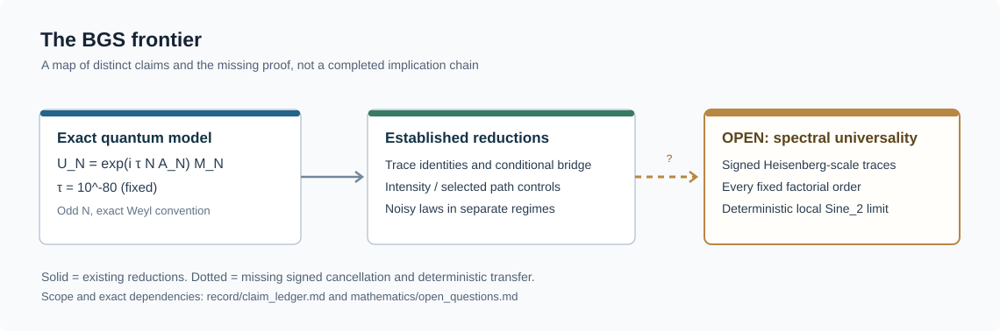
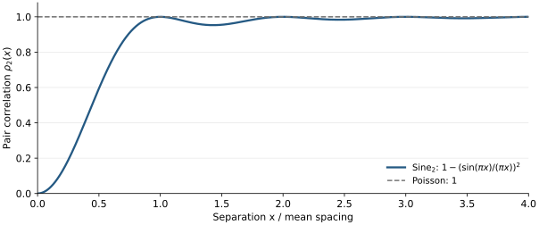
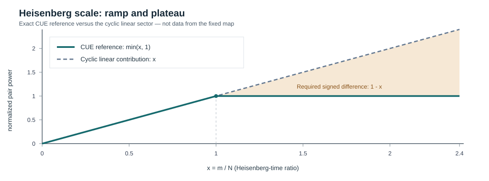

# BGS — квантовый хаос и универсальность спектральной статистики

[English](README.md) · [Научный обзор](RESEARCH.md) · [Карта корпуса](docs/corpus_atlas.md) · [Математическое введение](docs/reader_guide.ru.md) · [Указатель теорем](mathematics/results.md) · [Полная рукопись](manuscript/README.md)

**Гипотеза Бохигаса — Джаннони — Шмита** — одна из центральных проблем квантового хаоса: почему при надлежащих динамических и симметрийных условиях микроскопическая статистика энергетических уровней детерминированных хаотических систем должна согласовываться с теорией случайных матриц? Репозиторий содержит точные результаты, контрпримеры и воспроизводимые проверки, прежде всего для одного строго фиксированного квантового отображения тора.

**Научный статус (22 октября 2026 года):** микроскопический предел BGS для рассматриваемого детерминированного отображения **остаётся открытым**. Ряд вспомогательных теорем доказан внутри проекта при явно оговорённых условиях, но это не доказательство универсальности для всех хаотических систем. [Ревизия от 22 октября](record/audits/repository_recheck_20261022/report.md) указывает точную область проверки. [Реестр статусов](record/claims.json) · [Открытые задачи](mathematics/open_questions.md).

**Арифметические всплески, невидимые для толчка (28 октября 2026 года).** У чистого отображения кота при каждом нечётном $n\ge5$ и размерности $N=u_n$ статистика Абеля пар остаётся на расстоянии больше $1/2$ от значения CUE. Фиксированный толчок $\tau=10^{-80}$ сохраняет этот зазор на всех 99 нечётных индексах $5\le n\le201$, включая 77-значную размерность $u_{201}$. Это [BGS-TRACE-117](mathematics/fixed-map/kick_blind_arithmetic_spike.md). Следующий нечётный индекс $n=203$ закрыт разложением второго порядка: орбита символа под отображением кота ортогональна по следу, кроме одного явного перекрытия, и [BGS-TRACE-118](mathematics/fixed-map/orbit_orthogonal_kick_spike.md) даёт тот же зазор на 78-значной размерности $u_{203}$. Следующий нечётный индекс $n=205$ закрыт разложением по положительному времени, сохраняющим ортогональность следа: [BGS-TRACE-119](mathematics/fixed-map/positive_time_spike.md) даёт тот же зазор на 79-значной размерности $u_{205}$. При $n=207$ центр второго порядка по-прежнему удовлетворяет $(1-\varepsilon_2)^2<3/4$, поэтому этот диск зазор не доказывает. Порядок $C$ по модулю $N$ разделяет ту же статистику: [BGS-TRACE-120](mathematics/fixed-map/order_ladder_abel.md) ставит всякую нечётную размерность с $12t(N)\le5N$ строго выше $3/4$ и ставит всякое нечётное простое, чей порядок не меньше половины размерности, на расстояние меньше $1/2$ от значения CUE. Фиксированный толчок сохраняет короткую сторону до $10^{39}$ и длинную до $10^{26}$. Размерность $N=35$ порядка $6$ не является числом Пелля, и одного возвращения там недостаточно для порога $3/4$. [BGS-TRACE-121](mathematics/fixed-map/order_trichotomy_abel.md) закрывает оставшиеся простые порядки: всякий порядок делит $p-\varepsilon$ и бывает коротким, длинным или полупорядком расщепления; простое $p=7$ лежит выше $3/4$, а всякое большее такое простое лежит ниже $5/7$. Та же глубина решает всякую степень простого. Чистое отображение при $u_{207}$ уже выше $3/4$, потому что его порядок делит $207$. Ни один из этих результатов не доказывает предел при $N\to\infty$ и не доказывает зазор толчка при $u_{207}$. [BGS-TRACE-122](mathematics/fixed-map/crt_composite_abel.md) умножает квадрат следа по простым степенным множителям всякого нечётного модуля и решает всякое произведение двух нечётных простых: короткие составные порядки и семейство семёрки лежат выше $3/4$, а всякий оставшийся полупростой модуль лежит ниже $5/7$. Фиксированный толчок сохраняет верхний зазор до $10^{26}$ на $N=21$. Окно полного порядка при расщеплении и некороткое произведение $3$ на короткое простое не встречаются. [BGS-TRACE-123](mathematics/fixed-map/squarefree_product_abel.md) ставит всякий бесквадратный нечётный модуль с хотя бы тремя различными простыми множителями строго выше $3/4$. Фиксированный толчок сохраняет этот зазор до $10^{39}$, если простых множителей не меньше четырёх или модуль есть произведение трёх простых, не делящихся на $15$, и до $10^{26}$ на $N=15r$. Квадрат простого, например $315=3^2\cdot5\cdot7$, лежит вне этого утверждения. [BGS-TRACE-124](mathematics/fixed-map/odd_modulus_abel.md) ставит всякий нечётный модуль строго выше $3/4$ или строго ниже $5/7$; $315$ короток, потому что его радикал $105$ короток. Фиксированный толчок сохраняет верхний зазор при $8t(N)\le3N$ и $N\le10^{39}$, до $10^{26}$ на сохраняющих отношение башнях, чей чистый запас больше $13/420$, и до $2\cdot10^{26}$ на $N=15r$. Толчок не утверждается для башни над потолком, для инертного партнёра $q\ge40$ при показателе единицы, для $15r>2\cdot10^{26}$ и при $u_{207}$. [BGS-TRACE-125](mathematics/fixed-map/uniform_orbit_overlap.md) даёт квадратичный коэффициент следа перенесённого произведения при каждом нечётном возвращении Пелля $n\ge5$: $Tr(S^2)/N=n\cdot1650797/4000000$. Размерности $u_n$ образуют экспоненциальную последовательность. Этот коэффициент есть вторая производная при нулевой связи, а не оценка $f(1)$, и он не определяет собственные значения $U_N$. [Заметка о стратегии](mathematics/fixed-map/offdiagonal_strategy.md) не является теоремой. Плотность классов порядка и знакопеременная внедиагональная сумма остаются открытыми. BGS-TRACE-005 и BGS-BGS-001 остаются открытыми.

**Сумма по орбите в скалярном возвращении (29 октября 2026 года).** [BGS-TRACE-129](mathematics/fixed-map/scalar_return_bessel.md) даёт фазовое среднее классической суммы вдоль орбиты для позиционно-диагонального толчка при возвращении $S^m\equiv I$. Это тождество не есть квантовое среднее ансамбля из шестнадцати фаз. Среднее есть произведение множителей Бесселя $J_0$. Его струя второй степени есть $\exp(-m\sigma_{\mathrm{diag}}\eta^2)$. Зазор четвёртой степени есть аддитивный счёт на позиционной орбите, и экспонента не является тождеством при $\eta^2\sigma m$ порядка единицы. В момент один среднее равно $1+\rho_1$ внутри пертурбативного окна. Каждая из строк $\ell=\pm 1$ имеет энергию $9/160000$. В рецензентской выборке квантовое среднее отличается от классического на ≈1,7 при $N=11$ и до ≈6 при $N=29$ ($\eta=2$). Предел COE или CUE не доказан. BGS-TRACE-005 и BGS-BGS-001 остаются открытыми.

**Короткие пределы диагонального форм-фактора (29 октября 2026 года).** [BGS-TRACE-128](mathematics/fixed-map/diagonal_phase_short_time.md) даёт предел при фиксированном времени для отображения кота, умноженного на независимые равномерные фазы в $N$ позиционных узлах. При каждом $m\ge 3$ усреднённый квадрат следа стремится к $2m$, с явной оценкой расстояния до диэдрального главного члена. Обращение строк по правилу $x\mapsto x^{-1}$ на нечётном простом меняет предел на $m$. Ни одна из оценок не достигает степени $N$. Это не ансамбль из шестнадцати фаз и не фиксированный толчок. BGS-TRACE-005 и BGS-BGS-001 остаются открытыми.

**Диагональный случайно-фазовый форм-фактор (29 октября 2026 года).** [BGS-TRACE-127](mathematics/fixed-map/diagonal_phase_form_factor.md) даёт точный усреднённый квадрат следа отображения кота, умноженного на независимые равномерные фазы в $N$ позиционных узлах, в моменты один, два и три, вместе с оценкой $m!$ в каждый момент. Чистое ядро равно $1$ во время два и равно $49$ или $1$ во время три, смотря по тому, делит ли $7$ нечётный модуль. Предел в момент три равен $6$, а не значению CUE $3$. Это не ансамбль из шестнадцати фаз и не фиксированный толчок. BGS-TRACE-005 и BGS-BGS-001 остаются открытыми.

**Фазовый форм-фактор (29 октября 2026 года).** Для вспомогательного ансамбля, в котором 16 пар мод толчка несут независимые равномерные фазы, [BGS-TRACE-126](mathematics/fixed-map/interaction_phase_form_factor.md) даёт точное разложение второго порядка усреднённого квадрата следа, с явным коэффициентом из сумм Гаусса и остатком в операторной норме. На нечётном простом модуле $p$ коэффициент возрождения второго порядка равен $-m(\sigma-\sigma_0(p))p^2$, где $\sigma_0(p)$ — энергия мод, сравнимых с нулём по модулю $p$: $\sigma_0(3)=81/64000$, $\sigma_0(5)=1/320000$, $\sigma_0(7)=81/200$ и $\sigma_0(p)=0$ при $p\ge 11$. У фиксированного толчка есть линейный член, отличный от нуля при $N=11$, $m=3$. Чётность и комплексное сопряжение в позиционном базисе нарушаются для толкнутого пропагатора при $0<|\eta|<\pi/B$, кроме размерности $7$, где $A_7=(9/10)I$. Предел возрождения не доказан. BGS-TRACE-005 и BGS-BGS-001 остаются открытыми.



*Исследовательская карта, а не цепочка доказанных импликаций: последний переход ещё не установлен.*

*Для работы с репозиторием, проверок и реализации кода использовались GPT 6 и Muse Spark 1.3.*

## О чём гипотеза

[Работа 1984 года](https://doi.org/10.1103/PhysRevLett.52.1) связала спектры квантовых хаотических систем с универсальными флуктуациями случайных матриц. Строгая теорема требует точного квантового семейства, правильного сектора симметрии, обоснованной развёртки спектра и локального корреляционного предела. Одна лишь классическая гиперболичность не определяет автоматически класс симметрии или универсальный спектр.

Для унитарного класса эталоном является детерминантальный процесс $\mathrm{Sine}_2$ с ядром и парной корреляцией различных точек

```math
K(x,y)=\frac{\sin\pi(x-y)}{\pi(x-y)},
\qquad
\rho_2(x,y)=1-|K(x,y)|^2.
```



*Аналитические эталонные кривые, **не численные данные** основной модели. Показана парная корреляция, а не распределение расстояний между соседними уровнями.*

## Точная модель и цель

Для нечётных $N\ge3$ изучается семейство

```math
S=\begin{pmatrix}3&4\\2&3\end{pmatrix},
\qquad
U_N=\exp(i\tau N A_N)M_N,
\qquad
\tau=10^{-80}.
```

Здесь $M_N$ — фиксированное квантование гиперболического отображения кота, а $A_N$ — заданное Вейлево квантование нелинейного возмущения. [Каноническое описание](mathematics/fixed-map/fixed_map_resolvent_frontier.md) уточняет конвенции, исключительные размерности и симметрии. **Связь остаётся фиксированной при $N\to\infty$**: замена её на исчезающее возмущение, независимые случайные фазы или шум меняет задачу.

Следующий парный эталон в предписанной иерархии моментов следов для данного семейства пока не доказан. Слабая сходимость к Sine₂ сама по себе не гарантирует сходимости этих неограниченных парных моментов без дополнительной равномерной интегрируемости:

```math
L_N(s)=\frac{1}{N^2}\sum_{m\ge1}e^{-2sm/N}
\left|\mathrm{Tr}\,U_N^m\right|^2
\;\longrightarrow\;
\frac{1-e^{-2s}}{4s^2},
\qquad s>0.
```

Полная задача [BGS-TRACE-005](mathematics/open_questions.md#b-prove-heisenberg-scale-desymmetrized-joint-trace-estimates) сильнее: **знаковое факториальное сравнение совместных следов** после правильного разделения симметрий, для всех фиксированных порядков и гладких тестов с компактной фурье-поддержкой при $m\asymp N$. Абсолютная величина берётся **после полной фурье-суммы**, а не для каждого слагаемого отдельно. [Переход от следов к локальной статистике](mathematics/trace-bridge/trace_to_local_statistics_bridge.md) описывает дополнительные условия плотности и продолжения.

[Продолжение об операторной точности](mathematics/trace-bridge/microscopic_unitary_stability_20261027.md) переносит парный тест исходной семьи через матричную ошибку $O(N^{-2})$, используя TRACE-113; значение предела при этом не установлено. [Теорема о коротких следах](mathematics/fixed-map/balanced_rounding_research_20261027.md) показывает недостаточность полиномиального числа коротких следов и более грубых квантовых данных для общего квантования. [Разбор результатов](record/trace005_continuation_review.md) отделяет эти доказательства с авторской проверкой от ранее известных результатов и ещё не проверенных кандидатов.

## Другие результаты и оставшийся разрыв

В проекте различаются несколько самостоятельных направлений:

| Математический слой | Установлено в указанной области | Пока не установлено |
|---|---|---|
| Переход от спектра к следам | Точная конечномерная комбинаторика и условные критерии корреляций | Знаковые совместные оценки для исходной модели |
| Основная модель: интенсивности и пути | [FM-021](mathematics/fixed-map/position_chain_mixing.md) — смешивание и циклический рост; [FM-022](mathematics/fixed-map/reversed_path_decay.md) — подавление обратных путей | Вся оставшаяся когерентная интерференция, включая отрицательную поправку плато |
| Сбалансированная микроскопика | Точные тождества [Уорда](mathematics/trace-bridge/phase_ward_identity.md) и [энергии Шура](mathematics/trace-bridge/balanced_pair_schur_reduction.md) | Нужные предельные оценки перекрытий и радиальной энергии |
| Следы и вставки | Отдельные [WKB](mathematics/fixed-map/factorial_wkb_reduction.md)-секторы, [упорядоченные диагонали](mathematics/fixed-map/factorial_ordered_diagonal.md) и [иерархия без масок](mathematics/fixed-map/right_frame_unmasked_pinch_hierarchy.md) | Полный знаковый остаток, маски и недемпфированные границы |
| Стохастическое сравнение | Шумовые локальные законы [FLOW-014](mathematics/fixed-map/circular_dyson_actual_start.md) и [FLOW-017](mathematics/fixed-map/coboundary_all_order_limit.md) при разных явно указанных режимах | Снятие шума для исходного детерминированного семейства |
| Другие математические результаты | [Кэли](mathematics/topics/cayley-arithmetic/README.md), [Пелль](mathematics/topics/pell/README.md), [возвраты](mathematics/topics/returns/README.md), резонансы, локальность и информация | Строгая импликация из отдельных режимов к детерминированной BGS |
| Формализация Lean | [Карта покрытия Mathlib](formalization/MATHLIB_LAYER_RU.md) связывает 29 прежних и 39 адаптированных модулей с конечными, алгебраическими и отдельными скалярными результатами; исторический протокол содержит проверку аксиом для 589 деклараций | Полная аналитическая иерархия следов и детерминированный предел BGS |

Решающая трудность — не отсутствие конечномерных тождеств, а **контроль знаковых сокращений на времени Гейзенберга** для неизменённого пропагатора. Ни график расстояний, ни результат для вспомогательной случайной модели сами по себе не закрывают эту задачу. Точные границы результатов приведены в [научном обзоре](RESEARCH.md), а список незакрытых импликаций — в [постановке открытых задач](mathematics/open_questions.md).

### Почему требуется знаковое плато

Для случайной матрицы $V_N$ из кругового унитарного ансамбля справедлив точный эталон при положительных степенях:

```math
\mathbb E_{\mathrm{CUE}}\left|\mathrm{Tr}\,V_N^m\right|^2
=\min(m,N),\qquad m\ge1.
```

Нормированная форма циклического линейного вклада — $x=m/N$, тогда как эталон CUE равен $\min(x,1)$. При $x>1$ разность составляет **$1-x<0$**. Поэтому одного циклического роста недостаточно для нужного плато: остальные когерентные знаковые вклады должны в сумме дать отрицательную поправку. Это необходимое условие, **но не доказанный результат** для исходного детерминированного семейства.



*Аналитическое сравнение, не симуляция. Закрашена величина отрицательной поправки относительно циклического линейного вклада.*

## Последние результаты и их границы

Последние результаты для основной модели имеют доказательства проекта с явными ограничениями масштаба:

| Результат | Установленная область | Граница |
|---|---|---|
| [Вставленный след, TRACE-109](mathematics/fixed-map/finite_grid_one_step_trace.md) | Исправленная амплитуда на конечной сетке; ошибка вставленного следа $O(N^{-1})$ | Отдельная вставка, а не полная знаковая иерархия |
| [Спектральное расстояние, TRACE-110](mathematics/fixed-map/spectral_orbit_distance.md) | Глобальное сопоставление $O(1/\log N)$ и совпадающий нижний порядок на размерах Пелля | Макроскопическое сопоставление не даёт микроскопической статистики |
| [Плотность смещения, TRACE-112](mathematics/fixed-map/displacement_density_trace_bound.md) | Равномерный классический контроль и независимый путь к следам на логарифмическом времени | Нет сокращений на времени Гейзенберга |
| [Следы всех степеней, TRACE-113](mathematics/fixed-map/fixed_kick_uniform_trace_bound.md) | $|\mathrm{Tr}\,U_N^m|\le Ca^m$, $1<a<\sqrt{3+2\sqrt2}$, с одним порогом размерности для всех $m$ | При $m\asymp N$ оценка неинформативна |

[Тематическое издание четырнадцати раундов](mathematics/spectral_research/README.md)
сохраняет 535 исходных единиц исследования. Для продолжения есть
[самостоятельная постановка оставшейся задачи](record/remaining_breakthrough_task_20261021.md).

Во вспомогательном фазовом ансамбле размерность фурье-матрицы равна
$N=p^{2d}$ при нечётном простом $p$, а фазы независимы и равномерны.
Здесь $t=m/N$ — масштабированное время следа; сила кика в детерминированной
модели выше остаётся фиксированной.

| Семейство теорем | Установленный результат | Оставшийся переход |
|---|---|---|
| [Знаковые кластерные суммы](mathematics/trace-bridge/phase_ensemble_continuation.md) | Авторские доказательства; проверка по реестру не завершена: полный сектор суммарного дефекта 2 при $0<t<1$; любое число кластеров индивидуального дефекта не более 2 при $0<t<1/9$, с равномерной ошибкой $O(N^{-1})$ | Высшие связанные типы и перенос на замороженный оператор |
| [Положительные проекции Коши](mathematics/trace-bridge/cauchy_positive_source_boundary.md) | Авторские доказательства; проверка по реестру не завершена: точные скалярные законы и явное разделение полных матричных законов | Положительных проекций недостаточно для спектрального закона |
| [Абелева устойчивость часового спектра](mathematics/trace-bridge/abel_clock_rigidity.md), [закон столкновений](mathematics/trace-bridge/wick_collision_poisson.md) | Оптимальная оценка через квадратный корень и отношение $B/G\to e^{-\alpha^2}$ во вспомогательной мере Вика | Физическое знаковое сравнение вне плоского сектора |
| [Переход от полной иерархии к процессу](mathematics/trace-bridge/all_order_process_closure.md) | Полная знаковая иерархия влечёт локальный Sine2 и контроль локальных моментов | Физическая иерархия остаётся открытой |
| [Исключение каналов на полной глубине](mathematics/trace-bridge/unconditional_feedback_flatness.md) | Оценки элементов и интенсивностей, законы часов при оговорённых начальных условиях и пороге глубины | Начальный микроскопический закон и знаковый перенос |

В таблице различаются доказанные результаты проекта и сохранённые авторские
доказательства с незавершённой проверкой по реестру. Статусы и точные границы
даны в [полном реестре](record/claim_registry.md).
Гауссов эталон известен ранее; внешний приоритет не установлен.
[Подробный научный обзор](RESEARCH.md) · [История проверок](record/README.md) ·
[Ревизия репозитория](record/audits/repository_recheck_20261022/report.md).

## Три восстановленных аналитических результата

**Фазовая память при повторном использовании тех же фаз — [BGS-TRACE-053](mathematics/trace-bridge/max_entry_phase_channel.md).**
Для $S\in U(m)$ положим $P_{ij}=|S_{ij}|^2$, $\delta=\max P_{ij}$,
$A=\Pi\mathrm{Ad}(S)$ и
$T_n=\mathbb E_D\mathrm{Ad}((DS)^n)$. Здесь $\Pi$ — диагональное
пинчирование, а независимые равномерные диагональные фазы $D$ остаются теми
же во всех степенях; все элементы $J_m$ равны $1/m$.
На всём комплексном пространстве Фробениуса при $n\ge2$

$$\|T_n-A^n\|_{2\to2}
\le(n!-1)\sqrt\delta+n!n(n-1)\delta.$$

При $n=2$ норма равна $\max_{i\ne j}|S_{ij}S_{ji}|\le\delta$.
Если $\|P-J_m\|\le\rho<1$, усреднённое пинчирование по собственным
подпространствам на бесследовых матрицах имеет норму
$O_\rho(\log\log(1/\delta)/\log(1/\delta))$ при $\delta\to0$.
Эта оценка операторной нормы ещё не вычисляет микроскопический спектральный след.

**Оптимальные производные матричных внутренних функций — [BGS-TRACE-054](mathematics/trace-bridge/sharp_inner_jet.md).**
Пусть $F=zG$ — квадратная конечная рациональная внутренняя матричная функция,
$T=F^*zF'\ge I$ на окружности и $d\mu=d\theta/(2\pi)$.
При $\dot T=dT/d\theta$, без предположения коммутативности

$$\int\mathrm{Tr}(\dot T T^{-1}\dot T)\,d\mu
\le\frac13\int\mathrm{Tr}(T^3-T)\,d\mu,$$

$$\int\|F''T^{-1/2}\|_F^2\,d\mu
\le\frac43\int\mathrm{Tr}T^3\,d\mu
-2\int\mathrm{Tr}T^2\,d\mu
+\frac23\int\mathrm{Tr}T\,d\mu.$$

Главный коэффициент $4/3$ оптимален в каждой матричной размерности; во
вложении стояло $13/3$. Гладкая локализация сохраняет явную поправку с
производной веса. Доказательство само по себе не даёт кубического момента
задержки случайной полости.

**Перенос скалярного источника при обычном поглощении — [BGS-TRACE-056](mathematics/trace-bridge/phase_channel_real_flow.md).**
Для последовательности детерминистических унитарных $S_m$ с
$\delta_m=\max_{ij}|(S_m)_{ij}|^2\to0$ и
$\||S_m|^2-J_m\|\le\rho<1$, а также эрмитовых $H_m$,
независимых от повторно используемых случайных фаз, при
$\mathrm{Tr}H_m=m$ и $\mathrm{Tr}H_m^2\le C_Hm$ сопоставление
собственных фаз вдоль $DS_m e^{ixH_m/m}$ даёт $L^1$-сравнение
нормированного скалярного резольвентного источника с источником
$e^{ix/m}DS_m$. Сходимость локально равномерна при
$\mathrm{Re}\,s>0$ и ограниченных вещественных $x$, включая
каждую фиксированную производную по поглощённому скалярному параметру $s$.
Учтены кратные собственные значения. Продолжение от 11 октября доказывает
сравнение физических источников в $L^2$ и все фиксированные произведения
нормально поглощённых источников при указанных в нём условиях. Высшие
произведения физических источников и гипотезы для фактической полости
остаются открытыми; предел для детерминистического $D=I$ не доказан.

Это самостоятельные доказательства проекта с независимым внутренним
восстановлением. Внешний приоритет не установлен.
[Разбор вложенной статьи](literature/phase_channel_jet_sources_20261008.md)
сопоставляет её утверждения с действующими результатами и кандидатами,
ожидающими проверки. В частности, полилогарифмическая иерархия глубокого
источника BGS-TRACE-055 **ещё не прошла доказательную проверку**.

## Чтение, воспроизведение и цитирование

Начните с [математического введения](docs/reader_guide.ru.md), затем воспользуйтесь [указателем теорем](mathematics/results.md) или [тематической картой](mathematics/topics/README.md). Зарегистрированные статусы определяет [реестр утверждений](record/claims.json), а [хронологический журнал](record/claim_ledger.md) объясняет изменения, а [SOURCE_OF_TRUTH.md](SOURCE_OF_TRUTH.md) задаёт порядок разрешения разночтений.

[Полная исследовательская рукопись](manuscript/README.md) — **развивающееся научное изложение**, специально сохраняемое по мере продолжения работы; это не завершённое доказательство BGS и не замена исходным математическим доказательствам. [Отдельные публикационные направления](papers/README.md) обозначают возможные самостоятельные статьи, а не уже состоявшиеся публикации.

[Воспроизведение](REPRODUCE_unified.md) · [Вычисления](computations/README.md) · [Границы Lean-формализации](formalization/README.md) · [Литература и приоритет](literature/README.md) · [Порядок участия](CONTRIBUTING.md) · [Цитирование](CITATION.cff)

[Пакет проверки от 11 октября 2026 года](archive/evidence/executions/20261011/chat-research/fresh/README.md) содержит точные проверки Python и C++, сборку 23 модулей Lean и рукописи на ту дату. [Интеграция от 28 октября](formalization/README.md) расширяет граф исходников до 68 модулей; её [протокол](evidence/formalization/aristotle_20261027/receipt.json) отделяет исторические проверки ядром от слияния с GitHub, для которого новая проверка CI не выполнялась. **Lean подтверждает лишь отдельные конечные, алгебраические и скалярные фрагменты, но не весь аналитический корпус и не BGS.** Внутренние доказательства ещё не означают независимого внешнего рецензирования или установленного научного приоритета.


## Лицензия

Исходный код (`computations/`, `formalization/`) распространяется по
лицензии MIT — см. `LICENSE`. Научные тексты, рукопись, математическое
изложение, реестры и исследовательские данные распространяются по
лицензии CC BY 4.0 — см. `LICENSE-CC-BY-4.0.txt`. Карта соответствия
путей лицензиям — в `LICENSE_POLICY.md`. До этого релиза открытая
лицензия не предоставлялась; историю решения см. в `LICENSE_POLICY.md`.

