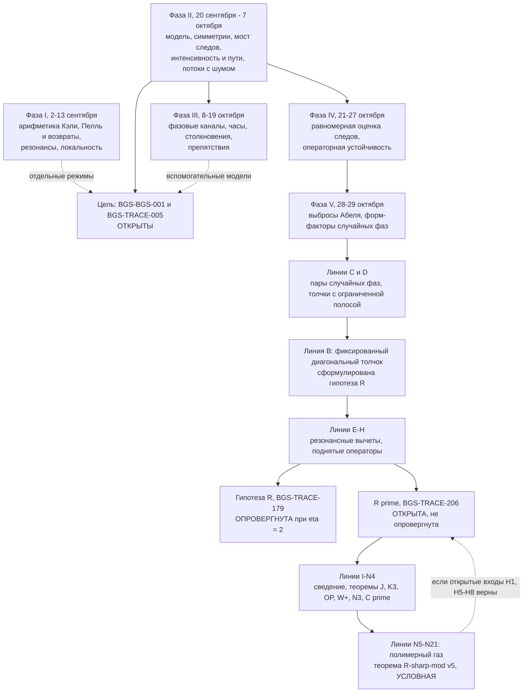

# BGS: квантованное отображение кота с толчком, его арифметика и открытый фронт гипотезы BGS

[](record/claim_registry.md)
[](record/claim_registry.md)
[](record/claim_registry.md)
[](mathematics/open_questions.md)
[](record/claim_registry.md)
[](record/claim_registry.md)
[](formalization/README.md)
[](manuscript/BGS_unified.pdf)
[](LICENSE_POLICY.md)

[**Результаты**](RESULTS.md) · [English](README.md) · [Состояние](STATUS.md) · [Научный обзор](RESEARCH.md) · [Реестр утверждений](record/claim_registry.md) · [Математическое введение](docs/reader_guide.ru.md) · [Указатель теорем](mathematics/results.md) · [Открытые задачи](mathematics/open_questions.md) · [Рукопись (PDF)](manuscript/BGS_unified.pdf) · [Карта корпуса](docs/corpus_atlas.md)

> **Аннотация.** Репозиторий — исследовательская программа по гипотезе Бохигаса — Джаннони — Шмита (BGS) для одного явно заданного квантованного отображения кота на торе с толчком, $U_N=\exp(i\tau N A_N)M_N$ при фиксированном $\tau=10^{-80}$. **Предел BGS для этого отображения не доказан:** микроскопическая универсальность при фиксированной силе (BGS-BGS-001) и знаковая оценка совместных следов на масштабе Гейзенберга, которая закрыла бы разрыв (BGS-TRACE-005), обе открыты. С сентября по ноябрь 2026 года программа зарегистрировала 419 точно ограниченных утверждений; 338 доказаны в заявленных границах (доказательства проекта, многие с компьютерной поддержкой, многие проверены внутренним независимым рецензентом, **ни одно не рецензировано внешне**). Работа делится на семь фаз. (I) Арифметика конечных полей и Кэли, законы возвратов Пелля — Флоке, резонансная когомология и локальность. (II) Фронт фиксированного отображения: точная модель, её симметрии и алгебраический спектр, точный мост от следов к локальной статистике, перемешивание интенсивностей и сокращения путей, секторы следов фиксированного порядка и сравнения Дайсона с шумом. (III) Фазовые каналы, часы обратной связи, законы столкновений и спектральные препятствия. (IV) Равномерная оценка следов степеней исходного семейства и перенос через операторную устойчивость. (V) Арифметические выбросы Абеля чистого отображения кота и точные форм-факторы случайных фаз. (VI) Линии B–H о фиксированном диагональном толчке, завершившиеся компьютерным опровержением гипотезы R при η = 2. (VII) Линии I–N об исправленном законе среднего R′ (BGS-TRACE-206), который **открыт и не опровергнут**; их итог — **условная** теорема R♯-mod v5 (BGS-TRACE-325). Все статусы на этой странице взяты из реестра.

Числа на значках статичны и взяты из [`record/claims.json`](record/claims.json) (реестр обновлён 2026-11-01). Статус определяет реестр, а не эта страница ([SOURCE_OF_TRUTH.md](SOURCE_OF_TRUTH.md)). **GitHub Actions в этом репозитории не работает** (оплата аккаунта, на 1 ноября 2026 года), поэтому значка CI нет. Все приведённые проверки выполнены локально, журналы лежат в [`evidence/executions/`](evidence/README.md).

## Содержание

1. [Состояние вкратце](#состояние-вкратце)
2. [Задача и модель](#задача-и-модель)
3. [История исследования по фазам](#история-исследования-по-фазам)
4. [Основные результаты программы](#основные-результаты-программы)
5. [Теорема R♯-mod v5 (условная)](#теорема-r-mod-v5-условная)
6. [Другие результаты и оставшийся разрыв](#другие-результаты-и-оставшийся-разрыв): открытые задачи и фронт
7. [Методы и проверка](#методы-и-проверка)
8. [Карта всей программы](#карта-всей-программы)
9. [Карта репозитория](#карта-репозитория), [маршруты чтения](#маршруты-чтения), [как воспроизвести](#как-воспроизвести), [известные проблемы](#известные-проблемы)
10. [Чтение, воспроизведение и цитирование](#чтение-воспроизведение-и-цитирование)

## Состояние вкратце

| Состояние в реестре | Утверждений | Значение |
|---|---:|---|
| proved | 338 | Доказательство проекта в заявленных границах, включая компьютерные доказательства; не внешнее рецензирование |
| verification-pending | 17 | Рассуждение или вычисление есть; независимая проверка не завершена |
| conditional | 21 | Доказанная импликация из явно указанных гипотез, которые сами открыты |
| open | 42 | Гипотеза, предположение или обязательство программы без доказательства |
| refuted | 1 | Опровергнуто в исходной формулировке (гипотеза R, BGS-TRACE-179) |
| **всего** | **419** | |

Утверждения распределены по всей программе. Фазы I–V (сентябрь — 29 октября 2026 года) содержат 226 утверждений, из них 197 доказаны. Линии B–N (29 октября — 1 ноября) содержат 193 утверждения, из них 141 доказано. Разбивка — в [таблице фаз](#история-исследования-по-фазам). 167 неоткрытых утверждений ссылаются на файлы Lean 4 из 182 модулей в `formalization/Bgs`. Lean сертифицирует конечные или арифметические утверждения, названные в границе каждого утверждения, но не полные аналитические рассуждения.

## Задача и модель

### О чём гипотеза

[Статья 1984 года](https://doi.org/10.1103/PhysRevLett.52.1) Бохигаса, Джаннони и Шмита связала спектры хаотических квантовых систем с универсальными флуктуациями случайных матриц. Строгая теорема требует заданного квантового семейства, правильного сектора симметрии, обоснованного развёртывания спектра и предела локальных корреляций. Одна лишь классическая гиперболичность не гарантирует ни определённого класса симметрии, ни универсального спектра. Данные 1984 года относились к ортогональному классу (бильярды Синая); здесь цель — унитарный класс.

Для спектров унитарного класса эталонный точечный процесс — $\mathrm{Sine}_2$; его детерминантное ядро и двухточечная корреляция различных точек равны

```math
K(x,y)=\frac{\sin\pi(x-y)}{\pi(x-y)},
\qquad
\rho_2(x,y)=1-|K(x,y)|^2.
```


*Аналитические эталонные кривые, **не измеренные данные** детерминированного отображения. Рисунок показывает парную корреляцию, а не распределение расстояний между соседними уровнями.*

### Точная модель и цель

Для нечётных $N\ge3$ поддерживаемое семейство задаётся так:

```math
S=\begin{pmatrix}3&4\\2&3\end{pmatrix},
\qquad
U_N=\exp(i\tau N A_N)M_N,
\qquad
\tau=10^{-80}.
```

Здесь $M_N$ — заданное квантование гиперболического отображения кота, $A_N$ — заданный нелинейный толчок в квантовании Вейля. [Канонический источник модели](mathematics/fixed-map/fixed_map_resolvent_frontier.md) фиксирует соглашения, исключительные размерности и вопросы симметрии. **Сила связи остаётся фиксированной при $N\to\infty$.** Замена её исчезающей связью, независимыми случайными фазами, другим толчком или шумом меняет задачу. Многие результаты ниже намеренно относятся к таким соседним моделям, и граница каждого это указывает.

Эталон парного момента в предписанной иерархии следов для этого семейства не доказан. Слабая сходимость к Sine₂ сама по себе не даёт сходимости этих неограниченных парных моментов без контроля равномерной интегрируемости:

```math
L_N(s)=\frac{1}{N^2}\sum_{m\ge1}e^{-2sm/N}
\left|\mathrm{Tr}\,U_N^m\right|^2
\;\longrightarrow\;
\frac{1-e^{-2s}}{4s^2},
\qquad s>0.
```

Полное [обязательство BGS-TRACE-005](mathematics/open_questions.md#b-prove-heisenberg-scale-desymmetrized-joint-trace-estimates) сильнее: правильно десимметризованное **знаковое сравнение факториальных совместных следов** для каждого фиксированного порядка и каждой гладкой компактно носимой фурье-пробы при степенях $m\asymp N$, причём модуль берётся **после полной фурье-суммы**. [Мост от следов к локальной статистике](mathematics/trace-bridge/trace_to_local_statistics_bridge.md) формулирует дополнительные условия плотности и продолжения.

**Почему важно знаковое плато.** Для распределённой по Хаару $V_N$ из кругового унитарного ансамбля

```math
\mathbb E_{\mathrm{CUE}}\left|\mathrm{Tr}\,V_N^m\right|^2
=\min(m,N),\qquad m\ge1.
```

Циклический линейный член, доказанный для настоящего отображения (BGS-FM-021), имеет нормированную форму $x=m/N$, а эталон CUE равен $\min(x,1)$. При $x>1$ разность равна **$1-x<0$**, так что оставшиеся когерентные знаковые вклады путей в сумме должны дать отрицательную поправку. Это необходимая цель, **а не** результат, доказанный для детерминированного семейства.


*Аналитическое сравнение (без моделирования). Заштрихованная область — величина отрицательной поправки относительно циклического линейного вклада.*

## История исследования по фазам

Фазы идут в хронологическом порядке. У каждой свои модели, масштабы и гипотезы; это **не** цепочка импликаций к BGS. Числа — состояния реестра по фазам (диапазоны номеров указаны ниже). Буквенные «линии» B–N — так в репозитории названа работа октября — ноября о фиксированном толчке; «линии A» нет.

| Фаза | Даты (2026) | Вопрос | Утв. | доказано / ожид. / усл. / откр. / опров. |
|---|---|---|---:|---|
| I. Арифметика и побочные программы | 2–13 сентября | Точная теория конечных полей, Пелля, возвратов, резонансов и локальности вокруг отображений кота | 45 | 38 / 2 / 2 / 3 / 0 |
| II. Фронт фиксированного отображения | 20 сентября — 7 октября | Что точно верно для неизменённого $U_N$ и чего ещё не хватает для BGS | 89 | 85 / 0 / 2 / 2 / 0 |
| III. Фазовые каналы, часы, столкновения | 8–19 октября | Достигают ли модели со случайными фазами или обратной связью микроскопических законов, и какие короткие пути не работают | 56 | 41 / 10 / 5 / 0 / 0 |
| IV. Оценки физического толчка и операторная устойчивость | 21–27 октября | Равномерный контроль всех следов степеней исходного семейства | 11 | 11 / 0 / 0 / 0 / 0 |
| V. Выбросы Абеля, форм-факторы случайных фаз, Lean | 28–29 октября | Точная арифметика чистого отображения кота; точные короткие форм-факторы фазовых ансамблей | 25 | 22 / 1 / 0 / 2 / 0 |
| VI. Линии B–H: фиксированный диагональный толчок | 29–30 октября | Воспроизводит ли детерминированный толчок закон $2m$ случайных фаз (гипотеза R)? | 68 | 42 / 2 / 6 / 17 / 1 |
| VII. Линии I–N: замороженный R′ вдоль $m=3p$ | 31 октября — 1 ноября | Верен ли исправленный закон среднего R′? | 125 | 99 / 2 / 6 / 18 / 0 |
| **всего** | | | **419** | **338 / 17 / 21 / 42 / 1** |

Фаза I: CAYLEY, RET, INFO, RES (кроме RES-006/007), FLOW-022..025, FM-034..037. Фаза II: BGS-001, LOOP-001, RES-006/007, CUE-001, FUP-001, FORMAL-002/003, FM-001..031, FLOW-001..021, TRACE-001..029. Фаза III: TRACE-053..105, FM-032/033, CUE-002. Фаза IV: TRACE-106..116. Фаза V: TRACE-117..142 и FORMAL-001. Фаза VI: TRACE-143..210. Фаза VII: TRACE-211..336. (Номера 030–052, 138, 139 и 334 не зарегистрированы.)

**Фаза I — арифметика и побочные программы (сентябрь 2026).** Программа началась с точной арифметики отображений кота над конечными полями. Доказаны сведение к парным ключам и четвёртому моменту (BGS-CAYLEY-001), сведение к аддитивной энергии Кэли (BGS-CAYLEY-002), равномерная оценка энергии по кривым подгрупп (BGS-CAYLEY-004), гауссовы пределы следа Кэли — Якоби (BGS-CAYLEY-006) и полукруговой закон магнитного фактора (BGS-CAYLEY-009). Точная центрированная оценка энергии Кэли (BGS-CAYLEY-005) остаётся открытой. Глава о Пелле — Флоке доказала гармонические законы возвратов и гармонический переход для пропагатора Пелля с толчком (BGS-RET-001, BGS-RET-002), критический резонансный закон (BGS-FLOW-022) и необходимый масштаб толчка (BGS-FLOW-025). Резонансная когомология дала точную коэрцитивность на фурье-прямых (BGS-RES-001), щель Рисса по всем лагам для замороженного символа при линейном переносе (BGS-RES-005) и конструктивный запас для радиуса восемь (BGS-RES-023); аналитическая невырожденность для всех членов (BGS-RES-003) остаётся открытой. Локальность при фиксированной силе (BGS-FM-034, BGS-FM-036) показывает, что можно доказать, когда отображение гладко сопряжено арифметическому. Это глобальные законы или законы сжатых наблюдаемых, а не микроскопическая статистика $U_N$.

**Фаза II — фронт фиксированного отображения (20 сентября — 7 октября 2026).** На этой фазе модель была зафиксирована, а разрыв размечен. Структурные теоремы: исключение классических симметрий (BGS-FM-001), полная невырожденность метаплектических миноров и качественная простота спектра (BGS-FM-008), отличие от нуля каждого следа степени (BGS-FM-010) и скалярный коммутант во всех нечётных размерностях, кроме 7 (BGS-FM-024). Точный мост: формула разбиений — Мёбиуса (BGS-TRACE-001), фурье-представление факториальной статистики через следы (BGS-TRACE-002) и достаточность взвешенного сравнения совместных следов для RMT-корреляций с ограниченной полосой (BGS-TRACE-003, BGS-TRACE-004); универсальная точная нижняя граница Абеля (BGS-TRACE-007); условный путь через смешанные петли (BGS-LOOP-001). Динамика настоящего отображения: перемешивание интенсивностей с циклическим ростом (BGS-FM-021), убывание обращённых путей (BGS-FM-022), знаковые сокращения трёх и четырёх блоков (BGS-TRACE-015, BGS-TRACE-016) и ВКБ-редукция иерархии следов фиксированного порядка (BGS-TRACE-017). Препятствия: абсолютное сравнение во всех порядках невозможно (BGS-TRACE-010). Сравнения с шумом: закон Sine₂ исходной цепи из настоящего старта (BGS-FLOW-014) и все фиксированные факториальные порядки для кограничной цепи (BGS-FLOW-017) — на явно заданных расписаниях шума.

**Фаза III — фазовые каналы, часы обратной связи и столкновения (8–19 октября 2026).** Восстановленные аналитические результаты о фазовой памяти (BGS-TRACE-053), точных струях внутренних функций (BGS-TRACE-054) и поглощённом скалярном переносе (BGS-TRACE-056); замороженные круговые фазовые законы в трёх классах симметрии (BGS-TRACE-068) и критический предел CSE всех порядков (BGS-TRACE-069); безусловная плоскость обратной связи и законы часов фиксированного порядка из детерминированного старта (BGS-TRACE-080); точное разложение Абеля и жёсткость часов с корнем (BGS-TRACE-092); пуассоновский закон столкновений Вика на масштабе Гейзенберга (BGS-TRACE-094); импликация от знаковой диагональной иерархии всех порядков к локальному Sine₂ (BGS-TRACE-086). Препятствия показывают, что идеальное перемешивание интенсивностей, малое обращение и простой спектр не определяют микроскопическую статистику (BGS-TRACE-081), а когерентная память возвратов имеет универсальное плато (BGS-TRACE-082). Полилогарифмическая иерархия глубоких источников (BGS-TRACE-055) и большая часть работы 19 октября о фазовых ансамблях (BGS-TRACE-096 и BGS-TRACE-098..105) ожидают проверки.

**Фаза IV — оценки физического толчка и операторная устойчивость (21–27 октября 2026).** Равномерное убывание следов физического толчка (BGS-TRACE-106), глобальное спектральное расстояние порядка $1/\log N$ (BGS-TRACE-110) и, главное, **равномерная оценка следов степеней исходного семейства** с одним порогом размерности для всех итераций (BGS-TRACE-113). Матричная ошибка $O(N^{-2})$ переносит компактный парный тест (BGS-TRACE-116), а сбалансированное округление показывает, что полиномиально многие короткие следы не определяют локальный закон для общего квантования (BGS-TRACE-114).

**Фаза V — выбросы Абеля и точные форм-факторы (28–29 октября 2026).** Для чистого отображения кота парная статистика Абеля остаётся дальше 1/2 от значения CUE на нечётных возвратах Пелля, и фиксированный толчок сохраняет это до $u_{201}$ (BGS-TRACE-117); в отдельных размерностях это продлено в BGS-TRACE-118 и BGS-TRACE-119. Порядок отображения кота управляет статистикой (BGS-TRACE-120, BGS-TRACE-121), и каждый нечётный модуль лежит выше 3/4 или ниже 5/7 (BGS-TRACE-124). Точные результаты о случайных фазах: усреднённый по фазам форм-фактор (BGS-TRACE-126), форм-фактор диагональных случайных фаз во времена один — три (BGS-TRACE-127), пределы при фиксированном времени для каждого гиперболического отображения кота (BGS-TRACE-132) и унитарное значение для импульсных фаз (BGS-TRACE-140); законы возрождения BGS-TRACE-136 и BGS-TRACE-137 — открытые гипотезы. Интеграция Aristotle адаптировала 39 модулей Lean (BGS-FORMAL-001).

**Обозначения для фаз VI–VII.** Здесь $m$ — степень (дискретное время) в $\mathrm{Tr}\,U^m$, а $\eta=\tau N$ — эффективная сила толчка. Линия B заменяет случайные фазы фиксированным диагональным толчком $K_\eta=\mathrm{diag}\,e^{i\eta f(q/N)}$ с фиксированным тригонометрическим многочленом $f$ из 32 мод; начиная с линии E, «толчок k1» — один косинус $0.9\cos2\pi q$. $\lambda=3+2\sqrt2$ — растягивающее собственное число $S$; для нечётных $m$ положено $h_m=\mathrm{Re}(1+\sqrt2)^m$ (1, 7, 41, 239, …), так что $h_p$ — это число при $m=p$. $F_m$ — среднее $|\mathrm{Tr}\,U^m/\mathrm{Tr}\,M_N^m|^2$ по арифметической фазе (точно с точностью до $O(1/N)$). R′ утверждает $W'_m=F_m-\mathrm{RMT}_m-\mathrm{Res}_m=o(m)$, где $\mathrm{RMT}_m=4m-m^2/h_m$, а $\mathrm{Res}_m$ — замороженная резонансная сумма по делителям («уровням») $d\mid h_m$. Член «Робина» оценивает отношение суммы делителей по неравенству Робина. Точные определения: [заметка линии G](mathematics/fixed-map/resonance_classification_lineG.md) и раздел 126.1 рукописи.

**Фаза VI — линии B–H: фиксированный диагональный толчок и гипотеза R (29–30 октября 2026).** Линия C отождествила отображение кота с диагональными фазами Хаара со звёздным графом ДПФ со случайными фазами и классифицировала первые недиагональные пары (BGS-TRACE-143, BGS-TRACE-145); гипотеза о скейлинговом пределе BGS-TRACE-148 открыта. Линия D дала точный мост следов для случайных толчков с ограниченной полосой (BGS-TRACE-149) и $B_m^{\mathrm{sym}}<2m$ для нечётных $m$ (BGS-TRACE-154). Линия B сделала толчок детерминированным: точная формула следа через норму Пелля (BGS-TRACE-163), теорема N для одиннадцати сертифицированных простых (BGS-TRACE-168) и сертифицированное убывание $\chi_m$ при $\eta\in[1,81.574]$ (BGS-TRACE-173); она сформулировала **гипотезу R** (BGS-TRACE-179). Линия E нашла резонансные вычеты и нарушения на конечных диапазонах для однокосинусного толчка k1 (BGS-TRACE-187); линия F доказала, что аналог R для k1 неверен при η = 2 для всех нечётных $m\ge15$ (BGS-TRACE-199); линия G доказала закон частичных следов и тождество разбавления (BGS-TRACE-203, BGS-TRACE-204) и сформулировала исправленный закон **R′** (BGS-TRACE-206). Линия H сертифицировала спектр на 49 состояниях и доказала, что гипотеза R неверна для толчка линии B при η = 2 (BGS-TRACE-209), поэтому BGS-TRACE-179 зарегистрирована как **опровергнутая**.

**Фаза VII — линии I–N: замороженный R′ вдоль m = 3p (31 октября — 1 ноября 2026).** R′ вычитает резонансные вклады фиксированного первичного набора на каждом включённом уровне и утверждает, что остаток есть $o(m)$; его определение **заморожено** в границе утверждения, так что последующие линии не могут его подстраивать. Линия I точно свела R′ к трём открытым входам (BGS-TRACE-213). Линия J доказала, что замороженный вклад $d=7$ осциллирует с ростом не медленнее $1.0184224^m$ (BGS-TRACE-225). Линия K обошла гипотезу иррациональности H_arg, не доказывая её, показав бесконечность нужного множества $m=3p$ (BGS-TRACE-235), а линия L сертифицировала операторный вход OP (BGS-TRACE-244); тогда для открытого диапазона нужна H_mean (BGS-TRACE-256, открыта; BGS-TRACE-257 — импликация). Линии M и N нашли структуру кондукторов: теорема W⁺ (BGS-TRACE-280), «шрамированные» кондукторы несут медленную орбиту (BGS-TRACE-283), теорема C′ на унаследованном уровне (BGS-TRACE-296, требует свободного от квадратов $h_p$, что не доказано ни для одного $p$). Линии N5–N21 построили путь полимерного газа к условной теореме R♯-mod v5 (BGS-TRACE-325), [описанной ниже](#теорема-r-mod-v5-условная). **R′ остаётся открытой.**

## Основные результаты программы

Выборка по всем фазам с состояниями реестра. Полный список — [`record/claim_registry.md`](record/claim_registry.md); генерируемая сводка — [RESULTS.md](RESULTS.md); семейства теорем с их границами — [mathematics/results.md](mathematics/results.md). Столбец Lean показывает, ссылается ли утверждение на файл Lean (для открытых — только формулировка).

| Область | Утверждение | Состояние | Результат | Lean |
|---|---|---|---|---|
| **Цель** | [BGS-BGS-001](mathematics/fixed-map/fixed_map_resolvent_frontier.md) | **open** | Микроскопическая универсальность BGS при фиксированной силе для поддерживаемого отображения | — |
|  | [BGS-TRACE-005](mathematics/open_questions.md) | **open** | Знаковая оценка совместных следов на масштабе Гейзенберга с десимметризацией | только формулировка |
| **Арифметика Кэли** (I) | [BGS-CAYLEY-002](mathematics/cayley-arithmetic/cayley_additive_energy.md) | proved | Сведение к аддитивной энергии Кэли | да |
|  | [BGS-CAYLEY-006](mathematics/cayley-arithmetic/cayley_trace_gaussian_limit.md) | proved | Гауссовы пределы полного следа Кэли — Якоби | — |
|  | [BGS-CAYLEY-005](mathematics/open_questions.md) | **open** | Точная центрированная поточечная оценка энергии Кэли | — |
| **Пелль и возвраты** (I) | [BGS-RET-001](mathematics/pell/pell_harmonic_returns.md) | proved | Гармонический закон возвратов для пропагатора Пелля с толчком | — |
|  | [BGS-FLOW-022](mathematics/pell/pell_floquet_normal_form.md) | proved | Критический резонансный закон для пропагатора Пелля с толчком | да |
|  | [BGS-RET-003](mathematics/returns/noncommuting_return_words.md) | conditional | Квантовая сопряжённость всех порядков для некоммутирующих слов возврата | — |
| **Резонансы** (I) | [BGS-RES-005](mathematics/resonance-cohomology/frozen_full_lag_resonance.md) | proved | Классическая щель Рисса по всем лагам для замороженного символа | — |
|  | [BGS-RES-023](mathematics/resonance-cohomology/resonance_nondegeneracy_and_hessian.md) | proved | Конструктивный запас сертификата радиуса восемь | — |
|  | [BGS-RES-003](mathematics/open_questions.md) | **open** | Аналитическая резонансная невырожденность для всех членов | — |
| **Локальность, информация** (I) | [BGS-FM-034](mathematics/locality/fixed_strength_locality.md) | proved | Сравнение всех порядков при фиксированной силе для кограничного толчка | да |
|  | [BGS-INFO-001](mathematics/open_questions.md) | **open** | Полный переход томографии при исчезающем шуме | — |
| **Мост след → статистика** (II) | [BGS-TRACE-003](mathematics/trace-bridge/trace_to_local_statistics_bridge.md) | proved | Взвешенного сравнения совместных следов на масштабе Гейзенберга достаточно для RMT-корреляций с ограниченной полосой | — |
|  | [BGS-TRACE-004](mathematics/trace-bridge/bandlimited_correlation_extension.md) | proved | Сравнение для каждой компактной полосы продолжается на тесты Шварца | — |
|  | [BGS-TRACE-086](mathematics/trace-bridge/all_order_process_closure.md) | proved | Знаковая диагональная иерархия всех порядков влечёт локальный Sine₂ и UI моментов (импликация) | — |
|  | [BGS-LOOP-001](mathematics/fixed-map/fixed_map_resolvent_frontier.md) | conditional | Полная смешанная петлевая иерархия влечёт целевые компактные корреляции | да |
| **Структура $U_N$** (II) | [BGS-FM-001](mathematics/fixed-map/fixed_model_symmetry_theorem.md) | proved | Исключение классических симметрий замороженной модели | — |
|  | [BGS-FM-008](mathematics/fixed-map/frozen_algebraic_spectral_simplicity.md) | proved | Невырожденность метаплектических миноров; качественная простота спектра | — |
|  | [BGS-FM-010](mathematics/fixed-map/frozen_arithmetic_trace_rigidity.md) | proved | Все следы степеней ненулевые; скалярные возвраты классифицированы | — |
|  | [BGS-FM-024](mathematics/fixed-map/actual_seven_primary_commutant.md) | proved | Скалярный совместный коммутант во всех нечётных размерностях, кроме 7 | — |
| **Интенсивность, пути, секторы** (II) | [BGS-FM-021](mathematics/fixed-map/position_chain_mixing.md) | proved | Перемешивание координатной цепи и циклический рост для настоящего отображения | — |
|  | [BGS-FM-022](mathematics/fixed-map/reversed_path_decay.md) | proved | Убывание нормы обращённых путей | — |
|  | [BGS-TRACE-017](mathematics/fixed-map/factorial_wkb_reduction.md) | proved | ВКБ-редукция факториальной иерархии следов фиксированного порядка | — |
|  | [BGS-TRACE-010](mathematics/trace-bridge/signed_heisenberg_comparison.md) | proved | Абсолютное сравнение с CUE во всех порядках невозможно (препятствие) | — |
| **Сравнения с шумом** (II) | [BGS-FLOW-014](mathematics/fixed-map/circular_dyson_actual_start.md) | proved | Круговая релаксация Дайсона и Sine₂ исходной цепи из настоящего старта | — |
|  | [BGS-FLOW-017](mathematics/fixed-map/coboundary_all_order_limit.md) | proved | Все фиксированные факториальные порядки для кограничной цепи из настоящего старта | — |
| **Фазовые каналы и часы** (III) | [BGS-TRACE-068](mathematics/trace-bridge/phase_contraction.md) | proved | Замороженные круговые фазовые законы в трёх классах симметрии | — |
|  | [BGS-TRACE-080](mathematics/trace-bridge/unconditional_feedback_flatness.md) | proved | Безусловная плоскость обратной связи и законы часов фиксированного порядка | — |
|  | [BGS-TRACE-094](mathematics/trace-bridge/wick_collision_poisson.md) | proved | Пуассоновский закон столкновений Вика на масштабе Гейзенберга | — |
|  | [BGS-TRACE-081](mathematics/spectral-obstructions/flat_spectrum_obstruction.md) | proved | Идеальное перемешивание интенсивностей не определяет микроскопическую статистику (препятствие) | да |
|  | [BGS-TRACE-055](archive/record/research_checkpoint_20261008.md) | verification-pending | Присланная полилогарифмическая иерархия глубоких источников | — |
| **Следы исходного семейства** (IV) | [BGS-TRACE-113](mathematics/fixed-map/fixed_kick_uniform_trace_bound.md) | proved | Равномерная оценка следов степеней исходного семейства (строгая щель давления) | — |
|  | [BGS-TRACE-116](mathematics/trace-bridge/microscopic_unitary_stability_20261027.md) | proved | Компактный парный тест переносится через матричную ошибку $O(N^{-2})$ | — |
|  | [BGS-TRACE-114](mathematics/fixed-map/balanced_rounding_research_20261027.md) | proved | Короткие следы не определяют локальный закон для общего квантования (барьер) | — |
| **Арифметика отображения кота** (V) | [BGS-TRACE-117](mathematics/fixed-map/kick_blind_arithmetic_spike.md) | proved | Выбросы, слепые к толчку: статистика Абеля дальше 1/2 от CUE на нечётных возвратах Пелля | да |
|  | [BGS-TRACE-124](mathematics/fixed-map/odd_modulus_abel.md) | proved | Каждый нечётный модуль лежит выше 3/4 или ниже 5/7 (чистое отображение кота) | да |
| **Ансамбли случайных фаз** (V–VI) | [BGS-TRACE-127](mathematics/fixed-map/diagonal_phase_form_factor.md) | proved | Форм-фактор диагональных случайных фаз во времена один, два и три | да |
|  | [BGS-TRACE-143](mathematics/fixed-map/random_phase_encounter_pairs.md) | proved | Отображение кота с диагональными фазами Хаара = звёздный граф ДПФ со случайными фазами (линия C) | — |
|  | [BGS-TRACE-148](mathematics/fixed-map/random_phase_encounter_pairs.md) | **open** | Скейлинговый предел форм-фактора с диагональными фазами Хаара | — |
|  | [BGS-TRACE-149](mathematics/fixed-map/band_limited_kick_bridge.md) | proved | Случайный толчок с ограниченной полосой: точный мост следов (линия D) | да |
| **Фиксированный толчок, гипотеза R** (VI) | [BGS-TRACE-163](mathematics/fixed-map/derandomized_fixed_kick.md) | proved | Точная формула следа через норму Пелля для фиксированного диагонального толчка (линия B) | да |
|  | [BGS-TRACE-173](mathematics/fixed-map/derandomized_fixed_kick.md) | proved | Сертифицированное убывание $\chi_m$ при $\eta\in[1,81.574]$ [CA] | да |
|  | [BGS-TRACE-199](mathematics/fixed-map/lifted_transfer_lineF.md) | proved | Аналог R для толчка k1 неверен при η = 2 для нечётных $m\ge15$ [CA] (линия F) | — |
|  | [BGS-TRACE-209](mathematics/fixed-map/lineH_49state_certificate.md) | proved | Гипотеза R неверна для толчка линии B при η = 2 [CA] (линия H) | да |
|  | [BGS-TRACE-179](mathematics/fixed-map/derandomized_fixed_kick.md) | **refuted** | Гипотеза R в исходной формулировке | — |
|  | [BGS-TRACE-210](mathematics/fixed-map/derandomized_fixed_kick.md) | **open** | Гипотеза R_NSW (вдоль $m$ с простым $h_m$) | — |
| **Замороженный R′** (VII) | [BGS-TRACE-206](mathematics/fixed-map/resonance_classification_lineG.md) | **open** | Гипотеза R′ (исправленный закон среднего, толчок k1, η = 2) | — |
|  | [BGS-TRACE-213](mathematics/fixed-map/lineI_rprime_reduction.md) | proved | Точное сведение R′ к (E″), (T″) и (D), ни одно не доказано (линия I) | — |
|  | [BGS-TRACE-225](mathematics/fixed-map/lineJ_d7_twisted_coefficient.md) | proved | Теорема J: вклад $d=7$ растёт не медленнее $1.0184224^m$ [CA] | — |
|  | [BGS-TRACE-244](mathematics/fixed-map/lineK_harg_removal.md) | proved | Операторный вход OP для четырёх семейств [CA] | да |
|  | [BGS-TRACE-283](mathematics/fixed-map/lineMN_conductor_structure.md) | proved | Теорема N3: «шрамированные» кондукторы несут медленную орбиту β = 1 | да |
|  | [BGS-TRACE-296](mathematics/fixed-map/lineN2N4_inherited_level.md) | proved | Теорема C′ для $p$ со свободным от квадратов $h_p$ (не известно ни для одного $p$) | да |
|  | [BGS-TRACE-325](mathematics/fixed-map/lineN5N18_gas_conditional.md) | **conditional** | Теорема R♯-mod v5 | да |
Метки внутри заметок: [P] доказательство на бумаге, [CA] интервальная или шаровая арифметика, [CA-fp] плавающая точка с выведенными априорными оценками округления, [P-arith] арифметическая импликация, [H] гипотеза.

### Три восстановленных аналитических результата

Три результата фазы III самодостаточны и не требуют знания модели.

**Фазовая память при повторном использовании тех же фаз — [BGS-TRACE-053](mathematics/trace-bridge/max_entry_phase_channel.md).** Для $S\in U(m)$ положим $P_{ij}=|S_{ij}|^2$, $\delta=\max P_{ij}$, $A=\Pi\mathrm{Ad}(S)$ и $T_n=\mathbb E_D\mathrm{Ad}((DS)^n)$, где $\Pi$ — диагональное пинчирование, а одни и те же независимые равномерные диагональные фазы $D$ используются во всех степенях. На всём комплексном пространстве Фробениуса при $n\ge2$

$$\|T_n-A^n\|_{2\to2}\le(n!-1)\sqrt\delta+n!n(n-1)\delta.$$

Норма степени два равна в точности $\max_{i\ne j}|S_{ij}S_{ji}|\le\delta$. Этот вывод об операторной норме не вычисляет микроскопический спектральный след.

**Оптимальные струи матричных внутренних функций — [BGS-TRACE-054](mathematics/trace-bridge/sharp_inner_jet.md).** Пусть $F=zG$ — квадратная конечная рациональная внутренняя матричная функция, $T=F^*zF'\ge I$ на окружности, $d\mu=d\theta/(2\pi)$ и $\dot T=dT/d\theta$. Без предположения коммутативности

$$\int\|F''T^{-1/2}\|_F^2\,d\mu\le\frac43\int\mathrm{Tr}T^3\,d\mu-2\int\mathrm{Tr}T^2\,d\mu+\frac23\int\mathrm{Tr}T\,d\mu,$$

и старший коэффициент $4/3$ оптимален в любой размерности (в присланной работе было $13/3$).

**Нормально поглощённый скалярный перенос — [BGS-TRACE-056](mathematics/trace-bridge/phase_channel_real_flow.md).** Для детерминированных унитарных $S_m$ с $\max_{ij}|(S_m)_{ij}|^2\to0$ и спектральной щелью у $|S_m|^2$ и детерминированной эрмитовой $H_m$ с $\mathrm{Tr}H_m=m$ и $\mathrm{Tr}H_m^2\le C_Hm$ сопоставление собственных фаз вдоль $DS_m e^{ixH_m/m}$ сравнивает нормированную скалярную резольвенту в $L^1$ с резольвентой $e^{ix/m}DS_m$. Детерминированный предел при $D=I$ не доказан.

Это доказательства проекта с независимой внутренней реконструкцией; внешний приоритет не установлен ([обзор присланной работы](literature/phase_channel_jet_sources_20261008.md)). BGS-TRACE-055 из той же работы **ожидает проверки** (verification-pending) и не должна цитироваться как доказательство проекта.

## Теорема R♯-mod v5 (условная)

Это итог фазы VII и один результат среди многих. Каноническая формулировка — [`THEOREM_DRAFT_v5.md`](computations/verification/lineN_theorem_draft/THEOREM_DRAFT_v5.md) (авторская v5 с правками E1–E8 рецензента lineN22); утверждение — BGS-TRACE-325, краткое изложение в рукописи — [`lines_I_N_gas_theorem.tex`](manuscript/unified_sections/lines_I_N_gas_theorem.tex). Она заменяет v4 (BGS-TRACE-299).

Для простого $p$ и $m=3p$ величина $B_p$ объединяет нижнюю оценку полимерного газа $2(1+\mathrm{Re}\,\Lambda'_{\mathrm{lo}})^p e^{-p(\delta+A_{\mathrm{bad}}^{\mathrm{KP}})}-1$ с хвостовыми, перекрёстными членами и членами типа Робена. Здесь $\mathrm{Re}\,\Lambda'_{\mathrm{lo}}=6.234\cdot10^{-4}$ (BGS-TRACE-310), $\delta\le5.0313\cdot10^{-6}$ (BGS-TRACE-326), а $A_{\mathrm{bad}}^{\mathrm{KP}}$ — активность плохих кластеров Котецкого — Прейса из предложения K (BGS-TRACE-332). При H0, H1 и H5–H8 в точке $p$, для $p\ge p_{\mathrm{thr}}$,

```math
\frac{W'_{3p}}{m}\;\ge\;-4+\frac1m\sum_{\rho=(\pm2,8)}S_\rho\,B_p,\qquad S_\rho\ge c\,1.13287^{m},
```

поэтому **если $B_p\ge\kappa>0$ для бесконечно многих простых, то замороженный R′ неверен вдоль $m=3p$.** Теорема имеет статус [P mod inputs]; шаг, помещающий $A_{\mathrm{bad}}^{\mathrm{KP}}$ в показатель, — [P-sketch], рецензент lineN22 признал его верным.

| Вход | Содержание | Состояние в реестре |
|---|---|---|
| H0 | Базовый пакет (представление следа; предложение X′, BGS-TRACE-324) | принят как данность; BGS-TRACE-324 ожидает проверки |
| H1 | Совместный второй момент плохих кластеров, $C\le0.082$ при $J_0=12$ | **open** (BGS-TRACE-336) |
| H2, H4 | Константы взаимодействия | выполнены (BGS-TRACE-307, BGS-TRACE-302 через BGS-TRACE-326) |
| H3 | Вес Котецкого — Прейса | следует из H1 (BGS-TRACE-332, conditional) |
| H5–H8 | Составные $h_p$; входы теоремы C′; другие уровни; точки обёртывания | **open** (BGS-TRACE-303..306) |

При идеализации аддитивных членов газовая оценка превосходит оценку Робена начиная с простого 3307 при $C\le0.082$ или 1409 при $C\le8.8\cdot10^{-4}$ (BGS-TRACE-333, условно по H1). **R′ не опровергнута:** входы открыты, ни одно неравенство для отдельного $p$ не доказано в режиме больших $p$, а данные для малых $p$ только численные.

## Другие результаты и оставшийся разрыв

Слои программы: что установлено и что остаётся открытым.

| Слой | Установлено в заявленных границах | Пока не установлено |
|---|---|---|
| Мост от следов к статистике | Точная комбинаторика и условные критерии корреляций (BGS-TRACE-001..004, BGS-TRACE-086) | Модельная знаковая оценка совместных следов (BGS-TRACE-005) |
| Настоящее отображение: структура | Исключение симметрий, алгебраическая простота, ненулевые следы, коммутанты (семейство FM) | Любая количественная щель собственных фаз или локальная статистика |
| Настоящее отображение: интенсивность и пути | Перемешивание, циклический рост, убывание обращённых путей, сокращения трёх и четырёх блоков | Вся оставшаяся когерентная интерференция, включая отрицательную поправку плато |
| Секторы фиксированного порядка | ВКБ, [упорядоченно-диагональный](mathematics/fixed-map/factorial_ordered_diagonal.md) и [немаскированный](mathematics/fixed-map/right_frame_unmasked_pinch_hierarchy.md) секторы; тождества [фазового Уорда](mathematics/trace-bridge/phase_ward_identity.md) и [энергии Шура](mathematics/trace-bridge/balanced_pair_schur_reduction.md) | Полный знаковый остаток с большим числом переключений, маски и концевые точки |
| Равномерные следы | Оценка следов степеней для всех итераций (BGS-TRACE-113) | Информация при $m\propto N$, где оценка неинформативна |
| Стохастические сравнения | Локальные законы с шумом на явных расписаниях (семейство FLOW); законы фазовых ансамблей и часов (фаза III) | Устранение шума или фаз для детерминированного семейства |
| Арифметика фиксированного толчка | Точные формулы следов, операторы переноса, опровержение R, сведения R′ (линии B–N) | Сама R′; R_NSW; входы теоремы R♯-mod v5 |
| Арифметические побочные программы | Результаты о [Кэли](mathematics/topics/cayley-arithmetic/README.md), [Пелле](mathematics/topics/pell/README.md), [возвратах](mathematics/topics/returns/README.md), резонансах, локальности и информации | Центрированная оценка Кэли, аналитическая невырожденность, переход томографии; любая импликация к детерминированной BGS |
| Формализация в Lean | [Карта покрытия Mathlib](formalization/MATHLIB_LAYER_RU.md) связывает 29 существующих и 39 адаптированных модулей с ограниченными конечными, алгебраическими и скалярными результатами; более поздние модули линий покрывают конечные арифметические ядра | Полная аналитическая иерархия следов и предел BGS |

**Открытые задачи и фронт.** Главное препятствие — **контролируемое сокращение знаковых вкладов на масштабе Гейзенберга** для неизменённого пропагатора (BGS-TRACE-005, а значит, BGS-BGS-001), а не нехватка конечномерных тождеств. Ни численный график расстояний, ни результат для рандомизированной вспомогательной модели этот разрыв не закрывают. Другие основные открытые направления, все зарегистрированы:

* **Фиксированный толчок:** замороженный R′ (BGS-TRACE-206) и его входы H_mean (BGS-TRACE-256), Ω-гипотеза (BGS-TRACE-287), изотропная часть на $h_p$ (BGS-TRACE-298), H1 и H5–H8 теоремы R♯-mod v5; R_NSW (BGS-TRACE-210).
* **Ансамбли случайных фаз:** скейлинговый предел BGS-TRACE-148 и гипотезы возрождения BGS-TRACE-136, BGS-TRACE-137.
* **Арифметика:** центрированная оценка энергии Кэли (BGS-CAYLEY-005); аналитическая резонансная невырожденность для всех членов (BGS-RES-003); переход томографии при исчезающем шуме (BGS-INFO-001).
* **Долг проверки:** 17 утверждений ожидают проверки; десять из них — из фазы III (BGS-TRACE-055, BGS-TRACE-096 и BGS-TRACE-098..105).

[Доска обязательств](mathematics/open_questions.md) формулирует каждое с условием закрытия; [научный обзор](RESEARCH.md) даёт датированные подробности.

## Методы и проверка

**Один источник статуса.** Учитывается только состояние в реестре [`record/claims.json`](record/claims.json). Заметки, этот README, RESULTS.md и рукопись — его представления. [Датированный журнал](record/claim_ledger.md) объясняет каждое изменение, а [SOURCE_OF_TRUTH.md](SOURCE_OF_TRUTH.md) — как разрешать расхождения. Утверждения правятся только в реестре; человекочитаемые представления заново создаются генераторами с режимом `--check`.

**Метки доказательности.** Внутри заметок и черновиков теорем:

| Метка | Значение |
|---|---|
| [P] | Доказательство на бумаге, записанное полностью (и прорецензированное, где указано) |
| [P-sketch] | Рассуждение полно только в общих чертах |
| [CA] | С компьютерной поддержкой в строгой шаровой или интервальной арифметике (arb) |
| [CA-fp] | IEEE binary64 с выведенными априорными оценками округления в заявленной модели; **не** [CA] |
| [P-arith] | Арифметическая импликация, проверенная в плавающей точке с точными целыми частями и монотонностью |
| [N] | Численные данные без контроля ошибки: свидетельство, никогда не доказательство и никогда не регистрируются как доказанные |
| [H] | Гипотеза или эвристика |

Условная теорема ровно настолько сильна, насколько силён её самый слабый открытый вход. Заменённые значения остаются в разделах опечаток черновиков и в [ERRATA.md](ERRATA.md) (65 записей) и не цитируются.

**Lean 4.** [`formalization/`](formalization/README.md) содержит 182 модуля в `formalization/Bgs` (2386 объявлений `theorem`/`lemma`, подсчёт grep), закреплённых за `leanprover/lean4:v4.33.1` и Mathlib через `lake-manifest.json`. Lean проверяет конечные и арифметические ядра, названные в границе каждого утверждения, но не аналитические рассуждения. Последняя полная локальная сборка завершилась «Build completed successfully (8889 jobs)» ([журнал](evidence/executions/20261101/lean_batch4/lake_build_Bgs.log)). `sorry` в активном графе не допускается. **Унаследованный `native_decide`:** 37 использований в 8 старых модулях доверяют компилятору сверх аксиом ядра; границы утверждений это раскрывают, модули линий B–N его не используют.

**Рецензенты.** Результаты фаз II–III имеют датированные внутренние проверки (воспроизведения Wave2 и Wave3, контрольная точка 7 октября, независимые реконструкции). Каждая линия начиная с E прошла независимую внутреннюю рецензию: 24 папки `referee/` в [`computations/verification/`](computations/verification/lineN16/referee/REPORT.md) и итоговые рецензенты линии N lineN20, lineN21, lineN21b и lineN22 в [`evidence/executions/20261101/lineNgas/`](evidence/executions/20261101/lineNgas/v5_integration/README.md). Всё это не внешнее рецензирование.

**Контроль зависимостей.** Ни одно доказанное утверждение не может зависеть от недоказанного. Проверка [`proved_deps_gate_v5.py`](computations/verification/lineN_theorem_draft/integration_checks/proved_deps_gate_v5.py) строга для BGS-TRACE-244..336 с одним исключением — замороженным определением BGS-TRACE-206; последний запуск вернул GATE_OK ([журнал](computations/verification/lineN_theorem_draft/integration_checks/proved_deps_gate_v5.log)). Семь более старых нарушений на main записаны там как вне области проверки.

**Замороженные пакеты.** Пакеты авторов и рецензентов в `computations/verification/line*/` хранятся дословно и закреплены sha256 ([реестр](computations/maintenance/frozen_evidence_packets.json): 39 каталогов, 368 файлов). Они фиксируют, что было запущено; это не поддерживаемые точки входа. Исторические квитанции и запечатанные воспроизведения (Wave2, Wave3) также закреплены побайтно.

## Карта всей программы



*Карта исследования, а не цепочка доказанных импликаций. Сплошные стрелки означают «привело к»; пунктирные — отдельные режимы или условные утверждения.*

## Карта репозитория

```sh
BGS/
├── README.md, README.ru.md   # эта страница (английская / русская)
├── RESULTS.md, STATUS.md     # генерируемые сводки (render_results.py, render_status.py)
├── RESEARCH.md               # датированный научный обзор, новое сверху
├── SOURCE_OF_TRUTH.md        # какая поверхность что решает
├── record/                   # claims.json (реестр), журнал, опечатки, аудиты, генерируемые виды
├── mathematics/              # поддерживаемые доказательства и их точные границы
│   ├── topics/               # тематические представления для чтения
│   ├── fixed-map/            # модель, заметки фаз II-V, заметки линий B-N (line*.md)
│   ├── trace-bridge/         # мост, фазовые каналы, часы, столкновения
│   └── cayley-arithmetic/, pell/, returns/, resonance-cohomology/, locality/, ...
├── computations/
│   ├── verification/         # проверки, аудиты; line*/ = замороженные пакеты авторов и рецензентов
│   └── maintenance/          # генераторы, сборщик рукописи, модульные тесты (tests/)
├── formalization/            # проект Lean 4 (Bgs.lean, Bgs/*.lean)
├── manuscript/               # единый TeX-источник и отслеживаемый BGS_unified.pdf
├── evidence/                 # датированные квитанции: команды, хеши, журналы
├── literature/               # проверки внешних источников, библиография, заметки о приоритете
├── docs/                     # руководства для читателя, соглашения, карта корпуса
├── papers/                   # возможные отдельные статьи (не поданные)
├── supplement/, environment/, assets/figures/
└── archive/                  # исторические снимки, хранятся для происхождения
```

## Маршруты чтения

* **Математику.** [Руководство](docs/reader_guide.ru.md) → [модель](mathematics/fixed-map/fixed_map_resolvent_frontier.md) и [мост следов](mathematics/trace-bridge/trace_to_local_statistics_bridge.md) → [указатель теорем](mathematics/results.md) или [тематические представления](mathematics/topics/README.md) → [открытые задачи](mathematics/open_questions.md) → [рукопись](manuscript/BGS_unified.pdf).
* **Физику.** Обсуждение плато выше → результаты о случайных фазах и форм-факторах ([линия C](mathematics/fixed-map/random_phase_encounter_pairs.md), [линия D](mathematics/fixed-map/band_limited_kick_bridge.md), [диагональные фазы](mathematics/fixed-map/diagonal_phase_form_factor.md)) → [выбросы Абеля](mathematics/fixed-map/kick_blind_arithmetic_spike.md) → [гипотеза R и её опровержение](mathematics/fixed-map/lineH_49state_certificate.md). Заметки о приоритете в [literature/](literature/README.md) указывают предшествующую физику (Гнуцман — Зайф, Берколайко — Китинг, Боасман — Китинг и другие).
* **Проверяющему.** [SOURCE_OF_TRUTH.md](SOURCE_OF_TRUTH.md) → [`record/claims.json`](record/claims.json) и его [представление](record/claim_registry.md) → [REVIEWING.md](REVIEWING.md) → [REPRODUCE_unified.md](REPRODUCE_unified.md) → [квитанции](evidence/README.md) → [границы формализации](formalization/README.md).

## Как воспроизвести

Все команды выполняются из корня репозитория. Зависимости Python закреплены в `requirements.txt`; проверкам синхронизации нужен pandoc 3.12.1 в `PATH`.

```sh
pip install -r requirements.txt
## аудиты реестра и репозитория
python computations/verification/scientific_registry_audit.py
python computations/verification/repository_audit.py
## генерируемые виды должны быть синхронны (каждая команда печатает OK)
python computations/maintenance/render_results.py --check
python computations/maintenance/render_status.py --check
python computations/maintenance/render_claim_registry.py --check
## модульные тесты (40 файлов, 266 тестов)
python -m unittest discover -s computations/maintenance/tests
## Lean
(cd formalization && lake exe cache get && lake build Bgs)
## PDF рукописи (pdflatex или Tectonic через переменную TECTONIC)
python computations/maintenance/build_unified_manuscript.py --engine auto --output-dir out
```

Полный список 23 проверок и их последние результаты — в новейшей квитанции в [`evidence/executions/20261101/`](evidence/executions/20261101/final_editorial/README.md). Сборщик рукописи завершается ошибкой при любом переполненном боксе, неразрешённой ссылке или цитате и повторной метке и записывает манифест; `--publish` копирует проверенный PDF в `manuscript/`. Подробнее: [REPRODUCE_unified.md](REPRODUCE_unified.md).

## Известные проблемы

* **Нет непрерывной интеграции.** На 1 ноября 2026 года GitHub Actions отказывается запускать задания в этом репозитории (оплата аккаунта). Все приведённые результаты проверок — локальные запуски с сохранёнными журналами.
* **Унаследованный `native_decide`.** 37 использований в 8 старых модулях Lean опираются на нативное вычисление и потому доверяют компилятору. Модули линий B–N его не используют.
* **Закреплённые хешами битые ссылки.** 24 относительные ссылки в 11 файлах указывают на пути, которые позже были перемещены. Эти файлы закреплены побайтно печатями, манифестами или квитанциями либо генерируются, и намеренно не правятся; см. [RESULTS.md](RESULTS.md#known-issues).
* **Слабая доказательная база у нескольких утверждений.** BGS-TRACE-095 и BGS-TRACE-097 (conditional) не указывают проверяющего скрипта. BGS-RES-015 (proved) ссылается как на свидетельство на собственную заметку и зависит от условного BGS-RES-014 по тождеству символов, которое пересчитывает напрямую.
* **Неравномерная глубина рукописи.** Фазы I–VI имеют полные разделы в рукописи. Линии I–N (BGS-TRACE-211..336) изложены в одной сжатой главе с результатами и их состояниями в реестре; доказательства остаются в заметках `mathematics/fixed-map/line*.md` и в пакетах.
* **Закреплённые заголовки заметок.** Некоторые заметки линий (например, заметка о линиях N5–N21, в заголовке которой ещё указана v4) закреплены квитанцией от 1 ноября и сохраняют исходные заголовки; реестр и эта страница называют v5.

## Чтение, воспроизведение и цитирование

Начните с [математического введения](docs/reader_guide.ru.md), затем воспользуйтесь [указателем теорем](mathematics/results.md) или [тематической картой](mathematics/topics/README.md). Зарегистрированные статусы определяет [реестр утверждений](record/claims.json), [хронологический журнал](record/claim_ledger.md) объясняет изменения, а [SOURCE_OF_TRUTH.md](SOURCE_OF_TRUTH.md) задаёт порядок разрешения разночтений.

[Полная исследовательская рукопись](manuscript/README.md) ([PDF](manuscript/BGS_unified.pdf)) — **развивающееся полное научное изложение**. Это не завершённое доказательство BGS и не замена исходным доказательствам. [Отдельные публикационные направления](papers/README.md) — возможные статьи, а не поданные работы.

[Воспроизведение](REPRODUCE_unified.md) · [Вычисления](computations/README.md) · [Границы Lean-формализации](formalization/README.md) · [Литература и приоритет](literature/README.md) · [Порядок участия](CONTRIBUTING.md) · [Рецензирование](REVIEWING.md) · [Опечатки](ERRATA.md) · [Журнал изменений](CHANGELOG.md)

**Цитирование.** Цитируйте конкретный результат, где это возможно, и этот репозиторий — для корпуса и инфраструктуры проверки. Метаданные — в [CITATION.cff](CITATION.cff): Maksim Churilov, *BGS: arithmetic quantum chaos and spectral universality*, версия research-2026.10.1, https://github.com/ChurilovMaksim/BGS. Эта версия обозначает релиз research-2026.10.1, а не текущую ветку main.

**Лицензия.** Исходный код (`computations/`, `formalization/`) распространяется по лицензии MIT ([LICENSE](LICENSE)). Научные тексты, рукопись, математическое изложение, реестры и исследовательские данные распространяются по лицензии CC BY 4.0 ([LICENSE-CC-BY-4.0.txt](LICENSE-CC-BY-4.0.txt)). Карта соответствия путей лицензиям и её история — в [LICENSE_POLICY.md](LICENSE_POLICY.md).

*Для работы с репозиторием, проверки и реализации кода использовались GPT 6 и Muse Spark 1.3. Статус доказательства проекта не означает независимого внешнего рецензирования или установленного научного приоритета.*
