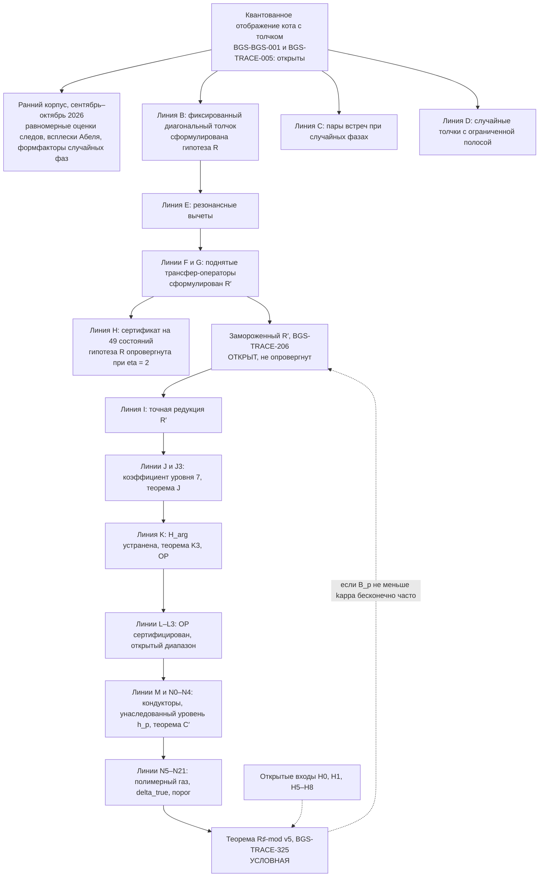

# BGS: квантованное отображение кота с толчком и открытый фронт гипотезы BGS

[](record/claim_registry.md)
[](record/claim_registry.md)
[](record/claim_registry.md)
[](mathematics/open_questions.md)
[](record/claim_registry.md)
[](record/claim_registry.md)
[](formalization/README.md)
[](manuscript/BGS_unified.pdf)
[](LICENSE_POLICY.md)

[**Результаты**](RESULTS.md) · [English](README.md) · [Научный обзор](RESEARCH.md) · [Реестр утверждений](record/claim_registry.md) · [Математическое введение](docs/reader_guide.ru.md) · [Указатель теорем](mathematics/results.md) · [Рукопись (PDF)](manuscript/BGS_unified.pdf) · [Карта корпуса](docs/corpus_atlas.md)

> **Аннотация.** Репозиторий изучает гипотезу Бохигаса — Джаннони — Шмита (BGS) для одного явно заданного квантованного отображения кота на торе с толчком. **Предел BGS для этого отображения не доказан:** микроскопическая универсальность при фиксированной силе (BGS-BGS-001) и модельная знаковая оценка следов, которая закрыла бы разрыв (BGS-TRACE-005), обе открыты. Вокруг этой цели в программе зарегистрировано 419 точно очерченных утверждений; 338 доказаны в своей области (доказательства проекта, многие с компьютерной поддержкой, многие с внутренним независимым рецензентом, ни одно не прошло внешнего рецензирования). Среди них равномерные оценки следов для фиксированного толчка, точные формфакторы для случайных фаз и компьютерное опровержение гипотезы R при η = 2 (BGS-TRACE-179). Текущий фронт — исправленный закон среднего R′ (BGS-TRACE-206); он **открыт и не опровергнут**. Главный недавний результат, **теорема R♯-mod v5 (BGS-TRACE-325), условен**: она сводит нарушение замороженного R′ вдоль m = 3p к явно перечисленным открытым входам H0, H1 и H5–H8.

Числа на значках статичны и взяты из [`record/claims.json`](record/claims.json) (реестр обновлён 2026-11-01); статус определяет реестр, а не эта страница ([SOURCE_OF_TRUTH.md](SOURCE_OF_TRUTH.md)). **GitHub Actions в этом репозитории не работает** (оплата аккаунта, на 1 ноября 2026 года), поэтому значка CI нет: все приведённые проверки выполнены локально, а их журналы закоммичены в [`evidence/executions/`](evidence/README.md).

## Содержание

* [Состояние вкратце](#состояние-вкратце)
* [Задача](#задача): [о чём гипотеза](#о-чём-гипотеза), [точная модель и цель](#точная-модель-и-цель), [замороженный закон среднего R′](#замороженный-закон-среднего-r-bgs-trace-206)
* [Основные результаты](#основные-результаты) и [теорема R♯-mod v5](#главный-текущий-результат-теорема-r-mod-v5-условная)
* [Как связаны линии исследования](#как-связаны-линии-исследования)
* [Другие результаты и оставшийся разрыв](#другие-результаты-и-оставшийся-разрыв)
* [Принципы проверки](#принципы-проверки)
* [Карта репозитория](#карта-репозитория)
* [Как воспроизвести](#как-воспроизвести)
* [Известные проблемы](#известные-проблемы)
* [Три восстановленных аналитических результата](#три-восстановленных-аналитических-результата)
* [Чтение, воспроизведение и цитирование](#чтение-воспроизведение-и-цитирование)

## Состояние вкратце

| Состояние в реестре | Утверждений | Смысл |
|---|---:|---|
| proved (доказано) | 338 | Доказательство проекта в указанной области, включая компьютерные доказательства; не внешнее рецензирование |
| verification-pending (ожидает проверки) | 17 | Аргумент или вычисление есть; независимая проверка ещё не выполнена |
| conditional (условно) | 21 | Доказанная импликация из явных гипотез, которые сами открыты |
| open (открыто) | 42 | Гипотеза, предположение или обязательство программы без доказательства |
| refuted (опровергнуто) | 1 | Ложно в исходной формулировке (гипотеза R, BGS-TRACE-179) |
| **всего** | **419** | |

144 неоткрытых утверждения ссылаются на файлы Lean 4; всего в `formalization/Bgs` 155 модулей. Lean подтверждает конечные или арифметические утверждения, названные в границе каждого утверждения, но не полные аналитические доказательства.

## Задача

### О чём гипотеза

[Работа 1984 года](https://doi.org/10.1103/PhysRevLett.52.1) связала спектры квантовых хаотических систем с универсальными флуктуациями случайных матриц. Строгая теорема требует точного квантового семейства, правильного сектора симметрии, обоснованной развёртки спектра и локального корреляционного предела. Одна лишь классическая гиперболичность не определяет автоматически класс симметрии или универсальный спектр.

Для унитарного класса эталоном является детерминантальный процесс $\mathrm{Sine}_2$ с ядром и парной корреляцией различных точек

```math
K(x,y)=\frac{\sin\pi(x-y)}{\pi(x-y)},
\qquad
\rho_2(x,y)=1-|K(x,y)|^2.
```


*Аналитические эталонные кривые, **не численные данные** основной модели. Показана парная корреляция, а не распределение расстояний между соседними уровнями.*

### Точная модель и цель

Для нечётных $N\ge3$ изучается семейство

```math
S=\begin{pmatrix}3&4\\2&3\end{pmatrix},
\qquad
U_N=\exp(i\tau N A_N)M_N,
\qquad
\tau=10^{-80}.
```

Здесь $M_N$ — фиксированное квантование гиперболического отображения кота, а $A_N$ — заданное Вейлево квантование нелинейного возмущения. [Каноническое описание](mathematics/fixed-map/fixed_map_resolvent_frontier.md) уточняет конвенции, исключительные размерности и симметрии. **Связь остаётся фиксированной при $N\to\infty$**: замена её на исчезающее возмущение, независимые случайные фазы или шум меняет задачу.

Следующий парный эталон в предписанной иерархии моментов следов для данного семейства пока не доказан. Слабая сходимость к Sine₂ сама по себе не гарантирует сходимости этих неограниченных парных моментов без дополнительной равномерной интегрируемости:

```math
L_N(s)=\frac{1}{N^2}\sum_{m\ge1}e^{-2sm/N}
\left|\mathrm{Tr}\,U_N^m\right|^2
\;\longrightarrow\;
\frac{1-e^{-2s}}{4s^2},
\qquad s>0.
```

Полная задача [BGS-TRACE-005](mathematics/open_questions.md#b-prove-heisenberg-scale-desymmetrized-joint-trace-estimates) сильнее: **знаковое факториальное сравнение совместных следов** после правильного разделения симметрий, для всех фиксированных порядков и гладких тестов с компактной фурье-поддержкой при $m\asymp N$. Абсолютная величина берётся **после полной фурье-суммы**, а не для каждого слагаемого отдельно. [Переход от следов к локальной статистике](mathematics/trace-bridge/trace_to_local_statistics_bridge.md) описывает дополнительные условия плотности и продолжения.

[Продолжение об операторной точности](mathematics/trace-bridge/microscopic_unitary_stability_20261027.md) переносит парный тест исходной семьи через матричную ошибку $O(N^{-2})$, используя TRACE-113; значение предела при этом не установлено. [Теорема о коротких следах](mathematics/fixed-map/balanced_rounding_research_20261027.md) показывает недостаточность полиномиального числа коротких следов и более грубых квантовых данных для общего квантования. [Разбор результатов](record/trace005_continuation_review.md) отделяет эти доказательства с авторской проверкой от ранее известных результатов и ещё не проверенных кандидатов.

### Замороженный закон среднего R′ (BGS-TRACE-206)

Недавние линии работают с более простым толчком из одного косинуса — толчком k1, 0.9 cos 2πq при η = 2, где λ = 3 + 2√2. Для нечётных m модуль пелевского типа h_m удовлетворяет λ^m ≡ 1 (mod h_m). Гипотеза R для толчка линии B (BGS-TRACE-179) предсказывала, что перенормированное отклонение следов есть o(m). Линия H показывает, что при η = 2 это неверно (BGS-TRACE-209, с компьютерной поддержкой), поэтому BGS-TRACE-179 зарегистрировано как **опровергнутое**. Затем линия G предложила исправленный закон среднего R′ для толчка k1 ([BGS-TRACE-206](mathematics/fixed-map/resonance_classification_lineG.md)). Он вычитает резонансные вклады фиксированного первичного набора P* = {(±2, 8), (±2, 16)} на каждом включённом уровне d | h_m, 1 < d ≤ √h_m, и утверждает, что оставшееся отклонение W′_m есть o(m).

Определение **заморожено**: правило включения, члены и нормировка зафиксированы в границе утверждения, так что последующие линии не могут его подстраивать. Линии I–N исследуют, выполняется ли замороженный R′ вдоль m = 3p (p простое). **R′ открыт: он не доказан и не опровергнут.**

## Основные результаты

Выборка с состояниями из реестра. Полный список — [`record/claim_registry.md`](record/claim_registry.md), генерируемая сводка — [RESULTS.md](RESULTS.md). Метки: [P] доказательство на бумаге, [CA] интервальная или шаровая арифметика, [CA-fp] плавающая точка с выведенными априорными оценками округления, [P-arith] арифметическая импликация, [H] гипотеза.

| Утверждение | Состояние | Результат | Lean | Источник |
|---|---|---|---|---|
| BGS-BGS-001 | **open** | Микроскопическая универсальность BGS при фиксированной силе для поддерживаемого замороженного отображения | — | [модель](mathematics/fixed-map/fixed_map_resolvent_frontier.md) |
| BGS-TRACE-005 | **open** | Знаковая оценка совместных следов на масштабе Гейзенберга с разделением симметрий (модельный разрыв до BGS) | только формулировка | [открытые вопросы](mathematics/open_questions.md) |
| BGS-TRACE-113 | proved | Равномерная оценка степеней следа для исходного семейства с фиксированным толчком (строгий зазор давления) | — | [заметка](mathematics/fixed-map/fixed_kick_uniform_trace_bound.md) |
| BGS-TRACE-117 | proved | Арифметические всплески, нечувствительные к толчку: парная статистика Абеля отстоит от CUE более чем на 1/2 на нечётных возвратах Пелля | да | [заметка](mathematics/fixed-map/kick_blind_arithmetic_spike.md) |
| BGS-TRACE-124 | proved | Каждый нечётный модуль лежит выше 3/4 или ниже 5/7 (чистое отображение кота) | да | [заметка](mathematics/fixed-map/odd_modulus_abel.md) |
| BGS-TRACE-127 | proved | Диагональный формфактор случайных фаз в моменты один, два и три | да | [заметка](mathematics/fixed-map/diagonal_phase_form_factor.md) |
| BGS-TRACE-143 | proved | Отображение кота с хааровскими диагональными фазами = звёздный граф ДПФ со случайными фазами; точное тождество пар встреч (линия C) | — | [заметка](mathematics/fixed-map/random_phase_encounter_pairs.md) |
| BGS-TRACE-149 | proved | Случайный толчок с ограниченной полосой: точный мост следов (линия D) | да | [заметка](mathematics/fixed-map/band_limited_kick_bridge.md) |
| BGS-TRACE-173 | proved | Сертифицированное экспоненциальное убывание χ_m для η в [1, 81.574] (с компьютерной поддержкой; линия B) | да | [заметка](mathematics/fixed-map/derandomized_fixed_kick.md) |
| BGS-TRACE-209 | proved | Гипотеза R неверна для толчка линии B при η = 2: W̃rest_m/m ≥ 1.4·10⁴ для нечётных m ≥ 47, 3 ∤ m (линия H, [CA]) | да | [заметка](mathematics/fixed-map/lineH_49state_certificate.md) |
| BGS-TRACE-179 | **refuted** | Гипотеза R в исходной формулировке (o(m) равномерно на компактных интервалах η) | — | [заметка](mathematics/fixed-map/derandomized_fixed_kick.md) |
| BGS-TRACE-206 | **open** | Гипотеза R′ (исправленный закон среднего, толчок k1, η = 2) | — | [заметка](mathematics/fixed-map/resonance_classification_lineG.md) |
| BGS-TRACE-213 | proved | Линия I: точная редукция R′ к (E″), (T″) и дилатационному остатку (D), ни одно из которых не доказано | — | [заметка](mathematics/fixed-map/lineI_rprime_reduction.md) |
| BGS-TRACE-225 | proved | Теорема J: вклад d = 7 осциллирует с ростом ≥ 1.0184224^m (с компьютерной поддержкой) | — | [заметка](mathematics/fixed-map/lineJ_d7_twisted_coefficient.md) |
| BGS-TRACE-235 | proved | Теорема K3: S⁺ содержит бесконечно много m = 3p в каждом классе единиц по модулю 56 | да | [заметка](mathematics/fixed-map/lineK_harg_removal.md) |
| BGS-TRACE-244 | proved | Операторный вход OP для четырёх семейств (сертификат arb) | да | [заметка](mathematics/fixed-map/lineK_harg_removal.md) |
| BGS-TRACE-257 | proved | Из H_mean следует, что замороженный R′ неверен вдоль m = 3p (только импликация; H_mean, BGS-TRACE-256, открыта) | — | [заметка](mathematics/fixed-map/lineL_op_open_range.md) |
| BGS-TRACE-283 | proved | Теорема N3: «шрамированные» кондукторы несут медленную орбиту β = 1 | да | [заметка](mathematics/fixed-map/lineMN_conductor_structure.md) |
| BGS-TRACE-296 | proved | Теорема C′: часть с единичными β на уровне h_p для p, при которых h_p бесквадратно (это не доказано ни для одного p) | да | [заметка](mathematics/fixed-map/lineN2N4_inherited_level.md) |
| **BGS-TRACE-325** | **conditional** | **Теорема R♯-mod v5**: условная редукция «замороженный R′ неверен вдоль m = 3p» к H0, H1, H5–H8 | да | [заметка](mathematics/fixed-map/lineN5N18_gas_conditional.md) |
| BGS-TRACE-326 | proved | H4 выполнено: δ_true ≤ 5.0313·10⁻⁶ для всех G ([P] + [CA-fp]) | да | [заметка](mathematics/fixed-map/lineN5N18_gas_conditional.md) |
| BGS-TRACE-332 | conditional | Предложение K: из H1 следует H3 (вес Котецкого — Прейсса a = a(C)) | да | [заметка](mathematics/fixed-map/lineN5N18_gas_conditional.md) |
| BGS-TRACE-333 | conditional | Сравнение газа и оценки Робина со всеми бюджетами скоростей: первое простое 3307 (C ≤ 0.082) / 1409 (C ≤ 8.8·10⁻⁴) | да | [заметка](mathematics/fixed-map/lineN5N18_gas_conditional.md) |

### Главный текущий результат: теорема R♯-mod v5 (условная)

Каноническая формулировка — [`THEOREM_DRAFT_v5.md`](computations/verification/lineN_theorem_draft/THEOREM_DRAFT_v5.md) (авторская v5 с правками E1–E8 финального рецензента lineN22); зарегистрированное утверждение — BGS-TRACE-325, глава рукописи — [`lines_I_N_gas_theorem.tex`](manuscript/unified_sections/lines_I_N_gas_theorem.tex). Для простого p и m = 3p положим

```math
B_p=\frac{n}{h_p}\Big[\big(2(1+\mathrm{Re}\,\Lambda'_{\mathrm{lo}})^{p}\,e^{-p(\delta+A_{\mathrm{bad}}^{\mathrm{KP}})}-1-|X_{\mathrm{tail}}|-|X_{\mathrm{cross}}|-|Y|-e^{-0.28p}\big)^{2}-1\Big]-I_p-\varepsilon_{16}-\varepsilon_{\mathrm{fl}}-\varepsilon_{\mathrm{other}} .
```

Нижняя оценка газа в скобке равна 2(1 + Re Λ′)^p e^{−p(δ + A_bad)} − 1, где Re Λ′_lo = 6.234·10⁻⁴ (BGS-TRACE-310), δ = δ_true ≤ 5.0313·10⁻⁶ (BGS-TRACE-326), а A_bad = A_bad^KP — активность плохих кластеров по Котецкому — Прейссу из предложения K (BGS-TRACE-332), зависящая от константы C гипотезы H1. Величина I_p = σ(K_p)/K_p − 1 оценивается неравенством Робина. При H0, H1 и H5–H8 в точке p и p ≥ p_thr

```math
\frac{W'_{3p}}{m}\;\ge\;-4+\frac1m\sum_{\rho=(\pm2,8)}S_\rho\,B_p,\qquad S_\rho\ge c\,1.13287^{m},
```

поэтому **если B_p ≥ κ > 0 для бесконечно многих простых p ≥ p_thr, то W′_{3p}/m → ∞ и замороженный R′ неверен вдоль m = 3p.** Теорема имеет метку [P mod inputs]; шаг, вносящий A_bad^KP в показатель, — [P-sketch], и рецензент lineN22 признал его верным и необходимым. Теорема заменяет v4 (BGS-TRACE-299).

| Вход | Содержание | Состояние в реестре |
|---|---|---|
| H0 | Постоянный пакет (представление следов линий F/J/J3/L16; архитектура предложения X′, BGS-TRACE-324; n_cert) | принимается как данность; BGS-TRACE-324 ожидает проверки |
| H1 | Переформулирована линией N20: совместный второй момент (A, B) плохих кластеров, C ≤ 0.082 при J₀ = 12, плюс константы близких столкновений | **open** ([BGS-TRACE-336](mathematics/fixed-map/lineN5N18_gas_conditional.md)) |
| H2 | Константа взаимодействия ядра δ_int^core ≤ 5.14476·10⁻⁷ | выполнено (BGS-TRACE-307, proved, [CA-fp]) |
| H3 | Полимерный вес Котецкого — Прейсса | **open** (BGS-TRACE-301); больше не вход: следует из H1 по предложению K (BGS-TRACE-332, conditional) |
| H4 | Переход от ядра к истинному функционалу | **выполнено**: δ_true ≤ 5.0313·10⁻⁶ (BGS-TRACE-302 через BGS-TRACE-326, proved) |
| H5 | Составное h_p или p с простым h_p | **open** (BGS-TRACE-303) |
| H6 | Входы теоремы C′: явное p₀, бесквадратность h_p | **open** (BGS-TRACE-304) |
| H7* | Уровни, отличные от h_p, рост ниже T′ = 1.42785 | **open** (BGS-TRACE-305) |
| H8 | Точки «заворачивания» при составном h_p | **open** (BGS-TRACE-306) |

**Порог (BGS-TRACE-333, условно по H1, [P-arith]).** При идеализации хвосты = Y = X_cross = ε = 0, n/h_p := 1 оценка газа превосходит оценку Робина на унаследованных уровнях начиная с **первого простого 3307** при C ≤ 0.082. Это значение хрупкое: +1 % в A_bad^KP сдвигает его до 3359. При C ≤ 8.8·10⁻⁴ первое простое — **1409**, и оно устойчиво вплоть до множителя 2 в A_bad^KP. Порог с аддитивными бюджетами не вычислен.

> **R′ НЕ опровергнут.** Теорема R♯-mod v5 — это редукция. Её входы H0, H1 и H5–H8 открыты, причём H7* нужен даже при простом h_p. Никакое неравенство для отдельного p в режиме больших p не доказано, а данные для малых p только численные.

## Как связаны линии исследования



*Это карта исследований, а не цепочка доказанных импликаций. Пунктирные стрелки условны. В репозитории линии для фиксированного отображения помечены буквами от B до N; метки «линия A» нет, и ранний корпус показан одним узлом.*

## Другие результаты и оставшийся разрыв

В проекте различаются несколько самостоятельных направлений:

| Математический слой | Установлено в указанной области | Пока не установлено |
|---|---|---|
| Переход от спектра к следам | Точная конечномерная комбинаторика и условные критерии корреляций | Знаковые совместные оценки для исходной модели |
| Основная модель: интенсивности и пути | [FM-021](mathematics/fixed-map/position_chain_mixing.md) — смешивание и циклический рост; [FM-022](mathematics/fixed-map/reversed_path_decay.md) — подавление обратных путей | Вся оставшаяся когерентная интерференция, включая отрицательную поправку плато |
| Сбалансированная микроскопика | Точные тождества [Уорда](mathematics/trace-bridge/phase_ward_identity.md) и [энергии Шура](mathematics/trace-bridge/balanced_pair_schur_reduction.md) | Нужные предельные оценки перекрытий и радиальной энергии |
| Следы и вставки | Отдельные [WKB](mathematics/fixed-map/factorial_wkb_reduction.md)-секторы, [упорядоченные диагонали](mathematics/fixed-map/factorial_ordered_diagonal.md) и [иерархия без масок](mathematics/fixed-map/right_frame_unmasked_pinch_hierarchy.md) | Полный знаковый остаток, маски и недемпфированные границы |
| Стохастическое сравнение | Шумовые локальные законы [FLOW-014](mathematics/fixed-map/circular_dyson_actual_start.md) и [FLOW-017](mathematics/fixed-map/coboundary_all_order_limit.md) при разных явно указанных режимах | Снятие шума для исходного детерминированного семейства |
| Другие математические результаты | [Кэли](mathematics/topics/cayley-arithmetic/README.md), [Пелль](mathematics/topics/pell/README.md), [возвраты](mathematics/topics/returns/README.md), резонансы, локальность и информация | Строгая импликация из отдельных режимов к детерминированной BGS |
| Формализация Lean | [Карта покрытия Mathlib](formalization/MATHLIB_LAYER_RU.md) связывает 29 прежних и 39 адаптированных модулей с конечными, алгебраическими и отдельными скалярными результатами; исторический протокол содержит проверку аксиом для 589 деклараций | Полная аналитическая иерархия следов и детерминированный предел BGS |

Решающая трудность — не отсутствие конечномерных тождеств, а **контроль знаковых сокращений на времени Гейзенберга** для неизменённого пропагатора. Ни график расстояний, ни результат для вспомогательной случайной модели сами по себе не закрывают эту задачу. Точные границы результатов приведены в [научном обзоре](RESEARCH.md), а список незакрытых импликаций — в [постановке открытых задач](mathematics/open_questions.md).

### Почему требуется знаковое плато

Для случайной матрицы $V_N$ из кругового унитарного ансамбля справедлив точный эталон при положительных степенях:

```math
\mathbb E_{\mathrm{CUE}}\left|\mathrm{Tr}\,V_N^m\right|^2
=\min(m,N),\qquad m\ge1.
```

Нормированная форма циклического линейного вклада — $x=m/N$, тогда как эталон CUE равен $\min(x,1)$. При $x>1$ разность составляет **$1-x<0$**. Поэтому одного циклического роста недостаточно для нужного плато: остальные когерентные знаковые вклады должны в сумме дать отрицательную поправку. Это необходимое условие, **но не доказанный результат** для исходного детерминированного семейства.


*Аналитическое сравнение, не симуляция. Закрашена величина отрицательной поправки относительно циклического линейного вклада.*

## Принципы проверки

**Один источник статуса.** Учитывается только состояние в [`record/claims.json`](record/claims.json). Заметки, этот README, RESULTS.md и рукопись — его представления. [Хронологический журнал](record/claim_ledger.md) объясняет каждое изменение, а [SOURCE_OF_TRUTH.md](SOURCE_OF_TRUTH.md) задаёт порядок разрешения разночтений.

**Метки доказательности.** В заметках и черновиках теорем:

| Метка | Смысл |
|---|---|
| [P] | Доказательство на бумаге, выписанное полностью (и прорецензированное, где это указано) |
| [P-sketch] | Аргумент полон только в общих чертах |
| [CA] | Компьютерное доказательство со строгой шаровой или интервальной арифметикой (arb) |
| [CA-fp] | IEEE binary64 с выведенными априорными оценками округления в указанной модели; **не** [CA] |
| [P-arith] | Арифметическая импликация, проверенная в плавающей точке с точными целыми частями и монотонностью |
| [N] | Численные данные без контроля ошибки: свидетельство, но никогда не доказательство и никогда не регистрируется как proved |
| [H] | Гипотеза или эвристика |

Условная теорема сильна ровно настолько, насколько сильна её самая слабая открытая предпосылка. Заменённые или отозванные значения сохраняются в разделах опечаток черновиков и не цитируются.

**Формализация Lean 4.** В [`formalization/`](formalization/README.md) находится 155 модулей в `formalization/Bgs` (2186 деклараций `theorem`/`lemma` по подсчёту grep), закреплённых за `leanprover/lean4:v4.33.1` и Mathlib через `lake-manifest.json`. Lean проверяет конечные и арифметические ядра, названные в границе каждого утверждения, но не аналитические доказательства; 144 неоткрытых утверждения ссылаются на файл Lean. Сборка:

```sh
cd formalization && lake exe cache get && lake build Bgs
```

Последняя полная локальная сборка завершилась строкой «Build completed successfully (8862 jobs)» ([журнал](evidence/executions/20261101/lineNgas/v5_integration/lake_build_Bgs.log)); этот PR не меняет ни одного файла Lean. **`sorry` в активном графе запрещён**, а новые модули печатают свои аксиомы (не более `propext`, `Classical.choice`, `Quot.sound`). **Унаследованный `native_decide`:** 88 использований в 12 старых модулях доверяют компилятору сверх аксиом ядра. Границы утверждений это раскрывают; модули линий B–N его не используют.

**Рецензии.** Каждая линия начиная с E прошла независимую внутреннюю рецензию. В [`computations/verification/`](computations/verification/lineN16/referee/REPORT.md) 24 папки `referee/` (от lineE до lineN16), а финальные рецензии линии N — lineN20, lineN21, lineN21b и lineN22 — лежат в [`evidence/executions/20261101/lineNgas/referee/`](evidence/executions/20261101/lineNgas/v5_integration/README.md). Замечания рецензентов применяются дословно и перечислены в черновиках. Это не внешнее рецензирование.

**Проверка зависимостей.** Доказанное утверждение не может зависеть от недоказанного. Скрипт [`proved_deps_gate_v5.py`](computations/verification/lineN_theorem_draft/integration_checks/proved_deps_gate_v5.py) строг для BGS-TRACE-244..336 с одним исключением — замороженным определением BGS-TRACE-206. Последний запуск вернул GATE_OK ([журнал](computations/verification/lineN_theorem_draft/integration_checks/proved_deps_gate_v5.log)). Семь более старых нарушений в main записаны там как выходящие за рамки.

**Замороженные пакеты.** Пакеты авторов и рецензентов в `computations/verification/line*/` хранятся дословно и закреплены sha256 ([реестр](computations/maintenance/frozen_evidence_packets.json)). Они фиксируют то, что было запущено, и не являются поддерживаемыми точками входа.

## Карта репозитория

```sh
BGS/
├── README.md, README.ru.md   # эта страница (английская / русская)
├── RESULTS.md                # генерируемая сводка на одну страницу (render_results.py)
├── RESEARCH.md               # датированный научный обзор
├── SOURCE_OF_TRUTH.md        # какая поверхность что решает
├── record/                   # claims.json (реестр), журнал, опечатки, аудиты, генерируемые виды
├── mathematics/              # поддерживаемые доказательства и их точные границы
│   └── fixed-map/            # модель, заметки линий B–N (line*.md)
├── computations/
│   ├── verification/         # проверки и аудиты; line*/ = замороженные пакеты авторов и рецензентов
│   │   └── lineN_theorem_draft/   # THEOREM_DRAFT v1–v5, пакет V5, проверка зависимостей
│   └── maintenance/          # генераторы, сборка рукописи, модульные тесты (tests/)
├── formalization/            # проект Lean 4 (Bgs.lean, Bgs/*.lean, lakefile.toml)
├── manuscript/               # единый исходник TeX и отслеживаемый BGS_unified.pdf
│   └── unified_sections/     # по одному .tex на раздел, включая lines_I_N_gas_theorem.tex
├── evidence/                 # датированные протоколы: команды, хеши, журналы
├── literature/               # проверки источников, библиография, приоритет
├── docs/                     # путеводители, конвенции, карта корпуса
├── papers/                   # возможные отдельные статьи (не поданные)
├── supplement/               # дополнительные материалы по фиксированному отображению
├── environment/              # манифест окружения
├── assets/figures/           # рисунки README и рукописи
└── archive/                  # исторические снимки, сохранённые ради происхождения
```

## Как воспроизвести

Все команды запускаются из корня репозитория. Зависимости Python закреплены в `requirements.txt`; запуски 1 ноября выполнялись в виртуальном окружении с pandoc в `PATH`.

```sh
pip install -r requirements.txt
## аудиты реестра и репозитория
python computations/verification/scientific_registry_audit.py
python computations/verification/repository_audit.py
## генерируемые виды должны быть синхронны (каждая команда печатает OK)
python computations/maintenance/render_results.py --check
python computations/maintenance/render_appendix_a.py --check
python computations/maintenance/render_claim_registry.py --check
## модульные тесты (40 файлов, 266 тестов)
python -m unittest discover -s computations/maintenance/tests
## Lean
(cd formalization && lake exe cache get && lake build Bgs)
## PDF рукописи (pdflatex или Tectonic через переменную TECTONIC)
python computations/maintenance/build_unified_manuscript.py --engine auto --output-dir out
```

Полный список из 23 проверок (аудит реестра, библиографический аудит и его самопроверка, восемь проверок генераторов, проверки замороженных пакетов, аудиты репозитория и спектрального издания, аудиты wave2/wave3 и проверки их источников, проверка ссылок рукописи и три проверки синхронизации) и их последние результаты находятся в [`evidence/executions/20261101/final_presentation/`](evidence/executions/20261101/final_presentation/README.md). Сборщик рукописи завершается ошибкой при любом переполненном боксе, неразрешённой ссылке или цитате и повторной метке и записывает манифест; `--publish` копирует проверенный PDF в `manuscript/`. Подробнее: [REPRODUCE_unified.md](REPRODUCE_unified.md).

## Известные проблемы

* **Непрерывной интеграции нет.** На 1 ноября 2026 года GitHub Actions отказывался запускать задачи в этом репозитории (оплата аккаунта). Все приведённые здесь и в недавних PR результаты проверок — локальные запуски с закоммиченными журналами.
* **Унаследованный `native_decide`.** 88 использований в 12 старых модулях Lean опираются на нативное вычисление и потому доверяют компилятору. Модули линий B–N его не используют.
* **Битые ссылки в закреплённых файлах.** 24 относительные ссылки в 11 файлах указывают на пути, которые позже переместились. Эти файлы побайтно закреплены печатями, манифестами или протоколами либо генерируются и намеренно не редактируются; список — в [RESULTS.md](RESULTS.md#known-issues).
* **Замороженные пакеты.** 368 дословных файлов пакетов, закреплённых sha256, не подпадают под политику точек входа и шаг компиляции с SyntaxWarning ([обоснование](computations/maintenance/ASSERTION_POLICY.md)).
* **Слабые свидетельства у нескольких утверждений.** BGS-TRACE-095 и BGS-TRACE-097 (conditional) не указывают проверяющего скрипта. BGS-RES-015 (proved) ссылается на собственную заметку как на свидетельство и зависит от условного BGS-RES-014 в тождестве символов, которое пересчитывает напрямую.
* **Рукопись кратко излагает линии I–N.** Линии I–N (BGS-TRACE-211..336) представлены одной сжатой главой с результатами и их состояниями в реестре. Доказательства остаются в заметках `mathematics/fixed-map/line*.md` и в пакетах.

## Три восстановленных аналитических результата

**Фазовая память при повторном использовании тех же фаз — [BGS-TRACE-053](mathematics/trace-bridge/max_entry_phase_channel.md).**
Для $S\in U(m)$ положим $P_{ij}=|S_{ij}|^2$, $\delta=\max P_{ij}$,
$A=\Pi\mathrm{Ad}(S)$ и
$T_n=\mathbb E_D\mathrm{Ad}((DS)^n)$. Здесь $\Pi$ — диагональное
пинчирование, а независимые равномерные диагональные фазы $D$ остаются теми
же во всех степенях; все элементы $J_m$ равны $1/m$.
На всём комплексном пространстве Фробениуса при $n\ge2$

$$\|T_n-A^n\|_{2\to2}
\le(n!-1)\sqrt\delta+n!n(n-1)\delta.$$

При $n=2$ норма равна $\max_{i\ne j}|S_{ij}S_{ji}|\le\delta$.
Если $\|P-J_m\|\le\rho<1$, усреднённое пинчирование по собственным
подпространствам на бесследовых матрицах имеет норму
$O_\rho(\log\log(1/\delta)/\log(1/\delta))$ при $\delta\to0$.
Эта оценка операторной нормы ещё не вычисляет микроскопический спектральный след.

**Оптимальные производные матричных внутренних функций — [BGS-TRACE-054](mathematics/trace-bridge/sharp_inner_jet.md).**
Пусть $F=zG$ — квадратная конечная рациональная внутренняя матричная функция,
$T=F^*zF'\ge I$ на окружности и $d\mu=d\theta/(2\pi)$.
При $\dot T=dT/d\theta$, без предположения коммутативности

$$\int\mathrm{Tr}(\dot T T^{-1}\dot T)\,d\mu
\le\frac13\int\mathrm{Tr}(T^3-T)\,d\mu,$$

$$\int\|F''T^{-1/2}\|_F^2\,d\mu
\le\frac43\int\mathrm{Tr}T^3\,d\mu
-2\int\mathrm{Tr}T^2\,d\mu
+\frac23\int\mathrm{Tr}T\,d\mu.$$

Главный коэффициент $4/3$ оптимален в каждой матричной размерности; во
вложении стояло $13/3$. Гладкая локализация сохраняет явную поправку с
производной веса. Доказательство само по себе не даёт кубического момента
задержки случайной полости.

**Перенос скалярного источника при обычном поглощении — [BGS-TRACE-056](mathematics/trace-bridge/phase_channel_real_flow.md).**
Для последовательности детерминистических унитарных $S_m$ с
$\delta_m=\max_{ij}|(S_m)_{ij}|^2\to0$ и
$\||S_m|^2-J_m\|\le\rho<1$, а также эрмитовых $H_m$,
независимых от повторно используемых случайных фаз, при
$\mathrm{Tr}H_m=m$ и $\mathrm{Tr}H_m^2\le C_Hm$ сопоставление
собственных фаз вдоль $DS_m e^{ixH_m/m}$ даёт $L^1$-сравнение
нормированного скалярного резольвентного источника с источником
$e^{ix/m}DS_m$. Сходимость локально равномерна при
$\mathrm{Re}\,s>0$ и ограниченных вещественных $x$, включая
каждую фиксированную производную по поглощённому скалярному параметру $s$.
Учтены кратные собственные значения. Продолжение от 11 октября доказывает
сравнение физических источников в $L^2$ и все фиксированные произведения
нормально поглощённых источников при указанных в нём условиях. Высшие
произведения физических источников и гипотезы для фактической полости
остаются открытыми; предел для детерминистического $D=I$ не доказан.

Это самостоятельные доказательства проекта с независимым внутренним
восстановлением. Внешний приоритет не установлен.
[Разбор вложенной статьи](literature/phase_channel_jet_sources_20261008.md)
сопоставляет её утверждения с действующими результатами и кандидатами,
ожидающими проверки. В частности, полилогарифмическая иерархия глубокого
источника BGS-TRACE-055 **ещё не прошла доказательную проверку**.

## Чтение, воспроизведение и цитирование

Начните с [математического введения](docs/reader_guide.ru.md), затем воспользуйтесь [указателем теорем](mathematics/results.md) или [тематической картой](mathematics/topics/README.md). Зарегистрированные статусы определяет [реестр утверждений](record/claims.json), [хронологический журнал](record/claim_ledger.md) объясняет изменения, а [SOURCE_OF_TRUTH.md](SOURCE_OF_TRUTH.md) задаёт порядок разрешения разночтений.

[Полная исследовательская рукопись](manuscript/README.md) ([PDF](manuscript/BGS_unified.pdf)) — **развивающееся научное изложение**. Это не завершённое доказательство BGS и не замена исходным доказательствам. [Отдельные публикационные направления](papers/README.md) — возможные статьи, а не поданные работы.

[Воспроизведение](REPRODUCE_unified.md) · [Вычисления](computations/README.md) · [Границы Lean-формализации](formalization/README.md) · [Литература и приоритет](literature/README.md) · [Порядок участия](CONTRIBUTING.md) · [Рецензирование](REVIEWING.md) · [Опечатки](ERRATA.md) · [Журнал изменений](CHANGELOG.md)

**Цитирование.** Цитируйте конкретный результат, где это возможно, и этот репозиторий — для корпуса и инфраструктуры проверки. Метаданные — в [CITATION.cff](CITATION.cff): Maksim Churilov, *BGS: arithmetic quantum chaos and spectral universality*, версия research-2026.10.1, https://github.com/ChurilovMaksim/BGS. Эта версия обозначает релиз research-2026.10.1, а не текущую ветку main.

**Лицензия.** Исходный код (`computations/`, `formalization/`) распространяется по лицензии MIT ([LICENSE](LICENSE)). Научные тексты, рукопись, математическое изложение, реестры и исследовательские данные распространяются по лицензии CC BY 4.0 ([LICENSE-CC-BY-4.0.txt](LICENSE-CC-BY-4.0.txt)). Карта соответствия путей лицензиям и её история — в [LICENSE_POLICY.md](LICENSE_POLICY.md).

*Для работы с репозиторием, проверки и реализации кода использовались GPT 6 и Muse Spark 1.3. Статус доказательства проекта не означает независимого внешнего рецензирования или установленного научного приоритета.*
