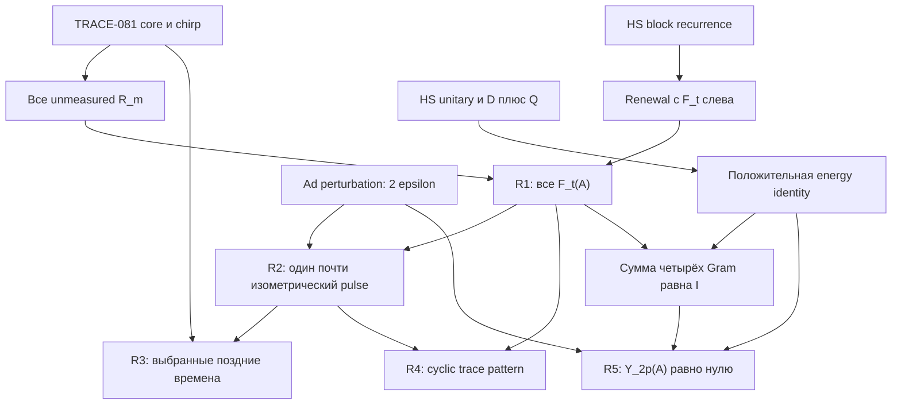

# Независимый аудит наблюдаемого first-return pulse, R1–R5

Дата: 14 октября 2026 года. Проверяется полный окончательный frozen кандидат, а не авторский verdict и не только finite controls.

**Нормализованное утверждение.** Пусть $k\ge2$, $n=4^k$, $p$ — нечётное простое, $N=np$, $\epsilon=N^{-4}$, $A=H^{\otimes k}\otimes V_p$, $S=(H^2)^{\otimes k}$. Для выбранного в TRACE-081 простого спектра $U=AE$, $\|U-A\|\le\epsilon$, first-return amplitudes определены именно как $F_t(U)=\mathcal D\mathcal T_U(\mathcal Q\mathcal T_U)^{t-1}\mathcal D$, $t\ge1$. R1 вычисляет все коэффициенты для $A$ на всех положительных временах. R2 даёт почти изометрический один коэффициент $F_{2p}(U)$ и предел его normalized HS energy на centered diagonal space при совместном $k,p\to\infty$. R3 выбирает одну последовательность $p_k\ge4^{k^2}$ с задержкой позднее каждого фиксированного $N^\alpha$, $0<\alpha<1$, и всё же $o(N)$. R4 при $p\ne3$ даёт точную finite-$q$ ошибку $q\delta$ для всех $q\ge1$, $\delta=4p\epsilon$, и fixed-$q$ пределы в этом же совместном режиме. R5 для всех диагональных источников ограничивает всю положительную energy tail после $2p$ величиной $\delta^2$.

**Единственный основной verdict: proved as written — доказано в сформулированном виде.** Все R1–R5 проходят самостоятельную реконструкцию с заявленными порядками произведений, областями, константами и кванторами. Недостающей математической импликации в этом frozen кандидате не обнаружено. Это доказательство abstract-family obstruction; оно не закрывает physical-source hierarchy или BGS.

## Точная привязка

Полный исходник получен через GitHub fetch_file по точному commit. Все его 9693 characters прочитаны, включая R5 и Boundary.

| Артефакт | Идентификация |
|---|---|
| Окончательный candidate commit | aaaa25c412147c08ab1ae8c4f83d85a0cefd6932, unreferenced proposal |
| Candidate tree | fd6e738ebca201dca75d0530f56b836483704e8c |
| Mathematics path | mathematics/coherent_first_return_pulse_20261014.md |
| Candidate Git blob | bbb8fc78e5405ada148fadbe52da9d95eaff0096 |
| Candidate SHA-256 | c79a75933760de94f73f610c79af0e9c6a5f7bb59bbd78828a5df398fe1d9a7c |
| Base main | 57150ac73b5140af744b62fe1653a199a7781a04 |
| TRACE-081 на base main | Git blob d7a2ec9297819f409d322dd95d336d7bec23f5ee; SHA-256 d78e0a8b27e77c3853caab03e05357a0f878e27ed7fe1d8c57d066008ee94c91 |
| TRACE-082 на base main | Git blob db7cd07b5ed3686698bc1b3c1f5cbcef2d8cef0e; SHA-256 5c311f6f09714abfe3da9e4e50befa33a5acda3449f19bdb30e331183bb561bc |
| Собственный контроль | [independent_controls.mjs](independent_controls.mjs), Git blob d1aa12b62f8aef9d97bf1892090f6c616722e6c2, SHA-256 d2219c7f5a2680188d783ccd92c2206f8ad7791dc790af08195982199e8b9b62 |
| Фактический собственный результат | [independent_controls_result.json](independent_controls_result.json), Git blob b944717e2e05db63aba952418d84e8cae47e33f2, SHA-256 258f2fd565ec1013fd21667e368087869682f1e4f25a2726fcc4349ffa638eb5 |

[Полный проверенный кандидат](https://github.com/ChurilovMaksim/BGS/blob/aaaa25c412147c08ab1ae8c4f83d85a0cefd6932/mathematics/coherent_first_return_pulse_20261014.md) — authoritative объект этого аудита. R1 начинается на строке 36, R2 — 84, R3 — 130, R4 — 151, R5 — 192, Boundary — 236.

Промежуточные inputs d5411d8f8ec64868a6138dd8e100b1c0a6d06d4c / blob ad149b38e5e26ba31e78388cd2991bf5df77428b и 09cec34c287339cd60beab90b55cedf523440e08 / blob cd72da3d0eec9ff671cd64238aa170b9e1fffe79 также были прочитаны целиком. Побайтно проверено, что R1–R3 и Boundary сохранились в R1–R4 revision, а R1–R4 и Boundary сохранились в окончательном R1–R5 revision. Вердикт привязан только к последней полной версии.

AGENTS.md и SOURCE_OF_TRUTH.md повторно прочитаны на base main. Применён ранее прочитанный mathbox:proof-audit и его checklist логики, admissible objects, норм, действий, boundary cases, computation coverage и convergence scope. SHA-256 обоих current prerequisite proofs совпадает с источниками предыдущего самостоятельного аудита TRACE-081/082. Их core definitions и exact phase construction используются на своей доказанной границе; никакой clock theorem не является входом.

## Граф зависимостей



Все математические листья здесь внутренние элементарные аргументы и точно указанные conventions. Проверочные программы подтверждают конечную алгебру, но не являются листьями универсальных или асимптотических выводов. R4 не требуется для R5. Полный return $R_m$ не подменяет first-return coefficient $F_t$.

## Матрица обязательств

| Обязательство | Статус | Решающее основание |
|---|---|---|
| Объект, нормы, complex domains | passed | $\mathcal T_U$ — unitary на $M_N(\mathbb C)$ с HS-нормой; diagonal vectors имеют Euclidean норму |
| $F_t$ против полного $R_t$ | passed | Между $t$ unitary steps стоят $t-1$ projections $\mathcal Q$; $R_t$ этих projections не имеет |
| $F_t=L E^{t-2}C$, $t\ge2$ | passed | Вставки $\mathcal Q^2=\mathcal Q$ и точные блоковые domains |
| Renewal порядок | passed | $R_m=\sum_{t=1}^mF_tR_{m-t}$ выведено без interchange факторов |
| Начало $R_0=I$, отсутствие $F_0$ | passed | Highest unknown $F_mR_0=F_m$ делает recursion уникальной |
| R1 все времена, не только один период | passed | Four-sector substitution удовлетворяет renewal при каждом $m\ge1$ |
| Odd prime, distinct times, $p=3$ | passed | $1,2,p,2p$ различны; $p=3$ допустим для R1/R2/R5 |
| Core powers и chirp powers | passed | Even powers — permutation; odd core powers flat; nonzero quadratic coefficient modulo $p$ gives flat chirp |
| Trace-zero domain $D_0$ | passed | $T$ сохраняет trace, $D$ сохраняет trace, $Q$ имеет trace-zero range |
| Perturbation constant и число факторов | passed | В $F_t$ ровно $t$ factors $T$; operator difference не больше $2t\epsilon$ |
| R2 isometry на именно $W$ | passed | $F_{2p}(A)|_W=S^p\otimes I$, $S$ unitary permutation |
| Min-max и positivity перед squaring | passed | $\delta<1$ в stated domain; существует $d_W$-мерное подпространство с uniform lower bound |
| HS operator norm meaning и normalization | passed | Это sum squared images ONB of $D_0$, делитель ровно $N-1$ |
| Совместный limit $k,p\to\infty$ | passed | Dimension ratio tends 1; fixed-$p$ limit не переносится сюда |
| R3 одна prime sequence для всех fixed $\alpha$ | passed | Lower growth exponent $(1-\alpha)k^2-\alpha k$ tends $+\infty$ |
| Exact reversal/time relation | passed | $\|B(U)\|^2=4^{-k}=1/n$, следовательно $t/N=2/n$ |
| R4 $p\ne3$ и positive $q$ | passed | $3\nmid p$; identity for $(S^p-J_n)^q$ применяется при $q\ge1$ |
| R4 all-$q$ finite error, fixed-$q$ limit | passed | Contractions telescope, trace bound uses dimension $N-1$ |
| Unconjugated vs conjugated traces | passed | $\operatorname{Tr}M^q$ отличается от $\operatorname{Tr}MM^*$; последнее normalized tends 1 |
| R5 exact energy difference | passed | Orthogonal $D/Q$ split после одного HS-unitary step |
| R5 Gram partition, $Y_{2p}(A)=0$ | passed | Все четыре Gram — orthogonal sector projections, сумма $I$ |
| R5 infinite tail | passed | Каждая finite partial sum ограничена; монотонный limit nonnegative sums |
| R5 all-source and normalized HS statements | passed | Uniform norm bound для $Y_{2p}(U)$; затем finite ONB sum |
| $M_U^q$ versus $F_{2pq}(U)$ | passed | Composition completed excursions не равна одной uninterrupted first excursion |
| Finite controls arithmetic/coverage | passed в явно указанном диапазоне | BigInt exact coefficients; полный matrix renewal, отдельный permutation replay |
| Weighted return times / UI / complete detection | out of scope | R5 требует только upper bound, не такую более сильную theorem |
| Actual physical source, phase ensemble, BGS | out of scope | Семейство abstract; физическая identification не добавлена |
| Priority, full registry/LaTeX/Lean/CI | out of scope | Этим pass не исследовались и не использовались для theorem verdict |

## Самостоятельная реконструкция R1

Запишем $\mathcal H=D\oplus Q$ и $\mathcal T=\left(\begin{smallmatrix}P&L\\C&E\end{smallmatrix}\right)$. Для diagonal $X_0$:
$$
a_{m+1}=Pa_m+Lc_m,\qquad c_{m+1}=Ca_m+Ec_m,\qquad c_0=0.
$$
Решение второй recursion и подстановка в первую дают
$$
R_m=PR_{m-1}+\sum_{s=0}^{m-2}LE^{m-2-s}CR_s
=\sum_{t=1}^m F_tR_{m-t}.
$$
Здесь $F_1=P$, $F_t=LE^{t-2}C$ для $t\ge2$. Это именно левый множитель $F_t$. Не нужно переставлять $F_t$ и $R_{m-t}$ или выводить order из факта commutation в данном примере. Из $R_0=I$ следует unique recursion
$$
F_m=R_m-\sum_{t=1}^{m-1}F_tR_{m-t}.
$$

С core definitions TRACE-081 имеем $H^2=K$, $K^3=I$. Поэтому $H^{2a}=K^a$, а $H^{2a+1}=K^aH$, где multiplication permutation сохраняет flat entry moduli. После tensorization
$$
P((H^{\otimes k})^m)=
\begin{cases}S^{m/2},&m\text{ even},\\J_n,&m\text{ odd}.\end{cases}
$$
В chirp $V_p^m=F_p^*\operatorname{diag}(\omega^{mb^2})F_p$. Если $p\mid m$, это identity. Иначе squared Gauss sum с nonzero coefficient $m\bmod p$ равен $p$ и каждый squared entry равен $1/p$. Это получается из bijection
$(b,c)\mapsto(b-c,m(b+c)+d)$, determinant $2m\ne0$ в $\mathbb F_p$, и Fourier orthogonality. Следовательно, stated formula для $R_m=P(A^m)$ верна при каждом $m\ge0$, включая $m=0$.

$S$ — permutation, фиксирующая $\mathbf1_n$, так что $S$ commutes with $J_n$. На four orthogonal diagonal sectors получаем:

| Sector | $R_m$ | Единственный nonzero first coefficient |
|---|---|---|
| constants $\otimes$ constants | Identity для каждого $m$ | $t=1$, identity |
| centered $n$ $\otimes$ constants | $S^a$ при $m=2a$, иначе 0 | $t=2$, $S$ |
| constants $\otimes$ centered $p$ | Identity при $p\mid m$, иначе 0 | $t=p$, identity |
| $W=$ centered $n$ $\otimes$ centered $p$ | $(S^p)^a$ при $m=2pa$, иначе 0 | $t=2p$, $S^p$ |

Каждый proposed first coefficient, повторяемый renewal, воспроизводит эту sequence при всех $m$, не только до $6p$. Unique recursion доказывает все claimed zero coefficients. Собирая sectors, получаем в точности
$$
F_1=J_n\otimes J_p,\quad
F_2=(S-J_n)\otimes J_p,\quad
F_p=J_n\otimes\Pi_p,\quad
F_{2p}=(S^p-J_n)\otimes\Pi_p.
$$
Для $p=3$ $S^p=I$; формулы остаются верными. Они относятся к $A$. После phase perturbation у $U$ exact zero coefficients вне этих времён не утверждаются.

## Самостоятельная реконструкция R2 и R3

Для unitary $U,A$ на ambient matrix space
$$
(\mathcal T_U-\mathcal T_A)X=(U-A)XU^*+AX(U^*-A^*)
$$
и $\|\mathcal T_U-\mathcal T_A\|_{\rm HS\to HS}\le2\epsilon$. Каждый множитель и projection contractive; в $F_t$ ровно $t$ unitary superoperator factors, поэтому
$$
\|F_t(U)-F_t(A)\|\le2t\epsilon.
$$
На $W$, $\dim W=d_W=(n-1)(p-1)$, $F_{2p}(A)=S^p\otimes I$ сохраняет норму. При $\delta=4p\epsilon$:
$$
\|F_{2p}(U)x\|\ge(1-\delta)\|x\|\qquad(x\in W).
$$
Все промежуточные maps сохраняют trace-zero input: $\mathcal T$ сохраняет trace, $\mathcal D$ не меняет trace, а $\mathcal Q$ всегда имеет trace-zero range. Поэтому restriction является operator $D_0\to D_0$, где $\dim D_0=N-1$.

Заявленный singular-value step верен: если $d_W$-й singular value был бы меньше $1-\delta$, span последних $N-d_W$ right singular vectors пересекался бы с $W$ ненулевым вектором, противореча lower bound на $W$. Здесь $\delta\le4N^{-3}<1$, так как $k\ge2$, $p\ge3$, $N\ge48$, поэтому squaring lower bound допустимо. Summing по ONB $W$ и используя global contractivity получаем ровно
$$
d_W(1-\delta)^2\le\|F_{2p}(U)|_{D_0}\|_{\rm HS}^2\le N-1.
$$
Разница HS operator norm и ambient matrix operator norm соблюдена. При совместном $k,p\to\infty$ $\delta\to0$ и $d_W/(N-1)\to1$.

Для R3 primes существуют по unboundedness: finite список простых противоречит существованию prime divisor у произведения этого списка плюс 1. Можно выбрать smallest prime выше каждого threshold, без prime-gap theorem. Одна такая sequence даёт для каждого fixed $0<\alpha<1$
$$
\frac{2p_k}{(4^kp_k)^\alpha}
\ge2\cdot4^{(1-\alpha)k^2-\alpha k}\longrightarrow\infty.
$$
Одновременно $t_k/N_k=2/4^k\to0$. Это не claim uniform in $\alpha\to1$ и не claim для произвольной медленно растущей prime sequence. Exact identity $t_k/N_k=2\|B(U_k)\|^2$ использует прежнюю exact norm $\|B(U_k)\|=2^{-k}$, сохранённую column phases. Simple spectrum, macro phase law и прежние local statistics относятся к тому же $U_k$, не к заменителю $A_k$.

## Самостоятельная реконструкция R4

Для $q\ge1$, $S^pJ_n=J_n$ и $J_n^2=J_n$ дают
$$
M_A^q=(S^{pq}-J_n)\otimes\Pi_p.
$$
RHS annihilates constants, поэтому его full diagonal trace равен trace restriction на $D_0$. В $K$ и $K^2$ ровно одна неподвижная координата, hence $\operatorname{Tr}S=\operatorname{Tr}S^2=1$. При $p\ne3$:
$$
\operatorname{Tr}_{D_0}M_A^q=
\begin{cases}0,&3\nmid q,\\d_W,&3\mid q.\end{cases}
$$
For $q=0$ формула не применима: identity на $D_0$ не равна projection на $W$. У source правильный domain $q\ge1$.

Обе $M_U,M_A$ contractive. Noncommuting telescoping powers gives
$$
\|M_U^q-M_A^q\|\le q\delta,\quad
|\operatorname{Tr}_{D_0}(M_U^q-M_A^q)|\le(N-1)q\delta.
$$
Последняя оценка получается суммой diagonal matrix coefficients на ONB; complex modulus берётся от полного trace. Это доказывает stated error для каждого finite integer $q\ge1$. Fixed-$q$ limit относится к совместному режиму $k,p\to\infty$ R2 и, в частности, к selected sequence R3. При fixed $p\ne3$ и $k\to\infty$ предел для $3\mid q$ был бы $(p-1)/p$, а не 1; такой fixed-$p$ режим не является заявленным normalized limit.

$p=3$ — существенное исключение: $M_A=\Pi_n\otimes\Pi_p$ есть projection, и все positive power traces равны $d_W$. Для growing $q$ source правильно сохраняет explicit $q\delta$ error и не утверждает unqualified limit. Нельзя заменить unconjugated traces на conjugated covariance:
$$
\frac{\operatorname{Tr}M_UM_U^*}{N-1}
=\frac{\|M_U\|_{\rm HS}^2}{N-1}\longrightarrow1.
$$
Итак, cancellations первых двух scalar traces не переносятся на куб этого specified memory operator. Это не spectral-trace statement для actual BGS propagator.

## Самостоятельная реконструкция R5

Пусть $Y_s=(\mathcal Q\mathcal T_U)^s\mathcal D$. Для diagonal source $x$, $Y_0x=x$. Orthogonal splitting одного HS-unitary step даёт
$$
\|\mathcal T_UY_{t-1}x\|_{\rm HS}^2
=\|\mathcal D\mathcal T_UY_{t-1}x\|_{\rm HS}^2
+\|\mathcal Q\mathcal T_UY_{t-1}x\|_{\rm HS}^2
=\|F_t(U)x\|_2^2+\|Y_tx\|_{\rm HS}^2.
$$
Левая сторона равна $\|Y_{t-1}x\|_{\rm HS}^2$, что доказывает точную energy identity для каждого $t\ge1$.

Для $A$ four Gram operators R1 равны
$$
J_n\otimes J_p,\quad
\Pi_n\otimes J_p,\quad
J_n\otimes\Pi_p,\quad
\Pi_n\otimes\Pi_p.
$$
Они pairwise orthogonal projections и суммируются в $I_N$. Energy telescoping до $2p$ даёт $\|Y_{2p}(A)x\|^2=0$ для каждого source, то есть operator $Y_{2p}(A)=0$. Здесь не утверждается recurrence completeness theorem.

В $Y_{2p}$ ровно $2p$ factors $\mathcal T$, hence
$$
\|Y_{2p}(U)\|
\le\|Y_{2p}(U)-Y_{2p}(A)\|
\le4p\epsilon=\delta.
$$
Для любого finite $T>2p$:
$$
\sum_{t=2p+1}^T\|F_t(U)x\|^2
=\|Y_{2p}(U)x\|^2-\|Y_T(U)x\|^2
\le\delta^2\|x\|^2.
$$
Nonnegative partial sums монотонны и ограничены. Их increasing limit даёт claimed infinite inequality. Затем finite ONB sum на $D_0$ даёт
$$
\frac1{N-1}\sum_{t>2p}\|F_t(U)|_{D_0}\|_{\rm HS}^2\le\delta^2.
$$
Из $p\le N$ получаем $\delta^2=16p^2N^{-8}\le16N^{-6}$. Дополнительного $p\ne3$ условия здесь нет.

Согласованность с R4 проверена непосредственно: $F_{6p}(A)=0$, поскольку $6p>2p$ вне finite first-return support; но $R_{6p}(A)|_W=I_W$ и $M_A^3|_W=I_W$. $M_U^q$ — композиция completed returns с промежуточным diagonal input, а $F_{2pq}(U)$ — одна uninterrupted first excursion. Даже полное зануление first-return tail для $A$ не исключает таких повторных коротких excursions. R5 не оценивает weighted return-time moments, не доказывает uniform integrability и не даёт physical-measurement probabilities.

## Собственные дешёвые альтернативные проверки

Код написан непосредственно из $W$, Fourier quadratic phases и определений, без копирования root superoperator replay. Исполнен в functions V8; local filesystem executor недоступен. Не заявляется Node, Python, C++, Lean или manuscript execution.

Replay contract: загрузить declaration из independent_controls.mjs и вызвать

```javascript
runIndependentFirstReturnControls()
```

JSON содержит полный фактический результат, arithmetic, ranges и non-claims.

1. Из $W$ вычислен $K=W^2/4$, а tensor integer core $B=W^{\otimes k}$ проверен через $BB^T=nI$.
2. Unmeasured $R_m$ пересчитаны из actual integer powers $B^m$, с squared core denominator $n^m$, и из coefficient counts
   $\sum_{b,c}\omega^{m(b^2-c^2)+d(b-c)}$.
   Reduction modulo $\Phi_p=1+\omega+\cdots+\omega^{p-1}$ выполнено exactly; Gauss flatness formula не подставлялась.
3. Полные $N\times N$ $F_m$ получены unique matrix renewal в порядке $F_tR_{m-t}$, с exact common denominator $N$. Every division checked for exactness. Claimed coefficient formula used только на стадии сравнения.
4. Пульс, его cube, conjugated Gram и сумма Gram всех four pulses checked exactly.

| $(k,p)$ | $N$ | Полные проверенные $t$ | Entries $F_t$ | Support | Traces pulse powers $q=1,2,3$ |
|---|---:|---|---:|---|---|
| $(1,5)$ | 20 | 1–32 | 12800 | $1,2,5,10$ | $0,0,12$ |
| $(1,7)$ | 28 | 1–44 | 34496 | $1,2,7,14$ | $0,0,18$ |
| $(2,3)$ | 48 | 1–20 | 46080 | $1,2,3,6$ | $30,30,30$ |

Итого 93376 exact first-return entries. В каждом случае pulse cube и conjugated Gram равны $\Pi_n\otimes\Pi_p$, а сумма four $F_t^*F_t$ равна $I_N$ к time $2p$. Entries — BigInt; конечные indexing/counting integers малы и exact. Нет floating point или eigenvalue tolerance. Финальный run завершился status passed, elapsed 1094 ms.

Отдельный integer permutation replay проверил $\operatorname{Tr}S^p$, $\operatorname{Tr}S^{2p}$, $\operatorname{Tr}S^{3p}$ в 20 случаях $k=2,\ldots,6$, $p=3,5,7,11$: для $p\ne3$ counts $1,1,n$, для $p=3$ counts $n,n,n$.

$k=1$ — меньшая boundary algebraic проверка, не часть asserted $k\ge2$ family. Также есть admissible $k=2,p=3$ и permutation checks с $k\ge2,p\ne3$. Программа не проверяет chosen small generic phases, min-max или universal/asymptotic assertions. Она не является direct projected-superoperator replay; связь matrix renewal с defining $F_t$ доказана выше. В этом constructed family matrices commute on sectors, поэтому finite replay сам по себе не доказывает general renewal factor order; порядок установлен analytic block derivation.

## Проверка root evidence и её точная граница

Полные root sources и results прочитаны, но не приняты вместо universal proof.

| Root artifact | Git blob | Actual scope по source/result |
|---|---|---|
| controls.mjs | d0742f934d366fea1956bd17457290b26b08f61f | Direct $N=12,k=1,p=3$ projected replay, 144 unitarity entries, 1728 first-return entries, $t=1,\ldots,12$ |
| controls_result.json | 54d67235168d1c30100eded1c8c14e72ad149463 | status passed, first support $1,2,3,6$ |
| survival_controls.mjs | e0fab1ad0ec7e0fc36f492268af408585788801f | Тот же $N=12$ replay, полный surviving HS matrix zero после $t=6$ для 12 basis sources |
| survival_result.json | 87f03cbd6524ebf9ac1dfa2892802ceb20f4c6ef | status passed; дополнительно 1728 survival-zero entries |
| wolfram_controls.wl | 712d31f2c4aade0cf8a0ddcfe25ff19cfa531d8d | Exact rational $n=4,p=5$ replay specified $M_A$; $q=1,\ldots,9$, cube and Gram |
| wolfram_result.json | 4c2c2e0a27f47773b61a927a87dee044f95574e6 | Actual tool-result text: traces $0,0,12,0,0,12,0,0,12$; cube/Gram projections true |

Root $p=3$ replay подтверждает R1/R5 и существенное R4 exception, но не доказывает $p\ne3$ cancellations. Wolfram uses explicit memory-operator formula; это finite trace/Gram check, не новое derivation first-return coefficient. Transpose[m] в Wolfram source корректно является conjugate transpose, поскольку $M_A$ real rational. Ни один root record не показывает asymptotic execution. Root executions отделены от собственного V8 run.

Полная registry regression, native test suites, LaTeX build, Lean build и CI для этого нового candidate в данном независимом pass не запускались и не заявляются. Исторические main receipts не усиливают статус нового proposal. Проверка местного executor была остановлена после единственного зависшего read; новых filesystem retries нет.

## Решающее следствие и следующий шаг

Новый результат действительно касается одного observable coefficient $L E^{2p-2}C$ с почти полной normalized centered HS energy, а не только unobserved norm witness или полного $R_{2p}$. На выбранной prime sequence он расположен позже каждого fixed sublinear power $N^\alpha$. Его первые два unconjugated power traces исчезают, а кубическая композиция имеет normalized trace 1 в пределе. Одновременно все positive all-source first-return energy tails после $2p$ bounded by $\delta^2$.

Эти выводы совместимы, поскольку first excursion, полный return и composition completed excursions — разные точно определённые операторы. Algebraic mixing inputs не идентифицируют specified physical signed sources или scalar microscopic law. Abstract family не является unchanged fixed chaotic quantizer и не даёт BGS conclusion.

Remaining mathematical gap в R1–R5 отсутствует. Самый дешёвый следующий шаг — publication transfer именно этого полного frozen body, с отдельной записью finite controls и execution scope. Review artifacts сохраняются как unreferenced child proposal; никакой main/ref update этим аудитором не выполняется.
