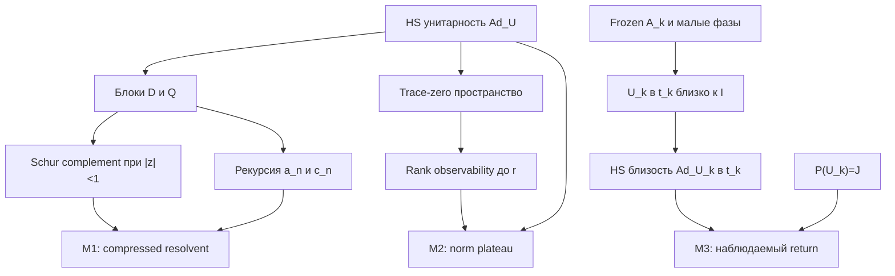

# Независимая рецензия companion M1–M3

Дата: 14 октября 2026 года. Предмет: исходный замороженный `coherence_memory_candidate_20261014.md`, независимо от вердикта основного отчёта O1–O5.

**Нормализованное математическое утверждение.** Для всех \(N\ge2\) и \(U\in U(N)\), при ортогональных HS-проекциях \(D\) на диагональные матрицы и \(Q=I-D\), оператор \(T=\operatorname{Ad}_U\) имеет блоки \(P=DTD\), \(L=DTQ\), \(C=QTD\), \(E=QTQ\). M1 утверждает точную Schur/resolvent identity при \(|z|<1\) и точную return recurrence. M2 утверждает \(\|E^r\|_{HS\to HS}=1\) для каждого целого \(0\le r<N\). M3 относится только к построенным ранее \(U_k=A_kE_k\) и даёт две оценки диагонального return при \(t_k=N_k-4p_k\), включая отличие от \(P(U_k)^{t_k}\) не меньше \(1-2t_k\epsilon_k\).

**Единственный основной verdict для полного frozen текста: correct only after a stated restriction — верно после ограничения прозаического заключения.** Точные математические утверждения M1, M2 и M3 доказаны с исходными кванторами и константами, без каких-либо дополнительных гипотез на \(U\). Но отдельное неограниченное предложение M1 «They are different operators» нельзя сохранять как утверждение универсальной строгой неравности. Для \(U=I_N\) имеем \(DT^nD=P^n=I_N\) на диагональном пространстве при каждом \(n\). Необходимая точная правка: «These operators need not agree» с разрешёнными случаями совпадения. Это ограничение прозаического вывода, а не ограничение универсальной теоремы M2 или изменение формул M1/M3.

## Привязка и область аудита

| Артефакт | Идентификация |
|---|---|
| Frozen companion | 3615 байт; Git blob `61268c845f5782dd2c04947240dcf043feefe642` |
| SHA-256 companion | `b7b90c31b51f5cca32c1ef189d064f6896fcb38a232a740e8dccc05b995afb09` |
| Математический вход M3 | Frozen `flat_spectrum_obstruction_20261013.md`, blob `666e8a9ab551e945936198638ebb4d4286a67454`, SHA-256 `08de07484be6e6a8fb2612ac9abbbb12ecdeb6660c23b3cb57ba158de62c1030` |
| Независимая проверка этого входа | `flat_spectrum_obstruction_independent_review_20261014.md`, SHA-256 `1b0fca70d10031c01f78117c14840b2a48b305c87de46d0b5ee52b3fd6ed804c` |
| Новый конечный проверочный код | `coherence_memory_independent_checks_20261014.py`, SHA-256 `97f83543efbdf2cf10002e0821aff11edbf8f55abee67aa6097b5bdf1d296e12` |
| Исполненные finite controls | `coherence_memory_independent_checks_20261014.json`, SHA-256 `d43f47d01435246a9bf172512cd80023307746eb6be21304217a69a0d0a35c85` |

Исходный companion прочитан целиком и независимо реконструирован. Использованы те же `AGENTS.md`, `SOURCE_OF_TRUTH.md` и skill `mathbox:proof-audit` с checklist логики, типов, минимальных размерностей, норм, действий и конечной арифметики, что в основном отчёте. Новый аудит не использует авторский verdict и не наследует корректность companion из корректности O1–O5. Main и математические файлы не изменялись.

Точные локаторы frozen companion: определения — строки 7–11; M1 — строки 13–32; M2 — строки 34–58; M3 — строки 60–80. Прозаическое замечание о несовпадении входит в конец M1.

## Граф зависимостей



M2 не используется для доказательства M3. M3 использует только точную плоскость \(P(U_k)=J\), конечный порядок \(A_k\), \(t_k\) и нормовую малость фаз из основного construction. Ни макропредел O2, ни spacing/local пределы O3–O4, ни form-factor заключение O5 ему не нужны. Внешнего theorem leaf или предпосылки о приоритете нет.

## Матрица обязательств

| Обязательство | Статус | Основание |
|---|---|---|
| Типы и ориентация \(P,L,C,E\) | passed | Диагональные coordinates \(\mathbb C^N\); \(L:Q\to D\), \(C:D\to Q\), \(E:Q\to Q\) |
| \(P=DTD=|U|^{\circ2}\) | passed | \((U\operatorname{diag}(a)U^*)_{ii}=\sum_j|U_{ij}|^2a_j\) |
| HS унитарность и \(E\) contraction | passed | Сохранение \(\operatorname{Tr}X^*X\) и ортогональность \(Q\) |
| Обратимость full и нижнего блоков при \(|z|<1\) | passed | Neumann series для норм не больше 1 |
| Schur inverse, знаки и порядок факторов | passed | Нижний блок \(I-zE\), off-diagonal блоки \(-zL,-zC\) |
| Recurrence, индексы и \(n=0\) | passed | \(c_0=0\); при \(n=0\) сумма пуста и \(a_1=Pa_0\) |
| Универсальная строгая интерпретация «different operators» | failed | Минимальный допустимый пример \(N=2,U=I_2\): оба оператора равны \(I_2\) |
| Trace-zero размерности и число наблюдений | passed | \(N^2-1\), codimension одного ограничения не больше \(N-1\), времена \(j=0,\ldots,r\) |
| Положительность dimension budget до \(r=N-1\) | passed | \((N-1)(N-r)>0\) ровно в объявленном диапазоне |
| Witness остаётся off-diagonal на каждом шаге | passed | Одновременное \(DT^jX=0\); индукция \(E^jX=T^jX\) |
| \(r=0\), \(N=2\), граница \(r=N\) | passed | Off-diagonal пространство ненулевое; конкретный \(N=2\) пример имеет \(E^2=0\) |
| M2: различие norm и spectral radius | passed | Плато не даёт radius 1; в граничном примере radius 0 |
| M2: различие полного и наблюдаемого memory | passed | При \(U=I_N\), \(E=I\), но \(L=C=0\) |
| M3 применяется к исходному perturbed \(U_k\) | passed | \(\|U_k^{t_k}-I\|\le t_k\epsilon_k\) выведено для того же \(U_k\) |
| M3: HS superoperator constant 2 | passed | Два члена в \(WXW^*-X\), ограниченные операторной нормой \(W-I\) |
| M3: entrywise modulus и степень интенсивности | passed | \(DT^{t_k}D=P(U_k^{t_k})\); отдельно \(P(U_k)^{t_k}=J\) |
| M3: lower bound и order-one предел | passed | \(\|I-J\|=1\), \(t_k\epsilon_k\le N_k^{-3}\to0\) |
| Один отдельный kernel \(LE^rC\) order one при большом \(r\) | not addressed | M3 доказывает полный return deviation, а не такую более сильную оценку |
| Конечные Gaussian-rational controls | passed в указанном диапазоне | Три конкретные матрицы, девять resolvents, 18 recurrence transitions, семь нормосохраняющих witnesses |
| Signed source hierarchy, фактический quantizer, BGS | out of scope | Для этих утверждений универсальное norm plateau не даёт наблюдаемого signed контроля |

## Самостоятельное доказательство M1

Пространство \(\mathcal H=M_N(\mathbb C)\) с обычной HS-нормой раскладывается ортогонально как \(operatorname{ran}D\oplus\operatorname{ran}Q\). На этом разложении

\[
T=\begin{pmatrix}P&L\\C&E\end{pmatrix},\qquad
I-zT=\begin{pmatrix}I-zP&-zL\\-zC&I-zE\end{pmatrix}.
\]

Унитарность \(U\) даёт унитарность \(T\) на HS-пространстве. \(E\) — ортогональное сжатие унитарного оператора, поэтому \(\|E\|\le1\). При \(|z|<1\) оба \(I-zT\) и \(I-zE\) обратимы по Neumann series. Исключение нижнего блока даёт

\[
S(z)=I-zP-z^2L(I-zE)^{-1}C.
\]

Поскольку полный блок и \(I-zE\) обратимы, \(S(z)\) обратим; top-left block полного inverse равен \(S(z)^{-1}\). Левая сторона M1 является inverse compression именно на диагональном подпространстве, а не обратимостью \(D\) на всём \(M_N\). Знаки, множитель \(z^2\) и порядок \(L\), inverse, \(C\) верны.

Для диагонального \(X_0\) block recurrence имеет вид

\[
a_{n+1}=Pa_n+Lc_n,\qquad c_{n+1}=Ca_n+Ec_n,\qquad c_0=0.
\]

Отсюда \(c_n=\sum_{s=0}^{n-1}E^{n-1-s}Ca_s\) и объявленная recurrence для \(a_{n+1}\). При \(n=1\) получаем \(DT^2D=P^2+LC\); при \(n=2\)

\[
DT^3D=P^3+PLC+LCP+LEC.
\]

Значит, \(P^n\) описывает канал с удалением coherences на каждом шаге; \(DT^nD\) описывает diagonal observation после \(n\) unmeasured шагов. Формулы не дают универсальной строгой неравности между этими операторами. При diagonal или monomial \(U\) диагональное подпространство инвариантно и оба процесса действительно совпадают. Это и есть необходимое ограничение текста.

## Самостоятельное доказательство M2 и острая граница

Рассмотрим комплексное trace-zero пространство \(mathcal H_0\) размерности \(N^2-1\). Оператор \(T\) сохраняет trace. Каждый linear map

\[
A_j:\mathcal H_0\longrightarrow\operatorname{ran}D\cap\mathcal H_0,
\qquad A_jX=DT^jX
\]

имеет rank не больше \(N-1\). Для stacked map \(A_0\oplus\cdots\oplus A_r\) rank не больше \((r+1)(N-1)\), поэтому

\[
\dim\bigcap_{j=0}^r\ker A_j
\ge N^2-1-(r+1)(N-1)=(N-1)(N-r)>0
\]

при \(0\le r<N\). Выбираем ненулевой \(X\) из этого пересечения. Условие \(j=0\) даёт \(QX=X\); условия следующих времён дают \(QT^jX=T^jX\). По индукции \(E^jX=T^jX\) для всех \(j\le r\). Поскольку \(T\) HS-унитарен,

\[
\|E^rX\|_{HS}=\|T^rX\|_{HS}=\|X\|_{HS}.
\]

Это даёт нижнюю операторную норму 1, а contractivity даёт верхнюю 1. При \(r=0\) это identity на пространстве размерности \(N(N-1)>0\). Witness может зависеть от \(U\) и \(r\); theorem не утверждает norm preservation для каждого источника или каждого времени одним выбранным \(X\).

Роль trace-zero ограничения существенна для приведённого budget: оно сохраняет положительную нижнюю границу до \(r=N-1\). При \(r=N\) dimension budget равен нулю, а не отрицательному утверждению о kernel. Иногда плато продолжается, иногда заканчивается.

Точная минимальная граничная матрица:

\[
U_*={I-i(\sigma_x+\sigma_y+\sigma_z)\over2}
={1\over2}\begin{pmatrix}1-i&-1-i\\1-i&1+i\end{pmatrix}.
\]

Она унитарна и \(P(U_*)=J_2\). Прямое умножение даёт циклическое действие \(T\sigma_x=\sigma_y\), \(T\sigma_y=\sigma_z\), \(T\sigma_z=\sigma_x\). На off-diagonal пространстве, порождённом \(\sigma_x,\sigma_y\), имеем

\[
E\sigma_x=\sigma_y,\qquad E\sigma_y=0,\qquad E^2=0.
\]

Таким образом, \(\|E\|=1\), но при \(r=N=2\) норма уже равна нулю. Spectral radius также равен нулю. Утверждение M2 не может быть заменено утверждением radius 1 или вечного plateau. Для этого же примера \(LC=0\), \(LEC=I-J_2\), \(DT^3D=I_2\), а \(P^3=J_2\): возвращение coherences действительно наблюдаемо. Для противоположного примера \(U=I_N\) имеем \(E=I\), но \(L=C=0\). Поэтому M2 само по себе не доказывает наличие observed memory; исходник справедливо отделяет это от M3.

## Самостоятельное доказательство M3

Чтобы проверить применимость к действительному perturbed construction, достаточно восстановленных ранее точных входов:

\[
P(U_k)=J_{N_k},\quad A_k^{6p_k}=I,\quad
\|U_k-A_k\|\le\epsilon_k,\quad
t_k=(4^k-4)p_k\in6p_k\mathbb Z_{>0}.
\]

Телескопирование унитарных степеней даёт

\[
\|U_k^{t_k}-I\|=\|U_k^{t_k}-A_k^{t_k}\|
\le\delta_k:=t_k\epsilon_k\le N_k^{-3}.
\]

Для \(W=U_k^{t_k}\) и любого \(X\)

\[
WXW^*-X=(W-I)XW^*+X(W^*-I),
\quad \|WXW^*-X\|_{HS}\le2\|W-I\|_{2\to2}\|X\|_{HS}.
\]

Следовательно, \(\|T^{t_k}-I\|_{HS\to HS}\le2\delta_k\). Диагональное сжатие contractive и является \(P(W)=|W|^{\circ2}\), откуда

\[
\||U_k^{t_k}|^{\circ2}-I\|_{2\to2}\le2\delta_k.
\]

Здесь \(P(U_k^{t_k})\) не заменялось на \(P(U_k)^{t_k}\). Поскольку \(t_k\ge1\) и \(P(U_k)=J\), последнее действительно равно \(J\). Reverse triangle inequality и \(\|I-J\|=1\) для \(N_k\ge2\) дают

\[
\||U_k^{t_k}|^{\circ2}-P(U_k)^{t_k}\|
\ge\|I-J\|-\||U_k^{t_k}|^{\circ2}-I\|
\ge1-2t_k\epsilon_k\longrightarrow1\ \text{в нижней границе}.
\]

Эта нижняя граница доказывает order-one **полный наблюдаемый return deviation**. Она не является нижней границей одного отдельно выбранного kernel \(LE^rC\); такие более сильные observed/signed утверждения не проверены и не утверждаются. Она также не требует и не утверждает независимого фазового усреднения. Буква \(E\), off-diagonal superoperator в M1–M2, не смешивается с \(E_k\), диагональной фазовой матрицей construction.

## Фактические конечные проверки

Из `research_session/` исполнено:

```bash
python3 coherence_memory_independent_checks_20261014.py
```

Python 3.12.14, exit code 0, `passed`. Арифметика — точные Gaussian rationals, представленные парами `fractions.Fraction`; floating point и numerical singular values не используются.

Проверены \(U=I_2\), \(U_*\) и отдельный \(N=3\) Cayley unitary \((I-iK)(I+iK)^{-1}\), где

\[
K=\begin{pmatrix}0&1&2i\\1&2&3\\-2i&3&-1\end{pmatrix}=K^*.
\]

Для каждого непосредственно проверены унитарность \(U\) и векторизированного \(T\); тип и coefficients \(P,L,C,E\); exact block-resolvent identity при \(z\in\{1/3,-1/2,i/4\}\); recurrence для \(n=0,\ldots,5\); stacked observability ranks до \(r=N\); ненулевые norm-preserving witnesses для \(0\le r<N\).

Nullities после ограничения начального источника off-diagonal:

| Input | \(r=0\) | \(r=1\) | \(r=2\) | \(r=3\) |
|---|---:|---:|---:|---:|
| \(I_2\) | 2 | 2 | 2 | — |
| \(U_*\), \(N=2\) | 2 | 1 | 0 | — |
| Cayley, \(N=3\) | 6 | 4 | 2 | 0 |

Нулевая nullity на \(r=N\) здесь согласуется с границей theorem; универсального вывода из трёх examples не делается. Gaussian-rational run проверяет конечную алгебру и witnesses. Универсальный M2 доказан rank argument выше. Asymptotic M3 доказан оценкой \(2t_k\epsilon_k\to0\), а не этим run. Lean kernel, полный repository regression и manuscript build этим аудитом не запускались.

## Остаток и безопасное заключение

В формулах M1–M3 нет оставшегося proof gap. Единственное требуемое уточнение полного frozen текста — ограничить прозаическую фразу о «different operators» до возможного, а не универсального несовпадения. Рецензия не редактирует frozen input.

После этой точной правки безопасное conclusion таково: unaveraged off-diagonal compression любого \(\operatorname{Ad}_U\) имеет norm plateau до \(N-1\), поэтому прямой strictly contracting singular-norm route для этого блока не существует; observed/signed memory требует отдельной информации. Построенное abstract flat family дополнительно имеет order-one diagonal return deviation на Heisenberg временах. Какой-либо signed microscopic source bound для неизменённого физического quantizer и BGS из этих утверждений не следуют.

Самый дешёвый следующий шаг — проверить перенос именно формул и кванторов M1–M3 вместе с единственным прозаическим уточнением. Новый универсальный proof, дополнительное численное тестирование или исследование приоритета для этого переноса не нужны.
