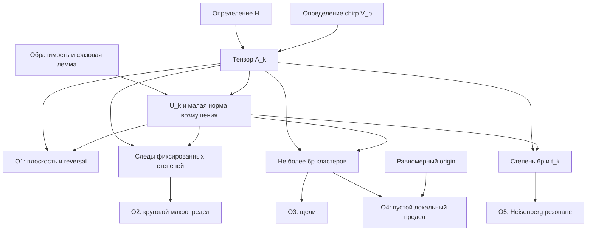

# Независимая рецензия O1–O5 и леммы о малых фазах

Дата: 14 октября 2026 года. Предмет: ровно утверждения O1–O5 и лемма раздела 5 в замороженном тексте `flat_spectrum_obstruction_20261013.md`.

**Нормализованное утверждение.** Для любой последовательности нечётных простых чисел \(p_k\to\infty\), при \(k\ge2\), \(n_k=4^k\), \(N_k=n_kp_k\), \(\epsilon_k=N_k^{-4}\), существует детерминированная последовательность \(U_k\in U(N_k)\), одновременно удовлетворяющая O1–O5 с указанными в исходнике нормами, константами и типами сходимости. Вспомогательная лемма утверждает: для каждого положительного \(N\), каждой обратимой комплексной матрицы \(A\) размера \(N\) и каждого непустого произведения открытых дуг окружности почти все наборы колонных фаз дают простой спектр \(A\operatorname{diag}(z)\). Унитарность \(A\) для самой леммы не требуется.

**Единственный основной verdict: proved as written — доказано в сформулированном виде.** Независимая реконструкция не обнаружила недостающей математической импликации в O1–O5 или в лемме. Конечные вычисления ниже служат проверкой точной алгебры; универсальный квантор леммы и асимптотику они не доказывают. Вывод относится к абстрактному семейству унитарных матриц на данной последовательности размерностей.

## Объект проверки и происхождение

Проверен полный сырой текст, а не авторская оценка его статуса или прежняя рецензия. Предыдущие отчёты об этом результате не читались и не использовались. Авторские проверки не использовались как доказательственные входы; новый проверочный код написан непосредственно по определениям.

Точный исходник после удаления родительским агентом одного лишнего конечного LF при материализации имеет длину 14450 байт. Совпадение Git blob проверено независимо. Эта операция восстановила переданный замороженный объект и не изменила математический текст.

| Артефакт | Точная идентификация |
|---|---|
| Замороженный исходник | Git blob `666e8a9ab551e945936198638ebb4d4286a67454` |
| SHA-256 исходника | `08de07484be6e6a8fb2612ac9abbbb12ecdeb6660c23b3cb57ba158de62c1030` |
| Переданный временный commit | `22d6fc94b8060e1a65420b5e007ba3ccbbef4d16`; commit не был доступен как локальный Git object, поэтому рецензия привязана к самостоятельно проверенному blob |
| Локальный HEAD BGS при начале проверки | `53d60cbb4b51d64b3ff82d396ab74e21f704f3a9` |
| Независимый проверочный код | `flat_spectrum_obstruction_independent_checks_20261014.py`, SHA-256 `fe63c99ad591207dd29a307642579b90f0544c25669cf0759323547bd4679327` |
| Фактический результат проверок | `flat_spectrum_obstruction_independent_checks_20261014.json`, SHA-256 `2f01be30eec2fbad43b96aeb2e745f01e4272e0ebcdc8bae0feecd41a1b923e8` |

Прочитаны `BGS/AGENTS.md`, `SOURCE_OF_TRUTH.md`, правила `record/repository_conventions.md` и относящиеся к предмету положения `RESEARCH.md`, `record/claim_ledger.md`, `record/claims.json`, `mathematics/results.md`, `mathematics/open_questions.md`. Применён `mathbox:proof-audit`, включая разделы checklist о логике, допустимых объектах, границах параметров, топологии, симметриях и вычислениях. `.mathbox/` отсутствует. Репозиторий уже имел рабочие изменения; эта рецензия их не изменяет. Все созданные этой проверкой файлы находятся только в `research_session/`.

Локаторы исходника: точное утверждение — раздел 1, строки 15–88; core — раздел 2, строки 90–125; chirp — раздел 3, строки 127–164; тензор — раздел 4, строки 166–192; лемма и фазовое возмущение — раздел 5, строки 194–263; локализация и пределы — раздел 6, строки 265–309; резонанс — раздел 7, строки 311–322.

## Граф зависимостей

Все математические листья ниже являются внутренними элементарными аргументами или явно указанными соглашениями: евклидова операторная норма, нормированная круговая мера, произведение мер фаз, главный аргумент на окружности. Ни TRACE-079/080, ни theorem о clock, ни исследование приоритета не входят в доказательство O1–O5.



В частности, простота спектра не заменяет локализацию по норме, а макропредел O2 не используется для вывода O3 или O4. Логической цикличности нет.

## Матрица обязательств

| Обязательство | Статус | Решающее основание |
|---|---|---|
| Размерности, коэффициенты и нормировка | passed | \(N_k=4^kp_k\), комплексные унитарные матрицы; все матричные нормы — операторные для евклидовой нормы |
| Core определён в допустимом классе | passed | \(WW^T=4I\); \(H=W/2\) ортогонален, каждый квадрат модуля равен \(1/4\) |
| Конечный порядок и reversal core | passed | Прямое умножение даёт O6; \(B(H)B(H)^*=I/4\), откуда норма \(1/2\) |
| Chirp для каждого нечётного простого | passed | Fourier ортогональность и биекция \((b,c)\mapsto(b-c,b+c+d)\) в \(\mathbb F_p^2\) |
| Симметрия chirp и точная reversal норма | passed | Замена \(b\mapsto-b\) даёт \(V_p^T=V_p\), затем \(B(V_p)=J_p\) |
| Тензор — исходный объект, а не заменитель | passed | \(A_k=H^{\otimes k}\otimes V_{p_k}\), произведение настоящих унитарных матриц |
| Лемма для всех обратимых \(A\) | passed | Мультиаффинность исключает повторный фактор с фазовой зависимостью; \(det A\ne0\) исключает повторный фактор \(\lambda\) |
| Переход к \(\mathbb C(z)[\lambda]\) | passed | Моничность исключает коэффициентные факторы; Gauss lemma и характеристика ноль сохраняют square-free свойство |
| Каждое произведение открытых дуг и почти все фазы | passed | Ненулевой полином не исчезает тождественно на дугах; индукция по числу переменных и Fubini дают нулевую меру исключений |
| Произвольно малая детерминированная селекция | passed | Хорошее множество открыто и непусто; плотность рациональных фаз даёт выбор по фиксированной нумерации |
| Сохранение плоскости и правильный порядок \(E^*,E\) | passed | \(B(AE)_{ij}=e^{-i\alpha_i}B(A)_{ij}e^{i\alpha_j}\) |
| Оценка степеней для любого положительного целого | passed | Телескопирование двух унитарных степеней; применимо также к растущему \(t_k\) |
| Квантор фиксированного \(q\) в O2 | passed | Для каждого фиксированного \(q>0\) в конце \(p_k\nmid q\); отрицательные Fourier коэффициенты — сопряжённые |
| Локализация новых eigenvalues | passed | Нормальность \(A_k\) даёт нижнюю resolvent оценку на каждом eigenvector \(U_k\); matching не нужен |
| Угловой радиус, разделение и wrapping | passed | Хорда \(epsilon_k\) даёт радиус не больше \(2\epsilon_k\); круговые щели считаются после разреза между кластерами |
| O3: все \(N_k\) щелей, константа и слабая топология | passed | Не менее \(N_k-6p_k\) внутренних щелей; разбиение интеграла bounded continuous test |
| O4: union bound и константы | passed | Радиус для origin \(2\epsilon_k+2\pi R/N_k\); \(6p_k\) круговых дуг дают ровно объявленную оценку |
| O4: vague сходимость в вероятности и точное среднее | passed | На компактных носителях отсутствуют точки с вероятностью \(1-o(1)\); отдельное фазовое усреднение даёт \(2R\) |
| O4: отсутствие uniform integrability | passed | Неотрицательные counts идут к нулю в вероятности, сохраняя ожидание \(2R>0\) |
| O5: положительность \(t_k\), модуль и квадрат | passed | \(k\ge2\); \(4^k\equiv4\pmod6\); \(t_k\epsilon_k<1\) позволяет возвести нижнюю оценку в квадрат |
| Конечные проверки: арифметика и покрытие | passed в указанном конечном диапазоне | Python integers/Fraction; точные диапазоны и исключённые претензии записаны в JSON |
| Полная классификация antiunitary symmetries | out of scope | \(B(U)\) здесь только явно определённая координатная матрица |
| TRACE-079/080, полный feedback процесс и clock corollaries | out of scope | Их истинность не является предпосылкой O1–O5 |
| Приоритет, Tanner и Gnutzmann–Altland | out of scope | Эти ссылки не используются для доказательства проверяемого утверждения; внешнего источникового verdict здесь нет |
| Фиксированный гладкий chaotic quantizer и BGS | out of scope | Построено другое абстрактное семейство на \(N_k=4^kp_k\) |

## Независимая реконструкция решающих шагов

### Core, chirp и тензор

Из отображённого \(W\) получаются ортогональные строки длины 2, поэтому \(H=W/2\) является унитарной матрицей с плоскими модулями. Прямое умножение даёт

\[
H^2=\begin{pmatrix}1&0&0&0\\0&0&1&0\\0&0&0&1\\0&1&0&0\end{pmatrix},
\qquad H^6=I.
\]

Независимая точная проверка характеристического полинома даёт

\[
\det(\lambda I-H)=\lambda^4+\lambda^3-\lambda-1
=(\lambda-1)(\lambda+1)(\lambda^2+\lambda+1).
\]

Так что уже исходный \(H\) имеет roots с индексами \(0,2,3,4\) в шестой корневой сетке. Из определения \(B(H)_{ij}=H_{ij}H_{ji}\) знак-матрица \(4B(H)\) имеет Gram \(4I\). Следовательно, именно операторная норма \(B(H)\) равна \(1/2\).

Для chirp Fourier ортогональность даёт \(F_p^*F_p=I\) и

\[
(F_p^*D_pF_p)_{ij}=p^{-1}\sum_b\omega^{b^2+(j-i)b}.
\]

Положив \(d=j-i\), получаем

\[
\left|\sum_b\omega^{b^2+db}\right|^2
=\sum_{b,c}\omega^{(b-c)(b+c+d)}
=\sum_{a,h}\omega^{ah}=p.
\]

Обратная замена существует: \(b=(h-d+a)/2\), \(c=(h-d-a)/2\) в поле нечётной характеристики. Для \(a=0\) сумма по \(h\) равна \(p\); для \(a\ne0\) она равна нулю. Это доказывает точное \(1/p\) для каждого квадрата модуля, а не только его среднее.

Замена \(b\mapsto-b\) делает \(d\) и \(-d\) эквивалентными и доказывает симметрию \(V_p\). Поэтому \(B(V_p)_{ij}=|(V_p)_{ij}|^2=1/p\), то есть \(B(V_p)=J_p\) и \(\|B(V_p)\|=1\). При \(p\nmid q\) та же замена с \(h=q(b+c)\) даёт \(left|\sum_b\omega^{qb^2}\right|^2=p\). Eigenvalues \(V_p\) равны \(omega^{b^2}\), и \(V_p^p=I\).

Теперь тензорный \(A_k\) унитарен, все его квадраты модулей равны \(4^{-k}p_k^{-1}=N_k^{-1}\), а из координатного определения напрямую следует

\[
B(A_k)=B(H)^{\otimes k}\otimes J_{p_k},\qquad
B(A_k)B(A_k)^*=4^{-k}I_{4^k}\otimes J_{p_k}.
\]

Последнее равенство сразу даёт \(\|B(A_k)\|=2^{-k}\), без замены операторной нормы entrywise нормой. Также \(A_k^{6p_k}=I\); его spectrum находится в сетке из \(6p_k\) roots. Не требуется, чтобы каждый центр был занят или чтобы порядок был ровно \(6p_k\). Например, при \(p=3\) число занятых центров меньше этого верхнего ограничения.

### Универсальный квантор леммы

Универсальность не опирается на ненулевые диагональные элементы \(A\), её нормальность или диагонализуемость. Рассмотрим

\[
f(\lambda,z)=\det(\lambda I-A\operatorname{diag}z)
=\sum_{S\subseteq\{1,\ldots,N\}}(-1)^{|S|}
  \det A_{S,S}\,\lambda^{N-|S|}\prod_{j\in S}z_j.
\]

Из этой формулы независимо видны моничность по \(\lambda\), степень не больше 1 в каждом \(z_j\), \(f(\lambda,0)=\lambda^N\), и коэффициент при \(\lambda^0\), равный \((-1)^N\det A\prod_jz_j\). Благодаря обратимости последний коэффициент не является нулевым полиномом; в частности, степень по каждому \(z_j\) равна 1.

Если в UFD \(\mathbb C[\lambda,z]\) неприводимый \(g\) повторяется в \(f\), то \(g^2\mid f\). Аддитивность степеней по каждому \(z_j\) вынуждает \(deg_{z_j}g=0\) для всех \(j\). Значит, \(g\in\mathbb C[\lambda]\). Специализация \(z=0\) тогда даёт \(g\mid\lambda^N\); неприводимость вынуждает \(g=c\lambda\). Но \(\lambda\nmid f\), поскольку коэффициент при \(\lambda^0\) не нулевой. Противоречие.

Здесь важно проверить следующий переход: square-free свойство в многомерном кольце действительно даёт square-free свойство по \(\lambda\) над \(K=\mathbb C(z)\). Моничность делает \(f\) примитивным и исключает его неприводимые множители, зависящие только от \(z\). По Gauss lemma факторизация положительных \(\lambda\)-степеней сохраняется при переходе к \(K[\lambda]\). В характеристике ноль каждый такой неприводимый множитель separable. Поэтому дискриминант \(\Delta_A(z)\) — ненулевой полином. Это закрывает универсальный шаг, который нельзя заменить проверкой нескольких матриц.

Чтобы получить меру ноль на каждом произведении дуг, раскладываем ненулевой полином по последней переменной. Хотя бы один коэффициент — ненулевой полином остальных переменных. По индукции множество параметров, где все коэффициенты исчезают, имеет меру ноль; вне его остаётся ненулевой одномерный полином с конечным числом roots на дуге. Fubini завершает доказательство. При \(N=1\) дискриминант равен 1 и утверждение тривиально.

На торе дополнение к нулевому множеству дискриминанта открыто. В каждом малом кубе \(|\alpha_j|<\epsilon\) оно непусто, поэтому содержит рациональный набор углов. Фиксированная нумерация рациональных наборов даёт детерминированную селекцию по каждому \(k\). Это утверждение существования, а не обещание алгоритмически решить равенство трансцендентных выражений. Обратимость необходима для данного универсального утверждения: матрица \(A=0_{2\times2}\) оставляет двойной нулевой eigenvalue при всех фазах.

### Сохранение O1 и макропредел O2

Пусть \(E_k=\operatorname{diag}(e^{i\alpha_j})\) с выбранным простым spectrum и \(|\alpha_j|<\epsilon_k\). Тогда

\[
\|A_kE_k-A_k\|=\|E_k-I\|\le\epsilon_k,\quad
P(A_kE_k)=P(A_k),\quad B(A_kE_k)=E_k^*B(A_k)E_k.
\]

Последняя формула получается с правой фазой \(alpha_j\) и сопряжённой обратной фазой \(-\alpha_i\), поэтому порядок сопряжения правильный. Она сохраняет точную операторную норму reversal. Все компоненты O1 доказаны одновременно для той же матрицы \(U_k=A_kE_k\).

Для двух унитарных матриц и любого положительного целого \(q\)

\[
U^q-A^q=\sum_{r=0}^{q-1}U^{q-1-r}(U-A)A^r,
\quad \|U^q-A^q\|\le q\epsilon,
\quad |\operatorname{Tr}(U^q-A^q)|\le Nq\epsilon.
\]

Для каждого фиксированного \(q>0\) в конце \(p_k>q\), поэтому

\[
\frac{|\operatorname{Tr}A_k^q|}{N_k}
=\frac{|\operatorname{Tr}(H^{\otimes k})^q|}{4^k}
 \frac{|\operatorname{Tr}V_{p_k}^q|}{p_k}
\le p_k^{-1/2}.
\]

Это доказывает O2 с точной добавкой \(q\epsilon_k\). Отрицательные Fourier коэффициенты — сопряжённые к положительным вследствие унитарности, нулевой коэффициент равен 1. Плотность тригонометрических полиномов в непрерывных функциях на окружности даёт слабый предел — нормированную Lebesgue меру. Ограничений на скорость роста \(p_k\) не добавлено. Оценка имеет квантор «каждый фиксированный \(q\)»; она не переносится на все Heisenberg степени через этот Gauss шаг.

### Кластеры и щели O3

Если \(U_kx=\lambda x\) и \(\|x\|=1\), то

\[
\| (\lambda I-A_k)x\|\le\epsilon_k.
\]

Нормальность \(A_k\) даёт \(\|(\lambda I-A_k)x\|\ge\operatorname{dist}(\lambda,\operatorname{spec}A_k)\). Значит, каждый новый eigenvalue лежит в хордовом \(epsilon_k\)-окружении некоторого старого центра. Matching с кратностями не требуется.

Для кратчайшего угла \(0\le\delta\le\pi\), хорда равна \(2\sin(\delta/2)\ge2\delta/\pi\). Отсюда \(delta\le(\pi/2)\epsilon_k\le2\epsilon_k\). Поэтому радиус \(2\epsilon_k\) исходника корректен. Минимальное расстояние между различными сеточными центрами \(2\pi/(6p_k)\); \(p_k\epsilon_k\to0\), следовательно, исходные кластерные дуги в конце не пересекаются.

Проводим разрез окружности между дугами. Для каждой занятой дуги с \(s\) eigenphases имеем \(s-1\) внутренних соседних щелей не больше \(4\epsilon_k\). Если занято \(M_k\le6p_k\) дуг, число этих щелей равно \(N_k-M_k\ge N_k-6p_k\). Все остальные — переходы между дугами, включая одну wrapping щель. Возврат к любому другому разрезу лишь циклически переставляет список всех \(N_k\) щелей.

Таким образом, доля щелей с unfolded величиной не больше \(a_k=2N_k\epsilon_k/\pi\) не меньше \(1-6/4^k\). Для любого bounded continuous \(g\) на \([0,\infty)\)

\[
\left|\frac1{N_k}\sum_jg(s_{k,j})-g(0)\right|
\le \sup_{0\le s\le a_k}|g(s)-g(0)|
 +2\|g\|_\infty\frac6{4^k}\longrightarrow0.
\]

Это именно слабая сходимость распределений к \(delta_0\). Среднее каждого эмпирического распределения остаётся 1, поскольку сумма круговых щелей равна \(2\pi\). Для неограниченного теста \(g(s)=s\) предыдущая оценка не применима; противоречия нет.

### Origin average и топология O4

Величина главного аргумента измеряет кратчайшее круговое расстояние до origin. Если какая-либо точка попала в \([-R,R]\), origin находится на расстоянии не больше

\[
2\epsilon_k+\frac{2\pi R}{N_k}
\]

от хотя бы одного старого центра. Для равномерного origin вероятность одной такой дуги не больше её длины, делённой на \(2\pi\). Union bound по \(6p_k\) центрам даёт

\[
\mathbb P\{\Xi_k([-R,R])>0\}
\le6p_k\frac{4\epsilon_k+4\pi R/N_k}{2\pi}
=\frac{12p_k\epsilon_k}{\pi}+\frac{12R}{4^k}\longrightarrow0.
\]

Пересечение увеличенных дуг эту оценку не портит. При больших \(R\), когда отдельная дуга покрывает весь круг, оценка её длиной всё ещё является верхней. Выбор значения Arg в единственной граничной точке не влияет на вероятность и ожидание.

Каждая \(\Xi_k\) является локально конечной точечной мерой на \(\mathbb R\). Для любого \(f\in C_c(\mathbb R)\) выбираем \(R\), содержащий его носитель. На событии \(Xi_k([-R,R])=0\) интеграл \(\langle f,\Xi_k\rangle\) равен нулю. Более того, каждая vague окрестность пустой меры содержит условия на конечное число таких тестов с общим компактным носителем. Поэтому вероятность выйти из любой такой окрестности стремится к нулю. Это доказывает **vague сходимость в вероятности к пустой мере**, а не только сходимость одного count или среднего. Поскольку предел детерминирован, используемая связь origin между разными \(k\) на этот вывод не влияет; можно поместить всю последовательность на одно пространство с общим равномерным origin.

Отдельно, если \(N_k>2R\), для каждого eigenphase множество origin, помещающих его в окно, имеет круговую длину \(4\pi R/N_k\). Следовательно,

\[
\mathbb E\Xi_k([-R,R])=\sum_{j=1}^{N_k}\frac{2R}{N_k}=2R.
\]

Counts неотрицательны, стремятся к нулю в вероятности и имеют неизменное положительное среднее. Они не могут быть uniformly integrable. Именно этот механизм позволяет предельной мере иметь нулевую интенсивность при единичной интенсивности каждого конечного origin average. O2 не запрещает такое распределение редких больших кластеров.

### Модуль и нормировка O5

Для всех \(k\ge1\), \(4^k\equiv4\pmod6\). При \(k\ge2\)

\[
t_k=6p_k\lfloor4^k/6\rfloor=(4^k-4)p_k>0,
\quad \frac{t_k}{N_k}=1-\frac4{4^k}\longrightarrow1,
\quad A_k^{t_k}=I.
\]

Телескопическая оценка действует при \(q=t_k\), даже когда \(t_k\) растёт. Из неё и треугольного неравенства для полного комплексного следа получаем

\[
|\operatorname{Tr}U_k^{t_k}|
\ge N_k-|\operatorname{Tr}U_k^{t_k}-N_k|
\ge N_k(1-t_k\epsilon_k).
\]

Здесь \(t_k\epsilon_k\le N_k^{-3}<1\), поэтому нижняя граница неотрицательна и её можно возвести в квадрат:

\[
\frac{|\operatorname{Tr}U_k^{t_k}|^2}{N_k}
\ge N_k(1-t_k\epsilon_k)^2\longrightarrow\infty.
\]

В O5 делитель ровно \(N_k\), а модуль берётся от полного следа. Это утверждение об отдельных положительных целых временах. Переход к какой-либо signed сглаженной сумме не является частью этой рецензии. Минимальное \(k=2\) необходимо для положительного времени; при \(k=1\) эта конкретная формула даёт ноль, но этот случай исключён исходным утверждением.

## Фактически исполненные независимые проверки

Команда из `/workspace/scratch/06745ba532e4/research_session`:

```bash
python3 flat_spectrum_obstruction_independent_checks_20261014.py
```

Исполнено Python 3.12.14, процесс завершился с кодом 0, результат `passed`. Использованы только стандартные библиотеки, целые числа и `fractions.Fraction`; floating point, авторские fixtures и численное распознавание простоты spectrum не использовались.

Проверены:

- точные Gram и степени \(H\), его характеристический полином и \(B(H)\);
- тензорные шестикорневые multiplicities для \(k=1,\ldots,16\), построенные целочисленной свёрткой индексов \(0,2,3,4\), и отдельный точный reversal Gram при \(k=2,p=3\);
- при \(p\in\{3,5,7,11,13,17,19,23,29,31\}\) — биективность полной замены \((b,c)\mapsto(b-c,q(b+c)+d)\), коэффициентные counts для \(q=1\) и всех \(d\), для всех \(q\ne0\) и \(d=0\); всего 157576 упорядоченных пар \((b,c)\) по этим параметрам;
- symmetry chirp и multiplicities квадратных вычетов для тех же десяти простых;
- counts тензорных roots и резонансные времена при \(k\in\{2,3\}\), \(p\in\{3,5,7\}\);
- символические дискриминанты пяти обратимых примеров, включая \(N=1\), ненормальный Jordan block, swap и 3-cycle с нулевой диагональю; отдельно сингулярный нулевой \(2\times2\) пример.

В частности, swap даёт дискриминант \(4z_1z_2\), Jordan block — \((z_1-z_2)^2\), 3-cycle — \(-27(z_1z_2z_3)^2\). Эти adversarial примеры подтверждают, что проверяемое утверждение не должно неявно ограничиваться ненулевой диагональю или исходным простым спектром. Универсальная лемма доказана выше независимо от этого конечного набора.

JSON хранит диапазоны, арифметику, исходный blob, hashes и non-claims. Простой спектр фактически выбранного \(U_k\) численно не проверялся: его существование и допустимость следуют из аналитической леммы. Асимптотические O2–O5 получены из оценок, а не из перечисления конечных примеров. Lean, C++, полная репозиторная regression и сборка manuscript в рамках этой проверки не запускались и не заявляются.

## Критические выводы и граница результата

Математического gap внутри проверенного утверждения нет. Наиболее уязвимые места — переход к fraction field в лемме, сохранение нормы \(B\) при фазах, wrapping щель и passage от редкости локального попадания к vague топологии — закрываются указанными выше самостоятельными аргументами. Константы O1–O5 совпадают с исходником.

Сильнейшее безопасное следствие: точная плоскость интенсивностей, нулевая centered intensity норма, стремящаяся к нулю координатная reversal норма, простой спектр и равномерный макроскопический eigenphase предел могут сосуществовать с распределением щелей \(delta_0\), пустым origin-averaged локальным пределом и растущими Heisenberg form factors. Поэтому эти перечисленные алгебраические условия сами по себе не дают непустой локальный предел единичной интенсивности, в частности Sine2.

Физическая microscopic reference law для неизменённого фиксированного chaotic quantizer — отдельная нерешённая задача и не предпосылка этой теоремы. Проверенная конструкция не даёт ни доказательства, ни контрпримера BGS для него. Дешёвый следующий шаг — при научной интеграции сохранить точные O1–O5 и эту привязку к blob; новые вычисления не нужны для закрытия уже проверенных импликаций. Приоритет и внешняя рецензия этим внутренним аудитом не установлены.
