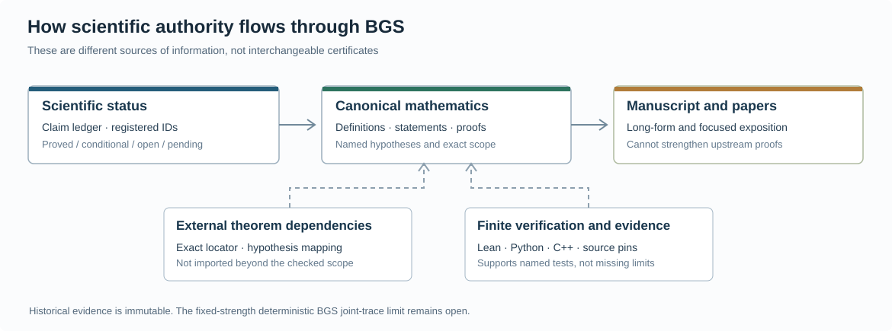

# Scientific corpus atlas

*8 October 2026 · editorial inventory from main commit `1ef5a60024317c2c136d508a8aef4415c4550023` (before this revision).*

This is a **reader's map of the research record**, not a replacement for theorem
statements or a certificate that every old proof has been refereed. Start with
the [BGS overview](../README.md), the [claim ledger](../record/claim_ledger.md)
and the [open mathematical obligations](../mathematics/open_questions.md).

*Authority and evidence relationship; this diagram is **not** a proof that every
registered claim has been externally verified.*

## Scientific organization by mathematical regime

| Track | Canonical entry point | Role in the evolving monograph |
|---|---|---|
| Finite-field arithmetic, Cayley energy, cyclotomy | [Cayley proofs](../mathematics/topics/cayley-arithmetic/README.md) | Exact finite combinatorics, subgroup and resultant estimates; the sharp centered quadratic target is open |
| Quantized arithmetic cat maps and Pell returns | [Pell proofs](../mathematics/topics/pell/README.md), [return laws](../mathematics/topics/returns/README.md) | Multiplicity, global Gaussian and arithmetic-subsequence return laws; these are not local unfolded eigenphase limits |
| Cohomological variance, resonance, finite-orbit rigidity | [Resonance proofs](../mathematics/topics/resonance-cohomology/README.md) | Separate smooth, analytic and linear-transport regimes; arbitrary nonlinear analytic nondegeneracy remains open |
| Fourier locality, uncertainty and spectral obstructions | [Locality](../mathematics/topics/locality/README.md), [spectral obstructions](../mathematics/topics/spectral-obstructions/README.md) | Conditional transfer principles, quantified obstructions and exceptional cases |
| Spectral/information-theoretic estimates | [Information theory](../mathematics/topics/information-theory/README.md) | Observation and tomography problems with their own measurement assumptions; not the BGS spectral process |
| Actual frozen deterministic map | [Fixed-map source route](../mathematics/topics/fixed-map/README.md) | Exact fixed model, symmetry and interference reductions; the signed Heisenberg-scale all-order comparison is **open** |
| Stochastic or randomized comparison | [Trace bridge](../mathematics/topics/trace-bridge/README.md), [noisy local laws](../mathematics/coboundary_all_order_limit.md) | Conditional criteria and proven results for distinct noise/flow schedules; deterministic noise removal remains open |

These tracks are **not an implication chain**. The paper candidates
([publication scopes](../papers/README.md)) extract limited subsets; the
[full manuscript](../manuscript/README.md) intentionally retains chronological
connections and historical development.

## Reading the full manuscript

The [single maintained TeX root](../manuscript/BGS_unified.tex) has
92 direct `\input` references, with **102 subordinate TeX files** in its
recursive include closure (103 files counting the root). These source segments
are not independent referee-approved papers. Read its parts in this orientation:

1. **Opening and finite-field chapters:** scope, conventions, pair-key/Cayley
   arithmetic, Gaussian Cayley traces, magnetic quotients
2. **Return and regularity chapters:** composite moduli, Pell/Floquet laws,
   return gases, weighted echoes, coboundaries and locality
3. **Nondegeneracy and dynamical analysis:** finite-box and analytic resonance,
   periodic orbits, Green--Kubo and spectral modules
4. **Independent spectral and information branches:** holomorphic shell
   rigidity, tomography and estimation under specified measurement models
5. **Fixed-map frontier chapters:** actual-map position/reversal paths,
   WKB/trace reductions, phase/Schur frontiers, recent checked continuations

The order is the historical presentation, not the logical order of dependency.
When reading the fixed-map target, use the
[trace-to-local-statistics bridge](../mathematics/trace_to_local_statistics_bridge.md)
and [signed comparison status](../mathematics/open_questions.md), not a
citation to a noisy or shrinking-coupling result.

## What is maintained, what is evidence

This frozen tree inventory counted **4,290 tracked files**
(out of **4,810 Git tree entries** including directories), distributed
principally across the following roots:

| Root | Tracked files | Primary responsibility |
|---|---:|---|
| `evidence/` | 2,638 | Immutable exact inputs, receipts, logs and dated source copies |
| `record/` | 625 | Current status, generated registries, provenance and historical reviews |
| `computations/` | 389 | Verification scripts, reproducible finite controls and C++ tools |
| `mathematics/` | 272 | Canonical mathematical proof and open-problem sources |
| `supplement/` | 119 | Source-bound auxiliary derivations and conditional branches |
| `manuscript/` | 104 | One LaTeX root and its maintained/generated sections |
| `literature/` | 45 | Bibliography, external theorem hypothesis checks and primary-source notes |
| `formalization/` | 28 | Finite/structural Lean modules, not an entire formalized BGS proof |
| `assets/`, `papers/`, `docs/` | 36 | Scientific figures, candidate articles and reader guides |

The corpus contains **3,584 unique Git blob object IDs** and
**271 groups of identical blobs**, accounting for 706 repeated tracked-file
paths beyond their first occurrences. The most common identical blob is an
empty stdout/stderr file (170 retained paths). Other repeats are historical
input snapshots and independently preserved review receipts. **Identical
bytes do not mean interchangeable provenance**: deleting these paths could
invalidate a receipt, a scoped manifest, a literal-path dependency or the
ability to reproduce a historical review. No bulk file deletions or proof
moves are authorized by these counts alone.

For working research, change the [canonical proof source](../mathematics/README.md)
rather than editing `evidence/`. Only prune an active duplicate once its
recorded consumers and scientific scope have been checked, and keep a
recoverable mapping of the old path. The source hierarchy and exception
policy live in [repository conventions](../record/repository_conventions.md).

## How far this editorial audit reaches

The 8 October 2026 editorial build's read-only manuscript audit reported
**52 bibliography keys, 36 distinct cited keys, 505 distinct labels and no
unresolved or duplicate labels** within the 101-file include closure.
These structural facts are not a theorem-proof verdict; later revisions
must re-run the audit.

The current stage examines the **whole Git tree structure** and registry
architecture, selected canonical proofs and manuscript section openings,
a [targeted metadata audit](../literature/README.md#bibliographic-metadata-screen-8-october-2026) of 39 dependency records (33 with DOI/arXiv identifiers), a BGS/loop/tomography bibliography reconciliation, and the main
manuscript's title, scope and front matter. This does **not** mean all
4,290 files or every line of the earlier 280-page monograph has been independently
read. The distinction matters: a CI pass establishes source integrity
and finite-test execution, not mathematical correctness, external novelty,
or the missing signed spectral estimates.

The next scientific acceptance threshold for a publication candidate is a
completed theorem-by-theorem check under [REVIEWING.md](../REVIEWING.md),
including all external assumptions, negative controls, known retractions
and a reproducible build. The [single canonical manuscript](../manuscript/README.md)
remains active during that process.

## Checked 11 October research

The [integration disposition](../record/chat_integration_20261011.md) indexes maximal microscopic paths, source transport, finite-field collision calculus and frozen circular phase laws. The global deterministic BGS and TRACE-005 claims remain open. Original receipts and fresh executions have separate scope.

The subsequent [Schur continuation](../record/cavity_continuation_20261011.md)
adds two maintained proof sources in the trace topic and a separate execution
packet. Its all-time-flatness premises are explicit; the original 199 source
files and earlier acceptance receipts remain preserved.
