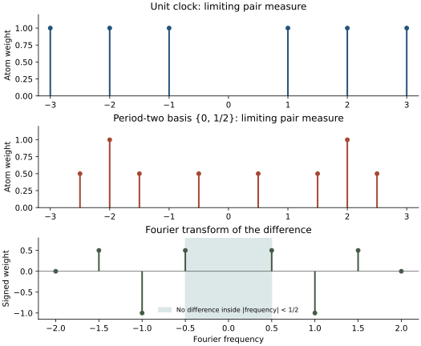
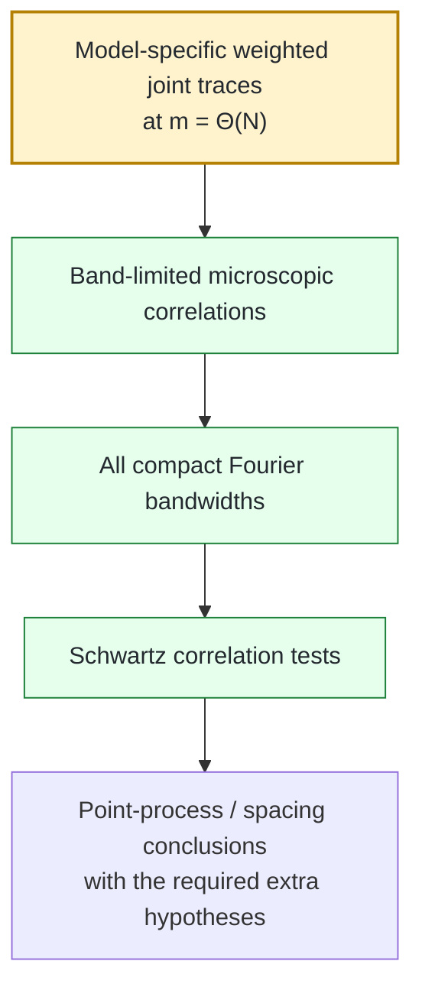
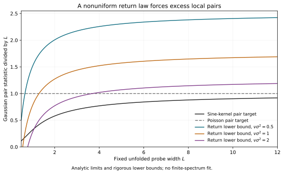
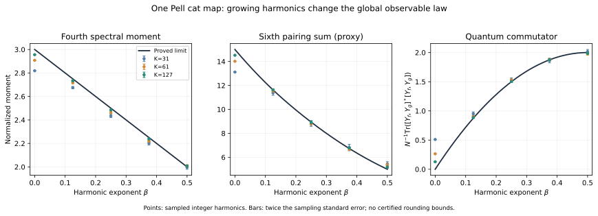
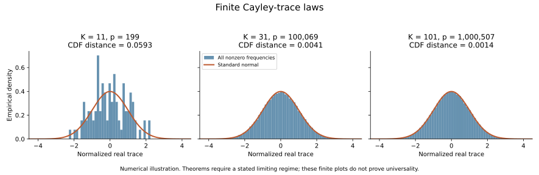

# Mathematical background and reader guide

This guide preserves the programme’s mathematical background and notation. The [current research brief](../RESEARCH.md), [claim ledger](../record/claim_ledger.md), and exact proof sources control current theorem status. This is exposition, not an independent proof certificate. The pre-revision entry pages are preserved with hashes in [the revision archive](../archive/history/2026/corpus_revision_20261006/manifest.json).

<a id="2-background-classical-chaos-quantization-and-bgs"></a>

## Background: classical chaos, quantization, and BGS

### Classical chaos

A classical Hamiltonian system or symplectic map may be chaotic in several related senses: nearby trajectories can separate rapidly, stable and unstable directions can coexist, periodic orbits can proliferate, and long-time dynamics can mix phase-space information.

For uniformly hyperbolic systems these ideas become mathematically rigid. A toral automorphism generated by a hyperbolic integer matrix is a canonical example.

### Quantization

For an $N$-dimensional quantum map, one step of time evolution is represented by a unitary operator $U_N$. Its eigenvalues lie on the unit circle:

```math
U_N\psi_j=e^{i\theta_j}\psi_j,
\qquad
j=1,\ldots,N.
```

The eigenphases $\theta_j$ are the quantum spectrum.

At global scale, many very different spectra can look similar. BGS concerns the opposite regime: the scale of a **single mean level spacing**.

### Historical origin

The conjecture takes its name from the 1984 paper by O. Bohigas, M. J. Giannoni, and C. Schmit:

> *Characterization of Chaotic Quantum Spectra and Universality of Level Fluctuation Laws*, Physical Review Letters **52** (1984), 1–4.
> DOI: [10.1103/PhysRevLett.52.1](https://doi.org/10.1103/PhysRevLett.52.1)

Their chaotic-billiard computation crystallized the conjectural connection between classical chaos and random-matrix level statistics.

The modern mathematical question is stronger than “does a histogram look GOE/GUE/CUE-like?” A proof must specify:

- the deterministic quantum family;
- the symmetry block being studied;
- the unfolding convention;
- the local test class;
- the random-matrix comparison ensemble;
- the range of trace/time scales under control;
- and the exact limiting statement.

---


<a id="3-mathematical-formulation-of-microscopic-universality"></a>

## Mathematical formulation of microscopic universality

### Mean-spacing scale

On the unit circle the average angular spacing is approximately $2\pi/N$. A schematic unfolded coordinate near a reference phase $\theta_0$ is

```math
x_j
=
\frac{N}{2\pi}
\bigl(\theta_j-\theta_0\bigr).
```

Microscopic universality concerns the point process formed by the $x_j$ as $N\to\infty$.

### Pair statistics

A typical pair functional has the form

```math
\frac{1}{N}
\sum_{j\neq k}
\phi\!\left(
\frac{N}{2\pi}(\theta_j-\theta_k)
\right),
```

where $\phi$ is a sufficiently regular test function.

The pair law records level repulsion and two-point correlation. Higher $k$-point statistics test genuinely higher-order local structure.

### Symmetry class

The comparison ensemble is determined by symmetry, not by visual resemblance.

For unitary quantum maps with no relevant antiunitary/reversing symmetry, circular-unitary statistics are the natural benchmark. If a suitable time-reversal symmetry survives, an orthogonal-class law is expected instead.

The maintained fixed-map programme is therefore careful to separate:

1. **classical symmetry elimination**;
2. **quantum block decomposition**;
3. **local random-matrix comparison**.

A theorem must not skip the second step.

### Point-process language

At the strongest level one wants convergence of local factorial correlation functions, or equivalently convergence of the local point process under enough tightness/occupation control.

Spacing distributions are downstream objects. They are not automatically determined by one low-order correlation statistic.

---


<a id="4-why-heisenberg-time-is-unavoidable"></a>

## Why Heisenberg time is unavoidable

The central structural fact is Fourier duality.

For the maintained pair normalization, one has the exact finite-$N$ identity

```math
C_{2,N}(U;\phi)
=
\frac{1}{N^2}
\sum_{m\in\mathbb Z}
\widehat{\phi}(m/N)
\left(
|\mathrm{Tr}U^m|^2-N
\right).
```

If $\widehat{\phi}$ is supported in a fixed compact interval $[-c,c]$, then the sum still involves

```math
|m|\le cN.
```

So compact microscopic Fourier support does **not** reduce the problem to short times. It rescales the Fourier mode by $N$.

For Haar unitary matrices $V_N\in U(N)$,

```math
\mathbb E_{\mathrm{CUE}}
\left|
\mathrm{Tr}V_N^m
\right|^2
=
\min(|m|,N).
```

This provides the exact second-moment benchmark in the unitary class.

### Hierarchy of scales

| Scale | Typical information | Enough for microscopic BGS? |
|---|---|---|
| $m=O(1)$ | fixed-time semiclassics, finite moments | **no** |
| $m=O(\log N)$ | arithmetic returns, Ehrenfest-type regimes | **no** |
| $m=o(N)$ | substantial sub-Heisenberg trace information | **still no in general** |
| $m=\Theta(N)$ | Heisenberg window | **required by microscopic Fourier tests** |
| spacing $O(N^{-1})$ | local eigenphase statistics | **target scale** |

The problem is therefore a long-time quantum problem even though it is phrased as a small-scale spectral problem.

<p align="center">
  
</p>

**Exact negative control.** One fixed Fourier bandwidth does not determine the microscopic pair law. This is why the maintained extension theorem requires convergence on **every** compact bandwidth.

---


<a id="5-the-maintained-frozen-quantum-map"></a>

## The maintained frozen quantum map

The principal family is

```math
U_N
=
\exp(i\tau N A_N)\,M_N,
\qquad
\tau=10^{-80}.
```

Here $M_N$ quantizes the hyperbolic cat map

```math
S=
\begin{pmatrix}
3&4\\
2&3
\end{pmatrix},
```

and $A_N$ is the maintained Weyl quantization of an explicit nonlinear kick symbol.

### Why such a tiny fixed parameter matters

The classical perturbation parameter $\tau$ is extremely small, but it is **fixed** while $N\to\infty$. The quantum exponent contains $\tau N$.

Therefore the target problem is not equivalent to a vanishing-coupling regime such as

```math
\tau_NN\longrightarrow0.
```

This is one of the main reasons the programme separates:

- weak/shrinking kick;
- bounded crossover;
- logarithmic return scales;
- and genuinely frozen fixed-strength asymptotics.

### Why a cat map?

The cat map is useful because it combines:

- explicit hyperbolicity;
- exact arithmetic structure;
- finite-dimensional quantization;
- exact return subsequences;
- explicit Fourier transport;
- and strong enough rigidity to expose false universality mechanisms.

The same arithmetic structure that makes the model tractable also creates nontrivial obstructions, making it a demanding universality laboratory.

---


<a id="6-notation-and-scales"></a>

## Notation and scales

| Symbol | Meaning |
|---|---|
| $N$ | Hilbert-space dimension / semiclassical parameter scale |
| $U_N$ | full frozen quantum propagator |
| $M_N$ | quantized hyperbolic cat map |
| $A_N$ | quantized nonlinear kick generator |
| $\tau$ | fixed kick strength, maintained as $10^{-80}$ |
| $\theta_j$ | eigenphases of $U_N$ |
| $m$ | trace/time index in $\mathrm{Tr}U_N^m$ |
| $\phi$ | local test function |
| $\widehat{\phi}$ | Fourier transform of the test function |
| $V_N$ | random-matrix comparison object |
| $C_{2,N}$ | maintained pair-correlation functional |
| $K$ | arithmetic/Pell period parameter in the corresponding branches |
| $p$ | finite-field prime in Cayley-energy branches |

### Common phrases

- **microscopic** — measured on the mean-spacing scale $O(N^{-1})$;
- **Heisenberg scale** — trace powers/time indices $m=\Theta(N)$;
- **frozen** — the perturbation strength is fixed rather than sent to zero with $N$;
- **desymmetrized** — restricted to the correct irreducible symmetry block before comparison with RMT;
- **band-limited** — the rescaled Fourier transform of the test is compactly supported;
- **joint traces** — products of several trace powers constrained by Fourier relations.

---


<a id="7-the-exact-trace-to-local-statistics-bridge"></a>

## The exact trace-to-local-statistics bridge

The deterministic spectral reduction is one of the most mature layers of the programme.

### Core trace and resolvent claims

| Claim | Status | Content |
|---|---|---|
| **BGS-TRACE-001** | **proved** | exact partition–Möbius formula for distinct-index spectral sums |
| **BGS-TRACE-002** | **proved** | microscopic Fourier representation in terms of quantum traces |
| **BGS-TRACE-003** | **proved** | Heisenberg-scale joint-trace comparison is sufficient for band-limited microscopic RMT correlations |
| **BGS-TRACE-004** | **proved** | every-compact-bandwidth convergence extends to Schwartz correlation tests |
| **BGS-TRACE-005** | **open** | model-specific Heisenberg-scale joint-trace / mixed-resolvent estimate |
| **BGS-TRACE-006** | **proved** | clustered Abel lower bound plus a simple-spectrum Heisenberg-window falsifier |
| **BGS-TRACE-007** | **proved** | sharp universal Abel floor, attained by the regular clock spectrum |
| **BGS-TRACE-008** | **proved** | odd two-clock counterexample to sufficiency of the Gram $4/3$ limit, even with simple phases and nonzero power traces |
| **BGS-RES-006** | **proved** | exact adjoint-resolvent representation of the pair target |
| **BGS-RES-007** | **proved in stated scope** | compact positive-$s$ smooth scalar-resolvent transfer between the original and seven-cut full propagators |

The newer [Haar-CUE singular-energy benchmark](../mathematics/cue_singular_energy.md)
(BGS-CUE-001) derives a stable inverse-gap energy law from the published
small-gap Poisson theorem and an explicit tail bound. The
[coboundary spectral-flow note](../mathematics/coboundary_spectral_flow_bound.md)
(BGS-FLOW-001/002) proves a finite phase-motion estimate and excludes
the proposed infinitesimal Dyson-noise shortcut. Neither supplies
the missing Heisenberg trace estimate for the fixed map.

For higher correlations, partition-lattice Möbius inversion produces constrained products

```math
\prod_{\nu=1}^{r}
\mathrm{Tr}U_N^{m_\nu},
```

with linear relations among the Fourier indices $m_\nu$.

The logical structure is therefore:



The first box is exactly the current model-specific gap.

The all-order implication [TRACE-086](../mathematics/all_order_process_closure_20261015.md) removes a separate
uniform-integrability premise under its stated factorial-correlation hypotheses.
Those hypotheses still require model-specific estimates for the frozen map.

---


<a id="14-selected-project-figures"></a>

## Selected project figures

The figures below are scientific outputs of the project, not decorative README artwork.

<p align="center">
  
</p>

**Return-law obstruction.** Global or arithmetic return information constrains the spectrum but does not determine the microscopic point process.

<p align="center">
  
</p>

**Harmonic Pell transition.** A rigorous project result in its stated arithmetic regime. The observable and time scale are global, not microscopic.

<p align="center">
  
</p>

**Finite Cayley trace diagnostics.** Numerical evidence for the arithmetic branch. Neither the finite plot nor the global Gaussian law implies local universality.

---


**Spectral diagnostic correction (6 October 2026).** The historical [spacing output](../evidence/numerical/goe_spacing.json) and [forward-window output](../evidence/numerical/matched_window_count_variance.json) used a polynomial unfolding that can reverse level order. These archived numbers are not validated statistical evidence. The [correction and method contract](../record/audits/spectral_diagnostics_correction_20261006.md), [corrected spacing output](../evidence/numerical/goe_spacing_monotone_v2.json), [corrected window output](../evidence/numerical/matched_window_count_variance_monotone_v2.json), and [smoothing/edge sensitivity](../evidence/numerical/spectral_smoothing_sensitivity_v2.json) use order-preserving integrated Gaussian smoothing and explicitly mark undefined standardized differences. These are finite descriptive diagnostics, not a BGS theorem; using the same flawed transformation for cat-map and GOE never guaranteed cancellation of its error.

<a id="16-glossary"></a>

## Glossary

| Term | Meaning in this repository |
|---|---|
| **Anosov map** | uniformly hyperbolic classical dynamical system |
| **BGS** | Bohigas–Giannoni–Schmit universality conjecture |
| **CUE** | circular unitary ensemble, a principal random-matrix benchmark for unitary spectra |
| **desymmetrization** | restriction to the correct symmetry block before spectral comparison |
| **unfolding** | normalization to unit mean local level density |
| **microscopic scale** | scale of one mean eigenphase spacing, $O(N^{-1})$ |
| **Heisenberg time** | quantum time/trace index proportional to $N$ |
| **trace form factor** | statistic built from $|\mathrm{Tr}U_N^m|^2$ |
| **mixed resolvent** | resolvent expression coupling opposite analytic orientations; unlike same-half-plane identities, it can carry local spectral information |
| **loop equation** | algebraic/analytic identity for resolvent observables used to characterize spectral statistics |
| **Pell subsequence** | arithmetic sequence along which the cat-map dynamics has especially explicit return structure |
| **Cayley energy** | additive-energy problem arising after a Cayley transform in the arithmetic fourth-moment branch |
| **Riesz gap** | coercive lower bound preventing a family of classical translates from becoming linearly degenerate |
| **falsifier / negative control** | explicit example showing that a proposed sufficient condition is actually insufficient |

---


<a id="17-frequently-asked-questions"></a>

## Frequently asked questions

### Is BGS solved in this repository?

**No.** The maintained fixed-strength microscopic claim **BGS-BGS-001** remains open.

### What is the single most important missing theorem?

**BGS-TRACE-005**: a model-specific Heisenberg-scale joint-trace comparison or an equivalently strong mixed-resolvent estimate for the actual frozen propagator.

### Why is $\tau=10^{-80}$ not effectively zero?

Because $\tau$ is fixed while $N$ grows. The quantum exponent contains $\tau N$, so the asymptotic problem eventually leaves every uniformly perturbative regime based only on the small numerical value of $\tau$.

### Why not settle the problem numerically?

Finite spectra can look random-matrix-like for reasons that do not survive asymptotically. Numerical experiments are excellent for falsification and diagnostics, but they cannot replace a uniform $N\to\infty$ theorem.

### Why is a cat map a useful model if it is arithmetic?

Because it is simultaneously explicit, hyperbolic, quantizable, and arithmetically structured. That makes both universality mechanisms and obstructions visible rather than hidden.

### Why are there so many side programmes?

Because different false proof routes fail for different reasons. Arithmetic energy, return laws, resonance, symmetry, and resolvent identities test distinct possible obstructions.

### Does proving classical mixing prove BGS?

No. The key missing information is quantum cancellation at the Heisenberg scale.

### Does matching $\mathbb E|\mathrm{Tr}V_N^m|^2$ for a few $m$ prove BGS?

No. Microscopic tests require a weighted family of trace powers up to $m=\Theta(N)$, and higher correlations require joint products.

### What would count as a genuine breakthrough here?

A proof that closes **BGS-TRACE-005** for the actual frozen map, with the correct symmetry block and uniformity needed by the exact trace bridge.

---


<a id="18-literature-and-relation-to-the-broader-bgs-landscape"></a>

## Literature and relation to the broader BGS landscape

The maintained [bibliography](../literature/bibliography.md) separates several roles:

1. external results actually imported into proofs;
2. neighbouring literature used for interpretation;
3. rigorous BGS-type universality theorems in other model classes;
4. source checks used to verify theorem hypotheses or publication metadata.

Important distinctions:

- quantum ergodicity is not microscopic eigenphase universality;
- eigenfunction equidistribution is not a spacing theorem;
- matrix-element fluctuations are not local eigenvalue statistics;
- quantum-graph universality theorems are genuine BGS-type results in their own model class, but do not automatically transfer to smooth or arithmetic quantum maps;
- semiclassical trace expansions below Heisenberg time do not automatically close the fixed-map problem.

Load-bearing external dependencies are pinned in [literature/external_dependencies.json](../literature/external_dependencies.json).

---
