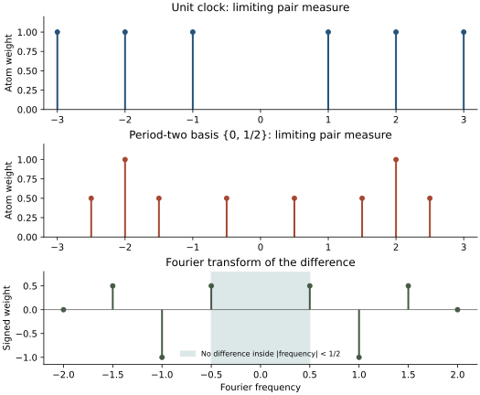
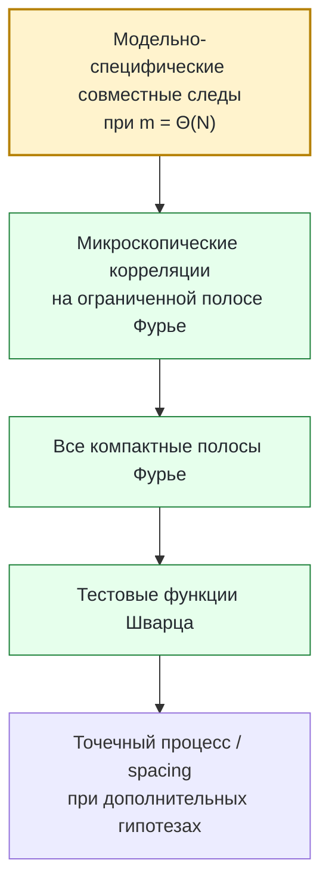
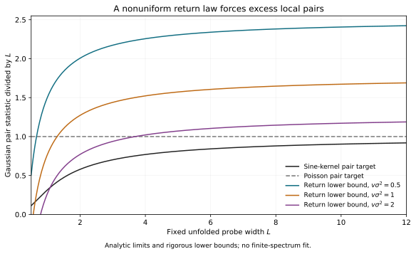
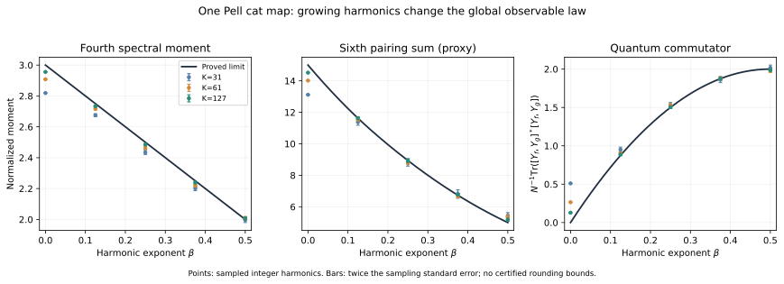
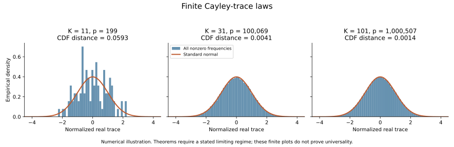

# Математическое введение и путеводитель

> **Начните с [README.ru.md](../README.ru.md)** — обзор всей программы, или с [RESULTS.md](../RESULTS.md) (1 ноября 2026 года, на английском). Это сгенерированная сводка на одну страницу: что доказано, что условно и что открыто, таблица результатов со ссылками на реестр, краткий путеводитель и известные проблемы. Это введение даёт к ней контекст и обозначения.

Здесь собраны математический контекст и обозначения программы. Текущие статусы определяются [исследовательской сводкой](../RESEARCH.md), [реестром утверждений](../record/claim_ledger.md) и точными источниками доказательств. Это изложение, а не независимый сертификат доказанности. Предыдущие вводные страницы сохранены с хешами в [архиве ревизии](../archive/history/2026/corpus_revision_20261006/manifest.json).

<a id="2-предыстория-классический-хаос-квантование-и-bgs"></a>

## Предыстория: классический хаос, квантование и BGS

### Классический хаос

Классическая гамильтонова система или симплектическое отображение может быть хаотическим в нескольких взаимосвязанных смыслах: близкие траектории быстро расходятся, существуют устойчивые и неустойчивые направления, число периодических орбит быстро растёт, а долгосрочная динамика перемешивает информацию по фазовому пространству.

Для равномерно гиперболических систем эти идеи приобретают жёсткую математическую форму. Гиперболический целочисленный автоморфизм тора — канонический пример.

### Квантование

Для $N$-мерного квантового отображения один шаг эволюции задаётся унитарным оператором $U_N$. Его собственные значения лежат на единичной окружности:

```math
U_N\psi_j=e^{i\theta_j}\psi_j,
\qquad
j=1,\ldots,N.
```

Фазы $\theta_j$ образуют квантовый спектр.

На глобальном масштабе очень разные спектры могут выглядеть сходно. BGS интересует противоположный режим — масштаб **одного среднего расстояния между уровнями**.

### Историческое происхождение

Гипотеза получила название по работе О. Бохигаса, М. Джаннони и К. Шмита 1984 года:

> *Characterization of Chaotic Quantum Spectra and Universality of Level Fluctuation Laws*, Physical Review Letters **52** (1984), 1–4.
> DOI: [10.1103/PhysRevLett.52.1](https://doi.org/10.1103/PhysRevLett.52.1)

Их вычисления для хаотического биллиарда сделали явной предполагаемую связь между классическим хаосом и статистикой уровней случайных матриц.

Современная математическая постановка намного строже, чем вопрос «похожа ли гистограмма на GOE/GUE/CUE?». Доказательство обязано точно задать:

- детерминированное квантовое семейство;
- исследуемый блок симметрии;
- правило развёртки спектра;
- класс локальных тестовых функций;
- сравниваемый ансамбль случайных матриц;
- диапазон времён/степеней следа;
- и точную предельную формулировку.

---


<a id="3-математическая-формулировка-микроскопической-универсальности"></a>

## Математическая формулировка микроскопической универсальности

### Масштаб среднего расстояния

На единичной окружности среднее угловое расстояние имеет порядок $2\pi/N$. Схематическая локальная координата возле фазы $\theta_0$:

```math
x_j
=
\frac{N}{2\pi}
\bigl(\theta_j-\theta_0\bigr).
```

Микроскопическая универсальность относится к предельному точечному процессу, образованному $x_j$ при $N\to\infty$.

### Парная статистика

Типичный парный функционал имеет вид

```math
\frac{1}{N}
\sum_{j\neq k}
\phi\!\left(
\frac{N}{2\pi}(\theta_j-\theta_k)
\right),
```

где $\phi$ — достаточно регулярная тестовая функция.

Парная статистика фиксирует отталкивание уровней и двухточечные корреляции. Высшие $k$-точечные статистики проверяют настоящую многоточечную локальную структуру.

### Класс симметрии

Ансамбль для сравнения определяется симметриями системы, а не визуальным сходством данных.

Для унитарных квантовых отображений без релевантной antiunitary/reversing symmetry естественным эталоном является круговой унитарный ансамбль. Если сохраняется подходящая симметрия обращения времени, возникает orthogonal class.

Поэтому fixed-map программа явно разделяет:

1. **устранение классических симметрий**;
2. **разложение квантового пространства по блокам симметрии**;
3. **сравнение локальной статистики с RMT**.

Теорема не имеет права перепрыгнуть второй шаг.

### Язык точечных процессов

На наиболее сильном уровне требуется сходимость локальных factorial correlation functions либо эквивалентная сходимость точечного процесса при достаточном контроле плотности/occupancy.

Распределение расстояний между соседними уровнями — уже производный объект. Одной корреляции низкого порядка для него в общем случае недостаточно.

---


<a id="4-почему-неизбежно-время-гейзенберга"></a>

## Почему неизбежно время Гейзенберга

Центральный структурный факт — двойственность Фурье.

Для принятой в проекте нормировки парного функционала имеется точное конечномерное тождество

```math
C_{2,N}(U;\phi)
=
\frac{1}{N^2}
\sum_{m\in\mathbb Z}
\widehat{\phi}(m/N)
\left(
|\mathrm{Tr}U^m|^2-N
\right).
```

Если $\widehat{\phi}$ поддержана в фиксированном компактном интервале $[-c,c]$, сумма всё равно использует

```math
|m|\le cN.
```

Следовательно, компактная микроскопическая Fourier-support **не** сводит задачу к малым временам. Индекс Фурье масштабируется вместе с $N$.

Для Хаарово-случайной унитарной матрицы $V_N\in U(N)$

```math
\mathbb E_{\mathrm{CUE}}
\left|
\mathrm{Tr}V_N^m
\right|^2
=
\min(|m|,N).
```

Это точный эталон второго момента в унитарном классе.

### Иерархия масштабов

| Масштаб | Типичная информация | Достаточно для микроскопической BGS? |
|---|---|---|
| $m=O(1)$ | fixed-time semiclassics, конечные моменты | **нет** |
| $m=O(\log N)$ | арифметические возвраты, Ehrenfest-type режимы | **нет** |
| $m=o(N)$ | значительная sub-Heisenberg информация | **в общем случае всё ещё нет** |
| $m=\Theta(N)$ | окно Гейзенберга | **вынуждается микроскопическими Fourier-тестами** |
| расстояние $O(N^{-1})$ | локальная статистика собственных фаз | **целевой масштаб** |

Поэтому задача о малом спектральном масштабе одновременно является задачей о длинном квантовом времени.

<p align="center">
  
</p>

**Точный отрицательный контроль.** Одной фиксированной полосы Фурье недостаточно для определения микроскопического парного закона. Поэтому поддерживаемая теорема продолжения требует сходимости на **каждой** компактной полосе.

---


<a id="5-поддерживаемая-фиксированная-квантовая-модель"></a>

## Поддерживаемая фиксированная квантовая модель

Основное семейство:

```math
U_N
=
\exp(i\tau N A_N)\,M_N,
\qquad
\tau=10^{-80}.
```

Здесь $M_N$ квантует гиперболический cat map

```math
S=
\begin{pmatrix}
3&4\\
2&3
\end{pmatrix},
```

а $A_N$ — зафиксированное в проекте квантование Вейля явного нелинейного kick-symbol.

### Почему чрезвычайно маленькое фиксированное $\tau$ всё равно существенно

Классический параметр возмущения $\tau$ очень мал, но **фиксирован** при $N\to\infty$. В квантовой экспоненте стоит $\tau N$.

Поэтому целевая задача не эквивалентна режиму исчезающей связи, например

```math
\tau_NN\longrightarrow0.
```

По этой причине программа различает:

- weak/shrinking kick;
- ограниченный crossover;
- логарифмические времена возврата;
- и настоящий frozen fixed-strength предел.

### Почему именно cat map?

Эта модель одновременно обладает:

- явной гиперболичностью;
- богатой арифметической структурой;
- конечномерным квантованием;
- точными подпоследовательностями возврата;
- явным переносом Fourier modes;
- и достаточной жёсткостью, чтобы строить контрпримеры к ложным критериям универсальности.

Именно арифметическая структура, делающая модель вычислимой, одновременно создаёт серьёзные препятствия — поэтому это хороший стресс-тест для BGS.

---


<a id="6-обозначения-и-масштабы"></a>

## Обозначения и масштабы

| Обозначение | Смысл |
|---|---|
| $N$ | размерность гильбертова пространства / основной semiclassical scale |
| $U_N$ | полный frozen квантовый пропагатор |
| $M_N$ | квантование гиперболического cat map |
| $A_N$ | квантованный генератор нелинейного kick |
| $\tau$ | фиксированная сила kick, в проекте $10^{-80}$ |
| $\theta_j$ | собственные фазы $U_N$ |
| $m$ | индекс времени/степени в $\mathrm{Tr}U_N^m$ |
| $\phi$ | локальная тестовая функция |
| $\widehat{\phi}$ | её преобразование Фурье |
| $V_N$ | random-matrix объект для сравнения |
| $C_{2,N}$ | принятый парный корреляционный функционал |
| $K$ | периодический/Pell-параметр в арифметических ветках |
| $p$ | простое конечного поля в Cayley-ветке |

### Часто используемые выражения

- **microscopic** — масштаб одного среднего расстояния, $O(N^{-1})$;
- **Heisenberg scale** — времена/степени $m=\Theta(N)$;
- **frozen** — сила возмущения фиксирована, а не стремится к нулю вместе с $N$;
- **desymmetrized** — выбран правильный неприводимый блок симметрии;
- **band-limited** — rescaled Fourier transform теста имеет компактный носитель;
- **joint traces** — произведения нескольких следов с ограничениями на индексы Фурье.

---


<a id="7-точный-переход-от-следов-к-локальной-статистике"></a>

## Точный переход от следов к локальной статистике

Детерминированная спектральная редукция — одна из наиболее зрелых частей программы.

### Базовые trace claims

| Claim | Статус | Содержание |
|---|---|---|
| **BGS-TRACE-001** | **доказано** | точная формула Мёбиуса по решётке разбиений для спектральных сумм по различным индексам |
| **BGS-TRACE-002** | **доказано** | микроскопическое представление Фурье через квантовые следы |
| **BGS-TRACE-003** | **доказано** | сравнения совместных следов на масштабе Гейзенберга достаточно для band-limited RMT-корреляций |
| **BGS-TRACE-004** | **доказано** | сходимость на всех компактных полосах продолжается на тестовые функции Шварца |
| **BGS-TRACE-005** | **открыто** | модельно-специфическая оценка совместных следов / смешанных резольвент на масштабе Гейзенберга |
| **BGS-TRACE-006** | **доказано** | Abel-нижняя оценка для кластеров и простой контрпример на Heisenberg window |
| **BGS-TRACE-007** | **доказано** | универсальная нижняя граница Абеля, достигаемая регулярным $N$-угольником |
| **BGS-TRACE-008** | **доказано** | нечётномерный контрпример к достаточности момента Грама $4/3$ даже при простом спектре и ненулевых следах всех степеней |
| **BGS-RES-006** | **доказано** | точное представление парной цели через резольвенту лапласиана сопряжённого действия |
| **BGS-RES-007** | **доказано при указанных предпосылках** | гладкий перенос скалярной резольвенты между исходным и семиразрезным полными пропагаторами при $s>0$ |

Новый [эталонный результат для сингулярной энергии CUE](../mathematics/spectral-obstructions/cue_singular_energy.md)
(BGS-CUE-001) выводит устойчивый закон из опубликованной теоремы о
малых зазорах и оценки остатка. [Оценка спектрального потока
кограничного возмущения](../mathematics/fixed-map/coboundary_spectral_flow_bound.md)
(BGS-FLOW-001/002) даёт конечномерную границу сдвига фаз и
исключает предложенный инфинитезимальный механизм шума Дайсона.
Эти утверждения не устанавливают оценки следов для исходной
фиксированной модели на времени Гейзенберга.

Для высших корреляций обращение Мёбиуса по решётке разбиений приводит к ограниченным произведениям

```math
\prod_{\nu=1}^{r}
\mathrm{Tr}U_N^{m_\nu},
```

с линейными соотношениями между индексами $m_\nu$.

Логическая схема выглядит так:



Первый блок — текущий модельно-специфический разрыв.

[TRACE-086](../mathematics/trace-bridge/all_order_process_closure.md) выводит заключение о точечном процессе
из сходимости факториальных корреляций всех порядков без отдельной гипотезы
равномерной интегрируемости. Эти предпосылки ещё требуется установить
для исходной фиксированной модели.

---


<a id="14-избранные-проектные-графики"></a>

## Избранные проектные графики

Ниже — научные outputs проекта, а не декоративные изображения README.

<p align="center">
  
</p>

**Препятствие из возвратных законов.** Глобальная или арифметическая recurrence information ограничивает спектр, но не определяет микроскопический point process.

<p align="center">
  
</p>

**Harmonic Pell transition.** Строгий проектный результат в заявленном арифметическом режиме. Масштаб и observable здесь глобальны, не микроскопичны.

<p align="center">
  
</p>

**Finite Cayley trace diagnostics.** Численные evidence для арифметической ветки. Ни finite plot, ни глобальный Gaussian law не дают локальную universality.

---


**Исправление спектральной диагностики (6 октября 2026).** Исторические [данные об интервалах](../evidence/numerical/goe_spacing.json) и [оконная статистика](../evidence/numerical/matched_window_count_variance.json) использовали полиномиальный unfolding, который может менять порядок уровней. Эти архивные числа не являются проверенным статистическим свидетельством. [Описание исправления и метода](../record/audits/spectral_diagnostics_correction_20261006.md), [исправленные интервалы](../evidence/numerical/goe_spacing_monotone_v2.json), [исправленная оконная статистика](../evidence/numerical/matched_window_count_variance_monotone_v2.json) и [проверка чувствительности к сглаживанию и краям](../evidence/numerical/spectral_smoothing_sensitivity_v2.json) используют сохраняющее порядок интегрированное гауссово сглаживание и явно отмечают неопределённые стандартизованные разности. Это конечные описательные диагностики, не теорема BGS; одинаковая ошибочная обработка cat-map и GOE не гарантировала компенсации ошибки.

<a id="16-глоссарий"></a>

## Глоссарий

| Термин | Значение в этом репозитории |
|---|---|
| **Anosov map** | равномерно гиперболическая классическая динамическая система |
| **BGS** | гипотеза универсальности Бохигаса–Джаннони–Шмита |
| **CUE** | круговой унитарный ансамбль, основной random-matrix benchmark для унитарных спектров |
| **desymmetrization** | выделение правильного symmetry block до сравнения спектров |
| **unfolding** | нормировка локальной средней плотности уровней к единице |
| **microscopic scale** | масштаб одного среднего расстояния, $O(N^{-1})$ |
| **Heisenberg time** | квантовое время/индекс следа порядка $N$ |
| **trace form factor** | статистика, построенная из $|\mathrm{Tr}U_N^m|^2$ |
| **mixed resolvent** | резольвентное выражение, связывающее противоположные аналитические ориентации и способное нести локальную спектральную информацию |
| **loop equation** | алгебраическое/аналитическое тождество для резольвентных observables |
| **Pell subsequence** | арифметическая подпоследовательность с особенно явной return structure cat map |
| **Cayley energy** | additive-energy problem после преобразования Кэли в арифметической ветке четвёртого момента |
| **Riesz gap** | coercive lower bound, препятствующая линейной дегенерации семейства классических сдвигов |
| **falsifier / negative control** | явный пример, показывающий недостаточность предложенного критерия |

---


## Как развивалась программа

Работа шла в восемь этапов с сентября по ноябрь 2026 года. Каждый этап ставил свой вопрос о той же цели, и большая часть
реестра относится к первым пяти этапам. Полная история с таблицей результатов — в [README.ru.md](../README.ru.md).

| Этап | Даты (2026) | Вопрос | Типичный итог |
|---|---|---|---|
| I | 2–13 сент. | Какие арифметические и динамические побочные задачи могут помешать BGS? | Редукции энергии Кэли, законы возвратов Пелля, когомологии резонансов, локальность |
| II | 20 сент. – 7 окт. | Какова точная граница для фиксированного отображения? | Структура модели, точный мост от следов к статистике, шумовые сравнения Дайсона, препятствия |
| III | 8–19 окт. | Могут ли фазовые каналы и законы часов дойти до масштаба Гейзенберга? | Законы часов и столкновений фиксированного порядка; часть результатов ждёт проверки |
| IV | 21–27 окт. | Насколько далеко идут оценки следов для исходного толчка? | Равномерная оценка степенных следов (BGS-TRACE-113) и перенос операторной устойчивости |
| V | 28–29 окт. | Что показывают точные арифметические и случайно-фазовые вычисления? | Абелевы пики вдали от CUE, точные форм-факторы на малых временах |
| VI | 29–30 окт. | Линии B–H: является ли кратковременный закон фиксированного толчка o(m)? | Гипотеза R опровергнута при η = 2 (BGS-TRACE-179, с компьютерной проверкой) |
| VII | 31 окт. – 1 нояб. | Линии I–N: выполняется ли исправленный закон среднего R′ вдоль m = 3p? | R′ открыта; условная теорема R♯-mod v5 (BGS-TRACE-325) |
| VIII | 4–5 нояб. | Можно ли сузить открытые входы H5–H7* теоремы R♯-mod v5? | Теорема о размахе; лемма W и явный порог H6 (условный, при свободном от квадратов h_p и принятой нормировке u = 1); область H7* на конечном сечении; арифметика h_p; лемма S; H5–H8 остаются открытыми |

Гипотеза R и её исправление R′ (BGS-TRACE-206) касаются кратковременной статистики следов фиксированного диагонального
толчка. Они проверяют один ингредиент, который понадобился бы для доказательства BGS-TRACE-005; решение любой из них не
решает BGS. Тематический указатель по линиям B–N: [mathematics/topics/fixed-map/README.md](../mathematics/topics/fixed-map/README.md).

---

<a id="17-часто-задаваемые-вопросы"></a>

## Часто задаваемые вопросы

### Решена ли BGS в этом репозитории?

**Нет.** Fixed-strength microscopic claim **BGS-BGS-001** остаётся открытым.

### Какая одна теорема сейчас важнее всего?

**BGS-TRACE-005**: модельно-специфическое сравнение совместных следов на масштабе Гейзенберга или эквивалентная смешанная резольвентная оценка для фактического frozen propagator.

### Почему $\tau=10^{-80}$ нельзя считать просто нулём?

Потому что $\tau$ фиксировано, а $N$ растёт. В квантовой экспоненте стоит $\tau N$, поэтому асимптотическая задача в конечном счёте выходит из любого uniformly perturbative режима, основанного лишь на малости числа $\tau$.

### Почему нельзя решить задачу одной большой численной серией?

Конечные спектры могут выглядеть random-matrix-like по причинам, не переживающим предел $N\to\infty$. Численные experiments отлично подходят для falsification и diagnostics, но не заменяют uniform asymptotic theorem.

### Зачем брать cat map, если он арифметический?

Потому что он одновременно явный, гиперболический, квантуемый и арифметически структурированный. Универсальные механизмы и препятствия здесь можно видеть явно, а не скрывать в black-box dynamics.

### Почему так много побочных направлений?

Потому что разные ложные маршруты ломаются по разным причинам. Arithmetic energy, return laws, resonance, symmetry и resolvent identities тестируют разные потенциальные препятствия.

### Следует ли BGS из classical mixing?

Нет. Недостающая информация — квантовое сокращение на Heisenberg scale.

### Достаточно ли совпадения $\mathbb E|\mathrm{Tr}V_N^m|^2$ для нескольких $m$?

Нет. Микроскопические тесты требуют взвешенного семейства степеней вплоть до $m=\Theta(N)$, а высшие корреляции требуют joint products.

### Что здесь будет считаться настоящим прорывом?

Доказательство, закрывающее **BGS-TRACE-005** для фактической frozen model с правильным symmetry block и uniformity, достаточной для точного trace bridge.

---


<a id="18-литература-и-место-программы-в-общей-картине-bgs"></a>

## Литература и место программы в общей картине BGS

Поддерживаемая [библиография](../literature/bibliography.md) разделяет несколько ролей:

1. внешние результаты, реально импортируемые в доказательства;
2. соседнюю литературу для интерпретации;
3. строгие BGS-type universality theorems в других модельных классах;
4. source checks, использованные для проверки гипотез теорем или публикационных данных.

Важные разграничения:

- quantum ergodicity не равна microscopic eigenphase universality;
- equidistribution eigenfunctions не является spacing theorem;
- matrix-element fluctuations не являются local eigenvalue statistics;
- universality theorems для quantum graphs — настоящие BGS-type результаты в своём классе, но не переносятся автоматически на smooth/arithmetic quantum maps;
- semiclassical trace expansions до Heisenberg time не закрывают fixed-map problem автоматически.

Load-bearing external dependencies зафиксированы в [literature/external_dependencies.json](../literature/external_dependencies.json).

---
