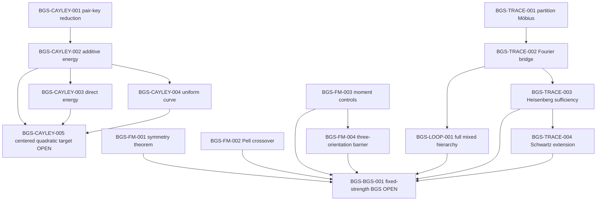

# Scientific dependency graph

The machine-readable authority for this graph is
`record/scientific_dependencies.json`; claim metadata lives in
`record/claims.json`.

The graph is intentionally sparse. An edge means “maintained scientific
prerequisite in the registered programme architecture”, not “every lemma
cited by the downstream proof”.

The two principal terminal obligations are `BGS-CAYLEY-005` and
`BGS-BGS-001`. The former is an arithmetic fourth-moment closure target; the
latter is the microscopic fixed-map universality target. Closing the Cayley
target alone would not prove the fixed-map BGS claim.
