# Scientific dependency graph

The machine-readable authority for this graph is
`record/scientific_dependencies.json`; claim metadata lives in
`record/claims.json`.

```mermaid
graph TD
  T20 --> T21[BGS-TRACE-021 disjoint pair residual]
  F21 --> T21
  F18 --> T21
  T1 --> T21
  F21 --> T20[BGS-TRACE-020 ordered-diagonal factorial sector and scoped companions]
  T2 --> T20
  F1 --> F26[BGS-FM-026 literal-time multiplicity bounds]
  F1 --> F25[BGS-FM-025 pure-five kick simplicity; bounded U companion]
  F8 --> F25
  F1 --> T19[BGS-TRACE-019 selected full-weight family]
  T17 --> T19
  T18 --> T19
  F1 --> T18[BGS-TRACE-018 phase-only locality and Frostman averages]
  F12 --> T18
  F1 --> F24[BGS-FM-024 actual pair commutant for odd N except7]
  F1 --> T17[BGS-TRACE-017 fixed-order complete WKB reduction]
  T1 --> T17
  T2 --> T17
  F21 --> T15[BGS-TRACE-015 once-counted three-block cancellation]
  F21 --> T16[BGS-TRACE-016 once-counted four-block cancellation]
  FK2[BGS-FORMAL-002 bounded four-cut predicate only] --> T16
  F1 --> F23[BGS-FM-023 bounded-power arithmetic translation exclusion]
  F16 --> F23
  F18 --> F23
  F1 --> F21[BGS-FM-021 position-chain mixing and cyclic path ramp]
  F1 --> F22[BGS-FM-022 reverse-cyclic path suppression]
  T14[BGS-TRACE-014 all-copy clock channel obstruction]
  C1[BGS-CAYLEY-001 pair-key reduction] --> C2[BGS-CAYLEY-002 additive energy]
  C2 --> C3[BGS-CAYLEY-003 direct energy]
  C2 --> C4[BGS-CAYLEY-004 uniform curve]
  C2 --> C5[BGS-CAYLEY-005 centered quadratic target OPEN]
  C3 --> C5
  C4 --> C5

  T1[BGS-TRACE-001 partition Möbius] --> T2[BGS-TRACE-002 Fourier bridge]
  T2 --> T3[BGS-TRACE-003 Heisenberg sufficiency]
  T3 --> T4[BGS-TRACE-004 Schwartz extension]
  T6[BGS-TRACE-006 clustered Abel and time-window boundary]
  T7[BGS-TRACE-007 universal clock Abel floor]
  T8[BGS-TRACE-008 two-clock Gram falsifier]
  T3 --> T9[BGS-TRACE-009 prime-resonant sector criterion]
  T1 --> T10[BGS-TRACE-010 absolute obstruction and signed controls]
  T2 --> T10
  T3 --> T10
  T1 --> T11[BGS-TRACE-011 resonant density and critical tails]
  T9 --> T11
  T10 --> T11
  T1 --> T12[BGS-TRACE-012 folded square and crowding]
  T9 --> T12
  T11 --> T12
  F1 --> T12
  F1 --> T9
  F10 --> T9
  CUE1[BGS-CUE-001 Haar singular-energy reference]
  FLOW1[BGS-FLOW-001 finite coboundary phase bound]
  FLOW2[BGS-FLOW-002 second-order radial obstruction]
  FLOW3[BGS-FLOW-003 quadratic noise and transfer boundary]
  FLOW3 --> FLOW4[BGS-FLOW-004 short-time coupling]
  FLOW3 --> FLOW5[BGS-FLOW-005 reversible correction]
  FLOW4 --> FLOW5
  FLOW3 --> FLOW6[BGS-FLOW-006 trace limits]
  FLOW5 --> FLOW6
  FLOW4 --> FLOW7[BGS-FLOW-007 clock local limit]
  FLOW5 --> FLOW7
  FLOW3 --> FLOW8[BGS-FLOW-008 fourth-order drift]
  FLOW3 --> FLOW9[BGS-FLOW-009 Mobius spectral limit]
  FLOW4 --> FLOW9
  FLOW7 --> FLOW9
  FLOW8 --> FLOW9
  FLOW3 --> FLOW10[BGS-FLOW-010 simultaneous random-kick limit]
  FLOW4 --> FLOW10
  FLOW7 --> FLOW10
  FLOW8 --> FLOW10
  FLOW9 --> FLOW10
  FLOW3 --> FLOW11[BGS-FLOW-011 polynomial random-kick limit]
  FLOW7 --> FLOW11
  FLOW9 --> FLOW11
  FLOW10 --> FLOW11
  FLOW9 --> FLOW12[BGS-FLOW-012 actual-start comparison]
  FLOW10 --> FLOW12
  FLOW11 --> FLOW12
  F13 --> FLOW12
  FLOW12 --> FLOW13[BGS-FLOW-013 prescribed-time obstruction]
  F7 --> F17[BGS-FM-017 logarithmic regularity and local saddles]
  F13 --> F17
  FLOW9 --> F17
  FLOW12 --> F17
  FLOW13 --> F17
  F17 --> FLOW14[BGS-FLOW-014 actual-start circular relaxation]
  FLOW12 --> FLOW14
  T1 --> FLOW15[BGS-FLOW-015 exact noise defect and transfer boundaries]
  FLOW7 --> FLOW15
  FLOW14 --> FLOW15
  F13 --> FLOW15
  F1 --> F16[BGS-FM-016 overlap rigidity]
  FLOW3 --> F16
  T13[BGS-TRACE-013 auxiliary expansion word obstruction]
  F1 --> F13[BGS-FM-013 bounded fixed-time packet traces]
  F1[BGS-FM-001 symmetry theorem] --> T5[BGS-TRACE-005 model estimate OPEN]
  F1 --> F6[BGS-FM-006 nonlinear bracket pressure]
  F1 --> F18[BGS-FM-018 Weyl coercivity and regularized gap]
  F6 --> F18
  F18 --> F19[BGS-FM-019 uniform collective diffusion and refined mass]
  F1 --> F7[BGS-FM-007 seven-cut transfer]
  F5[BGS-FM-005 exact kick-rank boundary] --> F7
  T1 --> F7
  F5 --> F8[BGS-FM-008 simple spectrum away from seven]
  F1 --> F9[BGS-FM-009 common antiunitary obstruction]
  F1 --> F10[BGS-FM-010 arithmetic traces]
  F1 --> F12[BGS-FM-012 periodic-point annihilator]
  F1 --> F14[BGS-FM-014 scalar finite type]
  F1 --> F15[BGS-FM-015 classical action remainder]
  F14 --> F15
  FU1[BGS-FUP-001 ideal digit parity classification]

  F8 --> F10
  F8 --> F11[BGS-FM-011 effective gap floor]
  T3 --> T5

  F3[BGS-FM-003 moment controls] --> F4[BGS-FM-004 three-orientation barrier]
  T2 --> L1[BGS-LOOP-001 mixed loop hierarchy]
  F7 -->|short-leg deletion only| L1

  R4[BGS-RES-004 finite-orbit rigidity]
  R5[BGS-RES-005 full-lag linear gap]
  R6[BGS-RES-006 exact pair-resolvent bridge]
  F7 --> R7[BGS-RES-007 smooth resolvent transfer]
  R6 --> R7
  R1[BGS-RES-001 Fourier-line coercivity] --> R3[BGS-RES-003 analytic all-members OPEN]
  R2[BGS-RES-002 local-jet obstruction] --> R3

  F1 --> B[BGS-BGS-001 fixed-strength BGS OPEN]
  F2[BGS-FM-002 Pell crossover] --> B
  F3 --> B
  F4 --> B
  L1 --> B
  T4 --> B
  T5 --> B

  I[BGS-INFO-001 vanishing-noise tomography OPEN]
```

The new Haar-CUE and finite coboundary nodes are auxiliary controls,
with no asserted implication to the fixed-map target.
The graph is intentionally sparse. An edge means “maintained scientific
prerequisite in the registered programme architecture”, not “every lemma
cited by the downstream proof”.

The exact nodes `BGS-RES-006` and `BGS-TRACE-007` are finite-spectrum results; `BGS-RES-007` transfers the scalar resolvent from the original to the seven-cut **full** propagator, and `BGS-TRACE-008` refutes sufficiency of the Gram $4/3$ limit for abstract spectra. None supplies a model-specific Heisenberg-scale joint-trace estimate. The terminal open claims currently include
`BGS-CAYLEY-005`,
`BGS-TRACE-005`, `BGS-RES-003`, `BGS-INFO-001`, and the final
`BGS-BGS-001`. Closing the arithmetic Cayley target alone would not prove
the fixed-map BGS claim.

The scalar/classical-action nodes close specified classical obligations.
The ideal digit FUP node uses EXT-COHEN-2025 and has no model-to-CUE edge.
The actual quantum FIO, open compression and renewal estimates remain open.

TRACE-009 proves the sector criterion and spectral comb. Actual block
trace-mass cancellation is open; there is no asserted closure edge to TRACE-005.

TRACE-010 excludes the simultaneous unaveraged all-order absolute target.
Its CUE variance and formal phase control have no closure edge to TRACE-005;
the latter explicitly retains signed weighted cancellation.

TRACE-011 and TRACE-012 give conditional resonant-sector deletion and
realizable spectral boundary controls. Actual E and shifted four-point
energy, root allocation and nonresonant cancellation remain open;
neither node has an asserted closure edge to TRACE-005.

FLOW-012 retains the actual bounded-trace start and its exact centered
Dyson reference. FLOW-013 excludes prescribed-time relaxation from the
listed abstract inputs. FM-017 derives logarithmic initial regularity
and local stationary points from FM-007. FLOW-014 closes the gap-independent
circular kernel and full Laplace law at t=8g, and transfers Sine_2 to the
original noisy chain. Deterministic noise removal remains open. These nodes have no asserted
closure edge to TRACE-005 or BGS-BGS-001.

FLOW-015 proves an exact weak-local defect criterion and four scoped method
boundaries. Its prerequisites preserve the prior clock, actual noisy law,
partition bridge and bounded actual traces. The actual signed defect is open;
there is no closure edge from FLOW-015 to TRACE-005 or BGS-BGS-001.

The later all-order branch has the following registered direct edges.
They supplement the schematic diagram; the JSON remains the complete DAG.

| New node | Scientific prerequisites | Exact conclusion |
|---|---|---|
| BGS-FLOW-016 | FLOW-004, FLOW-009, FLOW-014 | Packing moment transfer and projected-to-Dyson all fixed orders at t²logN→0. |
| BGS-FLOW-017 | FLOW-016, FLOW-010, FLOW-011, FLOW-012, FLOW-014, TRACE-001, FM-013 | Actual-start original-chain all fixed factorial limits and L2 signed CUE sums at one superpolynomial step schedule. |

The spatial ergodicity leaf EXT-SOSH-2000 is pinned in the external registry.
C16--C17 identify the exact remaining deterministic defect; its vanishing
is open. Neither new node has a closure edge to deterministic TRACE-005 or
BGS-BGS-001. This is not an all-order polynomial-schedule theorem.

The critical-noise branch adds these exact registered dependencies.

| New node | Scientific prerequisites | Remaining actual boundary |
|---|---|---|
| BGS-FLOW-018 | FLOW-007, FLOW-015, FLOW-016, FLOW-017, TRACE-007 | Exact clock selection rule and clock matching are not established for U_N. |
| BGS-FLOW-019 | FLOW-015, FM-013, FLOW-017 | Every fixed projection is estimated; growing-degree complementary evaluation remains open. |
| BGS-FLOW-020 | FLOW-019, FLOW-015, FM-013, FM-007 | Actual logarithmic projection is estimated; a fixed pair test is missed by every sublinear projection and has unstable Haar-L2 heat inversion. Actual signed value remains open. |
| BGS-FLOW-021 | FLOW-020 | Exact determinant pair compensation and superpolynomial actual-start smoothed band estimate. Actual signed noise removal and all deterministic bands/orders remain open. |

EXT-KT-2009 credits the prior lattice kernel; EXT-DE-2001 is used only at
2Q<=N. Neither node has a deterministic closure edge to TRACE-005 or
BGS-BGS-001. The small-Haar-norm complement obstruction is for a local
test on an abstract clock, not a counterexample to the maintained map.

FM-018 uses FM-001 and FM-006 with the checked EXT-PP-1990 classical
mixing leaf. Its common-noise two-copy invariant space is exactly
identity/swap at finite N,u>0; the original two-pair microscopic rate and full
nonlinear functional remain open. There is no closure edge from FM-018
to deterministic TRACE-005 or BGS-BGS-001.

FM-019 records FM-018 conventions/Gaussian averaging and one-step actual
Egorov as its prerequisite. Its uniform diffusion gap is self-contained;
no new external leaf is imported. The explicitly refined law has
Heisenberg-dominating two-copy mass, but no closure edge to deterministic
TRACE-005 or BGS-BGS-001. The original m=1 rate, nonlinear functional
and higher-copy quantitative estimates remain open.

TRACE-016 additionally uses the reviewed universal compression/lifting proof in `mathematics/four_cut_rank_two_classification.md`. FORMAL-002 certifies only its bounded predicate, not that reduction or the analytic theorem.

FM-007 feeds only the new normalized short-leg deletion sub-result of LOOP-001.
The abstract testing reduction and external characterization do not depend on it.

FM-024 proof route: actual matrix formula → reduction at 5 with unit gauges → exact two-row system → Casoratian/dictionary/norm and complete Rabin factors → minimal tails and actual N=49 residue → characteristic-zero rank lift. The separate algebraic-entry U corollary uses FM-024 plus EXT-POPESCU-2023. No spectral-simplicity or TRACE-005 consequence is asserted.

FORMAL-003 certifies only the finite executable predicates used as supporting evidence for FM-024. It is a separate node without a claimed abstract/formal implication to the complete commutant theorem.

TRACE-017 supporting (not prerequisite) route: exact Gaussian reciprocity plus the actual complex-strip/local-box inputs → finite-band global rotated-box representation and summed tail. Signed box evaluation and unrestricted-band TRACE-005 comparison remain open.

FM-024 first-seven extension: four actual boundary blocks → endpoint-free 63-by-48 system → three degree<=936 minors in each residue class → exact interpolation and odd-root exclusion → scalar leading coefficient and tail elimination → characteristic-zero lift. The FM-008 → FM-024 edge records only the combined 35∤N corollary via simple A and nonzero M entries; it is not used by the new seven-divisible proof. Odd multiples of 35 remain open.

Ramified first-seven supporting route: actual valuation gauge → rank-seven endpoint block → integral partial-trace commutator consequence → normalized two-harmonic trace and exact gcd → nine partitions/small Fourier minors → augmented-rank lift. No full reduced Fourier invertibility or additional external theorem is assumed. Combined remaining family: odd multiples of 245, with N=7 separately exceptional.

FM-024 now combines all odd-dimensional pair-commutant families except the genuine N=7 exception. Higher ramification is closed by the separately reviewed normalized-lattice/q-Lucas proof, not by extrapolating finite bases. TRACE-018 uses the actual HJ phase and prior FM-012 grid; the paired-character identity is a supporting representation lemma, not full quantum-weight cancellation.

## Reviewed phase checkpoint dependency boundary

FM-027 depends on scoped FM-021 amplitude/zero-charge inputs and actual
parametrix/nonlinear-phase A2--A5 only. It has no FM-018, Egorov or classical
mixing edge. TRACE-021 now adds FM-027 and removes the unnecessary old
whole-file FM-018 prerequisite while retaining separate historical
all-translation provenance. TRACE-022 uses FM-021 only for its inherited
actual boundary-density consequence; its core Schur identity is universal.
TRACE-023 has no actual-model prerequisite identifying a limit. FM-028 and
FM-029 really use inherited FM-018 ordinary-Weyl/Egorov/model inputs at their
precise scopes. FM-030 uses FM-021 only for its eventual actual constants,
plus checked EXT-BHATIA-2002. None closes TRACE-005/BGS or connects a
changed-family obstruction to a false claim about the literal operator.

## Reviewed Wave2 dependency scopes

TRACE-024 uses FM-027 exact setup/parametrix and FM-021 actual flatness for the new fixed-lag leaf; FM-028 C4 and TRACE-023 Abel (A) are only annealed-leaf inputs. The prior C1/C6 Gram note is history, not a new fixed-lag prerequisite. FM-031 uses the completed TRACE-023 source and mandatory EXT-ZIRN-2021 completion. TRACE-025 preserves its stated actual coarse-data inputs only to construct changed families; it has no actual-model counterexample implication. TRACE-026 finite identities are universal; FM-021/FM-022 enter only the conditional controlled-sector Abel application. The phase literature audit adds no new dependency leaf or universality node.

TRACE-027 finite algebra and signed Ward normalization inherit accepted phase Ward v2; actual upper-half slow-window use is FM-021/FM-022. Actual degree-two exception removal separately uses literal branch curvature and alias-safe transpose-product control, not coarse P/Q inputs alone. No edge to a proved Ward(13), microscopic law or TRACE-005 is added.

## Wave3 complete unmasked continuation

TRACE-028 uses the separately accepted actual right-frame/transpose extension of TRACE-024, FM-021 flatness, FM-028 C4 compactness and TRACE-023 Abel(A). The new S3 tail is compactness plus S2 flatness, with no rate. TRACE-029 finite resummation is conditional in general; TRACE-028 discharges the actual RIGHT input. FM-028 C4/TRACE-023 control its annealed companion; scoped whole-centered FM-027/FM-021 gives the unsigned actual logarithmic obstruction. No edge identifies masks, signed T16, microscopic Ward(13), balanced law or TRACE005.

## Phase-memory and sharp-jet continuation, 8 October

TRACE-053 is a self-contained abstract phase-channel theorem. TRACE-056 uses
it to control eigenphase transport along a bounded real flow. TRACE-054 is
self-contained finite rational-inner matrix analysis and has no actual-map
or TRACE-005 prerequisite or conclusion. TRACE-055 is verification-pending;
its TRACE-053 edge records only the reconstructed channel input. No edge
from these nodes closes the scalar cavity law, deterministic transfer or BGS.

| Input | Output | Scope |
|---|---|---|
| TRACE-053 | TRACE-056 | Uniform averaged pinching along the real flow |
| TRACE-053 | TRACE-055 (pending) | One accepted channel sub-input; the complete hierarchy remains pending; separately accepted covariance and conditional delay/gap inputs are tracked below |
| Self-contained finite factorization and cascade | TRACE-054 | Sharp general matrix inner jet; no stochastic input |

## Checked 11 October extensions

The exact machine-readable edges are in scientific_dependencies.json.
TRACE-057 and TRACE-053/056 support physical L2 transport (059).
TRACE-053/056/058 support maximal phase paths and fixed normal products (071).
TRACE-071's common-origin calculus and FM-018's fixed-symbol input support the
actual-map maximal observable-flow corollary (072). The sharp Jack coefficient
bound (067) supports compatible circular phase laws (068), then critical CSE
traces (069) and whole form-factor curves (070). No edge from these theorems
closes BGS-BGS-001 or TRACE-005. Conditional joint delays (060) do not establish
TRACE-055's full hierarchy or its flatness hypothesis.

## Schur continuation dependency scope, 11 October 2026

TRACE-060 now has a separately reviewed all-fixed killed upper-moment and
second/third equality extension. Its external concentration input is scalar
Tropp Theorem 1.1, and all-time flatness remains a premise.

The universal classical censoring and stopped quantum gap proof of TRACE-073
is self-contained. The machine edges FM-021/022 -> TRACE-073 supply only the
actual-map initial intensity/reversal gaps. The [reversal extension](reversal_channel_continuation_20261011.md)
uses the independently reconstructed general complex-contraction theorem. It is not a proof of all-time entry flatness,
an all-order clock law or the scalar cavity law. No new edge closes TRACE-005
or BGS-BGS-001. [Proof and review](cavity_continuation_20261011.md).
