# Scientific dependency graph

The machine-readable authority for this graph is
`record/scientific_dependencies.json`; claim metadata lives in
`record/claims.json`.

```mermaid
graph TD
  C1[BGS-CAYLEY-001 pair-key reduction] --> C2[BGS-CAYLEY-002 additive energy]
  C2 --> C3[BGS-CAYLEY-003 direct energy]
  C2 --> C4[BGS-CAYLEY-004 uniform curve]
  C2 --> C5[BGS-CAYLEY-005 centered quadratic target OPEN]
  C3 --> C5
  C4 --> C5

  T1[BGS-TRACE-001 partition Möbius] --> T2[BGS-TRACE-002 Fourier bridge]
  T2 --> T3[BGS-TRACE-003 Heisenberg sufficiency]
  T3 --> T4[BGS-TRACE-004 Schwartz extension]
  T6[BGS-TRACE-006 clustered Abel and time-window boundary]
  T7[BGS-TRACE-007 universal clock Abel floor]
  T8[BGS-TRACE-008 two-clock Gram falsifier]
  T3 --> T9[BGS-TRACE-009 prime-resonant sector criterion]
  T1 --> T10[BGS-TRACE-010 absolute obstruction and signed controls]
  T2 --> T10
  T3 --> T10
  T1 --> T11[BGS-TRACE-011 resonant density and critical tails]
  T9 --> T11
  T10 --> T11
  T1 --> T12[BGS-TRACE-012 folded square and crowding]
  T9 --> T12
  T11 --> T12
  F1 --> T12
  F1 --> T9
  F10 --> T9
  CUE1[BGS-CUE-001 Haar singular-energy reference]
  FLOW1[BGS-FLOW-001 finite coboundary phase bound]
  FLOW2[BGS-FLOW-002 second-order radial obstruction]
  FLOW3[BGS-FLOW-003 quadratic noise and transfer boundary]
  FLOW3 --> FLOW4[BGS-FLOW-004 short-time coupling]
  FLOW3 --> FLOW5[BGS-FLOW-005 reversible correction]
  FLOW4 --> FLOW5
  FLOW3 --> FLOW6[BGS-FLOW-006 trace limits]
  FLOW5 --> FLOW6
  FLOW4 --> FLOW7[BGS-FLOW-007 clock local limit]
  FLOW5 --> FLOW7
  FLOW3 --> FLOW8[BGS-FLOW-008 fourth-order drift]
  FLOW3 --> FLOW9[BGS-FLOW-009 Mobius spectral limit]
  FLOW4 --> FLOW9
  FLOW7 --> FLOW9
  FLOW8 --> FLOW9
  FLOW3 --> FLOW10[BGS-FLOW-010 simultaneous random-kick limit]
  FLOW4 --> FLOW10
  FLOW7 --> FLOW10
  FLOW8 --> FLOW10
  FLOW9 --> FLOW10
  FLOW3 --> FLOW11[BGS-FLOW-011 polynomial random-kick limit]
  FLOW7 --> FLOW11
  FLOW9 --> FLOW11
  FLOW10 --> FLOW11
  F1 --> F16[BGS-FM-016 overlap rigidity]
  FLOW3 --> F16
  T13[BGS-TRACE-013 auxiliary expansion word obstruction]
  F1 --> F13[BGS-FM-013 bounded fixed-time packet traces]
  F1[BGS-FM-001 symmetry theorem] --> T5[BGS-TRACE-005 model estimate OPEN]
  F1 --> F6[BGS-FM-006 nonlinear bracket pressure]
  F1 --> F7[BGS-FM-007 seven-cut transfer]
  F5[BGS-FM-005 exact kick-rank boundary] --> F7
  T1 --> F7
  F5 --> F8[BGS-FM-008 simple spectrum away from seven]
  F1 --> F9[BGS-FM-009 common antiunitary obstruction]
  F1 --> F10[BGS-FM-010 arithmetic traces]
  F1 --> F12[BGS-FM-012 periodic-point annihilator]
  F1 --> F14[BGS-FM-014 scalar finite type]
  F1 --> F15[BGS-FM-015 classical action remainder]
  F14 --> F15
  FU1[BGS-FUP-001 ideal digit parity classification]

  F8 --> F10
  F8 --> F11[BGS-FM-011 effective gap floor]
  T3 --> T5

  F3[BGS-FM-003 moment controls] --> F4[BGS-FM-004 three-orientation barrier]
  T2 --> L1[BGS-LOOP-001 mixed loop hierarchy]

  R4[BGS-RES-004 finite-orbit rigidity]
  R5[BGS-RES-005 full-lag linear gap]
  R6[BGS-RES-006 exact pair-resolvent bridge]
  F7 --> R7[BGS-RES-007 smooth resolvent transfer]
  R6 --> R7
  R1[BGS-RES-001 Fourier-line coercivity] --> R3[BGS-RES-003 analytic all-members OPEN]
  R2[BGS-RES-002 local-jet obstruction] --> R3

  F1 --> B[BGS-BGS-001 fixed-strength BGS OPEN]
  F2[BGS-FM-002 Pell crossover] --> B
  F3 --> B
  F4 --> B
  L1 --> B
  T4 --> B
  T5 --> B

  I[BGS-INFO-001 vanishing-noise tomography OPEN]
```

The new Haar-CUE and finite coboundary nodes are auxiliary controls,
with no asserted implication to the fixed-map target.
The graph is intentionally sparse. An edge means “maintained scientific
prerequisite in the registered programme architecture”, not “every lemma
cited by the downstream proof”.

The exact nodes `BGS-RES-006` and `BGS-TRACE-007` are finite-spectrum results; `BGS-RES-007` transfers the scalar resolvent from the original to the seven-cut **full** propagator, and `BGS-TRACE-008` refutes sufficiency of the Gram $4/3$ limit for abstract spectra. None supplies a model-specific Heisenberg-scale joint-trace estimate. The terminal open claims currently include
`BGS-CAYLEY-005`,
`BGS-TRACE-005`, `BGS-RES-003`, `BGS-INFO-001`, and the final
`BGS-BGS-001`. Closing the arithmetic Cayley target alone would not prove
the fixed-map BGS claim.

The scalar/classical-action nodes close specified classical obligations.
The ideal digit FUP node uses EXT-COHEN-2025 and has no model-to-CUE edge.
The actual quantum FIO, open compression and renewal estimates remain open.

TRACE-009 proves the sector criterion and spectral comb. Actual block
trace-mass cancellation is open; there is no asserted closure edge to TRACE-005.

TRACE-010 excludes the simultaneous unaveraged all-order absolute target.
Its CUE variance and formal phase control have no closure edge to TRACE-005;
the latter explicitly retains signed weighted cancellation.

TRACE-011 and TRACE-012 give conditional resonant-sector deletion and
realizable spectral boundary controls. Actual E and shifted four-point
energy, root allocation and nonresonant cancellation remain open;
neither node has an asserted closure edge to TRACE-005.
